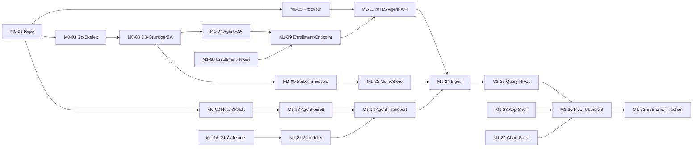

# SerMon – Implementierungsplan

> Grundlage: [KONZEPT.md](KONZEPT.md) (Roadmap §23) und [ADR 0001](adr/0001-zeitreihen-speicher-timescaledb.md).

**Planungsprinzip:** Der Plan wird von grob nach fein ausgearbeitet.

- **M0 und M1** sind bis auf Aufgabenebene detailliert.
- **M2–M5** sind als Epics beschrieben. Sie werden **vor Beginn des jeweiligen Meilensteins** in Aufgaben zerlegt, weil viele Details von den Ergebnissen davor abhängen, z. B. vom TimescaleDB-Spike.

| | |
|---|---|
| Stand | 2026-11-18 |
| Status | Entwurf |

---

## Inhalt

1. [Arbeitsweise](#1-arbeitsweise)
2. [Überblick und kritischer Pfad](#2-überblick-und-kritischer-pfad)
3. [M0 – Fundament](#3-m0--fundament)
4. [M1 – Metriken](#4-m1--metriken)
5. [M2 – Alerting](#5-m2--alerting)
6. [M3 – Logs und Live-Ansicht](#6-m3--logs-und-live-ansicht)
7. [M4 – Updates und Anomalien](#7-m4--updates-und-anomalien)
8. [M5 – Module und Ausbau](#8-m5--module-und-ausbau)
9. [v1.0 – Release](#9-v10--release)
10. [Risiken für den Plan](#10-risiken-für-den-plan)

---

## 1. Arbeitsweise

- **Eine Aufgabe ergibt einen Branch und einen PR.**
  - Branch-Name: `<id>-<kurztitel>`, z. B. `m1-07-agent-ca`
  - Commits nach Conventional Commits mit der Aufgaben-ID im Footer (`Refs: M1-07`)
- **TDD:** Jede Aufgabe beginnt mit den unter „Tests zuerst“ genannten Tests (Skill `sermon-tdd`).
- **Definition of Done** nach KONZEPT §19.4. Bei sicherheitsrelevanten Aufgaben (🔒) ist zusätzlich der Skill `sermon-security-review` Pflicht.
- **Aufwand** (grobe Richtwerte für eine Person mit Claude Code):

  | Größe | Aufwand |
  |---|---|
  | **S** | ≤ ½ Tag |
  | **M** | 1–2 Tage |
  | **L** | 3–5 Tage |

  Eine Aufgabe größer als L wird geteilt.
- **Stränge:** `X` Querschnitt · `A` Agent (Rust) · `S` Server (Go) · `W` Web (SvelteKit). Aufgaben verschiedener Stränge ohne gegenseitige Abhängigkeit können parallel laufen.
- **Status:** ☐ offen · ◐ in Arbeit · ☑ erledigt. Der Plan wird im selben PR aktualisiert, in dem die Aufgabe erledigt wird.
- **Verfeinerung:** Am Ende jedes Meilensteins gibt es ein kurzes Review mit diesen Schritten:
  - Ziel des Meilensteins erreicht?
  - Neue Erkenntnisse als ADRs festhalten
  - Den nächsten Meilenstein in Aufgaben zerlegen

---

## 2. Überblick und kritischer Pfad

| Meilenstein | Ziel / Demo | Grobe Dauer¹ |
|---|---|---|
| **M0 – Fundament** | Leere, aber lauffähige Skelette, grüne CI, Spike-Ergebnisse | 2–3 Wochen |
| **M1 – Metriken** | Node auf Debian/Ubuntu installieren, nach < 2 min Metriken in der UI sehen; Login mit TOTP; Mandantentrennung | 6–8 Wochen |
| **M2 – Alerting** | SSH-Brute-Force-Alert landet in ntfy/Slack; RHEL, Alpine, arm64 | 5–7 Wochen |
| **M3 – Logs und Live** | Fehlersuche ohne SSH: Logs, Live-Ansicht, Security-Dashboard; OIDC, Passkeys | 5–6 Wochen |
| **M4 – Updates und Anomalien** | Patch-Compliance auf einen Blick, Updates per Policy, Anomalie-Erkennung | 5–7 Wochen |
| **M5 – Module und Ausbau** | Integrationsmodule, eigene Dashboards, Kiosk-Modus | 5–7 Wochen |
| **v1.0** | Pentest, Doku, Performance-Nachweis | 2–3 Wochen |

¹ Grobe Schätzung für eine Person, keine Zusage. Wird nach M0 anhand der tatsächlichen Geschwindigkeit neu kalibriert.
Nach M1 (§4.8): Mit Claude Code ging es deutlich schneller; die Wochen dienen nur noch als grobe Relation zwischen
den Meilensteinen.

### Kritischer Pfad bis „erster Node sichtbar“ (M1)

**Parallel möglich:**

- **Agent-Collectors** (M1-16 bis M1-21) brauchen nur M0-02 und Fixtures. Sie laufen völlig unabhängig vom Server.
- **Web-Shell und Charts** (M1-28, M1-29) können gegen gemockte Connect-Clients entwickelt werden.
- **Auth** (M1-02, M1-03) läuft unabhängig von der PKI.

---

## 3. M0 – Fundament

**Ziel:** Alle Skelette bauen, testen und linten in CI. Die Entwicklungsumgebung startet mit einem Befehl. Die beiden kritischen Annahmen (TimescaleDB-Last, journald über `journalctl`) und der musl-Build für arm64 sind durch Spikes geprüft.

### ☑ M0-01 – Repo-Grundgerüst · X · S
> Erledigt. Zusätzlich gibt es `just setup`, eine PR-Vorlage und einen Commit-Message-Check
> (`scripts/check-commit-msg.sh` mit Tests). GitHub Private Vulnerability Reporting ist seit dem 2026-11-19 aktiv;
> das Repo ist seitdem öffentlich.
- **Ziel:** Struktur nach KONZEPT §20; `LICENSE` (AGPL-3.0), `README.md`, `SECURITY.md` (Responsible Disclosure), `.editorconfig`, `.gitignore`, `CODEOWNERS`, `justfile` mit Ziel-Stubs (`dev`, `gen`, `lint`, `test`, `e2e`, `security`), `lefthook.yml` (Format, Secret-Scan; gitleaks, inzwischen betterleaks – ADR 0005).
- **Abhängig von:** –
- **Abnahme:** `just --list` zeigt alle Ziele; lefthook-Hooks greifen; GitHub Private Vulnerability Reporting ist aktiviert.

### ☑ M0-02 – Rust-Workspace und Cross-Build · A · M
> Erledigt: Workspace mit 10 Crates, Lints, `cargo-deny`; Cross-Build mit cargo-zigbuild ([ADR 0002](adr/0002-agent-build-toolchain.md)).
> Beide Architekturen sind statisch gebaut und im Container getestet (`just build-agent`, `just smoke-agent`).
> Abweichung: Unter echtem QEMU läuft arm64 erst in CI (M0-06). Lokal auf Apple Silicon läuft arm64 nativ und amd64 emuliert.

- **Ziel:** `agent/` als Workspace mit den Crates aus §20 (zunächst leer, inkl. `lib.rs`); `rustfmt.toml`, Clippy-Lints im Workspace-Manifest, `deny.toml` (Lizenzen kompatibel mit AGPL, Advisories).
  - **Spike:** musl-Builds für `x86_64` und `aarch64` mit `cargo-zigbuild` oder `cross`.
- **Abhängig von:** M0-01
- **Tests zuerst:** Smoke-Test `sermon-agent --version`.
- **Abnahme:** `just lint test` grün; statische Binaries für beide Architekturen (`file` meldet „statically linked“); arm64-Binary startet unter QEMU. Ergebnis als ADR (Build-Toolchain).

### ☑ M0-03 – Go-Server-Skelett · S · M
> Erledigt: Konfiguration aus Environment und `*_FILE` (alle Fehler gesammelt), `slog`, `/healthz` und `/readyz`
> (ohne Fehlerdetails), HTTP-Timeouts gegen Slowloris, Graceful Shutdown; Testabdeckung 92,5 %
> (`just test-server`, `just smoke-server`). Die im Konzept optionale YAML-Konfigurationsdatei kommt erst, wenn sie
> gebraucht wird.

- **Ziel:** `server/` mit `cmd/sermon-server`, Schichten `internal/{domain,app,adapters,transport}`; Konfiguration aus Environment und `*_FILE`; `slog` mit JSON-Ausgabe; `/healthz` und `/readyz`; Graceful Shutdown; `golangci-lint`-Konfiguration (inkl. gosec, errcheck, revive).
- **Abhängig von:** M0-01
- **Tests zuerst:** Config-Parsing (Tabellen-Tests, auch fehlende oder ungültige Werte); Health-Handler.
- **Abnahme:** `go test ./...` und Lint grün; Binary startet und beendet sich sauber per SIGTERM.

### ☑ M0-04 – Web-Skelett · W · M
> Erledigt mit **SvelteKit 3**, Vite 8 und Paraglide 3 (aktuelle Versionen der `sv`-CLI). Eine Startseite mit
> Sprachwahl DE/EN ist in die Server-Binary eingebettet; strikte CSP ohne `unsafe-inline`, alle Ressourcen lokal (D27,
> [ADR 0003](adr/0003-ui-auslieferung-und-csp.md)). 10 Unit-/Komponententests und 7 E2E-Tests gegen die echte Binary,
> inklusive Netzwerk-Wächter, CSP-Prüfung und axe. Bundle 54 KiB gzip.
> Abweichung: Das JS-Budget prüft ein eigenes Skript (`pnpm run check:size`) statt Lighthouse; Lighthouse kommt bei
> Bedarf mit der CI (M0-06).
- **Ziel:** SvelteKit 2 + Svelte 5, `adapter-static`, Tailwind 4, shadcn-svelte, Paraglide (de/en), ESLint, Prettier, `svelte-check`, Vitest, Playwright mit `@axe-core/playwright`. Build-Ergebnis wird per `embed.FS` in den Server eingebettet (`server/web/`).
- **Abhängig von:** M0-01, M0-03
- **Tests zuerst:** Komponenten-Test für eine Platzhalter-Seite; Playwright-Smoke-Test inkl. axe.
- **Abnahme:** `sermon-server` liefert die SPA aus; der Sprachwechsel DE/EN funktioniert; Lighthouse-Budget (< 200 KB JS gzip) in CI.

### ☑ M0-05 – Proto und Codegen · X · M
> Erledigt: `AgentService.Session` (umbenannt, weil `Connect` mit dem tonic-Konstruktor `connect()` kollidierte),
> `Hello`/`HostFacts`/`Heartbeat`/`Ack`, `SystemService.GetVersion`, protovalidate-Regeln mit Tests. Code-Generierung
> nur mit lokalen, gepinnten Plugins; der generierte Code ist committet ([ADR 0004](adr/0004-protokoll-codegenerierung.md)).
> Befehle: `just gen`, `just lint-proto`, `just breaking-proto`, `just check-gen`.
- **Ziel:** `proto/` mit `buf.yaml` und `buf.gen.yaml`. Ziele: Rust (`prost`/`tonic`), Go (`connect-go`), TS (`connect-es`). Erstes Schema `sermon.agent.v1.AgentService/Session` mit `Hello`, `Heartbeat`, `Ack`; dazu `sermon.web.v1.SystemService/GetVersion`; protovalidate eingebunden. `just gen`.
- **Abhängig von:** M0-02, M0-03, M0-04
- **Skill:** `sermon-proto-change`
- **Abnahme:** Generierter Code kompiliert in allen drei Sprachen; `buf lint` und `buf breaking` laufen in CI.

### ☑ M0-06 – CI und Security-Pipeline · X · M 🔒
> Erledigt: `ci.yml`, `security.yml` und `renovate.json` ([ADR 0006](adr/0006-ci-und-supply-chain.md)). Actions sind per
> SHA gepinnt (mindestens 3 Tage alt), Rechte minimal, `just lint-ci` (actionlint + zizmor) ist sauber. Der erste Lauf
> war grün bis auf den Job `web`: Im frischen Checkout fehlte der generierte Paraglide-Code für `svelte-check`.
> Behoben, indem `pnpm run check` ihn zuerst erzeugt. Native arm64-Runner, CodeQL und Scorecard laufen, weil das Repo
> öffentlich ist. Abweichungen: Der Secret-Scan nutzt betterleaks statt gitleaks (ADR 0005). Branch-Protection wird
> auf Wunsch des Product Owners erst nach der Implementierung eingerichtet (siehe v1.0). Den Test mit einer absichtlich
> verwundbaren Abhängigkeit ersetzt der reale Fall `minimatch` (GHSA-g3hv-75wg-m249), den die Audits erkannt haben.
> Der Override dafür ist seit typescript-eslint 8.73.0 entfernt (2026-11-20).
- **Ziel:**
  - `ci.yml`: Lint- und Test-Matrix für Rust, Go und Web, Coverage-Upload
  - `security.yml`: CodeQL, gosec, govulncheck, cargo-audit, cargo-deny, `pnpm audit`, betterleaks, OpenSSF Scorecard
  - Alle Actions per SHA gepinnt, minimale `permissions:`
  - `renovate.json`, Branch-Protection für `main`
- **Abhängig von:** M0-02 bis M0-05
- **Abnahme:** PR mit absichtlich verwundbarer Abhängigkeit wird rot; Scorecard läuft.

### ☑ M0-07 – Entwicklungsumgebung · X · S
> Erledigt: `deploy/dev/compose.yaml` mit TimescaleDB 2.32 (pg17), Loki 3.7 (Multi-Tenant), Mailpit und ntfy. Images
> sind per Digest gepinnt, Ports nur auf 127.0.0.1, Telemetrie ist aus. Das DB-Passwort wird zufällig erzeugt und als
> Docker-Secret übergeben. `just dev` startet Infrastruktur, Server mit Hot-Reload (air) und Vite mit Proxy in ca. 6 s
> (die Images müssen dafür schon geladen sein). Der Devcontainer ist getestet: Setup, `just lint`, `just test` und
> `just dev-infra` laufen darin. Die Regeln für Compose-Dateien prüft `just lint-compose` (mit Tests).
- **Ziel:** `deploy/dev/compose.yaml` mit `timescale/timescaledb` (pg17), Loki, Mailpit und ntfy; Devcontainer; `just dev` startet Infrastruktur, Server (Hot-Reload über `air`) und Vite-Dev-Server.
- **Abhängig von:** M0-03, M0-04
- **Abnahme:** Frischer Clone → `just dev` → UI unter `localhost` erreichbar in < 5 min.

### ☑ M0-08 – Datenbank-Grundgerüst · S · M 🔒
> Erledigt ([ADR 0007](adr/0007-mandantentrennung-rls.md)):
> - goose-Migrationen (eingebettet, mit Advisory-Lock), sqlc mit pgx und `just gen-sql`.
> - `tenant.Scope` (100 % Testabdeckung) und `postgres.DB.InTenant` (SET LOCAL).
> - RLS mit FORCE auf `organizations`, `users` und `memberships`.
> - Getrennte Rollen: Owner nur für Migrationen, `sermon_app` für den Server; `Open` verweigert privilegierte Rollen.
> - 10 Integrationstests mit Testcontainers (`just test-integration`, CI-Job `integration`); die Gegenprobe ohne RLS
>   schlägt fehl.
>
> Nebenbefund: Das Init-Skript aus M0-07 lag in einem Unterordner und wurde nie ausgeführt; korrigiert.
- **Ziel:**
  - `goose`-Migrationen und `sqlc`-Konfiguration
  - Testcontainers-Helfer für Integrationstests
  - Typ `tenant.Scope` (OrgID + erlaubte NodeGroups); jede Repository-Methode erwartet ihn
  - Erste Migration: `organizations`, `users`
  - RLS-Muster festlegen: `SET LOCAL sermon.org_id` pro Transaktion
- **Abhängig von:** M0-03, M0-07
- **Tests zuerst:** Integrationstest „Abfrage ohne gesetzte Org liefert nichts“ (RLS greift).
- **Abnahme:** `just test-integration` grün; RLS-Muster als ADR dokumentiert.

### ☑ M0-09 – Spike TimescaleDB-Ingest · S · L
> Erledigt; Ergebnisse in [ADR 0001](adr/0001-zeitreihen-speicher-timescaledb.md#ergebnis-des-spikes-m0-09-2026-11-19).
> Ingest, CPU, Abfragen und Aggregate erfüllen die Kriterien, sobald der Index `(series_id, ts)` angelegt ist.
> - Bei 1 s in der DB entstehen ~320 GB WAL pro Tag. **Entschieden:** 10 s in der DB, 1 s im Ringpuffer (15 min).
> - RLS ist auf komprimierten Hypertables und Continuous Aggregates nicht möglich; die Zweitlinie über eine
>   `SECURITY DEFINER`-Funktion kommt in M1-22.
> - Abweichungen: 20 min statt 24 h Dauerlast, 6 statt 8 GB RAM.
- **Ziel:** Abnahmekriterien aus ADR 0001 messen.
  - Schema `series` und `metrics_raw` als Hypertable mit Kompression; Continuous Aggregates `metrics_1m` und `metrics_1h` mit Policies
  - Minimaler Lastgenerator (Go) für 50 Nodes × 400 Serien × 1 s
  - Schreiben per `COPY`
- **Abhängig von:** M0-08
- **Abnahme:** Messergebnisse in ADR 0001 nachgetragen (Ingest-Lag, CPU, Plattenbedarf, WAL-Volumen, Abfragelatenzen, RLS-Verhalten); Entscheidung bestätigt **oder** Fallback (5–10 s in der DB) festgelegt. Das Schema geht als Basis in M1-22.

### ☑ M0-10 – Spike journald über `journalctl` · A · S
> Erledigt; Ergebnisse in [ADR 0013](adr/0013-log-quelle-journald.md), Versuche in `spikes/journald/` (Container mit
> systemd als PID 1: Debian 13, Ubuntu 24.04, Rocky 9 und zusätzlich Rocky 8).
> - **Abweichung vom Konzept:** kein `--cursor-file`. Rocky 9 schreibt die Datei nach SIGTERM nicht, nach SIGKILL
>   bleibt überall ein alter Stand, systemd 239 (Rocky 8) kennt die Option nicht. Der Agent speichert `__CURSOR`
>   selbst, sobald der Eintrag im WAL liegt, und startet mit `--after-cursor` (0 Duplikate beim Neustart, überall).
> - Rotation und Neustart von journald überstehen den Kindprozess; nach `--vacuum` setzt er am nächsten Eintrag fort,
>   die Lücke zeigt `__SEQNUM` (ab systemd 254) bzw. die Sequenznummer im Cursor.
> - Format: `--all` nötig (sonst Felder > 4 KiB als `null`), binäre Werte als Byte-Array, auf Rocky 8 als ungültiges
>   UTF-8 im JSON; `_CMDLINE` enthielt ein Passwort und wird nicht übernommen.
> - Ressourcen: 6–8 MiB RSS im Leerlauf, ~16 MiB unter Last, 10–22 µs CPU pro Zeile, ~0,45 s Latenz; lesen nur mit
>   der Gruppe `systemd-journal`.
> - Fixtures echter sshd-, su-, sudo- und useradd-Ereignisse sowie der Sonderfälle unter `agent/fixtures/logs/`.
- **Ziel:** Kindprozess `journalctl -o json -f --cursor-file`; Verhalten bei Neustart, Journal-Rotation und `--vacuum`; Ressourcenbedarf; Ausgabeformate auf Debian, Ubuntu und Rocky.
- **Abhängig von:** M0-02
- **Abnahme:** ADR (Log-Quelle journald) mit Ergebnis; erste echte Logzeilen als Fixtures unter `agent/fixtures/logs/`.

### ☑ M0-11 – ADRs zum Entscheidungslog · X · M
> Erledigt: ADRs 0014–0021 fassen D1–D26 zusammen (Stack, Topologie und Betrieb, Zielsysteme und Agent-Rechte,
> Authentifizierung und Rechte, Retention, Alerting, Updates/Logs/Module, Produkt und Projekt). Die Übersicht
> [`docs/adr/README.md`](adr/README.md) listet alle ADRs mit Status und ordnet D1–D30 zu; D29 hat noch keins (folgt
> mit E3.8). KONZEPT §2 verweist darauf.
- **Ziel:** Kurze ADRs für die Entscheidungen D1–D26 aus KONZEPT §2, zusammengefasst, wo sinnvoll (z. B. eines für den gesamten Stack D1–D3 und D26). D13 ist bereits durch ADR 0001 abgedeckt.
- **Abhängig von:** –
- **Skill:** `sermon-adr`
- **Abnahme:** `docs/adr/` enthält eine Übersicht (`README.md`) mit allen ADRs und ihrem Status.

### ☑ M0-12 – Threat Model v1 · X · S 🔒
> Erledigt: [`docs/security/threat-model.md`](security/threat-model.md) mit Assets, Akteuren, Datenfluss (Mermaid),
> sechs Vertrauensgrenzen (Node ↔ Server, Browser ↔ Server, Server ↔ DB/Loki, Agent ↔ Helper, ausgehende
> Verbindungen, Lieferkette) und 53 Bedrohungen nach STRIDE, jeweils mit Gegenmaßnahme, Aufgabe und Stand
> (umgesetzt, teilweise, geplant). Stand nach M1-32, deshalb mit den Befunden aus der Umsetzung (z. B. `/metrics`,
> Live-Streams, Einladungslinks). Das Ergebnis von M1-35 steht am Ende (§6); `SECURITY.md` und der Skill
> `sermon-security-review` verweisen auf das Dokument.
- **Ziel:** `docs/security/threat-model.md`: Datenfluss-Diagramm, Vertrauensgrenzen (Node ↔ Server, Browser ↔ Server, Server ↔ DB, Agent ↔ Helper), STRIDE-Tabelle aus KONZEPT §18.1, Liste der Assets.
- **Abhängig von:** –
- **Abnahme:** Jede Bedrohung hat eine Gegenmaßnahme mit Verweis auf eine geplante Aufgabe in diesem Plan.

**M0 fertig, wenn:** Alle Aufgaben ☑, CI auf `main` grün, Spikes bewertet und M1 bei Bedarf angepasst.

---

## 4. M1 – Metriken

**Ziel (Demo):** Auf einem frischen Debian- oder Ubuntu-Host (amd64) mit dem Einzeiler aus der UI installieren. Nach weniger als 2 min erscheint der Node in der Fleet-Übersicht mit CPU, Memory, Disk, Netzwerk, Load und Uptime. Die Detailansichten funktionieren. Ein User aus Org B sieht davon nichts.

### 4.1 Server: Domäne, Auth und Mandanten

#### ☑ M1-01 – Domänentypen und Autorisierung · S · M 🔒
> Erledigt: Typen `identity.UserID`/`NodeID`, `role.Role`, `tenant.OrgID`/`GroupID`; `authz.Policy` verweigert alles,
> was nicht erlaubt ist, und bildet die Rollen-Matrix aus KONZEPT §7 ab (inkl. `RotateNodeKeys`, Superadmin ohne
> Datenzugriff, Logs für Viewer abschaltbar). `authz.ScopeFor` leitet den Tenant-Scope für Listen ab. Ein Test
> erzwingt, dass jede Action in der Matrix steht; 100 % Abdeckung, Gegenprobe ohne Org-Prüfung schlägt fehl.
- **Ziel:** Starke Typen (`OrgID`, `NodeID`, `UserID`, `GroupID`, `Role`); `authz.Policy` mit Verweigern als Standard und der Rollen-Matrix aus KONZEPT §7.
- **Abhängig von:** M0-03
- **Tests zuerst:** Tabellen-Test „Aktion × Rolle × Gruppen-Bindung → erlaubt/verboten“, inkl. `*`-Bindung und fremder Org.
- **Abnahme:** 100 % Abdeckung von `authz`.

#### ☑ M1-02 – Lokale Anmeldung und Sessions · S · L 🔒
> Erledigt in fünf Teilen:
> - Passwörter: Argon2id, Regeln, Liste häufiger Passwörter.
> - Sessions: Tokens nur als Hash gespeichert, Idle-Timeout 30 min, absolut 12 h, Step-up.
> - DB mit `sermon_definer` für Zugriffe ohne Mandant (ADR 0007 überarbeitet).
> - Login mit Kontosperre (ab dem 5. Fehlversuch, 1–15 min) und Rate-Limit pro IP; einheitliche Fehler und
>   Dummy-Hash gegen Enumeration.
> - Web-API `AuthService` (Login/Logout/GetSession) über Connect mit Cookie `__Host-sermon_session`,
>   Origin-Prüfung (auch gegen Login-CSRF), Security-Header, protovalidate, vertrauenswürdige Proxies für die
>   Client-IP; in `just dev` verdrahtet.
>
> E2E-Tests über HTTPS mit echter DB. Nebenbefund: Konflikt der Routen `GET /` und API (Panic beim Start) mit einem
> Regressionstest behoben. connect-go bleibt vorerst bei v1 (ADR 0004).
>
> Nachtrag Step-up: `AuthService.ConfirmPassword` erneuert den Step-up mit dem Passwort (Fehlversuche zählen zur
> Kontosperre, IP-Rate-Limit gilt); `Session.step_up_until` zeigt, wie lange er gilt. Fehlender Step-up liefert
> `FAILED_PRECONDITION` mit dem Detail `StepUpRequired`; in der UI fragt `withStepUp` per `StepUpDialog` nach dem
> Passwort und wiederholt die Aktion. Vorher war nach 15 min nur Ab- und Anmelden möglich.
- **Ziel:**
  - User mit Argon2id; Login und Logout
  - Serverseitige Sessions (`__Host-sermon_session`, Idle-Timeout 30 min, absolut 12 h)
  - Rate-Limit pro IP und pro Account
  - Middleware: Origin-Prüfung, Security-Header und CSP (KONZEPT §18.3), generische Fehler mit Korrelations-ID
- **Abhängig von:** M0-08, M1-01
- **Tests zuerst:** Passwort-Hashing und -Verifikation (Vergleich in konstanter Zeit), Session-Ablauf mit Fake-Clock, Rate-Limit, abgelehnte Requests ohne gültigen Origin, CSP-Header-Snapshot.
- **Abnahme:** Login-E2E-Test grün; Security-Review bestanden.

#### ☑ M1-03 – TOTP, Recovery-Codes und Step-up · S · M 🔒
> Erledigt:
> - **TOTP** (`app/auth/totp`, eigene Umsetzung von RFC 6238, geprüft mit den RFC-Testvektoren): SHA-1, 30 s,
>   6 Stellen, ±1 Schritt; jeder Zeitschritt gilt einmal (atomar in der DB, parallele Nutzung gewinnt genau einmal).
>   Seed mit der Secrets-Box versiegelt und an den User gebunden (ein kopierter Seed lässt sich nicht öffnen).
> - **Recovery-Codes:** 10 Stück mit 80 Bit, nur als Hash gespeichert, jeder einmal; neu erzeugen ersetzt den Satz.
> - **Login in zwei Schritten:** Nach dem Passwort eine Session, die höchstens 5 min auf den Code wartet und sonst
>   nichts darf (API, Session-Ansicht, Org-Wechsel lehnen sie ab); danach neues Cookie. Falsche Codes zählen zur
>   Kontosperre, und das richtige Passwort setzt den Zähler bei 2FA-Usern nicht mehr zurück – sonst ließen sich
>   Code-Versuche mit neuen Logins abwechseln (Gegenprobe vorhanden).
> - **Step-up:** mit 2FA per `ConfirmSecondFactor` (Code oder Recovery-Code), ohne 2FA weiter per Passwort.
>   Einrichten, Abschalten und neue Codes verlangen einen Step-up.
> - **Org-Pflicht:** `SecurityPolicyService` (Admin für alle Gruppen, Step-up, nur mit eigenem zweiten Faktor,
>   auditiert). Mitglieder ohne zweiten Faktor bekommen überall `FAILED_PRECONDITION` mit
>   `SecondFactorSetupRequired`, nur `TwoFactorService` bleibt erreichbar (Authenticator ohne Principal).
> - **UI:** Code-Schritt im Login, Step-up-Dialog mit Code, Seite „Sicherheit“ (QR-Code als SVG aus der Matrix von
>   `uqr`, Schlüssel zum Abtippen, Recovery-Codes zum Kopieren oder Speichern), Weiterleitung dorthin, solange die
>   Org es verlangt; Hilfetext `pages/security`.
> - **Tests:** Unit-Tests (Codes, Replay, Sperre, Richtlinie), Integration über HTTPS (Login, Step-up, Recovery,
>   Org-Pflicht inkl. Beta ändert Alpha nicht), Komponenten- und Playwright-Tests mit axe.
>
> Der Schalter für die Org-Pflicht ist seit M1-32 in der UI (Organisation → Sicherheit). WebAuthn/Passkeys
> (KONZEPT §7) sind nicht Teil von M1. (Das Bundle-Budget misst seit M1-30 das erste Laden je Seite.)
- **Ziel:** TOTP einrichten (QR-Code) und verifizieren; Recovery-Codes gehasht speichern; Middleware `RequireStepUp(maxAge)`; 2FA-Pflicht pro Org.
- **Abhängig von:** M1-02, M1-06
- **Tests zuerst:** RFC-6238-Testvektoren, Zeitfenster und Schutz vor Replay, Recovery-Code nur einmal verwendbar.

#### ☑ M1-04 – Orgs, Gruppen, Mitgliedschaften und Rollen · S · L 🔒
> Teil a erledigt (Grundlage):
> - Tabellen `node_groups`, `role_bindings` (zusammengesetzte Fremdschlüssel: Bindungen nur auf Gruppen derselben
>   Org) und `audit_log`, alle mit RLS (ENABLE + FORCE).
> - Audit-Log nur anfügen (`sermon_app` hat nur INSERT/SELECT); die Hash-Kette pro Org berechnet ein Trigger unter
>   Advisory-Lock mit fortlaufender `seq`; `VerifyAuditChain` erkennt Manipulationen, auch bei parallelem Schreiben.
> - `access.Loader` baut den Principal bei jedem Request neu: Entzug von Mitgliedschaft oder Rolle wirkt sofort.
> - `webapi.Authenticator` (Connect-Interceptor) verlangt für alle Services außer `AuthService` eine gültige Session.
> - Testgerüst `TestTenantIsolation_EveryProcedureIsCovered`: jede Web-RPC braucht einen Cross-Tenant-Test oder eine
>   begründete Ausnahme.
>
>
> Teil b erledigt (Verwaltung in der Org):
> - `AccessService`: Gruppen anlegen, umbenennen, löschen und auflisten; Mitglieder mit Rollen auflisten; Rollen
>   vergeben und entziehen; Mitglied entfernen (beendet dessen Sessions in der Org); Audit-Log seitenweise.
> - Jede Änderung schreibt ihren Audit-Eintrag in derselben Transaktion; fehlgeschlagene Änderungen hinterlassen keinen.
> - Rechteänderungen verlangen einen Step-up (15 min). Der letzte Admin für alle Gruppen lässt sich nicht entfernen,
>   auch nicht bei gleichzeitigen Änderungen (Advisory-Lock pro Org).
> - `AuthService.SwitchOrganization`: neues Cookie, Timeouts und Step-up bleiben erhalten.
> - Cross-Tenant-Test über HTTPS für alle neuen RPCs: Ein Admin von Org B bekommt für Objekte von Org A `NotFound`
>   oder `PermissionDenied`, Listen enthalten keine fremden Daten, Org A bleibt unverändert.
>
> Teil c erledigt (Einladungen, D28, ADR 0008):
> - `AccessService.InviteMember`, `ListInvitations`, `RevokeInvitation`: Einladen verlangt einen Step-up.
>   Ein erneutes Einladen ersetzt den Link.
> - Die Antwort enthält das Token einmalig; die UI baut daraus `<origin>/invite#<token>`. Mail-Versand kommt mit E2.4.
> - `InvitationService` für die Einladungsseite, rate-limitiert:
>   - `GetInvitation` zeigt die Einladung.
>   - `AcceptInvitation` legt ein neues Konto an; ist die Adresse schon vergeben, scheitert es wie ein ungültiger
>     Link, und die Einladung bleibt bestehen.
>   - `JoinOrganization` nimmt angemeldete User mit passender Adresse auf.
> - Die Annahme verbraucht die Einladung genau einmal und senkt nie eine bestehende Rolle.
> - Suche per Token-Hash über eine minimale Definer-Funktion; Audit für Einladen, Widerrufen und Beitreten.
> - Testhilfe korrigiert: Jeder Test-Client hat jetzt ein eigenes `http.Client`. `httptest.Server.Client()` liefert
>   immer dasselbe Objekt, die Clients hatten sich Cookies geteilt.
>
> Teil d erledigt (Orgs durch den Superadmin):
> - `OrganizationService`: `ListOrganizations` (Name und Mitgliederzahl, keine Mandantendaten),
>   `CreateOrganization` (mit Step-up; lädt den ersten Admin per Link ein), `RenameOrganization`.
> - Audit-Einträge im Log der jeweiligen Org.
> - Ohne Mitgliedschaft sieht der Superadmin keine Daten einer Org (Test).
>
> Orgs zu löschen ist entschieden (D29: sperren, nach Frist löschen) und folgt mit E3.8.
- **Ziel:** CRUD-Use-Cases und Connect-RPCs für Orgs, Node-Gruppen, Mitgliedschaften und Rollen-Bindungen; RLS-Policies; Audit-Log-Tabelle (nur anfügen, Hash-Kette); Org-Switch.
  - **Testgerüst für Mandantentrennung:** ein generischer Test, der **jede** Web-RPC mit einem User aus fremder Org aufruft und `NotFound` oder `PermissionDenied` erwartet. Neue RPCs ohne Eintrag lassen den Test fehlschlagen.
- **Abhängig von:** M1-01, M1-02
- **Abnahme:** Testgerüst läuft in CI; Audit-Einträge für alle Änderungen an Rechten.

#### ☑ M1-05 – Erstinstallation `sermon-server init` · S · M 🔒
> Erledigt:
> - `sermon-server init --master-keys-file PFAD`: Master-Key-Datei (0600, nie überschrieben), Migrationen, Agent-CA,
>   Setup-Token auf stdout. Wiederholbar, bis die Einrichtung abgeschlossen ist; danach Exit-Code 1 ohne Änderung.
> - Der Server braucht mit DB `SERMON_MASTER_KEYS_FILE`, lädt oder erzeugt beim Start die Agent-CA und schreibt
>   ein frisches Setup-Token ins Log, solange die Einrichtung offen ist.
> - Setup-Token: 256 Bit, nur als SHA-256 gespeichert, 30 min gültig, ersetzt das vorige, genau einmal einlösbar
>   (auch bei gleichzeitigen Versuchen).
> - `SetupService` (`GetSetupStatus`, `CompleteSetup` mit Rate-Limit): legt Superadmin, erste Org, Mitgliedschaft
>   und Admin-Rolle für alle Gruppen in einer Transaktion an, mit Audit-Eintrag. Der Principal kennt jetzt `Superadmin`.
> - End-to-End-Test gegen echte DB: `init` zweimal, Serverstart, Token aus dem Log, Einrichtung über HTTP, Login,
>   danach verweigert `init`.
>
> Die Seite des Setup-Assistenten ist mit M1-28 entstanden (`/setup`).
- **Ziel:** Erzeugt Master-Key, Agent-CA (über M1-07) und den ersten Superadmin über ein einmaliges Setup-Token (30 min gültig, wird im Log ausgegeben); Setup-Assistent in der UI.
- **Abhängig von:** M1-02, M1-06, M1-07
- **Tests zuerst:** `init` ist idempotent und verweigert eine zweite Ausführung; das Token verfällt.

#### ☑ M1-06 – Secrets-Box · S · S 🔒
> Erledigt: `secrets.Box` (AES-256-GCM, Key-ID im Ciphertext, Kontextbindung per Associated Data, einheitlicher
> Fehler `ErrDecrypt`), Rotation mit lesbaren Altschlüsseln und `Reseal`, Schlüsseldatei `<id>:<base64>` (neuester
> zuerst, Fehlermeldungen ohne Schlüsselmaterial), `GenerateKeyLine`. 93,6 % Abdeckung; der Rest sind Fehlerpfade
> von `crypto/rand` bzw. AES, die nicht auftreten können. Die Gegenprobe ohne Kontextbindung schlägt fehl.
> Konfiguration (`SERMON_MASTER_KEYS_FILE`) folgt mit M1-05.
- **Ziel:** `secrets.Box`: AES-256-GCM mit Key-ID im Ciphertext; Schlüsselrotation (alte Schlüssel weiter lesbar).
- **Abhängig von:** M0-03
- **Tests zuerst:** Verschlüsseln und Entschlüsseln im Kreis, manipulierter Ciphertext wird abgelehnt, Rotation.

### 4.2 Server: PKI und Enrollment

#### ☑ M1-07 – Interne Agent-CA · S · M 🔒
> Erledigt:
> - `pki`: Root-CA (10 Jahre) und Intermediate-CA (2 Jahre, Name Constraint `spiffe://sermon`, keine weiteren CAs).
> - Agent-Zertifikate 30 Tage, nur `clientAuth`. Nur P-256-CSRs werden akzeptiert; alle Wünsche aus der CSR werden
>   ignoriert.
> - Strenges Parsen der Identität (`AgentIdentity`).
> - `agentca.Service`: Laden oder Anlegen der CA (Schlüssel versiegelt und an ihr Zertifikat gebunden, Race zwischen
>   mehreren Instanzen abgefangen), Ausstellen, Sperren, Prüfen.
> - Migration `00002`: Zertifikate mit RLS und Sperrprüfung per `SECURITY DEFINER`; ADR 0007 um Zugriffe ohne
>   Mandant ergänzt.
> - Unit- und Integrationstests, auch mit Eigentümer ohne Superuser-Rechte; Gegenprobe mit `SECURITY INVOKER`.
- **Ziel:** Root- und Intermediate-CA erzeugen (Schlüssel über M1-06 verschlüsselt gespeichert); CSR signieren mit SAN `spiffe://sermon/org/<org>/node/<node>`, Laufzeit 30 Tage; Serial-Verwaltung; Denylist.
- **Abhängig von:** M0-08, M1-06
- **Tests zuerst:** Ausgestellte Zertifikate validieren gegen die Kette; CSR mit fremden Extensions oder schwachem Schlüssel wird abgelehnt; Laufzeit stimmt; Serial auf der Denylist wird erkannt.

#### ☑ M1-08 – Enrollment-Token · S · M 🔒
> Erledigt:
> - Token `sme_` + 256 Bit; gespeichert wird nur der SHA-256-Hash.
> - Gebunden an Org und Gruppe; gültig 1 h (5 min bis 7 Tage), 1 bis 1000 Nutzungen, widerrufbar.
> - `EnrollmentTokenService` (Create, List, Revoke) für Operatoren und Admins der Gruppe; Listen enthalten nur
>   Gruppen mit diesem Recht.
> - Für M1-09 steht `Redeem` bereit:
>   - Suche per Hash über eine Definer-Funktion, danach ein Hash-Vergleich in konstanter Zeit.
>   - Die Einlösung ist atomar, `max_uses` hält auch bei parallelen Versuchen (Test mit 10 gleichzeitigen).
> - Audit-Einträge für Erzeugen, Widerrufen und Nutzen; Cross-Tenant-Fälle für alle neuen RPCs.
>
> Die Benachrichtigung bei Nutzung folgt mit den Notifiern (E2.4).
- **Ziel:** Token erzeugen (256 Bit, Präfix `sme_`, nur SHA-256-Hash gespeichert, TTL, maximale Nutzungen, an Gruppe gebunden); RPC für Operator und Admin; Audit-Eintrag und Benachrichtigung bei Nutzung.
- **Abhängig von:** M1-04
- **Tests zuerst:** Ablauf, maximale Nutzungen, Vergleich in konstanter Zeit, Bindung an Org und Gruppe.

#### ☑ M1-09 – Enrollment-Endpoint · S · M 🔒
> Erledigt (ADR 0009):
> - `sermon.agent.v1.EnrollmentService.Enroll` auf dem Web-Listener: gRPC über h2c hinter Caddy, ohne Origin-Prüfung
>   und Session, mit Rate-Limit pro IP und protovalidate (CSR höchstens 4 KiB).
> - Der Server signiert die CSR (nur P-256, Inhalt der CSR wird ignoriert) für einen neuen Node der Org und Gruppe des
>   Tokens.
> - In einer Transaktion: Token einmal nutzen, Node anlegen (Tabelle `nodes`, RLS), Zertifikat aufzeichnen, Audit
>   (`enrollment_token.use`, `node.enroll`).
> - Antwort: Zertifikat, Intermediate, Root als Trust-Anker, Node-ID.
> - `machine-id`-Konflikt → `ALREADY_EXISTS`; das Token bleibt unverbraucht, die Übernahme ist noch offen (siehe M1-32).
> - End-to-End-Test über gRPC: Kette prüft gegen den Trust-Anker, SPIFFE-Identität stimmt, `max_uses` und Widerruf
>   greifen. Abgelehnte Anfragen (RSA, manipulierte CSR, ungültiges Token) verbrauchen kein Token.
> - Rust: tonic-Client für `EnrollmentService` und Roundtrip-Tests.
- **Ziel:** `EnrollmentService.Enroll(token, csr, host_facts)` über TLS (Server-Zertifikat, noch ohne Client-Zertifikat). Der Endpoint legt den Node an und signiert das Zertifikat; bei Konflikt der `machine-id` gibt es eine Rückfrage, keine automatische Übernahme. Rate-Limit.
- **Abhängig von:** M0-05, M1-07, M1-08
- **Skill:** `sermon-proto-change`
- **Tests zuerst:** Gültiger Ablauf; ungültiger, abgelaufener oder aufgebrauchter Token; manipulierte CSR; Grenzwerte der Host-Fakten (protovalidate).

#### ☑ M1-10 – Agent-API mit mTLS · S · M 🔒
> Erledigt:
> - **Listener:** eigener Listener (`SERMON_AGENT_ADDR`), nur TLS 1.3 und HTTP/2, Keepalive per HTTP/2-Ping alle 15 s, keine
>   Lese- und Schreib-Timeouts für lange Streams. Beim Shutdown enden offene Streams sofort.
> - **Server-Zertifikat:** von der Agent-CA für `SERMON_AGENT_HOSTNAMES`, 7 Tage gültig, im Speicher nach 2/3 der
>   Laufzeit erneuert (volle Rotation mit M1-11b).
> - **Client-Zertifikat:** Pflicht. Bei jedem Handshake werden geprüft: Kette zur Agent-CA, Client-Auth-EKU, genau
>   eine SPIFFE-Identität, aufgezeichnet und nicht gesperrt.
> - **Identität:** Org und Node kommen nur aus dem Zertifikat in den Request-Kontext.
> - **`AgentService.Session`:** `Hello` zuerst, danach Heartbeats. Höchstens eine aktive Session pro Node; eine zweite
>   wird abgelehnt und als Security-Warnung geloggt.
> - **Tests:**
>   - Echte Handshakes: ohne Zertifikat, fremde CA, gesperrt und TLS 1.2 werden abgelehnt.
>   - Sperre gilt auch für wiederaufgenommene TLS-Sessions: `VerifyConnection` statt `VerifyPeerCertificate`, dazu
>     Session-Tickets aus. Den Befund lieferte gosec G123; die Gegenprobe zeigt die Umgehung über `DidResume`.
>   - Gegenproben für Sperrprüfung und TLS-Version.
>   - End-to-End mit der Server-Binary: Enrollment, mTLS-Session, Sperre greift bei der nächsten Verbindung.
>
> Ingest und Ack folgen mit M1-24, Node-Status mit M1-24/M1-30.
- **Ziel:** Eigener Listener nur mit TLS 1.3; Client-Zertifikat Pflicht und gegen die Agent-CA validiert; Identität (Org, Node) aus der SAN in den Request-Kontext; Denylist bei jedem Verbindungsaufbau prüfen; Keepalive.
- **Abhängig von:** M1-07, M1-09
- **Tests zuerst:** Verbindung ohne, mit fremdem oder mit gesperrtem Zertifikat wird abgelehnt; Identität kommt aus dem Zertifikat, auch wenn der Payload eine andere enthält.

#### ☑ M1-11 – Zertifikatsrotation · S+A · L 🔒
> Teil a erledigt (Server, automatische Rotation und parallele Nutzung):
> - **Protokoll:** `RotateCertificate` (neue CSR) und `CertificateIssued` im Stream.
> - **Rotation:** Der Server stellt für dieselbe Identität aus. Das alte Zertifikat bleibt 1 h gültig (Sperre mit
>   Zeitpunkt); die Prüfung beim Handshake beachtet das.
> - **Rotation mit bereits ersetztem Zertifikat:** vorsorgliche Sperre des Nodes. Alle Zertifikate werden gesperrt,
>   der Node bekommt `locked_at` und `lock_reason`, dazu ein Audit-Eintrag `security.node_locked`. Zertifikate eines
>   gesperrten Nodes sind unbrauchbar, auch später ausgestellte.
> - **Zweite Session:** gleiches Zertifikat und gleiche IP gelten als Reconnect und ersetzen die alte Session.
>   Sonst gibt es eine Sperre, und beide Sessions enden.
> - **Neue Quell-IP:** Rotation von einer anderen IP als die vorige Session → Security-Hinweis
>   (`security.rotation_new_ip`).
> - **Test:** End-to-End mit der Server-Binary. Rotation, neue Verbindung mit dem neuen Zertifikat, ein „Angreifer“
>   mit dem alten Schlüssel rotiert ebenfalls → Sperre, beide Schlüssel funktionieren nicht mehr.
>
> Teil b erledigt (Rotation auf Abruf):
> - `NodeService.RotateNodeKeys` für Nodes, eine Gruppe oder die ganze Org: Operator auf den Gruppen (für die Org auf
>   allen), Step-up, Audit pro Node. Unbekannte oder fremde Nodes → `NotFound`, ohne Änderung.
> - **Online-Agents:** Sie bekommen `RotateNow` im Stream. Ihre nächste Rotation sperrt das alte Zertifikat sofort,
>   danach endet die Session (Reconnect mit dem neuen Zertifikat). Antwortet ein Agent nicht innerhalb von 60 s,
>   werden alle Zertifikate gesperrt.
> - **Offline-Nodes:** Alle Zertifikate werden sofort gesperrt (Re-Enrollment nötig, keine Node-Sperre).
> - Web- und Agent-Listener teilen sich die Sessions.
>
> Agent-Seite erledigt mit M1-14: Rotation nach 2/3 der Laufzeit (Ausstellungszeit in `identity.toml`) und auf
> `RotateNow`, neues Schlüsselpaar, Prüfung und atomares Speichern, danach Reconnect mit dem neuen Zertifikat;
> abgelaufenes oder abgelehntes Zertifikat → Hinweis auf `enroll --force`. End-to-End gegen den echten Server
> (`just e2e-agent`): Rotation ohne Security-Event, zweite Session mit dem neuen Zertifikat.
>
> Weiter bei anderen Aufgaben: Security-Events und Benachrichtigung (E2.3/E2.4), Sperre aufheben (offen, siehe M1-32).
- **Ziel** (KONZEPT §6 „Schlüsselrotation“):
  - **Automatisch:** Der Agent erneuert sein Zertifikat nach 2/3 der Laufzeit über den Stream (`RotateCertificate`,
    neues Schlüsselpaar); der Server stellt aus und sperrt das alte Zertifikat nach Übergangszeit.
  - **Auf Abruf:** Rotation für einen Node, eine Gruppe oder alle; das alte Zertifikat wird sofort gesperrt
    (Operator/Admin, Step-up, Audit).
  - **Parallele Nutzung erkennen:** höchstens eine aktive Session pro Node; Security-Event und vorsorgliche Sperre bei
    zweiter Session, bei gescheiterter Rotation (Zertifikat bereits ersetzt) und bei einer Rotation von einer neuen
    Quell-IP.
- **Abhängig von:** M1-10, M1-14
- **Tests zuerst:**
  - Rotationszeitpunkt mit Fake-Clock; Rotation während eines Verbindungsabbruchs; abgelaufenes Zertifikat führt zu
    Re-Enrollment-Hinweis.
  - Rotation auf Abruf sperrt sofort, auch offene Sessions und offline Nodes.
  - Zweite Session mit derselben Identität wird abgelehnt und erzeugt ein Security-Event; nach einer Rotation durch
    einen Angreifer wird der echte Agent erkannt und die Identität gesperrt.

#### ☑ M1-11b – Rotation von Server-Zertifikat und Agent-CA · S · M 🔒
> Server-Seite erledigt:
> - **Server-Zertifikat:** 7 Tage gültig, erneuert nach 2/3 der Laufzeit und bei jeder Änderung der vertrauten CAs.
>   Offene Verbindungen laufen weiter (Test mit Fake-Clock).
> - **Mehrere CAs:** eine ausstellende CA, daneben weitere vertraute. Jedes Agent-Zertifikat kennt seine CA
>   (`authority_id`). Die Agent-API akzeptiert Zertifikate aller vertrauten CAs.
> - **`AgentCAService` (Superadmin):**
>   - `GetAgentCAStatus`: Fortschritt mit gültigen Zertifikaten pro CA.
>   - `StartAgentCARollover` (Step-up): neue ausstellende CA, die alte bleibt vertraut. Nur ein Wechsel gleichzeitig,
>     auch über mehrere Instanzen (Advisory-Lock).
>   - `RetireAgentCA` (Step-up): verweigert, solange gültige Zertifikate der CA existieren, und für die ausstellende CA.
> - **Trust-Bundle:** Während des Wechsels kommt das Server-Zertifikat von der ältesten vertrauten CA, damit Agents
>   ohne neues Bundle weiter verbinden. Das Bundle (alle Wurzeln) gibt es beim Enrollment (`trust_anchors`) und zu
>   Beginn jeder Session (`TrustBundle`).
> - **Mehrere Instanzen:** Jede lädt die CAs alle 30 s neu.
> - **End-to-End mit der Server-Binary:**
>   - Ein Agent mit nur der alten Wurzel verbindet während des Wechsels und bekommt beide Wurzeln.
>   - Er rotiert auf die neue CA; das Ausmustern wird in der Übergangszeit verweigert und gelingt danach.
>   - Danach verbindet ein Agent mit nur der neuen Wurzel, die alte verifiziert den Server nicht mehr.
>
> Agent-Seite erledigt mit M1-14: Das Bundle aus der Session ersetzt `trust.pem` atomar (leere oder kaputte Bundles
> werden ignoriert); das Server-Zertifikat wird gegen alle Wurzeln geprüft.
>
> Instanzweites Audit-Log (Nachtrag): Tabelle `instance_audit_log` mit derselben Hash-Kette wie das Org-Log (eine
> Kette für die Instanz, für `sermon_app` nur INSERT/SELECT). CA anlegen, Wechsel starten und CA ausmustern schreiben
> ihren Eintrag in derselben Transaktion (`pki.authority_created`, `pki.rollover_started`, `pki.authority_retired`, mit
> Fingerprint der Wurzel). Lesen nur für den Superadmin über `InstanceAuditService.ListInstanceAuditLog`.
> Tests: genau ein Eintrag pro erfolgreicher Aktion (der verlorene parallele Wechsel schreibt keinen), Manipulation
> wird erkannt, UPDATE/DELETE verweigert, End-to-End über die Web-API.
- **Ziel:** Das Server-Zertifikat der Agent-API ist kurzlebig und wird automatisch erneuert. Der CA-Wechsel läuft per
  Trust-Bundle (alte + neue CA über den Stream verteilt); nach dem Wechsel wird nur noch mit der neuen CA
  ausgestellt. Die alte CA wird entfernt, sobald kein gültiges Zertifikat mehr von ihr stammt; der Fortschritt ist
  sichtbar.
- **Abhängig von:** M1-07, M1-11
- **Tests zuerst:** Agent akzeptiert während des Wechsels beide CAs und danach nur die neue; der Server verweigert das
  Entfernen der alten CA, solange noch gültige Zertifikate von ihr existieren; Erneuerung des Server-Zertifikats ohne
  Verbindungsabbruch.

### 4.3 Agent

#### ☑ M1-12 – Agent-Grundgerüst · A · M
> Erledigt:
> - CLI mit clap: `run`, `enroll` (Argumente; Umsetzung mit M1-13), `uninstall --yes`, `version`, global `--config`.
>   Das Token kommt bevorzugt aus `SERMON_ENROLLMENT_TOKEN`; es erscheint weder in `Debug`-Ausgaben noch in
>   Fehlermeldungen (clap gibt ungültige Werte sonst wieder aus, deshalb wird es erst nach dem Parsen geprüft).
> - `agent.toml`: `[server] url/agent_url`, `[paths] state_dir/host_root`, `[local] allow_live_view/allow_logs`,
>   `log_level`. Unbekannte Schlüssel sind Fehler, alle Probleme werden auf einmal gemeldet. URLs nur `https://`
>   ohne User-Info, Pfad oder Query; `http://` nur für Loopback (`just dev`), für die Agent-API nie.
>   `agent_url` ist standardmäßig derselbe Host mit Port 8443.
> - `sermon-core`: Ports `Clock` (Wanduhr + monotone Zeit, `FakeClock` hinter Feature `testing`) und `ProcRoot`
>   (`proc/`, `sys/`, `etc/` unter einer injizierbaren Wurzel; Pfade mit `..` oder absolute Pfade werden abgelehnt,
>   Lesen auf 8 MiB begrenzt).
> - `uninstall` löscht nur, was der Agent selbst anlegt (`identity/`, `wal/`), folgt keinen Symlinks und verlangt
>   `--yes`.
> - `tracing`-Logs auf stdout, ohne eigenen Zeitstempel unter journald (`JOURNAL_STREAM`); SIGTERM und SIGINT beenden
>   sauber (Test mit der Binary, zusätzlich im Alpine-Container geprüft).
- **Ziel:** CLI mit `clap` (`enroll`, `run`, `version`, `uninstall`); `agent.toml` lesen; Ports `Clock` und `ProcRoot`; `tracing`-Logs auf stdout (landet in journald); Signal-Handling.
- **Abhängig von:** M0-02
- **Tests zuerst:** Config-Parsing inkl. Fehlerfälle; CLI-Argumente.

#### ☑ M1-13 – `sermon-agent enroll` · A · M 🔒
> Erledigt ([ADR 0010](adr/0010-agent-enrollment-tls-und-identitaet.md)):
> - Ablauf: Token-Format und vorhandenes Enrollment werden lokal geprüft, dann Host-Fakten gelesen, ein P-256-Schlüssel
>   erzeugt (rcgen) und die CSR ohne Subject und Extensions gesendet. Gespeichert wird erst nach geprüfter Antwort.
> - TLS über einen eigenen rustls-Connector (ring): System-CAs **oder** `--ca-fingerprint`. Der Pin passt auf das
>   Leaf-Zertifikat (wie ein SSH-Host-Key) oder auf eine CA in der Kette (dann mit Ketten- und Namensprüfung). Bei
>   falschem Pin bricht der Agent vor dem ersten Request ab und nennt die gezeigten Fingerprints. `http://` nur für
>   Loopback (`just dev`).
> - Prüfung der Antwort: eigener Schlüssel, Client-Auth, Signatur der ausstellenden CA, genau eine SPIFFE-ID mit
>   passender Node-ID, Ablauf in der Zukunft. Fehlercodes des Servers werden zu Hinweisen (Token ungültig,
>   `machine-id` schon registriert, Rate-Limit); Servermeldungen ohne Steuerzeichen.
> - Identität unter `identity/` (0700/0600, Eigentümer wie das State-Verzeichnis, Austausch als Ganzes per Rename,
>   keine Symlinks). Ohne `--force` bricht `enroll` bei vorhandener Identität ab; ein fehlgeschlagenes `--force` lässt
>   die alte stehen.
> - Host-Fakten (`sermon-collectors::host`) aus `/proc` und `/etc`; erste Fixtures für Debian 13 und Ubuntu 24.04
>   unter `agent/fixtures/`.
> - Tests: Fake-Server im Prozess (`sermon-testserver`, neue Server-Stubs nach ADR 0004) für TLS, Pinning, Fehler und
>   manipulierte Antworten; die Binary end-to-end; dazu `just e2e-agent` (Rust-Binary gegen den echten Go-Server,
>   auch in CI). Dieser Test fand eine Inkompatibilität: rustls-webpki lehnt den URI-Name-Constraint der Agent-CA ab.
>   Der Agent prüft den Constraint deshalb nicht selbst, das tut der Server (ADR 0010).
- **Ziel:** P-256-Schlüssel lokal erzeugen (`rcgen`); CSR bauen; TLS-Verbindung mit System-CA **oder** gepinntem Fingerprint (`--ca-fingerprint`); Zertifikat, Schlüssel (`0600`) und CA-Kette speichern.
- **Abhängig von:** M0-05, M1-12 (Server-Gegenstück: M1-09)
- **Tests zuerst:** CSR-Inhalt; Abbruch bei falschem Fingerprint; Dateirechte; Verhalten bei vorhandenem Enrollment (Abbruch ohne `--force`).

#### ☑ M1-14 – Agent-Transport · A · L
> Erledigt:
> - **Protokoll:** `Batch{seq, MetricBatch}` (Agent → Server) und `Throttle{min_interval}` (Server → Agent) mit
>   protovalidate-Regeln (Metriknamen `sermon_…`, höchstens 8 Labels, 2 000 Samples, keine NaN/∞). Der Server nimmt
>   Batches an, bestätigt aber bis M1-24 nichts – die Daten bleiben im WAL.
> - **Verbindung:** eigener rustls-Connector, nur TLS 1.3, Server-Zertifikat gegen das Trust-Bundle, Client-Zertifikat
>   aus der Identität; HTTP/2-Keepalive 15 s, gzip.
> - **Session:** `Hello` mit Host-Fakten, Heartbeat alle 15 s, Batches aus dem WAL in Seq-Reihenfolge, höchstens 64
>   unbestätigt; `Ack` löscht aus dem WAL; `Throttle` begrenzt auf einen Batch pro Intervall (höchstens 1 h).
>   Unbekannte Server-Nachrichten werden ignoriert, ein `Ack` jenseits des Gesendeten beendet die Session.
> - **Reconnect:** exponentieller Backoff mit Full Jitter (1 s bis 60 s), Reset nach erfolgreichem Aufbau; nach einer
>   Rotation sofort. Identität und Host-Fakten werden vor jeder Verbindung neu gelesen.
> - **`sermon-agent run`:** öffnet WAL und Transport, Housekeeping (fsync, Alterslimit) alle 5 s, sauberes Ende bei
>   SIGTERM; ohne Enrollment Abbruch mit Hinweis.
> - **Tests:** Fake-Agent-API im Prozess (mTLS, Mitschnitt pro Session, steuerbare Acks und Abbrüche): Hello und
>   Heartbeats, Reihenfolge und Löschen nach Ack, In-flight-Grenze, Resend nur des Unbestätigten, Property-Test über
>   zufällige Abbrüche ohne Datenverlust, Throttle, Trust-Bundle, Rotation (fällig und auf Abruf), abgelaufenes
>   Zertifikat, fremder Server. Gegenproben für In-flight-Grenze, Resend, Ack und Trust-Bundle. Binary-Tests für `run`
>   und End-to-End gegen den echten Server (`just e2e-agent`).
> - **Härtung:** Server-Meldungen ohne Steuerzeichen in den Logs (keine gefälschten Logzeilen).
>
> Abweichung: Nur gzip, kein zstd (bräuchte eine C-Bibliothek im statischen Build); KONZEPT §5 angepasst.
- **Ziel:** `tonic`-Client mit `rustls` und mTLS; bidirektionaler Stream; Reconnect mit exponentiellem Backoff und Jitter; `Hello` mit Host-Fakten; `Heartbeat`; Senden aus dem WAL nach Sequenznummer und Löschen erst nach `Ack`; `Throttle` beachten; gzip/zstd.
- **Abhängig von:** M1-13, M1-15
- **Tests zuerst:** Gegen Mock-gRPC-Server: Reconnect, Ack-Handling, Throttle, keine Datenverluste bei Abbruch (Property-Test über zufällige Abbrüche).

#### ☑ M1-15 – WAL-Puffer · A · L
> Erledigt (`sermon-buffer`):
> - **Format:** Segmente `seg-<erste Seq>.wal` mit Header; jeder Eintrag hat Länge, CRC-32, Seq, Zeitstempel und
>   Nutzdaten. Der Lesepfad prüft die Länge vor jeder Allokation.
> - **Seq:** Ein neues WAL beginnt bei der aktuellen Zeit in Mikrosekunden. Geht das Verzeichnis verloren, liegen neue
>   Nummern trotzdem über allen alten (Vorgabe für M1-24). Das aktive Segment wird nie gelöscht und hält den Zähler
>   auch dann, wenn alles bestätigt ist.
> - **Ack:** wird in `acked` gespeichert (Seq + CRC); nach einem Neustart kommen bestätigte Einträge nicht wieder.
>   Vollständig bestätigte Segmente werden gelöscht.
> - **Grenzen:** 200 MB und 24 h (konfigurierbar). Die ältesten Segmente werden verworfen und gezählt; ein Segment
>   wird nach 4 MB oder 1 h geschlossen. `expire()` setzt das Alterslimit auch ohne neue Daten durch.
> - **fsync:** `Always`, `Interval` (Standard 5 s) oder `Never`. Ein fehlgeschlagener Schreibvorgang hinterlässt keinen
>   halben Eintrag, hinter dem weitergeschrieben würde.
> - **Absturz:** Beim Öffnen wird jedes Segment am ersten kaputten oder nicht fortlaufenden Eintrag gekürzt;
>   unlesbare Segmente werden entfernt, fremde Dateien bleiben. Ein Lock (`flock`) verhindert zwei Prozesse.
> - **Tests:** Modell-basierter Property-Test (Reihenfolge, Ack, Neustarts), Grenzen (Bytes, Alter, Zählung,
>   lückenloser Rest), Beschädigung beliebiger Segmente (Kürzen, Bit-Kippen, Müll am Ende) inklusive Schreiben und
>   Lesen danach; Gegenproben für Ack-Persistenz und Kürzen. Auch unter Linux im Container ausgeführt.
>
> Den Lesepfad prüft proptest (beliebige Bytes, Bit-Kippen). Nachtrag: Zusätzlich gibt es `cargo-fuzz` (`agent/fuzz`,
> gepinnte nightly, eigener Workspace): `wal_recovery` überschreibt ein Segment mit beliebigen Bytes, öffnet den WAL
> und verlangt, dass Anhängen und Lesen danach funktionieren; `proc_parsers` füttert alle `/proc`-Parser und die
> Ratenberechnung aus zwei Messungen (Overflow-Prüfung an), Seeds aus `agent/fixtures`. `just fuzz-agent [sekunden]`;
> `fuzz.yml` fuzzt bei Agent-Änderungen 30 s und nachts 5 min pro Ziel. Gegenprobe: ein eingebauter Slice-Fehler in
> `parse_uptime` wird in Sekunden gefunden.
- **Ziel:** `sermon-buffer`: segmentierte Dateien, Sequenznummern, Kürzen nach Ack, Grenzen (24 h / 200 MB), FIFO-Verwerfen mit Zähler, konfigurierbare fsync-Strategie, Wiederherstellung nach Absturz (abgeschnittene Einträge erkennen).
- **Abhängig von:** M1-12
- **Tests zuerst:** Property-Tests (Reihenfolge bleibt erhalten, kein Eintrag doppelt nach Ack, Grenzen werden eingehalten); Absturz-Simulation mit abgeschnittener Datei; Fuzzing des Lese-Pfads.

#### ☑ M1-16 – Collector CPU und Load · A · M
> Erledigt (`sermon-collectors::cpu`, `::pressure`): Anteile je Modus (ppm), Kontextwechsel, Interrupts, Forks,
> laufende/blockierte Prozesse, Load 1/5/15 auch pro CPU; PSI für CPU, Memory und I/O als eigener Collector aus den
> `total`-Zählern (exakt pro Sekunde statt Kernel-Mittelwert). Abweichung: pro Kern nur der Busy-Anteil, nicht jeder
> Modus – 8 Modi × 128 Kerne würden das halbe Serienbudget belegen.
- **Ziel:** `/proc/stat` und `/proc/loadavg`, PSI CPU; Raten und Anteile aus Deltas (Reset-Erkennung). Fixtures für Debian und Ubuntu (RHEL und Alpine folgen in M2).
- **Abhängig von:** M1-12
- **Skill:** `sermon-add-collector`
- **Tests zuerst:** Parser-Tests auf Fixtures; Property-Test „Modi summieren sich zu 1 ± ε“; Counter-Reset; Fuzz-Target.

#### ☑ M1-17 – Collector Memory · A · M
> Erledigt: Zusammensetzung (total, free, available, used = total − available, buffers, cached, shared, slab), Swap,
> Swap-In/-Out, Major-Faults, OOM-Kills (Rate), Auslastung in ppm; Fallback für Kernel ohne `MemAvailable`.
- **Ziel:** `/proc/meminfo`, `/proc/vmstat` (Swap-IO, Major-Faults, OOM-Kills), PSI Memory.
- **Abhängig von:** M1-12
- **Skill:** `sermon-add-collector`

#### ☑ M1-18 – Collector Disk-IO und Dateisysteme · A · M
> Erledigt: pro ganzem Device (`/sys/block`, ohne Partitionen, `loop`, `ram`, `zram`, `nbd`, ungenutzte) Durchsatz,
> IOPS, Busy-Anteil, await, Queue-Länge. Dateisysteme aus `/proc/1/mountinfo` (der eigene Namespace des Agents ist
> unter `ProtectSystem=strict` read-only), `statvfs` über `rustix`, Allowlist lokaler Typen, jedes Device einmal,
> höchstens 64 Mounts, alle 10 s. Netzwerk-Dateisysteme bleiben weg (ein hängender Server würde `statvfs` blockieren).
> Mit `ProtectHome=yes` sähe der Agent eine eigene `/home`-Partition nicht; die Unit aus M1-27 nutzt deshalb
> `ProtectHome=read-only`.
- **Ziel:** `/proc/diskstats` (Durchsatz, IOPS, await, Auslastung, Queue); `statvfs` und `/proc/self/mountinfo` (Füllstand, Inodes, read-only); Filter für tmpfs, overlay, squashfs und loop; PSI IO.
- **Abhängig von:** M1-12
- **Skill:** `sermon-add-collector`

#### ☑ M1-19 – Collector Netzwerk · A · M
> Erledigt: pro Interface Bytes/Pakete/Fehler/Drops pro Sekunde, Link-Status und Speed; TCP established, time_wait,
> Retransmits, Listen-Overflows/-Drops; conntrack mit Auslastung. Gefiltert: `lo`, Container- und VM-Interfaces,
> Interfaces ohne je ein Paket; höchstens 64.
- **Ziel:** `/proc/net/dev` und `/sys/class/net` (Link, Speed), `/proc/net/snmp` und `/proc/net/netstat` (TCP-Zustände, Retransmits, Listen-Overflows), conntrack; Filter für `veth*`, `docker*` und `lo`.
- **Abhängig von:** M1-12
- **Skill:** `sermon-add-collector`

#### ☑ M1-20 – Collector System · A · S
> Erledigt (alle 10 s): Uptime, Boot-Zeit (Reboot-Erkennung), Prozesse, Threads, Zombies, File-Descriptors, Entropie,
> Temperaturen aus hwmon (höchstens 32 Sensoren). Abweichung: Zeit-Synchronisation (`adjtimex`) folgt mit E2.8.
- **Ziel:** Uptime, Boot-ID, Prozess- und Thread-Anzahl, Zombies, File-Descriptors (`file-nr`), Zeit-Synchronisation (`adjtimex`), Temperaturen (hwmon, optional).
- **Abhängig von:** M1-12
- **Skill:** `sermon-add-collector`

#### ☑ M1-21 – Collector-Scheduler und Cardinality-Schutz · A · M
> Erledigt (`sermon-agent::scheduler`): fester 1-s-Takt ohne Drift (verspätete Takte werden übersprungen statt
> nachgeholt), Intervalle pro Collector, Ausführung auf einem Blocking-Thread, Fehler einmal pro Fehlerserie geloggt;
> Serienlimit 2 000 (neue Serien darüber werden verworfen und gezählt, nach 1 h ungesehene vergessen); Batches mit
> höchstens 2 000 Samples in die Outbox. Selbst-Metriken: CPU, RSS, Puffer, verworfene Serien. Neuer Befehl
> `sermon-agent collect --seconds N` (lokal sammeln und ausgeben).
> - Jeder Parser hat Fixture-Tests (Debian 13, Ubuntu 24.04), Delta-/Reset-Tests und einen proptest „nie Panic“;
>   Property „Modi summieren sich zu 100 %“. Ein Test prüft alle Samples gegen die Regeln des Protokolls.
> - **Budget gemessen** (Release, arm64, 60 s im Container): 0,2 % eines Kerns, 7,5 MB RSS.
>
> Abweichungen: Statt `criterion`-Benchmarks die Messung über `collect`; Hilfetexte zu den Metriken entstehen mit dem
> Katalog (M1-25) und den Detailansichten (M1-31).
- **Ziel:** Takt von 1 s mit Ausgleich von Verschiebungen; Batches bilden; Serien-Limit pro Node; Ressourcen-Budget messen (`criterion`-Benchmarks + Test „< 1 % CPU, < 30 MB RSS“ in CI auf dem E2E-Host).
- **Abhängig von:** M1-16 bis M1-20, M1-15
- **Tests zuerst:** Scheduler mit Fake-Clock (kein Takt geht verloren, Verschiebung wird ausgeglichen); Cardinality-Limit greift.

#### ☑ M1-34 – Agent-Simulator · A · M
> Erledigt: `sermon-agent simulate --nodes N --seed S` (Unterbefehl statt `--simulate`, passend zur übrigen CLI).
> - **Nachtrag (M1-35):** nur mit dem Cargo-Feature `simulate` (`just simulate`, `just e2e-agent`); Release-Builds
>   enthalten den Simulator nicht, denn er meldet mit einem Token viele Identitäten an.
> - Jeder virtuelle Node ist ein echter Agent gegenüber dem Server: eigenes Enrollment (ein Token mit genug
>   Nutzungen), eigene Identität und mTLS-Session, eigener WAL unter `<state_dir>/simulate/node-NNNN`; ein Neustart
>   nutzt die Identitäten weiter.
> - Werte aus dem Metrik-Katalog: Tagesmuster (Spitze 14 Uhr, pro Node verschoben), Charakter pro Node (CPUs,
>   Speicher, Last, Netz), Rauschen, gelegentliche Lastspitzen, Load mit Kernel-Dämpfung, jeder fünfte Node füllt
>   seine Platte sichtbar (Prognose); deterministisch pro Seed. Dateisysteme und Bootzeit alle 10 s wie im Agent.
> - `just simulate [nodes] [seed]` gegen `just dev`.
> - Tests: Plausibilität (Modi summieren sich zu 100 %, Füllstände, Tagesmuster, Wachstum), der Katalog-Abgleich
>   umfasst den Simulator, End-to-End mit Server-Binary: drei virtuelle Nodes liefern Metriken, der Server meldet
>   nichts Unbekanntes, Neustart ohne Token.
>
> Der Go-Lastgenerator aus M0-09 bleibt als Spike-Artefakt unter `spikes/timescale`; für Last- und E2E-Tests dient
> künftig der Simulator.
- **Ziel:** `sermon-agent --simulate N`: N virtuelle Nodes mit realistischen Verläufen (Rauschen, Tagesmuster) für Entwicklung, E2E- und Lasttests. Ersetzt den Lastgenerator aus M0-09.
- **Abhängig von:** M1-14, M1-21

### 4.4 Server: Ingest und Speicher

#### ☑ M1-22 – `MetricStore` auf TimescaleDB · S · L 🔒
> Erledigt:
> - **Migration `00013_metrics.sql`:** `series` (RLS, FK auf den Node der Org), `metrics_raw` (10-s-Fenster
>   avg/min/max, 1-h-Chunks, Index `(series_id, ts DESC)`, Kompression nach 2 h, Retention 24 h), `metrics_1m`
>   (30 Tage) und `metrics_1h` (1 Jahr) als Continuous Aggregates; `nodes.ingest_seq`, `last_seen_at`, `agent_version`.
> - **Port** `app/metrics.Store` mit `Write` (Fenster + höchste Batch-Seq pro Node in einer Transaktion),
>   `PersistedSeq` und `Query`; Auswahl der Quelle nach Zeitraum und Schritt, automatischer Schritt, höchstens 2 000
>   Punkte pro Serie.
> - **`adapters/timescale`:** Serien-Register mit Cache (erst nach dem Commit befüllt), `COPY`, Lesen über
>   `SECURITY DEFINER`-Funktionen; `sermon_app` hat kein SELECT auf die Metrik-Tabellen.
> - **Tests:** Contract-Tests (`metricstoretest`): Roundtrip, Buckets, Zeitraum, Labels, fremde Org, Gruppen-Scope,
>   fremde Nodes beim Schreiben, Seq, Aggregate und komprimierte Daten. Bestanden von TimescaleDB (Testcontainers) und
>   `memstore`. Dazu: kein direktes Lesen für `sermon_app`, Reader-Funktionen ignorieren fremde Serien-IDs und liefern
>   ohne Mandant nichts (Gegenprobe mit Ausnahme-Policy schlägt fehl). ADR 0007 ergänzt.
>
> Abweichung: Das Batching auf 1 s entfällt; der Ingest (M1-24) schreibt abgeschlossene 10-s-Fenster.
> Vorgaben aus dem Spike M0-09:
> - 10-s-Fenster mit avg/min/max in `metrics_raw` und Index `(series_id, ts DESC)`.
> - Kein direktes SELECT für `sermon_app`; Lesen über eine `SECURITY DEFINER`-Funktion mit RLS-geschützter `series`.
> - Tests auf Mandantentrennung auch für komprimierte Chunks und Continuous Aggregates.
- **Ziel:**
  - Port `MetricStore` mit **Contract-Tests**; jede alternative Implementierung muss sie ebenfalls bestehen
  - Implementierung `adapters/timescale`: Migrationen aus M0-09 übernehmen
  - Serien-Register mit Cache
  - `COPY`-Writer mit 1-s-Batching
  - Abfragen sind immer an einen `tenant.Scope` gebunden
- **Abhängig von:** M0-09, M1-04
- **Tests zuerst:** Contract-Tests (Schreiben und Lesen, Zeitraum, Schrittweite, Auswahl der Aggregationsstufe, Mandantentrennung); Integrationstests mit Testcontainers.

#### ☑ M1-23 – Ringpuffer und Abfrage-Routing · S · M
> Erledigt (`app/metrics`): `Ring` mit einem Slot pro Sekunde (15 min, 12 Byte pro Sekunde und Serie), Scope-Prüfung
> nach Org und Node-Gruppe (Gruppe zum Zeitpunkt des Ingests), Buckets nach Schritt, `Prune` für verstummte Serien;
> `Reader` wählt Ring → `metrics_raw` → `metrics_1m` → `metrics_1h` nach Zeitraum und Schritt. Tests: Tabelle
> Zeitraum/Schritt → Quelle, Überlauf, Org/Gruppe/Node-Filter, nebenläufiger Zugriff mit `-race`, Routing.
- **Ziel:** Ringpuffer im Speicher (15 min, 1 s); Router wählt die Quelle nach Zeitraum und Schrittweite (Ring → `metrics_raw` → `metrics_1m` → `metrics_1h`).
- **Abhängig von:** M1-22
- **Tests zuerst:** Tabellen-Test „Zeitraum/Schritt → Quelle“; Ring-Überlauf; nebenläufiger Zugriff (`go test -race`).

#### ☑ M1-24 – Ingest-Pipeline und Node-Status · S · M 🔒
> Erledigt (`app/ingest`, verdrahtet im Session-Handler der Agent-API):
> - **Fenster und Ack:** 1-s-Samples in den Ringpuffer und in 10-s-Fenster; ein Fenster ist abgeschlossen, sobald
>   Daten eines späteren Fensters eintreffen. Alle 2 s (oder ab 32 wartenden Batches) werden abgeschlossene Fenster
>   geschrieben, zusammen mit der höchsten Seq, deren Fenster alle geschrieben sind; erst dann folgt das `Ack`. Offene
>   Fenster werden beim Session-Ende verworfen, der Agent sendet sie erneut → jeder Batch genau einmal.
> - **Deduplizierung:** `seq ≤ nodes.ingest_seq` wird sofort bestätigt und nicht gespeichert (auch nach Neustart des
>   Servers).
> - **Schutz:** Token-Bucket pro Node (10 000 Samples/s, Burst 50 000) → `Throttle` 5 s und Aufhebung; Serienlimit
>   2 000; Samples mehr als 5 min in der Zukunft oder älter als 24 h und Samples für schon geschriebene Fenster werden
>   verworfen (und bestätigt); ungültige Batches beenden die Session (protovalidate).
> - **Node:** `Hello` aktualisiert Host-Fakten und Agent-Version; Kontakt (`last_seen_at`) höchstens alle 30 s;
>   `ingest.Online` (offline nach 60 s ohne Kontakt). Org und Node nur aus dem Zertifikat.
> - **Zähler:** Batches, Samples, Duplikate, verspätete und verworfene Samples, Schreibfehler, Lag (`Service.Stats`).
> - **Tests:** Fenster und Ack, Duplikate nach Reconnect, offene Fenster beim Session-Ende, verspätete/zukünftige/alte
>   Samples, Schreibfehler mit Wiederholung, Ring, Throttle, Serienlimit, Kontakt-Intervall, unbekannte Nodes;
>   Gegenproben für Fenster-, Ack-, Duplikat- und Verspätungslogik. Handler-Test über mTLS mit Ack und Duplikat,
>   ungültiger Batch. **End-to-End:** Rust-Agent → Server → TimescaleDB in wenigen Sekunden (`just e2e-agent`).
>
> Nachtrag: Die Zähler stehen unter `/metrics` auf eigenem Listener `SERMON_METRICS_ADDR` (standardmäßig aus, ohne
> Anmeldung, nur Instanzwerte ohne Mandantendaten; [ADR 0011](adr/0011-server-metriken-endpunkt.md)): Ingest-Zähler
> und Lag, verbundene Agents, offene Live-Streams, Goroutinen, Heap, Version. Der End-to-End-Test mit der Agent-Binary
> prüft Batches, Samples und die Agent-Session dort und dass keine Node-Daten auftauchen.
- **Ziel:** Stream-Handler: `Hello` (Host-Fakten aktualisieren), Validierung, Quotas und `Throttle`, Deduplizierung über `(node_id, seq)`, Weitergabe an `MetricStore` und Ring, `Ack`; Node-Status online/offline per Heartbeat (60 s); Self-Metriken (Ingest-Lag).
- **Abhängig von:** M1-10, M1-22, M1-23
- **Tests zuerst:** Duplikate werden verworfen; Quota löst Throttle aus; Node-Status-Übergänge mit Fake-Clock; Identität nur aus dem Kontext.

#### ☑ M1-25 – Metrik-Katalog · S · S
> Erledigt (`domain/metric`): 79 Metriken mit Einheit (ppm, Bytes, Raten, …), genau erlaubten Labels,
> Standard-Aggregation (avg/max/last), Bereich sowie Schlüsseln für Anzeigename (`metric_…`) und Hilfe
> (`metrics/<name>`). Der Ingest verwirft unbekannte Metriken und abweichende Label-Sätze (gezählt, einmal geloggt) –
> das begrenzt auch die Cardinality. Abgleich mit dem Agent: Ein Rust-Test prüft jeden `sermon_…`-Namen der
> Collectors gegen den Katalog (Gegenprobe: fehlender Eintrag fällt auf), der End-to-End-Test prüft, dass der Server
> nichts als unbekannt meldet. Hilfetexte entstehen mit M1-29/M1-31.
- **Ziel:** `domain/metrics/catalog.go`: Name, Einheit, Labels, Anzeigename-Key, Hilfe-Key, Standard-Aggregation. Quelle für UI und Validierung beim Ingest (unbekannte Metriken nur mit Prometheus-Präfix, ab M5).
- **Abhängig von:** M0-03

#### ☑ M1-26 – Abfrage-RPCs für die Web-UI · S · M 🔒
> Erledigt (`app/fleet`, Web-API):
> - **`MetricsService`:** `ListMetrics` (Katalog), `QueryMetrics` (bis 100 Nodes, Zeitraum ≤ 400 Tage, Quelle und
>   Schritt automatisch, ≤ 2 000 Punkte pro Serie, ≤ 500 Serien), `WatchMetrics` (Server-Streaming, jede Sekunde die
>   neuen 1-s-Punkte, schaut 5 s zurück und schickt pro Serie nur Neues – verspätete Samples gehen nicht verloren;
>   endet nach 15 min). Nur für diesen Stream wird das Write-Timeout des Web-Servers per `ResponseController`
>   verlängert.
> - **`FleetService.GetFleetSummary`:** sichtbare Nodes mit Status (online = Kontakt in 60 s), Zählern und Kennzahlen
>   aus dem Ringpuffer (CPU busy, Memory, vollstes Dateisystem, Load pro CPU, Uptime, Netzwerk), optional pro Gruppe.
> - **`NodeService.GetNode`, `ListFilesystems`:** Details und Dateisysteme mit **Füllprognose** (lineare Regression
>   über 24 h in 10-min-Schritten, nur innerhalb eines Jahres).
> - **Rechte:** Viewer-Scope über `authz.ScopeFor`; jede fremde oder unsichtbare Node bzw. Gruppe → `NotFound`.
>   Cross-Tenant-Fälle für alle fünf neuen RPCs (`ListMetrics` als Katalog ausgenommen), positiver
>   Integrationstest als Viewerin der Gruppe, Unit-Tests für Scope, Kennzahlen, Prognose und Live-Stream.
>
> Abweichung: Werte in `QueryMetrics` kommen in der Einheit des Katalogs (z. B. ppm), die Kennzahlen der Übersicht
> als 0..1.
>
> Nachtrag Live-Streams: höchstens 32 pro Session, 64 pro User, 250 pro Org (seit M1-35) und 1 000 pro Instanz
> (`RESOURCE_EXHAUSTED`). Alle 30 s prüft ein laufender Stream Session und Rechte erneut: Logout oder entfernte
> Mitgliedschaft beenden ihn mit `UNAUTHENTICATED`, geänderte Rechte normal (der Client verbindet neu mit dem neuen
> Scope). Vorher lief ein Stream nach dem Logout bis zu 15 min weiter.
- **Ziel:** `MetricsService.Query` (typisiert: Metrik, Nodes, Zeitraum, Schritt, Aggregation); `FleetService.Summary`; `NodeService.Get` und `NodeService.Summary`; Server-Streaming für Live-Werte; Füllprognose (lineare Regression, für Kapazitäts-Badges).
- **Abhängig von:** M1-23, M1-24, M1-25
- **Skill:** `sermon-proto-change`
- **Tests zuerst:** Rollen- und Mandanten-Tests (Gerüst aus M1-04), Grenzen (maximaler Zeitraum, maximale Punktzahl), Regression auf synthetischen Reihen.

### 4.5 Paketierung

#### ☑ M1-27 – Install-Skript, systemd-Unit und Signaturen · X · M 🔒
> Erledigt ([ADR 0012](adr/0012-agent-installation-und-signaturen.md)):
> - **`packaging/install.sh`** (POSIX-sh, ShellCheck): erkennt Architektur, Distro und Init-System, lädt
>   `sermon-agent-linux-<arch>` samt `.minisig` vom Server, prüft die Signatur gegen den eingebetteten Release-Key
>   (minisign, sonst OpenSSL ≥ 3) und bricht vorher ab, legt `sermon` mit den Gruppen `systemd-journal`/`adm` an,
>   schreibt `/etc/sermon/agent.toml`, ruft `enroll` (Token per Umgebung, nie als Argument) und startet die Unit
>   (systemd oder OpenRC). Token auch aus `SERMON_ENROLLMENT_TOKEN`.
> - **Signaturen:** `scripts/release-sign.sh` erzeugt Schlüssel und minisign-kompatible Signaturen nur mit OpenSSL;
>   `just sign-agent KEY` signiert die Release-Binaries nach `dist/agent/`. Der Public Key wird in den Server
>   kompiliert (`SERMON_RELEASE_KEY` bzw. `packaging/release.pub`), ohne Key verweigert das Skript die Installation.
> - **Server:** `GET /install.sh` (als Text zum Ansehen) und `GET /downloads/…` aus `SERMON_AGENT_DOWNLOADS_DIR`,
>   nur die festen Dateinamen, über `os.Root` (Gegenprobe: mit `os.DirFS` würde ein Symlink `/etc/passwd`
>   ausliefern).
> - **Unit** `packaging/systemd/sermon-agent.service` nach KONZEPT §18.4 und strenger, `ProtectHome=read-only`
>   (Dateisystem-Collector); Score **1,6** per `systemd-analyze security --offline` (Gegenprobe: eine nackte Unit
>   hat 9,4 und lässt den Test scheitern). OpenRC-Skript mit `supervise-daemon`.
> - **Tests:** `just test-packaging` (Debian-Container, auch in CI): bats für Erkennung, Argumente, Konfiguration
>   und Signaturprüfung (gültig mit OpenSSL und mit minisign; veränderte Datei, fremder Schlüssel, kaputte
>   Signatur, Server ohne Key werden abgelehnt) sowie die Exposure-Schwelle; Go-Tests für Rendering, Dateien und den
>   laufenden Server.
>
> Offen: Den echten Release-Schlüssel erzeugt der Product Owner (`scripts/release-sign.sh generate`), legt ihn als
> Secret der Release-Pipeline ab und committet `packaging/release.pub`; die Release-Pipeline selbst (KONZEPT §20,
> `release.yml`) entsteht mit dem ersten Release. Die vollständige Installation in einem Container mit systemd
> prüft M1-33. Der Helper (`sermon-helper`) wird erst installiert, wenn er Funktionen hat (Updates, M4).
- **Ziel:**
  - `packaging/install.sh` (POSIX-sh): Erkennung von Distro und Architektur, Download, **minisign-Prüfung gegen eingebetteten Public Key**, User `sermon` mit Gruppen, Unit installieren, `enroll`
  - Gehärtete systemd-Unit (KONZEPT §18.4)
  - Release-Signierung in CI vorbereiten
  - Server liefert `install.sh` und Binaries aus
- **Abhängig von:** M1-13, M0-06
- **Tests zuerst:** ShellCheck; `bats`-Tests (Distro-Erkennung, Abbruch bei falscher Signatur); E2E: `systemd-analyze security sermon-agent` < 2,0.

### 4.6 Web-UI

#### ☑ M1-28 – App-Shell und Auth-Seiten · W · L
> Erledigt (`web/`):
> - **Routen:** `/` leitet je nach Zustand zu Setup, Login oder Flotte; `/login`, `/setup` (Setup-Assistent mit
>   Token, Organisation, Name, E-Mail, Passwort ≥ 12 Zeichen); `(app)/` mit Auth-Guard und `/fleet` als Empty State
>   bis M1-30.
> - **App-Shell:** Skip-Link, Navigation mit `aria-current`, Org-Switcher (neue Session per `SwitchOrganization`,
>   Seiteninhalt wird danach neu aufgebaut), Light/Dark/System (localStorage, Inline-Skript vor dem ersten Paint, per
>   CSP-Hash erlaubt), Sprache, Abmelden, deaktivierter Platzhalter für die Command-Palette.
> - **Sessions:** Connect-Clients mit Cookie (`credentials: same-origin`, Connect-JSON); ein Interceptor erkennt
>   `UNAUTHENTICATED` außerhalb von Auth/Setup als abgelaufene Session und führt zum Login mit Hinweis und Rücksprung.
>   Rücksprungziele nur als Pfad dieser App (`safeRedirect`, kein Open Redirect).
> - **Tests:** Komponenten-Tests für Login- und Setup-Formular (Validierung, Fehlercodes ohne Hinweis auf das falsche
>   Feld), Session-Store inkl. Ablauf, Org-Switcher, Theme; Playwright gegen den echten Server mit gemockter API:
>   Login mit Rücksprung, Setup-Durchlauf, Org-Wechsel, Logout, Open-Redirect-Abwehr, Dark-Theme ab dem ersten Paint
>   (Gegenprobe ohne Inline-Skript schlägt fehl), axe für Login, Setup und Shell (hell und dunkel).
>
> Abweichungen: Die **TOTP-Seite** kam mit M1-03 (Code-Schritt im Login, Seite „Sicherheit“). Der echte Login gegen die Datenbank
> wird mit M1-33 getestet; der E2E-Guard lässt dafür nur die Browser-Meldung zu 401-Antworten zu. Der Ablauf einer
> Session ist per Komponententest und seit M1-30 auch per E2E abgedeckt.
- **Ziel:** Layout mit Navigation, Light/Dark/System, Org-Switcher, Platzhalter für die Command-Palette; Seiten für Login, TOTP und Setup-Assistent (`SetupService` aus M1-05); Behandlung abgelaufener Sessions; Empty States.
- **Abhängig von:** M0-04, M0-05 (API zunächst gemockt)
- **Skill:** `sermon-ui-component`
- **Tests zuerst:** Komponenten-Tests für Formulare (Validierung, Fehlerzustände); E2E-Login inkl. axe.

#### ☑ M1-29 – Chart-Basis und Hilfe-Pipeline · W · M
> Erledigt (`web/`):
> - **`$lib/format`:** Bytes (IEC), bit/s (SI), Prozent, Dauer (zwei größte Einheiten), Zeitpunkte und `formatValue`
>   für jede Einheit des Metrik-Katalogs (ppm → %, Byte/s wahlweise als bit/s), über `Intl` nach Locale;
>   Tabellen-Tests DE/EN.
> - **Zeitraum:** `timeRange`-Store mit Presets (15 min bis 30 Tage, laufen mit) und Zoom; `TimeRangePicker`.
> - **`$lib/charts/TimeSeries.svelte`:** uPlot, gemeinsames Crosshair (`cursor.sync`), Ziehen zoomt alle Charts über
>   den Store, Doppelklick setzt zurück; Achsen und Legende über `$lib/format`, Farben aus Design-Tokens
>   (`--chart-1…5`, hell/dunkel), Lücken bleiben sichtbar; Lade-, Fehler- und Leer-Zustand; Zusammenfassung
>   (Min/Max/zuletzt im Zeitraum) für Screenreader.
> - **Hilfe-Pipeline:** `docs/help/{de,en}/**.md` → `web/scripts/help.js` (eigener kleiner Parser) → Baum aus Blöcken
>   und Inlines, per Vite-Plugin als `virtual:sermon-help/<locale>` (ein Chunk pro Sprache, bei Bedarf geladen).
>   Gerendert wird nur als Text (kein `{@html}`); Links nur `help:`, App-Pfade und https. `pnpm run lint:help` (Teil
>   von `lint`) schlägt fehl bei fehlender Übersetzung, kaputter Datei, Link auf unbekanntes Thema und im Code
>   verwendetem, fehlendem Thema. Format: `docs/help/README.md`.
> - **`HelpTip`** (ⓘ mit Zusammenfassung, „Mehr erfahren“) und **Hilfe-Panel** (rechts, `?`-Taste oder Hilfe-Button
>   der Shell, Seitenzuordnung in `$lib/help/pages.ts`); Hilfetexte für die Flotte, die sieben Kennzahlen und
>   „Charts und Zeitraum“.
> - **Tests:** Formatierer, Store, Chart (Zusammenfassung, Zoom per Ziehen, Doppelklick, Zustände), Parser und Lint
>   (Gegenprobe: fehlende EN-Datei), HelpTip/Panel inkl. Markup-als-Text; Playwright für Tooltip, Panel, `?`, Deutsch
>   und axe mit offenem Panel unter der strikten CSP.
>
> Offen: Hilfetexte zu den einzelnen Metriken mit M1-31 (dann prüft ein Test, dass es zu jeder Katalog-Metrik eine
> Datei gibt). Der Chart ist noch auf keiner Seite eingebaut; das kommt mit M1-30/M1-31 samt E2E unter der CSP.
- **Ziel:**
  - uPlot-Wrapper `TimeSeries.svelte`, globaler Zeitraum-Store, synchronisiertes Crosshair und Zoom
  - `$lib/format` (Bytes IEC, bit/s, %, Dauer; abhängig von der Locale)
  - `HelpTip` und Kontexthilfe-Panel
  - **Hilfe-Pipeline:** `docs/help/{de,en}` → JSON zur Build-Zeit + Lint für fehlende Übersetzungen
- **Abhängig von:** M0-04
- **Skill:** `sermon-ui-component`
- **Tests zuerst:** Formatierer (Tabellen-Tests DE/EN); Store-Synchronisation; Hilfe-Lint schlägt bei fehlender EN-Datei fehl.

#### ☑ M1-30 – Fleet-Übersicht · W · M
> Erledigt:
> - **Kacheln und Tabelle** (umschaltbar, gemerkt): Ampel mit Icon und Text, Mini-Anzeigen für CPU, Speicher und
>   vollstes Dateisystem (SVG statt Inline-Style wegen CSP), Sparkline der CPU-Last der letzten 15 min (eine
>   `QueryMetrics`-Abfrage für bis zu 100 Nodes, 30-s-Schritte), Uptime, Netzwerk; offline mit „zuletzt gesehen vor …“.
>   Probleme zuerst, dann nach Hostname.
> - **Kopfzeile:** Anzahl gesamt und je Status, zugleich Statusfilter; dazu Suche (Hostname, Gruppe, System) und
>   Gruppenfilter.
> - **Live:** Übersicht alle 10 s, Sparklines alle 30 s; scheitert eine Aktualisierung, bleiben die Daten mit Hinweis
>   stehen. Lade-, Fehler- und Leer-Zustand; ⓘ-Hilfe an den Kennzahlen der Tabelle.
> - **Tests:** Status- und Filterlogik, Store (Sparklines, Fehler, abgelaufene Session), Playwright mit axe in beiden
>   Ansichten, Filter, Leer-Zustand und der E2E-Fall „Session abgelaufen → Login mit Hinweis“ (aus M1-28 offen).
> - **Bundle-Budget** jetzt richtig gemessen: `tests/e2e/budget.e2e.ts` zählt das JavaScript, das der Browser beim
>   ersten Laden holt (Login 118 KiB, Flotte 163 KiB gzip, Grenze 200 KiB). `check:size` begrenzt nur noch die
>   Summe aller Chunks (400 KiB) gegen versehentlich große Abhängigkeiten.
>
> Abweichungen: Die Ampel kommt bis zur Alert-Engine (M2) aus den Kennzahlen (Warnung ab 80 %, kritisch ab 90 %).
> Tags gibt es im Datenmodell noch nicht, Badges für Updates und Reboot kommen mit M3 – deshalb keine Filter danach.
- **Ziel:** Kachel- und Tabellenansicht, Ampel, Mini-Anzeigen, Sparkline der letzten 15 min, Badges, Filter nach Gruppe, Tag und Suche, Kopfzeile mit Kennzahlen; Live-Aktualisierung.
- **Abhängig von:** M1-26, M1-28, M1-29
- **Skill:** `sermon-ui-component`

#### ☑ M1-31 – Node-Detail · W · L
> Erledigt (`/nodes/[id]`):
> - **Kopfzeile:** Hostname, Gruppe, System, Kernel, Architektur, CPUs, Arbeitsspeicher, Uptime, Agent-Version,
>   eingebunden seit, letzter Kontakt, Status und Mini-Anzeigen mit ⓘ; fremde oder unbekannte Nodes zeigen „Node
>   nicht gefunden“ (wie der Server: `NotFound`).
> - **Tabs CPU, Speicher, Datenträger, Netzwerk** mit synchronisierten Charts für den globalen Zeitraum (Live-Modus
>   rückt alle 10 s weiter): CPU nach Modus, Load pro CPU, PSI, Prozesse; Speicher, Swap, Major Faults, OOM-Kills;
>   Durchsatz, IOPS, Latenz, Auslastung je Device; Netzwerk-Durchsatz (umschaltbar auf bit/s), Pakete,
>   Fehler/Drops, TCP-Zustände, Retransmits, Conntrack. Jeder Chart hat ein ⓘ zur Metrik.
> - **Dateisysteme** mit Füllstand, Größe, verfügbar, Inodes, „nur lesbar“ und **Füllprognose** („voll in 3 Tagen“).
> - **Hilfetexte zu allen 74 Katalog-Metriken** (DE/EN, `docs/help/*/metrics/`) und zur Seite; ein Go-Test prüft,
>   dass jede Metrik des Katalogs beide Dateien hat (Gegenprobe: fehlende EN-Datei fällt auf).
> - **Bundle:** Die TypeScript-Generierung lässt `buf.validate` weg (die Regeln prüft der Server); das spart 13 KiB
>   gzip in jeder Seite. Erstes Laden: Login 107, Flotte 158, Node-Detail 185 KiB (Grenze 200).
> - **Tests:** Formatierer für Prognose und kleine Prozente, Playwright mit axe auf CPU- und Datenträger-Tab,
>   Bit-Umschaltung, unbekannter Node.
>
> Abweichungen: CPU-Modi als Linien statt gestapelt, keine Heatmap pro Kern und keine Top-Prozesse (die kommen mit
> der Live-Ansicht, §9); OOM-Kills als Chart statt als Marker. Das Budget der Node-Seite ist knapp – vor weiteren
> Bibliotheken dort Chunks prüfen.
- **Ziel:** Kopfzeile (Host-Fakten, Uptime, Agent-Version); Tabs CPU, Memory, Disk und Netzwerk gemäß KONZEPT §8.2 inkl. Füllprognose; ⓘ-Hilfe zu jeder Kennzahl (Hilfetexte DE und EN).
- **Abhängig von:** M1-26, M1-29
- **Skill:** `sermon-ui-component`

#### ☑ M1-32 – Admin-UI und Assistent „Node hinzufügen“ · W · M 🔒
> Erledigt:
> - **Rechte in der Session-Ansicht:** `Session.org_admin` und `enroll_group_ids` (`"*"` = alle Gruppen) aus dem
>   Principal (`AuthHandler.WithPrincipals`); sie steuern nur die Navigation, der Server prüft jeden Aufruf weiter.
>   Integrationstest für Admin, Betrachter und Operator einer Gruppe.
> - **Seite „Organisation“** (`/admin`, nur für Admins aller Gruppen in der Navigation) mit Tabs: Mitglieder (Rolle
>   für eine oder alle Gruppen vergeben, entziehen, Mitglied entfernen – mit Rückfrage), Einladungen (Link einmal
>   anzeigen, Token im Fragment, zurückziehen), Gruppen (anlegen, umbenennen, löschen), Sicherheit (Schalter für die
>   2FA-Pflicht aus M1-03), Audit-Log (seitenweise). Rechteänderungen laufen über `withStepUp`.
> - **Assistent „Node hinzufügen“** (`/nodes/add`, Knopf auf der Flottenseite für Operatoren und Admins): Gruppe aus
>   den erlaubten, Gültigkeit, Nutzungen; Befehl zum Kopieren (Token per Umgebung, nicht als Argument), Link „Skript
>   erst ansehen“, Hinweis zu `--ca-fingerprint`; Live-Status „verbunden ✓ – erste Metriken ✓“ per Abfrage der Gruppe
>   alle 3 s, danach „Node öffnen“.
> - **Einladung annehmen** (`/invite#token`): neues Konto (danach Login mit Hinweis) oder Beitritt mit dem
>   angemeldeten Konto samt Org-Wechsel; ungültige Links mit Meldung.
> - **Nebenbefund:** Die shadcn-Tabs erwarteten `data-active`/`data-horizontal`, bits-ui setzt `data-state` und
>   `data-orientation`; Varianten in `layout.css` zugeordnet (aktiver Tab war bisher nicht hervorgehoben).
>   `InvitationForm` lud die Einladung bei jedem Wechsel des Session-Status neu (jetzt `untrack`).
> - **Tests:** Komponententests für alle Panels, den Assistenten und die Einladung; Playwright mit axe für alle
>   Admin-Tabs inklusive Step-up-Dialog, Assistent bis „erste Metriken“, Einladung neu und mit Konto.
>
> Offen: Übernahme bei `machine-id`-Konflikt und „Sperre aufheben“ für Nodes (siehe M1-12, M1-11) brauchen eigene
> Server-APIs und folgen als eigene Aufgabe. Tags und das Paket-Repo gibt es noch nicht; die Eingabe des
> Fingerprints im Assistenten fehlt (Hinweistext stattdessen).
- **Ziel:** Verwaltung von Usern, Gruppen und Rollen; „Node hinzufügen“: Gruppe wählen, Token erzeugen, Befehl kopieren (mit Link „Skript erst ansehen“), Live-Status („verbunden ✓ – erste Metriken ✓“).
- **Abhängig von:** M1-04, M1-08, M1-28
- **Skill:** `sermon-ui-component`

### 4.7 Querschnitt

#### ☑ M1-33 – E2E-Umgebung und Demo-Test · X · M
> Erledigt (`just e2e-demo`, CI-Job `e2e-demo`):
> - **`deploy/e2e/compose.yaml`:** TimescaleDB, `sermon-server init` als einmaliger Lauf, Server (non-root,
>   read-only, ohne Capabilities) mit eingebetteter UI, Caddy mit `tls internal` vor dem Web-Port und drei
>   Agent-Hosts mit systemd als PID 1 (Debian 12, Debian 13, Ubuntu 24.04). Alle Images per Digest gepinnt; das
>   Compose-Lint prüft jetzt auch die Basis-Images selbst gebauter Images (Build-Args eingeschlossen).
> - **`scripts/e2e-demo.sh`:** baut Agent (musl), UI und Server, erzeugt einen Release-Schlüssel nur für den Lauf
>   (Public Key in den Server kompiliert, Agent damit signiert) und die DB-Passwörter, startet die Umgebung und räumt
>   danach ab (`KEEP=1`, `SKIP_BUILD=1`).
> - **Playwright-Ablauf** (`web/tests/demo`) gegen den echten Stack: Setup mit dem Token aus dem Server-Log → Login →
>   Gruppe anlegen (vom Assistenten aus) → Token für 3 Nutzungen → der Befehl aus der UI läuft in jedem Container
>   (zwei Hosts vertrauen Caddys CA systemweit, einer pinnt die Intermediate-CA mit `--ca-fingerprint`) → alle drei
>   Nodes mit Metriken in der Flotte (gemessen: 3 s, Grenze 120 s), Node-Detail mit Chart-Daten (14 s) → der
>   Superadmin legt Org B an, deren Admin tritt per Einladungslink bei und sieht keinen Node, auch nicht per
>   direkter URL oder API.
> - **Gegenprobe:** Vor der Installation wird die Binary auf dem Server manipuliert; `install.sh` bricht mit
>   „signature check failed“ ab und installiert nichts.
> - **Gefundene Fehler:**
>   - `install.sh` installierte nichts, weil `verify` die Variable `work` von `main` überschrieb (POSIX-sh kennt
>     keine lokalen Variablen); behoben, bats-Regressionstest.
>   - Ohne Gruppe zeigte „Node hinzufügen“ eine leere Auswahl ohne Erklärung; jetzt mit Hinweis und Link für Admins.
>   - Die y-Achse zeigte ohne Daten dreimal „0 %“ (Bereich 0–1 ppm); jetzt 0–100 % bzw. eine Einheit.
>   - Der Hinweis zum selbstsignierten Zertifikat nennt jetzt auch `curl -k`.
>
> Abweichungen: Die Agents erreichen den Agent-Port des Servers direkt (`--agent-url https://server:8443`); in
> Produktion leitet der Proxy ihn per TLS-Passthrough weiter (Caddy braucht dafür ein Layer-4-Plugin, folgt mit der
> Produktions-Compose; M2-26 entschied anders: auch in Produktion direkt, ADR 0028). Im Container sehen die Agents den
> Kernel der Docker-VM. Rocky und Alpine kommen mit E2.7.
- **Ziel:** Compose-Umgebung für E2E mit Server und Agent-Containern (Debian 12/13, Ubuntu 24.04 LTS, mit systemd im Container); Playwright-Ablauf: Setup → Login → Token erzeugen → Agent im Container enrollen → Node mit Metriken sichtbar in < 2 min; Mandantentrennung end-to-end (User aus Org B).
- **Abhängig von:** M1-27, M1-30, M1-31, M1-32

#### ☑ M1-35 – Security-Review M1 · X · S 🔒
> Erledigt: vier Teil-Reviews (Web-API und Mandanten; PKI, Enrollment und Ingest; Rust-Agent und Installation; Web-UI
> und Lieferkette) und `just security` ohne Befund. **Kein kritischer Befund offen.** Ergebnis und Entscheidungen im
> Threat Model §6 (`docs/security/threat-model.md`). Behoben, jeweils mit Test und Gegenprobe:
> - **Hoch:**
>   - `enroll` als root schrieb in das Verzeichnis von `sermon` und übereignete per `lchown`: ein übernommener Agent
>     konnte über getauschte Symlinks root-Rechte erlangen. Jetzt läuft `enroll` als `sermon` (`runuser`/`setpriv`),
>     als root verweigert der Agent fremde oder für andere beschreibbare Verzeichnisse (ADR 0010).
>   - Keine Größengrenze für Nachrichten: ein kleiner gzip-Body ohne Anmeldung dehnte sich auf Gigabytes aus. Jetzt
>     64 KiB (Web-API, Enrollment, auch nach dem Entpacken) und 4 MiB (Agent-Stream).
> - **Mittel:**
>   - Kontosperre: Jeder Versuch wird vor der Prüfung per Compare-and-swap reserviert (vorher: 12 parallele Versuche,
>     keine Sperre).
>   - Höchstens 512 MiB für gleichzeitige Argon2id-Prüfungen; Rate-Limits zählen IPv6 pro /64; alle
>     `X-Forwarded-For`-Zeilen werden gelesen.
>   - Ingest verwirft Werte eines Agents, der `Throttle` ignoriert (über die Batches im Flug hinaus).
>   - Offene Agent-Sessions prüfen ihr Zertifikat jede Minute (Widerruf, Schonfrist, Ablauf).
>   - HSTS, sobald alle erlaubten Origins `https://` sind; Enrollment-Tokens verlangen einen Step-up.
> - **Niedrig:**
>   - `sermon_app` darf `users` nicht mehr ändern (Migration 00016).
>   - `install.sh` bricht ab, wenn `agent.toml` auf einen anderen Server zeigt (außer `--force`) oder ein bestehender
>     User `sermon` kein System-Konto ist.
>   - Agent: `http://` nur zu Loopback-IPs, Simulator nur mit Cargo-Feature `simulate`, Bidi- und Null-Breite-Zeichen
>     aus Servertexten entfernt, Zeitwerte aus `identity.toml` ohne Panic.
>   - Web: GET mit `Sec-Fetch-Site` einer fremden Seite abgelehnt; Live-Streams auch pro User (64) und Org (250)
>     begrenzt; kein offener Redirect über `/.//host`; unerlaubte Links in Hilfetexten brechen den Build ab und werden
>     nie gerendert; `tailwind-variants` exakt gepinnt (Test prüft alle Pins).
>   - `release-sign.sh` nimmt nur Ed25519-Schlüssel; `.build/` der E2E-Umgebung nur für den eigenen User.
>
> Entscheidungen: Recovery-Codes bleiben bei 80 Bit (Threat Model §5). Der Re-Check offener Agent-Sessions
> aktualisiert `last_seen` nicht. Offene Befunde: M1-36 bis M1-40.
- **Ziel:** Skill `sermon-security-review` über alle M1-Änderungen; Threat Model aktualisieren; offene Findings als Aufgaben erfassen.
- **Abhängig von:** alle M1-Aufgaben

#### ☑ M1-36 – Ingest-Grenzen pro Node und Org · S · M 🔒
> Erledigt (ADR 0001, Nachtrag M1-36):
> - **`bigint`** für `series.id`, `metrics_raw.series_id`, die Aggregate und die Definer-Funktionen. Abweichung:
>   `00013_metrics.sql` direkt geändert statt einer neuen Migration – TimescaleDB ändert den Spaltentyp nicht mehr,
>   sobald Chunks komprimiert sind, und vor dem ersten Release gibt es keine Daten zu erhalten. Entwicklungs-DBs einmal
>   neu anlegen.
> - **Aktive Serien:** `series.seen_at` (Migration 00017, nur diese Spalte für `sermon_app` änderbar), höchstens alle
>   6 h fortgeschrieben. `MetricStore.NodeSeries` und `OrgSeriesCount` mit Contract-Tests (memstore und Timescale).
> - **Ingest:** `Open` lädt die Serien des Nodes mit Daten in den letzten 48 h; das Limit von 2 000 gilt so über
>   Reconnects. Pro Org höchstens 250 000 aktive Serien: gezählt höchstens einmal pro Minute (nach einem Neustart
>   verbinden alle Agents gleichzeitig), neue Serien aller Sessions zählen sofort mit.
> - **Speicher:** Ringpuffer höchstens 2 000 Serien pro Node, Serien-Cache des Adapters höchstens 500 000 Einträge.
> - **Tests:** Reconnect mit neuen Serien bleibt beim Limit, eingestellte Serien geben den Platz frei, Org-Limit, eine
>   Zählung für drei Sessions, Ring-Limit pro Node, Cache-Grenze ohne doppelte Serien, Spaltentypen `bigint`; Gegenproben
>   für Laden in `Open`, `seen_at`, Cache, Ring und die alte Migration.
- **Ziel:** Das Serien-Limit (2 000) gilt pro Node über alle Sessions und Instanzen, nicht pro Session: `Open` lädt die
  Zahl der gespeicherten Serien des Nodes. Dazu eine Obergrenze pro Org. Ring-Slots werden erst bei Bedarf oder mit
  Größenlimit angelegt, der Serien-Cache des Timescale-Adapters verdrängt alte Einträge. `series.id` und `series_id`
  werden `bigint`.
- **Hintergrund (M1-35):** Ein übernommener Agent verbindet sich neu und schickt jedes Mal 2 000 neue Label-Werte:
  etwa 21 MB RAM pro Reconnect für 15 min, ein Cache ohne Ende und eine `series`-Tabelle, deren `integer`-ID nach 2³¹
  Zeilen den Ingest aller Mandanten stoppt.
- **Tests zuerst:** Reconnects mit neuen Serien bleiben beim Limit pro Node; Org-Limit; Speicher des Rings bleibt
  begrenzt; Migration auf `bigint` mit bestehenden Daten.
- **Abhängig von:** M1-21, M1-22

#### ☑ M1-37 – Agent-Installation: Signatur, Bootstrap, Token · X · M 🔒
> Erledigt (ADR 0012, Nachtrag M1-37):
> - **Signatur:** `release-sign.sh sign KEY --version V` schreibt `file:` und `version:` in den Trusted Comment;
>   `just sign-agent KEY VERSION`. Der Server setzt seine Version in `install.sh` ein (`AGENT_VERSION`, Prüfung des
>   Formats). Das Skript prüft die globale Signatur auch im OpenSSL-Pfad und verlangt Dateiname und genau diese
>   Version.
> - **Bootstrap:** Abweichung vom Ziel – **Prüfsumme statt `--pinnedpubkey`**. Caddy `tls internal` tauscht das Leaf
>   alle 12 Stunden, ein SPKI-Pin im Befehl wäre bald ungültig, und `wget` kann gar nicht pinnen. Der Server schickt
>   die SHA-256 von `install.sh` im Header `X-Sermon-Script-SHA256`. Ist der Haken „kein öffentlich
>   vertrauenswürdiges Zertifikat“ gesetzt, liest die UI ihn über die Verbindung des Browsers. Sie nimmt den
>   Fingerprint entgegen (auch als Ausgabe von `openssl x509 -fingerprint`) und zeigt einen Befehl, der das Skript
>   mit `curl -k` lädt und vor `sudo` mit `sha256sum -c` prüft. Werte ohne sicheres Format lehnt sie ab, statt sie zu
>   escapen.
> - **Token:** Der Befehl exportiert das Token mit führendem Leerzeichen (bash-History) und reicht es per
>   `sudo --preserve-env` weiter. `install.sh` kennt `--token-file`; `--token` warnt.
> - **Tests:** bats für fremde Version, fremden Dateinamen und gefälschten Trusted Comment (minisign und OpenSSL,
>   Gegenprobe mit dem alten Skript), Server ohne Version, Token-Datei und Warnung. Go-Tests für Version und
>   Prüfsumme (GET und HEAD). Unit-Tests für Befehl und Fingerprint, Komponententest für die Variante. Die E2E-Demo
>   nutzt für den Host mit gepinnter CA die Variante aus der UI.
- **Ziel:**
  - `install.sh` prüft auch den Trusted Comment der Signatur (im OpenSSL-Pfad die globale Signatur) und verlangt
    `file:<Binary>` sowie eine Mindestversion oder einen Mindest-Zeitstempel, den der Server beim Build einträgt.
  - Bei selbstsigniertem Zertifikat zeigt „Node hinzufügen“ einen Befehl mit `curl --pinnedpubkey 'sha256//…'` (SPKI-Pin,
    curl prüft ihn auch mit `-k`); `install.sh` lädt mit demselben Pin statt `--insecure`, ohne curl bricht es ab.
  - Das Token steht nicht mehr in einer Kommandozeile: `install.sh` liest es ohne Echo von `/dev/tty` oder per
    `--token-file`; der Befehl in der UI nutzt `read -rs` und `sudo --preserve-env=SERMON_ENROLLMENT_TOKEN`.
- **Hintergrund (M1-35):** Mit `--ca-fingerprint` lädt das Skript ohne Zertifikatsprüfung; ein Angreifer im Netz könnte
  eine ältere signierte Binary (Rollback) oder ein eigenes `install.sh` ausliefern. `sudo SERMON_ENROLLMENT_TOKEN=… sh`
  zeigt das Token während der Installation in `ps`.
- **Tests zuerst:** bats: falscher Dateiname und zu alte Version im Trusted Comment werden abgelehnt (minisign und
  OpenSSL), Pin-Fehler bricht ab, Token aus Datei; UI-Test für den Befehl mit Pin.
- **Abhängig von:** M1-27, M1-32

#### ☑ M1-38 – Rotation und Identität nachschärfen · S · S 🔒
> Erledigt (ADR 0010, Nachtrag M1-38):
> - `pki.Issued` trägt Intermediate und Wurzel der signierenden CA; Enrollment und Rotation nutzen sie, das Trust-Bundle
>   enthält die signierende Wurzel immer. Die Signer-Ports kennen kein `Intermediate()` mehr.
> - Die Session endet nach jeder Rotation; `claim()` erkennt die in der Session ausgestellte Serial als Nachfolger
>   (von jeder IP). Vorher sperrte ein Reconnect mit dem neuen Zertifikat, der das Aufräumen der alten Session überholte,
>   den Node – selbst von derselben IP.
> - `agent_certificate_usable(serial, org, node, at)` (Migration 00018, die alte Funktion entfällt), im Handshake und bei
>   der Nachprüfung.
> - `RotateNodeKeys` mit `revoke_only`: alle Zertifikate widerrufen, Sessions beenden, keine Rotation (Antwort
>   `revoked`). Die UI folgt mit der Node-Verwaltung. Sessions enden jetzt mit dem passenden Grund
>   (`rotation.ErrRotationTimeout`, `rotation.ErrRevoked`).
> - **Tests:** Kette bei CA-Wechsel zwischen Signatur und Antwort (Enrollment, Rotation), Nachfolger von anderer IP
>   ersetzt statt Konflikt, Session-Ende nach Rotation und Reconnect ohne Sperre (mTLS), Serial mit fremder Org/Node
>   unbrauchbar (PostgreSQL), `revoke_only` im Service und über die API; Gegenproben mit dem alten Code.
- **Ziel:**
  - `SignAgentCertificate` liefert die ausstellende Intermediate und die Wurzel mit; Rotation und Enrollment nutzen
    diese statt eines späteren `Intermediate()`, damit ein CA-Wechsel dazwischen keine falsche Kette erzeugt.
  - Nach jeder erfolgreichen Rotation endet die alte Session; `claim()` erkennt die Nachfolge-Serial als Ersatz statt
    als zweite Session (sonst falsche Sperre bei IP-Wechsel oder langsamem Aufräumen).
  - Die Widerrufsprüfung bindet Serial an Org und Node (neue Migration, Handshake und Re-Check).
  - Ein Modus „widerrufen und neu enrollen“ ohne Rotation auf Abruf: Ist der Dieb gerade verbunden, bekäme er sonst das
    neue Zertifikat. In ADR 0010 bzw. im Threat Model (T4) festhalten.
- **Tests zuerst:** CA-Wechsel zwischen Signatur und Antwort; Reconnect mit neuer Serial vor dem Aufräumen ohne Sperre;
  Serial mit fremder Org/Node abgelehnt; Widerruf ohne Rotation.
- **Abhängig von:** M1-11, M1-11b

#### ☑ M1-39 – Einladungen ohne Konto-Squatting · S · M 🔒
> Erledigt (ADR 0022). Entscheidung des Product Owners: In Produktion ist SMTP Pflicht, ohne SMTP gilt der Nachweis
> nur im Entwicklungsmodus nicht.
> - **Betriebsmodus** `SERMON_MODE=production|development`, Standard `production`. Production verlangt mit Datenbank
>   SMTP und nur `https://`-Origins, `init` eingeschlossen; development erlaubt beides (Warnung beim Start).
> - **SMTP-Adapter** (`adapters/smtp`, `net/smtp`): STARTTLS Pflicht (sonst Abbruch vor AUTH und MAIL) oder
>   implizites TLS, Zertifikatsprüfung (System-CAs oder `SERMON_SMTP_CA_FILE`), Zeitlimit, Header nur aus geprüften
>   Werten (Zeilenumbruch → Fehler), UTF-8, quoted-printable; unverschlüsselt nur im Entwicklungsmodus.
> - **Einladungen und erste Admin-Einladung neuer Orgs** gehen mit Mailer nur per Mail (DE/EN). Die API gibt kein Token
>   zurück (`emailed`, `invitation_emailed`), Fehler beim Versand ergeben `UNAVAILABLE`. „Erneut senden“ in der UI lädt
>   die Adresse noch einmal ein. Eine einheitliche Antwort beim Annehmen ist nicht nötig: Den Link hat nur die
>   Inhaberin der Adresse.
> - **Entwicklung:** `just dev` schickt an Mailpit (`SERMON_DEV_SMTP=off`: Link in der UI). **E2E-Demo** in Produktion
>   gegen Mailpit mit STARTTLS und eigenem Zertifikat pro Lauf; der Test holt den Link über die Mailpit-API.
> - **Tests:** Config (Standard, Pflichten, Fehler ohne Passwort im Text), Mailer gegen einen Fake-SMTP-Server
>   (STARTTLS, implizites TLS, fremdes Zertifikat, Server ohne STARTTLS, Header-Injection, Zeitlimit), Services (Link nur
>   in der Mail, passt zum gespeicherten Hash), API (kein Token, gemailter Link funktioniert, `UNAVAILABLE` ohne
>   Details), UI („gesendet“, „Erneut senden“); Gegenprobe ohne STARTTLS-Prüfung.
- **Ziel:** Ein Org-Admin kann über die eigene Einladung kein instanzweites Konto mit fremder Adresse anlegen: Adresse
  nachweisen (Link per Mail, wenn SMTP eingerichtet ist) oder neue Konten bis zur Bestätigung als unbestätigt führen.
  `AcceptInvitation` antwortet gleich, ob die Adresse ein Konto hat oder nicht (z. B. „Mail prüfen oder anmelden“).
  ADR 0008 anpassen.
- **Hintergrund (M1-35):** ADR 0008, Nachtrag „Konto-Squatting“.
- **Tests zuerst:** Annahme durch den Admin legt kein nutzbares Konto für fremde Adressen an; gleiche Antwort mit und
  ohne bestehendes Konto.
- **Abhängig von:** M1-04, E2.4 (Mail, optional)

#### ☑ M1-40 – Kleinere Härtungen aus M1-35 · S · S 🔒
> Erledigt:
> - `session.Manager.Peek` prüft wie `Validate`, ohne `last_seen_at` zu erneuern; der Re-Check laufender Live-Streams
>   nutzt ihn. Eine offene Live-Ansicht ohne Bedienung endet jetzt nach dem Idle-Timeout (vorher erst nach 12 h).
> - Migration 00019: `issue_setup_token` und `complete_instance_setup` als `SECURITY DEFINER`-Funktionen
>   (`sermon_definer`). Die zweite verbraucht das Token und legt den Superadmin in einer Anweisung an. `sermon_app`
>   verliert `INSERT` auf `superadmins` und `INSERT`/`UPDATE` auf `instance_setup`; sonst hätte ein Fehler in der
>   Anwendung das Setup zurücksetzen und sich ein neues Token ausgeben können. Ein ungültiges Token wird weiter vor dem
>   Anlegen abgelehnt (Lese-Vorprüfung).
> - **Tests:** Peek ohne Erneuerung, Re-Check des Streams endet nach dem Idle-Timeout (rot vor der Änderung), direkte
>   Schreibzugriffe von `sermon_app` verweigert, Setup über die Funktionen inklusive gleichzeitiger Versuche.
- **Ziel:**
  - Der Re-Check laufender Live-Streams prüft die Session, ohne `last_seen_at` zu erneuern (`Peek`): Eine offene
    Live-Ansicht hält die Session nicht über das Idle-Timeout hinaus am Leben.
  - `sermon_app` verliert `INSERT` auf `superadmins`; der erste Superadmin entsteht über eine
    `SECURITY DEFINER`-Funktion, die das Setup-Token atomar verbraucht.
- **Tests zuerst:** Stream offen, keine Anfragen → Session läuft nach dem Idle-Timeout ab; `INSERT INTO superadmins`
  als `sermon_app` verweigert, Setup funktioniert weiter.
- **Abhängig von:** M1-05, M1-26

**M1 fertig, wenn:** Der Demo-Test M1-33 ist grün, Mandanten- und Rollen-Tests sind vollständig, das Ressourcen-Budget des Agents ist eingehalten, und die Security-Review hat keine offenen kritischen Findings.

### 4.8 Review M1 (2026-11-20)

**1. Ziel erreicht: ja.** `just e2e-demo` (CI-Job `e2e-demo`):

- Debian 12, Debian 13 und Ubuntu 24.04 mit systemd werden mit dem Befehl aus der UI installiert. Ein Host pinnt die
  CA und nutzt die Prüfsummen-Variante.
- Nach rund 3 s liefern alle Metriken, die Detailansicht hat nach rund 15 s Chartdaten aus der Datenbank.
- Ein User aus Org B sieht nichts.
- Gegenprobe: Eine manipulierte Binary wird abgelehnt, bevor etwas installiert ist.

| Kriterium | Stand |
|---|---|
| Demo-Test M1-33 grün | ✓ in CI, Laufzeit rund 17 s |
| Mandanten- und Rollen-Tests vollständig | ✓ Isolationstest für jede RPC (CI erzwingt die Abdeckung), Rollen-Matrix-Test, RLS-Tests pro Tabelle |
| Ressourcen-Budget des Agents | ✓ im Review gemessen, siehe unten; seit M2-25 als Prüfung in der E2E-Demo |
| Security-Review ohne offene kritische Findings | ✓ M1-35; alle Folgeaufgaben M1-36 bis M1-40 erledigt |

**Ressourcen-Budget** (Ziel < 1 % eines Kerns und < 30 MiB RSS, KONZEPT §4.1):

- Gemessen im Review am Agent unter systemd in den E2E-Containern, mit Transport, WAL und Stream zum Server.
- 60 s, arm64 (Docker-VM mit 16 Kernen): 0,27–0,43 % eines Kerns, 10,6–18,0 MiB RSS (Spitze 18,4 MiB),
  State-Verzeichnis 1,1 MB.
- In M1-21 waren es mit `collect` ohne Transport 0,2 % und 7,5 MB.

Abweichungen vom Ziel des Meilensteins:

- Das Ziel nennt amd64; gemessen und lokal getestet wurde arm64 (Docker auf Apple Silicon). amd64 läuft in CI.
- Die Agents erreichen den Agent-Port direkt statt über den Proxy (TLS-Passthrough braucht ein Layer-4-Plugin für
  Caddy, M2-26). Seit M2-26 gilt das auch in Produktion (ADR 0028).

**2. Erkenntnisse und ADRs.** In M1 entstanden die ADRs 0007 bis 0013 und 0022 sowie Nachträge zu 0001, 0007, 0008,
0010 und 0012. Es fehlt kein ADR; D29 folgt wie geplant mit E3.8. Erkenntnisse für die nächsten Meilensteine:

- **Das Security-Review am Ende lohnt sich**, obwohl jede 🔒-Aufgabe den Skill schon durchlaufen hatte. Vier
  unabhängige Teil-Reviews (je ein Bereich, ohne Kontext der Umsetzung) fanden zwei hohe und rund zehn mittlere
  Befunde, darunter eine root-Eskalation und Speichererschöpfung ohne Anmeldung. Die meisten lagen zwischen Aufgaben,
  etwa zwischen `install.sh` und dem Identitätsspeicher. M2-28 wird genauso aufgeteilt.
- **Schema-Entscheidungen auf Hypertables sind endgültig,** sobald Chunks komprimiert sind (ADR 0001, M1-36): Typen
  und Spalten neuer Zeitreihen- und Event-Tabellen vor dem ersten Release festlegen.
- **Ohne Produktions-Compose gibt es keine echte Installation.** Seit M1-39 ist SMTP Pflicht, der Agent-Port braucht
  TLS-Passthrough, und Release-Schlüssel und `release.yml` fehlen (Product Owner). Die Compose-Datei kommt in M2
  (M2-26), der Release-Prozess bleibt bei v1.0.
- **Kalibrierung:** Die Wochen-Schätzungen aus §2 passen nicht zur Arbeit mit Claude Code (M1 entstand in wenigen
  Arbeitstagen). Die Größen S, M und L bleiben als relative Maße; die Wochen-Spalte gilt nicht als Zusage.
- **Offen aus M1:** Die Übernahme eines Nodes bei einem `machine-id`-Konflikt und die Aktionen „Sperre aufheben“,
  „Schlüssel rotieren“ und „nur widerrufen“ haben noch keine UI (M2-23). Benachrichtigungen bei Token-Nutzung und
  zweiter Session (T3, T4) sowie Self-Monitoring-Alerts (T37) brauchen M2 (M2-24).

**3. M2 ist in Aufgaben zerlegt** (§5.1 bis §5.9, M2-01 bis M2-28).

---

## 5. M2 – Alerting

**Ziel (Demo):** Ein simulierter SSH-Brute-Force löst einen Alert aus, der in ntfy und Slack landet: mit Zeitstempel, User, IP und Port, Hysterese und Quittierung. Agent auf RHEL, Alpine und arm64.

| Epic | Inhalt | Skills | Abhängig von |
|---|---|---|---|
| **E2.1 Alert-Engine** | Zustandsautomat (OK → PENDING → WARNING/CRITICAL → RESOLVED), `for`, `clear`/Hysterese, Flapping, Quittieren, Instanzen pro Dimension; Auswertung alle 10 s; Leases in PG | `sermon-tdd` | M1-23 |
| **E2.2 Regeltypen und Standardregeln** | Typen `threshold`, `rate`, `state`, `absence`, `prediction`; YAML-Schema (aus Proto), Loader, Überschreiben pro Org; Standardregeln aus KONZEPT §12.3 (ohne Anomalie) | `sermon-add-alert-rule` | E2.1 |
| **E2.3 Security-Events** | Parser für `sshd`/`sshd-session`, sudo, useradd/userdel, OOM; Reboot über Boot-ID; Speicherung (partitioniert); Regeltyp `event` mit `groupBy` und Zeitfenster; Fleet-Korrelation (dieselbe IP auf mindestens 3 Nodes); „Login erfolgreich nach Fehlversuchen“ | `sermon-add-security-event`, `sermon-add-alert-rule` | M1-14, E2.1 |
| **E2.4 Notifier** | `safehttp` (SSRF-Schutz); Notifier-Framework mit Templates (i18n), Zustellprotokoll, „Test senden“; Kanäle in drei Wellen: ① E-Mail und Webhook (HMAC) ② Slack, Teams, Discord und Mattermost ③ Telegram, ntfy, Gotify und Pushover | `sermon-add-notifier`, `sermon-security-review` | M1-06 |
| **E2.5 Routing und Silences** | Notification-Policies (Label-Matcher), Gruppierung und Digest, Wiederholungsintervall, Eskalation, Silences, Wartungsfenster | `sermon-tdd` | E2.1, E2.4 |
| **E2.6 Alert-UI** | Seite mit aktiven Alerts, Historie und Timeline, Regel-Editor, YAML-Import und -Export mit Dry-Run-Diff, Kanal- und Policy-Verwaltung | `sermon-ui-component` | E2.1–E2.5 |
| **E2.7 Weitere Distros** | Fixtures und Tests für RHEL/Rocky/Alma, Fedora und Alpine; OpenRC-Script; Security-Events aus `/var/log/secure` und `/var/log/auth.log`; arm64 in der E2E-Nightly über QEMU; Pakete mit nfpm (`.deb`, `.rpm`, `.apk`) | `sermon-add-collector` | M1-27 |
| **E2.8 Zusätzliche Zustands-Collectors** | Fehlgeschlagene systemd-Units, Zeit-Synchronisation, RAID (`/proc/mdstat`), Dateisystem read-only, Interface down | `sermon-add-collector`, `sermon-add-alert-rule` | E2.2 |

**Aufgaben** (Zerlegung im Review M1, §4.8). Reihenfolge nach dem Demo-Pfad: Engine und Regeln → Security-Events →
Kanäle ntfy und Slack → Demo. Kanal-Welle 3 und Teile der UI lassen sich kürzen (§10). Security-Events brauchen in M2
schon die journald-Quelle aus E3.1, aber nur für die Parser, ohne Log-Versand an Loki.

**Kritischer Pfad:** M2-01 → M2-02 → M2-08 → M2-14 → M2-27, gespeist von M2-05 → M2-06 → M2-07 (Events) und
M2-09 → M2-10 → M2-11/M2-12 (Kanäle).

### 5.1 Alert-Engine (E2.1)

#### ☑ M2-01 – Alert-Domäne und Zustandsautomat · S · M
> Erledigt (`domain/alert`, ohne I/O):
> - **Regel-Bausteine:** `RuleID` (`<kategorie>.<thema>.<bedingung>`), `Type` (die sieben Typen aus KONZEPT §12.2,
>   keine freien Queries), `Timing` (`for` bis 24 h, Flapping), `Key` (Regel × Node × Dimension).
> - **`Thresholds`:** warning/critical/clear mit Prüfung auf Widersprüche (gleiche Richtung, critical jenseits von
>   warning, clear in Gegenrichtung und nicht jenseits der ersten Schwelle); `Evaluate` liefert Stufe und „clear
>   erreicht“, NaN bedeutet keine Daten.
> - **Zustandsautomat** `OK → PENDING → WARNING | CRITICAL → RESOLVED → OK`:
>   - `for` gilt beim Verlassen von OK; ein feuernder Alert eskaliert sofort zu CRITICAL.
>   - Zwischen Schwelle und `clear` hält er auf WARNING (Hysterese).
>   - RESOLVED geht beim nächsten Schritt nach OK oder fängt neu an.
>   - Quittieren nur feuernd; eine Eskalation hebt das Quittieren auf.
>   - Flapping: mehr als N Wechsel zwischen feuernd und gelöst in M Minuten (Standard 5 in 30 min), mit begrenzter
>     Historie.
>   - Jede Änderung ergibt eine `Transition` (Zustand, Quittieren, Flapping an/aus) für Historie und Benachrichtigung.
>   - Fehlende Daten ändern nichts; das ist Sache der `absence`-Regeln.
> - **Tests:** Tabellen-Tests der Abläufe, Schwellen und Prüfungen; Property-Test mit 200 Zufallsfolgen (nur erlaubte
>   Übergänge, Invarianten mit `Check`); Gegenproben ohne Hysterese, ohne Aufheben des Quittierens und ohne `for`.
- **Ziel:** Regel (Typ, Bedingung, Schwellen, `for`, `clear`, Selektor, Labels) und Alert-Instanz (Regel × Node ×
  Dimension) als Domänentypen; Zustandsautomat `OK → PENDING → WARNING | CRITICAL → RESOLVED → OK` mit `for`,
  Hysterese über `clear`, Flapping (N Wechsel in M Minuten), Quittieren als Flag. Reine Logik ohne I/O.
- **Tests zuerst:** Tabellen-Tests aller Übergänge mit Fake-Clock; Hysterese (kein Flattern zwischen Schwelle und
  `clear`); Flapping drosselt; Quittieren endet mit RESOLVED; property „jede Folge endet in einem gültigen Zustand“.
- **Abhängig von:** M1-23
- **Skill:** `sermon-tdd`

#### ☑ M2-02 – Engine-Worker und Persistenz · S · M 🔒
> Erledigt (`app/alerting`, `adapters/postgres/alert_store.go`, Migration 00020):
> - **Runde alle 10 s:** pro Org mit Regeln den Lease nehmen, Instanzen laden, jede Regel über ihren `Evaluator` im
>   Scope der Org auswerten (Nodes aus `fleet.Directory`, Metriken über den `metrics.Reader`), Ergebnisse in den
>   Zustandsautomaten aus M2-01. Geänderte Instanzen und Historie gehen zusammen in eine Transaktion, danach an einen
>   `Sink` (Routing, M2-14). Eine fehlerhafte Regel stoppt die anderen nicht. Orgs ohne Regeln kosten nichts.
> - **Lease** pro Org als Compare-and-swap auf `alert_leases` (30 s, der Halter erneuert), statt `FOR UPDATE SKIP
>   LOCKED`: Ein Lease lebt über Runden, ohne Transaktion während der Auswertung. Fällt eine Instanz aus, übernimmt
>   eine andere, und ein offenes PENDING feuert zur ursprünglichen Frist.
> - **Tabellen** `alert_instances`, `alert_history` und `alert_leases`, alle mit RLS (ENABLE + FORCE). Die Historie ist
>   für `sermon_app` nur anhängbar. Instanzen, die wieder OK sind und keine Flapping-Historie haben, werden gelöscht.
>   Die Historie hat noch keine Aufbewahrungsgrenze; die kommt mit der Historien-Ansicht (M2-16).
> - **Selbst-Metriken:** `sermon_server_alert_*` (Runden, Auswertungen, Übergänge, Fehler).
> - Bis M2-04 gibt es keine Regeln (`alerting.NoRules`). **Abweichung:** Die RPCs (Liste, Quittieren) und damit ihre
>   Rollen-Matrix kommen mit der Alert-Seite (M2-16).
> - **Tests:** Engine mit Fakes (Feuern nach `for`, Historie, Aufräumen, fehlende Daten, Neustart in PENDING, nur der
>   Halter wertet aus, Scope pro Org, fehlerhafte Regel); Store gegen PostgreSQL (Rundlauf, Isolation, Schreiben in
>   fremde Org scheitert, Historie nur anhängbar, Lease mit acht gleichzeitigen Bewerbern und Ablauf); zwei Engines
>   auf einer Datenbank mit Übernahme. Gegenproben ohne Lease-Prüfung, ohne Aufräumen und ohne Überspringen leerer Orgs.
- **Ziel:** Auswertung alle 10 s pro Org mit Lease in PostgreSQL (`SELECT … FOR UPDATE SKIP LOCKED`, später mehrere
  Instanzen); Instanzen und Historie in Tabellen mit RLS (ENABLE + FORCE); Abfragen nur über den `metrics.Reader`
  (Ringpuffer bis 15 min, länger aus TimescaleDB) mit dem Scope der Org. Ein Neustart behält die Zustände.
- **Tests zuerst:** Isolation (Alerts von Org A unsichtbar für B, Rollen-Matrix für die neuen RPCs); zwei Worker,
  genau einer wertet aus; fehlende Daten erzeugen keinen Fehlalarm; Neustart mitten in PENDING.
- **Abhängig von:** M2-01, M1-26

### 5.2 Regeltypen und Standardregeln (E2.2)

#### ☑ M2-03 – Regeltypen threshold, rate, absence, state, prediction · S · M
> Erledigt (`app/alerting/types.go`, je Typ ein `Evaluator`, aus dem YAML gebaut in M2-04):
> - **Gemeinsam (`SeriesSpec`):**
>   - Metrik aus dem Katalog, Label-Filter, Dimensionen und Glob-Ausschlüsse.
>   - Filter und Dimensionen müssen alle Labels der Metrik abdecken: genau eine Reihe pro Instanz, keine mehrdeutige
>     Verdichtung.
>   - Verhältnisse von ppm auf 0..1.
>   - Abfragen mit `Step 0` über den `metrics.Reader`: Fenster bis 15 min aus dem Ringpuffer mit 1-s-Werten, längere
>     aus TimescaleDB; in Blöcken zu `MaxNodes` Nodes.
>   - Nodes ohne Daten liefern nichts.
> - **`threshold`:** `avg`, `max`, `min`, `last`. **Abweichung:** kein `sum`, weil eine Summe über Zeit-Buckets von
>   deren Größe abhängt.
> - **`rate`:** pro Sekunde oder Minute, optional relativ zu einer zweiten Rate mit denselben Labels; keine Pakete und
>   keine Fehler ergeben 0.
> - **`absence`:** Sekunden seit `LastSeenAt` (wird höchstens alle 30 s geschrieben); nie gesehene Nodes zählen nicht.
> - **`state`:** letzter Wert der letzten 5 min (älter: nichts), optional `seen` mit Fenster („war vorher up“).
> - **`prediction`:** Stunden bis null über eine Rückschau (Trend wie bei `ListFilesystems`); zu wenig Historie ergibt
>   keine Daten, fallender oder flacher Bedarf keine Gefahr.
> - **Engine:** Regeln lassen sich auf Gruppen beschränken.
> - **Tests:** je Typ mit Fake-Reader (Werte, Abfragefenster, Aufteilung großer Flotten, Prüfung gegen den Katalog),
>   ein Test gegen den echten Reader mit Ringpuffer; Gegenproben ohne ppm-Umrechnung, Ausschlüsse, `seen`, relative
>   Rate und Gruppenfilter.
- **Ziel:** Auswertung je Typ über den Reader: Aggregat über Fenster (`avg|max|min|sum|last`), Rate aus Zählern,
  Ausbleiben von Daten (Node offline nach 60 s ohne Heartbeat), Zustandswechsel, Füllprognose (lineare Regression wie
  bei `ListFilesystems`). Dimensionen (Mountpoint, Interface) werden zu eigenen Instanzen.
- **Tests zuerst:** je Typ ein Satz Zeitreihen mit erwarteten Übergängen; Grenzen (genau auf der Schwelle, Lücken,
  Zähler-Reset); Prognose mit fallender und steigender Reihe.
- **Abhängig von:** M2-02

#### ☑ M2-04 – Regel-Schema, Loader und Standardregeln · X · M
> Erledigt (ADR 0019, Nachtrag M2-04):
> - **Schema:** `proto/sermon/web/v1/alert_rule.proto` mit protovalidate.
> - **Loader `app/alerting/ruleset`:**
>   - YAML → JSON → strikt `protojson`; unbekannte Felder mit YAML-Zeile und Pfad.
>   - Felder eines anderen Typs und Verhältnisse außerhalb von 0..1 sind Fehler; höchstens 64 KiB, genau ein Dokument.
>   - `Load` prüft Dateiname = ID und Verzeichnis = Kategorie, meldet doppelte IDs und alle Fehler mit Datei.
> - **Standardregeln:** 23 Regeln in `rules/` mit Hilfe DE/EN. Kopie in den Server per `just gen-rules`
>   (Teil von `gen`/`check-gen`), eingebettet. Abweichungen von KONZEPT §12.3 siehe dort: Agent-Puffer absolut, „Daten
>   verworfen“ fehlt noch, Bandbreite und Temperatur zurückgestellt.
> - **Overrides:** Tabelle `alert_rule_overrides` (Migration 00021, RLS) mit `AlertRuleStore`. `ruleset.Source`
>   mischt Standardregeln und Overrides pro Org (abschalten, ersetzen, eigene Regeln). Ein Override, das nicht mehr
>   lädt, wird protokolliert, und die Standardregel gilt. Die API dazu folgt mit M2-17.
> - **Engine:**
>   - Gilt eine Regel nicht mehr (abgeschaltet, entfernt, Node außerhalb ihrer Gruppen), endet ihr Alert über
>     `Instance.Retire`: Ein feuernder wird `RESOLVED` mit Historie, dann wird die Instanz gelöscht.
>   - Orgs ohne aktive Regeln werden dafür weiter ausgewertet.
>   - Fenster über 1 h lesen aus dem 1-min-Aggregat (24 h → 5-min-Schritt).
>   - Zustandsregeln lesen den aktuellen Wert getrennt aus den letzten 5 min.
> - **Tests:**
>   - Szenariotest: Für jede Standardregel gibt es auslösende und ruhige Daten in Agent-Einheiten (ppm) durch
>     Auswertung und Zustandsmaschine. Eine Regel ohne Szenario lässt den Test scheitern.
>   - Ungültige Regeln (21 Fälle) und Overrides mit Fallback.
>   - Integration: Store mit RLS; Standardregel „Node offline“ feuert über Engine und Datenbank und endet nach dem
>     Abschalten per Override.
>   - Gegenproben für Einheitenprüfung, Feldprüfung, Dateinamen, Duplikate, Abschalten, ID-Prüfung des Overrides,
>     `Retire`, grobe Schritte, `seen`-Historie und eine geänderte Regeldatei.
- **Ziel:** `AlertRule` als Proto-Nachricht mit protovalidate (Quelle des YAML-Schemas); Loader für `rules/*.yaml` mit
  klaren Fehlermeldungen; Standardregeln aus KONZEPT §12.3, soweit ihre Daten in M2 vorliegen (ohne Updates und
  Anomalien); Überschreiben und Abschalten pro Org, ohne das Original zu ändern; Hilfetexte DE/EN pro Regel.
- **Tests zuerst:** Alle mitgelieferten Regeln laden und validieren; jede Standardregel hat einen Test mit Daten, die
  sie auslösen; Überschreiben und Abschalten; ungültiges YAML (unbekannte Felder, falsche Einheiten) wird abgelehnt.
- **Abhängig von:** M2-03
- **Skill:** `sermon-add-alert-rule`, `sermon-proto-change`

### 5.3 Security-Events (E2.3)

#### ☑ M2-05 – journald-Quelle im Agent · A · M 🔒
> Erledigt (ADR 0013, Nachtrag M2-05):
> - **`sermon-logs::journal`:**
>   - Zeilenparser: tolerantes UTF-8; Strings, Byte-Arrays, Mehrfachwerte, `null`; feste Feldliste, `_CMDLINE` wird
>     nie übernommen; `MESSAGE` höchstens 16 KiB.
>   - Cursor-Datei atomar mit 0600.
>   - Quelle mit `journalctl` als Kindprozess: Neustart mit Backoff nach dem zuletzt gelesenen Eintrag; die Datei hält
>     nur, was der Verbraucher bestätigt hat. Erster Start mit `--lines=0`, immer `--all`, dazu `--quiet --no-pager`.
>   - Zeilen über 1 MiB werden übersprungen; kaputte Zeilen und Lücken in der Sequenznummer werden gezählt.
> - **Agent:** Die Quelle läuft in `run` (unabhängig von `allow_logs`). Bis M2-06 bestätigt ein Zwischen-Verbraucher
>   jeden Eintrag sofort. Neue Selbst-Metriken `sermon_agent_journal_lost_entries` und
>   `sermon_agent_journal_invalid_lines` mit Katalog und Hilfe; `journal.cursor` gehört zu den Agent-Daten
>   (`uninstall`).
> - **Abweichung:** Den Hinweis in der UI auf verlorene Einträge (ADR 0013) gibt es noch nicht, nur die Metrik. Nachgeholt
>   in M3-11 (Log-Explorer).
> - **Tests:**
>   - Parser mit den Fixtures aller vier Distros, Proptests, Fuzz-Ziel `journal_line` (60 s, 127 000 Läufe ohne Fund).
>   - Quelle gegen ein Fake-`journalctl` (`tests/fake-journalctl`) mit den Fixture-Strömen von Debian und Ubuntu: kein
>     Eintrag doppelt oder verloren über Abstürze; Fortsetzung nach dem bestätigten Cursor; Rotation; Vacuum mit
>     gezählter Lücke; kaputte Zeilen; fehlendes `journalctl`; Beenden ohne verwaisten Prozess.
>   - Gegenproben für UTF-8, Byte-Arrays, Kürzen, Lese- gegen bestätigte Position, Schreiben beim Beenden, Lücken
>     (auch seit dem letzten Lauf), Zeilenlimit, Kill beim Beenden und `--lines=0`.
> - **E2E unter der gehärteten Unit:**
>   - `journalctl` läuft als `sermon`, und nach einem Neustart des Agents geht es mit `--after-cursor` weiter.
>   - Die neuen Metriken kommen an, keine Warnungen.
>   - **Budget** bei 20 Journal-Zeilen/s über 60 s: Agent und `journalctl` zusammen 0,65–0,70 % eines Kerns und
>     13–18 MiB RSS.
- **Ziel:** `journalctl` als Kindprozess nach ADR 0013: eigener Cursor erst, wenn der Eintrag im WAL liegt; erster
  Start mit `--lines=0`; immer `--all`; feste Feldliste ohne `_CMDLINE`; tolerantes UTF-8; Neustart bei Absturz mit
  Backoff. In M2 nur Eingang der Security-Parser, ohne Versand an Loki (E3.1).
- **Tests zuerst:** Fake-`journalctl` mit Fixture-Strömen (Debian, Ubuntu); Cursor überlebt Neustart, kein Eintrag
  doppelt oder verloren; Journal-Rotation; kaputte Zeilen; Ressourcen-Budget mit aktiver Quelle.
- **Abhängig von:** M1-15, M0-10

#### ☑ M2-06 – Security-Event-Parser · A · M 🔒
> Erledigt (ADR 0023, Nachtrag ADR 0013):
> - **`sermon-security`:**
>   - Parser für `ssh.login.failed`, `ssh.login.invalid_user`, `ssh.login.success` (mit Schlüssel),
>     `ssh.preauth.disconnect`, `sudo.auth.failed`, **neu `sudo.not_allowed`**, `sudo.command` (aus, redacted),
>     `account.created`, `account.deleted`, `system.oom_kill` und `system.reboot` (Wechsel der Boot-ID, auch über den
>     gespeicherten Cursor).
>   - Absender `sshd`, `sshd-session` und `sshd-auth`; IPv4 und IPv6, IPv4-mapped, Zonen, Host-Namen.
> - **Vertrauen (ADR 0023):** Events nur von privilegierten Absendern (`_UID` 0 oder `_CAP_EFFECTIVE` ≠ 0), OOM nur
>   vom Kernel-Transport.
> - **Gegen Angreifer-Eingaben:** Adresse und Port vom Zeilenende, Oktal-Escapes von sshd decodiert, feste Längen, keine
>   Rohzeilen, `regex`-Crate.
> - **Protokoll:** `SecurityEventBatch` als weiterer Inhalt von `Batch`, ein Typ pro Event, protovalidate-Grenzen.
> - **Agent:** Journal-Einträge laufen durch die Parser. Die Events werden bis M2-07 nur geloggt (debug); Senden über
>   das WAL folgt dort.
> - **Abweichungen:**
>   - `sudo.not_allowed` ist neu.
>   - Fehlversuche mit keyboard-interactive meldet sshd nur als `error: PAM: Authentication failure … from <ip>`, ohne
>     Port.
>   - `sudo.command` nutzt vorerst nur die eingebaute Redaction; konfigurierbare Regeln kommen mit M3.
> - **Fixtures:** Neues Capture-Skript `agent/fixtures/logs/capture/` mit echten Zeilen aller vier Distros: IPv6, Root,
>   Public Key, keyboard-interactive, gefälschte und Unicode-User, „not in sudoers“, OOM, gefälschte Zeilen.
> - **Tests:**
>   - Erwartete Events je Fixture-Datei und Distro; Spoofing (falsches `from … port`), gefälschte Absender, Ports,
>     Escapes, OOM-Namen mit `) total-vm:`, Reboot, Redaction; Proptests.
>   - Fuzz-Ziel `security_parser` (120 s, 340 000 Läufe ohne Fund).
>   - Roundtrip im Protokoll.
>   - Goldene Datei `proto/testdata/security_events.binpb` aus dem Agent, im Server mit protovalidate geprüft.
>   - Gegenproben für alle Prüfungen; eine gleichwertige Mutante bleibt (lazy User-Name im preauth-Muster).
> - **Messung:** 0,43 µs pro Zeile für die Parser.
> - **Erkenntnis:** Die Tests der Crate liefen mit den Unicode-Features von `regex`, die `proptest` mitbringt. Im Agent
>   fehlte `unicode-case`, und `(?i)` wäre zur Laufzeit gescheitert. Der Golden-Test im Agent hat das gefunden.
- **Ziel:** Parser für `sshd`/`sshd-session` (Fehlversuch, ungültiger User, Erfolg, preauth), sudo (Fehler; Befehl
  optional und redacted), useradd/userdel, OOM-Kill, Reboot über die Boot-ID (KONZEPT §11); IPv4 und IPv6;
  `SecurityEvent` im Agent-Protokoll.
- **Tests zuerst:** echte Logzeilen pro Distro als Fixtures (RHEL und Alpine mit M2-19/M2-20); `cargo-fuzz`-Ziel pro
  Parser; property „nie Panic“; Nachricht im Protokoll mit Roundtrip-Test.
- **Abhängig von:** M2-05
- **Skill:** `sermon-add-security-event`, `sermon-proto-change`

#### ☑ M2-07 – Event-Ingest und Speicherung · S · M 🔒
> Erledigt (ADR 0007, Nachtrag M2-07; KONZEPT §11):
> - **Agent:**
>   - Der Journal-Verbraucher sammelt Events (bis 500 oder 1 s) und schreibt sie per `Outbox::push_security_events` ins
>     WAL.
>   - Erst danach rückt der Cursor vor. Schlägt das Schreiben fehl, wird nichts bestätigt und erneut versucht; im
>     Speicher bleiben höchstens 5 000 Events.
> - **Ingest:**
>   - Event- und Metrik-Batches teilen die Sequenznummern. Events werden im `Flush` vor den Metriken geschrieben und in
>     Reihenfolge bestätigt.
>   - Der Node kommt aus dem Zertifikat. Event-Zeiten gelten von 7 Tagen zurück bis 5 min voraus, ungültige Events
>     werden verworfen.
>   - Token-Bucket pro Node (50/s, Burst 5 000), der über Reconnects erhalten bleibt.
>   - Eigene Zähler als Server-Metriken.
> - **Speicherung (Migration 00022):**
>   - `security_events` ist nach Monat partitioniert, mit RLS und für die Anwendung nur anhängbar; typisierte Spalten
>     und `details` (jsonb, höchstens 4 KiB).
>   - Deduplizierung über `nodes.event_seq`, gesetzt in der Transaktion mit gesperrter Node-Zeile.
>   - Partitionen legt die Migration von 2026-10 bis 2036-12 an. Die Wartung läuft alle 6 h, löscht Monate älter als
>     ein Jahr (Definer-Funktion, nur `DROP`) und warnt ein Jahr vor dem Ende der Partitionen.
>   - **Erster Entwurf verworfen:** Partitionen zur Laufzeit per Definer-Funktion brauchen `CREATE` für
>     `sermon_definer`. Das verbietet ADR 0007, und der Test der Definer-Rolle schlug an. Eine Hypertable kam auch nicht
>     in Frage: Ihre Chunks haben keine RLS, und `sermon_app` las darüber die Daten aller Orgs (ausprobiert).
> - **Abfrage:**
>   - `SecurityEventService.ListSecurityEvents`: Zeitraum (höchstens 366 Tage), Nodes, Arten, User, IP/CIDR
>     (IPv4-mapped als IPv4), Keyset-Paging.
>   - Scope aus `view_security_events` über das neue `Policy.ScopeForAction`, das den Viewer-Logs-Schalter beachtet;
>     ohne Recht `PERMISSION_DENIED`.
>   - Fall im Tenant-Isolationstest.
> - **Abweichung, kein Event-Strom in die Engine:** Ingest und Auswertung einer Org laufen auf verschiedenen Instanzen
>   (Lease, M2-02). M2-08 liest neue Events aus der Tabelle; Index `(org_id, received_at, id)` und `received_at =
>   clock_timestamp()` sind dafür angelegt. **Für M2-08:** Gleichzeitige Transaktionen können IDs in anderer
>   Reihenfolge festschreiben, als sie vergeben wurden. Deshalb mit Abstand zu `now()` lesen, statt nur nach `id > x`.
> - **Tests:**
>   - Store mit RLS: einmal pro Batch, auch bei gleichzeitigen Writern (deterministisch über die gesperrte Zeile);
>     Isolation; alle Filter und Paging; Gruppen-Scope; nur anhängbar, Partitionen nicht direkt erreichbar, kein DDL;
>     Retention.
>   - Ingest: Reihenfolge der Bestätigung, Resend nach Reconnect, Schreibfehler, Zeitfenster, ungültige Events, Flut
>     über Reconnects, IPv4-mapped.
>   - Über den mTLS-Stream; Service und Policy.
>   - Agent: Batching, Commit erst nach dem Schreiben, voller Batch, Fehler mit Wiederholung, Boot aus dem Cursor.
>   - Gegenproben für alle Prüfungen. Zwei Lücken wurden so gefunden und geschlossen: das IPv4-mapping im Ingest und
>     die Sperre der Node-Zeile.
> - **E2E unter der gehärteten Unit:**
>   - Ein echtes `useradd`/`userdel` erscheint mit UID in der Datenbank. Gefälschte Zeilen (`logger -t sshd`,
>     `logger -t useradd`) eines Users ohne Rechte erzeugen nichts.
>   - Ein Event, das bei gestopptem Agent entstand, kommt nach zwei Neustarts genau einmal an.
>   - **Fehler, den nur der E2E-Test fand:** Bei einem `systemctl stop` mit wartenden Events kam jedes Event doppelt in
>     der Datenbank an. Die Quelle schrieb den Cursor zum letzten Mal, bevor der Verbraucher seinen letzten Batch
>     bestätigte. Der Neustart las die Einträge erneut, unter neuen Sequenznummern.
>     - Behoben: Nach dem Verbraucher wird der Cursor noch einmal geschrieben (`Checkpoint::persist`). Ein Test mit
>       Quelle, Verbraucher und Fake-`journalctl` reproduziert den Fehler.
>     - Ebenfalls behoben: Systemd beendet `journalctl` beim Stop vor dem Agent; das ist keine Warnung mehr.
- **Ziel:** Events im Stream des Agents, dedupliziert über die Batch-Seq; Speicherung in PostgreSQL (partitioniert nach
  Monat, ein Jahr Aufbewahrung), RLS; Rate-Limit pro Node; Abfrage-RPC mit Filtern; Event-Strom in die Engine.
  Spalten und Typen vor dem ersten Release festlegen (Erkenntnis aus M1-36).
- **Tests zuerst:** Isolation; Duplikate nach Reconnect; Flut eines Nodes wird begrenzt; Retention entfernt alte
  Partitionen.
- **Abhängig von:** M2-06, M1-24

#### ☑ M2-08 – Regeltyp event und Security-Standardregeln · S · M 🔒
> Erledigt (ADR 0019, Nachtrag M2-08; KONZEPT §12.2, §12.3; Threat Model T66):
> - **Regeltyp `event` (`app/alerting/event.go`):**
>   - Zählt eine Event-Art pro Node und `groupBy` (`ip`, `user`). Jede Runde liest die im Fenster angekommenen Events
>     (`received_at`) und zählt nach `occurred_at`: das Maximum innerhalb eines halb offenen Fensters. Kein Cursor und
>     kein Zustand im Speicher, damit die Übernahme des Leases nichts verliert.
>   - IPv6 zählt pro /64. `match` (Feldwerte), `after` (vorausgehende Events derselben Quelle auf dem Node),
>     `count.of: nodes` (Fleet-Korrelation, ein Alert pro beteiligtem Node, nur innerhalb der Org).
>   - Offene Instanzen ohne Events meldet die Regel als 0 (die Engine reicht sie über `Env.Open` durch).
>   - Grenzen: 50 000 Events pro Abfrage, 100 Instanzen pro Regel und Runde; bei einer Kappung behalten offene
>     Instanzen ihren Zustand. Neuer Zähler `sermon_server_alert_event_reads_truncated_total`. Regeln derselben Art
>     und desselben Fensters teilen sich eine Abfrage pro Runde.
> - **Felder:** `notifyFields` aus dem neuesten Event gehen in Transition und Instanz (`alert.Fields`), gespeichert als
>   `fields` in `alert_instances` und `alert_history` (Migration 00023). Steuerzeichen werden zu U+FFFD, höchstens
>   256 Bytes je Wert, ebenso in Dimensionen. `secevent.FieldsOf`/`Field`/`GroupKey` legen die Felder je Art fest.
> - **Schema:** `AlertRuleSpec` mit `event`, `match`, `groupBy`, `count`, `after`, `notifyFields`; der Loader prüft
>   gegen die Felder der Art, Bedingungen (`warning`/`critical`/`clear`) gelten für Event-Regeln nicht.
> - **Store:** `SecurityEventStore.Received` (Art, Nodes, angekommen seit; neueste zuerst; `occurred_at` begrenzt die
>   Partitionen über das neue `secevent.MaxAge`).
> - **Standardregeln (9):** `security.ssh.bruteforce` (10/50 in 5 min), `security.ssh.fleet_correlation` (3 Nodes in
>   15 min), `security.ssh.login_after_failures` (Erfolg nach 5 Fehlversuchen in 1 h, kritisch),
>   `security.ssh.root_login`, `security.sudo.auth_failed` (3/10 in 10 min), `security.sudo.not_allowed` (neu),
>   `security.account.created`, `system.node.rebooted`, `system.memory.oom_kill`; Hilfe DE/EN.
> - **Abweichungen:** „Info“ gibt es nicht, Reboot meldet eine Warnung. `sudo.not_allowed` ist eine zusätzliche Regel.
>   „Login von neuer IP“ fehlt (bekannte IPs, GeoIP). Goldene Benachrichtigungsdateien kommen mit den Kanälen (M2-10).
> - **Tests:**
>   - Evaluator: Brute-Force 10/50 pro Node und IP, Fenstergrenze, Rückstau nach Ausfall, IPv6 /64, `groupBy user`
>     und `match`, ohne Gruppierung, Korrelation über 3 Nodes und mit gemeinsamem Fenster, keine Korrelation über
>     Org-Grenzen, Erfolg nach Fehlversuchen (andere IP, anderer Node, Fehlversuche danach zählen nicht), offene
>     Instanzen, Flut mit Kappung, Bereinigung der Felder und Dimensionen, 18 ungültige Regeln.
>   - Engine: Feuern mit Feldern und Lösen, leeres Fenster löst einen Einzel-Alert, eine Abfrage pro Runde, Zähler.
>   - Loader: Event-Regel mit allen Optionen, 14 ungültige Dokumente. Szenario für jede neue Standardregel.
>   - Integration: Felder in Instanz und Historie, `Received` (Filter, Reihenfolge, Limit, fremde Org), Engine mit den
>     Standardregeln über PostgreSQL (Brute-Force feuert mit Feldern, dieselbe IP in zwei Orgs korreliert nicht).
>   - Gegenproben für 16 Prüfungen. Eine überlebte zuerst (`Env.Open` weggelassen), der Test für das leere Fenster
>     fängt sie jetzt.
- **Ziel:** `event`-Regeln mit `groupBy`, Zählfenster und `notifyFields`; Fleet-Korrelation (dieselbe IP auf mindestens
  3 Nodes); „Erfolgreicher Login nach Fehlversuchen derselben IP“; Root-Login, neuer Benutzer, sudo-Fehler, Reboot,
  OOM-Kill als Standardregeln.
- **Tests zuerst:** Ereignisfolgen mit erwarteten Alerts (Brute-Force 10/50 in 5 min, Korrelation über 3 Nodes,
  Erfolg nach Fehlversuchen); keine Alerts über Org-Grenzen hinweg korreliert.
- **Aus M2-07:** Die Engine liest neue Events aus `security_events` (`received_at`, mit Abstand zu `now()`). Einen
  Event-Strom im Prozess gibt es nicht, weil Ingest und Lease-Halter verschiedene Instanzen sein können.
- **Abhängig von:** M2-07, M2-04
- **Skill:** `sermon-add-alert-rule`

### 5.4 Notifier (E2.4)

#### ☑ M2-09 – `safehttp` · S · S 🔒
> Erledigt (ADR 0024; KONZEPT §18.6; Threat Model T43):
> - **`internal/platform/safehttp`:**
>   - `Policy` sperrt die Sonderadressen der IANA-Register (ohne die Dokumentationsbereiche, die nirgends geroutet
>     werden); IPv4-mapped und NAT64 (`64:ff9b::/96`) zählen als ihre IPv4, 6to4, Teredo und lokales NAT64 sind
>     gesperrt.
>   - `Client.Do` löst Namen selbst auf, prüft jede Antwort und verbindet sich nur mit geprüften Adressen;
>     `Dialer.Control` prüft den Socket noch einmal.
>   - Höchstens 3 Redirects, jeder neu geprüft und ohne Wechsel auf http. Öffentliche Ziele nur über https (TLS ≥
>     1.2), http nur zu Zielen auf der Allowlist. Kein Proxy aus der Umgebung.
>   - 15 s pro Request mit Redirects, Antwort höchstens 1 MiB (angekündigt oder beim Lesen), Header 64 KiB.
>   - Fehler nennen Methode und Host, nie Pfad oder Query; `ValidateURL` (für das Speichern von Kanälen, M2-10)
>     zitiert die URL auch bei Parser-Fehlern nicht.
> - **Abweichung, Allowlist:** `SERMON_OUTBOUND_ALLOWLIST` (CIDRs oder Adressen) in der Server-Konfiguration statt in
>   der UI des Superadmins. So kann ein übernommenes Konto das interne Netz nicht öffnen. `/0`, IPv4-mapped-Präfixe und
>   Präfixe mit einem Metadata-Dienst werden abgelehnt. Der Server meldet die Allowlist beim Start; `just dev` erlaubt
>   `127.0.0.1/32` (ntfy, Mailpit).
> - **Durchsetzung:** `forbidigo` verbietet `http.Client`, `http.Transport`, `http.Get` und Verwandte außerhalb von
>   `safehttp` und Tests (mit einer Probe geprüft).
> - **Tests:** jede gesperrte Adressklasse in IPv4, IPv6, IPv4-mapped und NAT64; Allowlist und gefährliche Allowlists;
>   gesperrte Namen und Literale ohne Verbindungsaufbau; gemischte DNS-Antwort; DNS-Antwort, die zwischen zwei Requests
>   wechselt; Redirect auf interne Namen und Literale, auf http und zu viele; http nur zur Allowlist; Größenlimit
>   angekündigt und beim Lesen; Zeitlimit; keine Geheimnisse der URL im Fehler; kein Proxy; Socket-Prüfung;
>   Konfiguration. Fuzz-Ziele `FuzzValidateURL` und `FuzzCheck_SameVerdictForEmbeddedIPv4` (zusammen 65 s ohne Fund).
> - **Gegenproben** für 17 Prüfungen. Vier überlebten zuerst und sind jetzt abgedeckt: Proxy (die Umgebung liest Go nur
>   einmal pro Prozess, deshalb prüft der Test den Transport), Zeitlimit (griff erst über den Header-Timeout nach
>   10 s), URL im Parser-Fehler und `/0` (die Meldung wird jetzt geprüft).
- **Ziel:** HTTP-Client für alle ausgehenden Requests: private, Loopback-, Link-local- und Metadata-Adressen gesperrt,
  aufgelöste IP gepinnt (DNS-Rebinding), höchstens wenige Redirects mit erneuter Prüfung, Zeitlimits, Größenlimit der
  Antwort; Allowlist durch den Superadmin (KONZEPT §18.6).
- **Tests zuerst:** jede gesperrte Adressklasse (IPv4, IPv6, IPv4-mapped); Redirect auf eine interne Adresse; DNS-
  Antwort, die zwischen den Aufrufen wechselt; Allowlist.
- **Abhängig von:** –

#### ☑ M2-10 – Notifier-Framework · S · M 🔒
> Erledigt (ADR 0019, Nachtrag M2-10; KONZEPT §4.5, §12.4; Threat Model T67):
> - **`app/notify`:**
>   - `Notifier` (Typ, Felder, eigene Prüfung, Senden) und `Registry`. Felder sind Text, URL, Auswahl oder Zahl,
>     geheim oder nicht, Pflicht. Die generische Prüfung lehnt ab: unbekannte Felder, Geheimes unter den Einstellungen
>     (und umgekehrt), Steuerzeichen, Überlängen, URLs gegen die Outbound-Policy, fremde Auswahlwerte.
>   - `Render`: Nachricht in DE/EN mit Titel, Zeilen und Deep-Link `/nodes/<id>`, Werte in ihrer Einheit; Werte der
>     Hosts bleiben auf ihrer Zeile.
>   - Escaping-Helfer für HTML, Markdown, Slack und `@`-Erwähnungen.
>   - Retry-Regeln: 6 Versuche (30 s bis 8 min), 429 mit `Retry-After` bis 1 h, dauerhafte Fehler sofort;
>     `HTTPStatus` ordnet Antworten der Dienste ein.
> - **Use-Cases (`Service`):**
>   - Kanäle auflisten, anlegen, ändern und löschen mit `manage_channels`; Schreiben nur mit frischem Step-up.
>   - Zugangsdaten versiegelt (`notification_channel:<org>:<id>`) und nur schreibbar; ein Update ersetzt nur die
>     genannten.
>   - Audit ohne Ziel und Zugangsdaten.
>   - „Test senden“ sofort, ohne Retry, im Protokoll, 5 pro Minute und Org.
> - **Zustellung (`Dispatcher`):** `Enqueue` (für M2-14, prüft die Kanäle der Org); alle 5 s pro Org fällige
>   Zustellungen holen (Claim 2 min), senden, Ergebnis speichern; Protokoll nach 30 Tagen löschen. Fehlertexte ohne
>   die Zugangsdaten des Kanals, eine Zeile, höchstens 500 Bytes. Selbst-Metriken `sermon_server_notify_*`, darunter
>   `blocked_total` für Requests, die `safehttp` sperrt.
> - **Speicherung (Migration 00024):** `notification_channels` und `notification_deliveries` mit RLS (ENABLE + FORCE);
>   Claim mit `FOR UPDATE SKIP LOCKED`; das Protokoll bleibt nach dem Löschen eines Kanals.
> - **API:** `NotificationChannelService` (Typen, Kanäle, Test, Protokoll). Das Protokoll zeigt Art, Regel, Node,
>   Status und Fehler, nicht die Felder der Alerts. Isolationsfälle für alle RPCs; `ListChannelTypes` ist statisch.
> - **Server:** Dienst, Worker und Metriken verdrahtet; die Outbound-Policy kommt aus `SERMON_OUTBOUND_ALLOWLIST`.
>   **Noch leer:** die Registry (Kanaltypen ab M2-11) und der `Sink` der Engine (Routing, M2-14).
> - **Tests:**
>   - Golden-Dateien DE/EN für Feuern, mit Dimension, Behoben, Quittiert, Flattern, Stabil, Security-Regel und Test.
>   - Einheiten; feindliche Eingaben gegen alle Escaper; Werte, die eine Zeile fälschen wollen.
>   - Konfigurationsprüfung (17 Fälle) und Allowlist; Rechte, Step-up und fremde Org.
>   - Zugangsdaten nie in Antwort, Audit, Fehlertext oder Log.
>   - Zustellung: Sprache des Kanals, Backoff bis zum endgültigen Fehler, dauerhafte und gesperrte Fehler, 429,
>     gelöschter oder abgeschalteter Kanal, exklusiver Claim, Aufbewahrung.
>   - Store gegen PostgreSQL: Rundlauf mit Audit, Isolation, Claim/Finish/Purge, 8 gleichzeitige Claimer ohne
>     Überschneidung, RLS. API-Test über den echten Stack.
>   - Gegenproben für 22 Prüfungen. Drei überlebten zuerst und sind jetzt abgedeckt: Org im Kontext der Zugangsdaten,
>     HTTP 408, und eine doppelte Prüfung, die zu einer zusammengefasst wurde.
- **Ziel:** Interface `Notifier`; Kanal-Konfiguration pro Org mit Zugangsdaten in `secrets.Box` (Associated Data mit
  Kanal-ID); Templates DE/EN mit Deep-Link in die UI; Zustellprotokoll; Retries mit Backoff; „Test senden“.
- **Tests zuerst:** Zugangsdaten nie in Antworten oder Logs; Retry und endgültiger Fehler im Protokoll; Template mit
  Werten aus Logs (Hostnamen, Usernamen) ohne Injection in Markdown/HTML der Zielsysteme.
- **Aus M2-09:** Alle Requests über `safehttp.Client` (aus `cfg.OutboundAllowlist`); Ziele beim Speichern mit
  `ValidateURL` prüfen. Ins Zustellprotokoll nur die Fehler von `Do` (Host, ohne Pfad). Zähler für gesperrte Requests.
- **Aus M2-08:** `Transition.Fields` trägt die `notifyFields` der Event-Regeln (ohne Steuerzeichen, höchstens 256 Bytes);
  Markdown- und HTML-Zeichen escapen die Templates je Kanal. Goldene Dateien für die Security-Regeln.
- **Abhängig von:** M2-09, M1-06
- **Skill:** `sermon-add-notifier`

#### ☑ M2-11 – Kanäle Welle 1: E-Mail, Webhook, ntfy · S · M 🔒
> Erledigt (ADR 0019, Nachtrag M2-11; KONZEPT §12.4; Threat Model T44, T45; Hilfe `channels/*`):
> - **`adapters/notify/webhook`:** JSON (Version 1) mit Daten und Text; `X-SerMon-Event` und
>   `X-SerMon-Signature: t=…,v1=…` (HMAC-SHA256 über `<t>.<Body>`); Geheimnis mindestens 16 Zeichen.
> - **`adapters/notify/ntfy`:** JSON-Publish mit Priorität und Tag aus Art und Severity, Klick auf den Node. Das
>   Topic ist geheim, das Access-Token optional.
> - **`adapters/notify/email`:** über den SMTP-Adapter, der jetzt einen HTML-Teil kann (`multipart/alternative`).
>   Eine Mail pro Empfänger, höchstens 10, nur reine Adressen ohne Duplikate. HTML mit `html/template`. SMTP 5xx ist
>   endgültig. Den Kanal gibt es nur mit SMTP.
> - **`adapters/notify/httppost`:** POST über `safehttp`, Auswertung mit `notify.HTTPStatus`; ein Fehler zitiert bis
>   zu 200 Bytes der Antwort auf einer Zeile.
> - **`notify.Message.Source`** trägt die Notification für strukturierte Kanäle; `notify.DimensionLabels` zerlegt
>   den Dimensionsschlüssel.
> - **Server:** Die drei Typen sind registriert, die HTTP-Kanäle teilen sich einen `safehttp`-Client mit der
>   Outbound-Policy.
> - **Tests:**
>   - Webhook: Signatur beim Empfänger nachgerechnet; Golden-Dateien für Feuern und Test; 5xx, 410, internes Ziel
>     gesperrt.
>   - ntfy: Priorität und Tag je Art; Token; Golden-Dateien; internes Ziel gesperrt; Topic-Prüfung.
>   - **Gegen den echten ntfy-Server** (Image aus `deploy/dev`, Testcontainers): Die Nachricht kommt mit Titel,
>     Priorität und Link an.
>   - E-Mail: eine Mail je Empfänger; feindlicher User-Name bleibt Text; Golden-Dateien Text und HTML in DE/EN;
>     Einordnung der Fehler des Mailservers; Empfängerprüfung.
>   - SMTP: Text und HTML als Alternativen. httppost: Einordnung, Retry-After, Begründung auf einer Zeile.
>   - Hilfetexte DE/EN für alle drei Kanäle.
>   - Gegenproben für 12 Prüfungen. Eine überlebte zuerst: Der Test für die Empfängergrenze nutzte doppelte Adressen.
- **Ziel:** E-Mail über den SMTP-Adapter aus M1-39 (Text und HTML); Webhook als JSON-POST mit
  `X-SerMon-Signature: t=<ts>,v1=<HMAC-SHA256>`; ntfy mit Priorität aus der Severity. Alle über `safehttp`.
- **Tests zuerst:** je Kanal gegen einen Test-Server (Format, Signatur prüfbar, Priorität); Ziel im internen Netz
  abgelehnt.
- **Aus M2-10:** Jeder Kanal implementiert `notify.Notifier` und wird in `newNotifyDeps` registriert. HTTP-Kanäle
  nutzen `safehttp.New(safehttp.Options{Policy: deps.Outbound})` und `notify.HTTPStatus`; Werte mit den Escapern
  ausgeben. Golden-Dateien pro Kanal; Hilfetexte `docs/help/{de,en}/channels/<typ>.md`.
- **Abhängig von:** M2-10
- **Skill:** `sermon-add-notifier`

#### ☑ M2-12 – Kanäle Welle 2: Slack, Teams, Discord, Mattermost · S · M
> Erledigt (ADR 0019, Nachtrag M2-12; KONZEPT §12.4; Threat Model T68; Hilfe `channels/*`):
> - **`adapters/notify/slack`:** Block Kit (Kopfzeile, Werte in Abschnitten zu je höchstens 10, Button) in einem
>   Attachment mit Farbe. Werte nur in `plain_text`, der mrkdwn-Fallback ist escapt. URL unter
>   `https://hooks.slack.com/`.
> - **`adapters/notify/teams`:** Adaptive Card 1.4 für Workflows. Titel und Werte als `TextRun` in
>   `RichTextBlock`, also ohne Markdown, dazu `Action.OpenUrl`. Nur https.
> - **`adapters/notify/discord`:** Embed (Titel, Link, Farbe, Felder, Zeit), `allowed_mentions` leer. Werte
>   Markdown-escapt, Erwähnungen entschärft und in einer Schleife auf 1024 Bytes gekürzt. Nur offizielle Webhook-Hosts.
> - **`adapters/notify/mattermost`:** Slack-kompatibles Attachment, Werte Markdown-escapt mit entschärften
>   Erwähnungen.
> - **Gemeinsam:** Die Webhook-URL ist ein Geheimnis. `notify.Message.Tone` gibt die Farbe vor,
>   `notify.OpenInSerMon` den Button-Text. Das Testpaket `adapters/notify/notifytest` liefert lokalen Client,
>   mitschneidenden Server, eine Nachricht mit feindlichen Werten und Golden-Dateien.
> - **Server:** Die vier Typen sind registriert.
> - **Tests:**
>   - Golden-Dateien je Kanal (Security DE, Behoben EN).
>   - Feindliche Werte (`<!here>`, `@everyone`, Markdown-Links und -Hervorhebung, `<script>`): bei Slack nur in `plain_text`,
>     bei Teams nur in `TextRun` (kein TextBlock, kein FactSet), bei Discord und Mattermost escapt und entschärft.
>   - Kürzung bei fünffach wachsenden Werten; Prüfung der Hosts; 404 mit Begründung, 429; internes Ziel gesperrt.
>   - Gegenproben für 11 Prüfungen. Eine überlebte zuerst: Der Fallback-Text von Slack wurde nie mit Sonderzeichen
>     geprüft.
- **Ziel:** Incoming Webhooks mit formatierten Nachrichten (Blocks, Adaptive Cards, Embeds).
- **Tests zuerst:** Golden-Files der erzeugten Nachrichten; Escaping von Feldern aus Logs.
- **Abhängig von:** M2-11
- **Skill:** `sermon-add-notifier`

#### ☑ M2-13 – Kanäle Welle 3: Telegram, Gotify, Pushover · S · S
> Erledigt (ADR 0019, Nachtrag M2-13; KONZEPT §12.4; Threat Model T68; Hilfe `channels/*`):
> - **`adapters/notify/telegram`:** `sendMessage` im HTML-Modus, Titel fett, Werte HTML-escapt mit entschärften
>   Erwähnungen, Link-Vorschau aus, Link zum Node als Text. Gekürzt auf 4096 Zeichen (UTF-16), Titel auf 256.
>   Quittiert und stabil ohne Ton; optional ein Thema (`thread`). Token (geheim) und Chat-ID werden geprüft.
> - **`adapters/notify/gotify`:** `POST <server>/message` mit `X-Gotify-Key`, reiner Text, Priorität 8/5/3/2, Klick
>   auf den Node; Server auch unter einem Pfad.
> - **`adapters/notify/pushover`:** Formular, reiner Text, Priorität 1/0/−1, Zeitstempel, Link mit Titel, Geräte
>   optional. Titel und Nachricht gekürzt auf 250 bzw. 1024 Zeichen. App-Token und User-Key geheim und geprüft.
> - **`httppost.PostWith`:** liest die Wartezeit nach 429 aus dem Body, wenn kein `Retry-After` kommt (Telegram).
> - **Server:** Die drei Typen sind registriert.
> - **Tests:**
>   - Golden-Dateien je Kanal (Security DE und Behoben bzw. Test EN); Priorität bzw. Ton je Art.
>   - Feindliche Werte: bei Telegram escapt und entschärft, bei Gotify und Pushover wörtlich als Text.
>   - Kürzung bei überlangen Titeln und Werten; Prüfung von Tokens, Chat-IDs und Geräten; 400/401 dauerhaft mit
>     Begründung, 429 mit Wartezeit; internes Ziel gesperrt; das Telegram-Token steht in keinem Fehler.
>   - Gegenproben für 20 Prüfungen. Eine überlebte zuerst: die Kürzung des Telegram-Titels.
- **Ziel:** jeweilige HTTP-APIs; kann bei Zeitdruck nach M3 rutschen.
- **Tests zuerst:** wie M2-12.
- **Abhängig von:** M2-11
- **Skill:** `sermon-add-notifier`

### 5.5 Routing und Silences (E2.5)

#### ☑ M2-14 – Notification-Policies und Eskalation · S · M
> Erledigt (ADR 0019, Nachtrag M2-14; KONZEPT §12.1; Threat Model T67; Migration 00025):
> - **`app/routing`:**
>   - `Policy` mit Matchern (Severity, Gruppe, Regel-Muster, Labels der Regel), 1 bis 10 Kanälen, Gruppierung,
>     Wiederholung und Eskalation; Grenzen in `Validate`.
>   - `Plan` (ohne I/O): Änderungen an die passenden Policies, jeder Kanal einmal; Wiederholung und Eskalation für
>     feuernde, unquittierte Instanzen; Feuern und Behoben fallen weg, solange eine Instanz flattert; Zustände von
>     Beendetem und von abgeschalteten oder gelöschten Policies werden entfernt. Ohne Policies an alle aktiven Kanäle.
>   - `Router` (Sink der Engine): Regelname, Labels und Einheit aus den Regeln (`RulesOf`), Hostname und Gruppe aus der
>     Runde, Anzeigename bei Quittierung (`UsersOf`); nur aktive Kanäle; pro Node oder als Digest gruppiert; Zustellungen
>     und Zustand in einer Transaktion. Ruhige Runden lesen nichts. Selbst-Metriken `sermon_server_routing_*`.
>   - `Service`: Policies auflisten, anlegen, ändern (ersetzen) und löschen mit `manage_policies`, Schreiben mit frischem
>     Step-up, Audit; Kanäle und Gruppen müssen zur Org gehören; höchstens 100 pro Org.
> - **Engine:** Der Sink bekommt jede gehaltene Runde (`alerting.Round`: Übergänge, Instanzen danach, Nodes).
> - **`notify`:** Sammelnachricht `digest` (höchstens 20 Einträge und 12 KiB, Einträge ohne Felder, Titel und Farbe vom dringendsten);
>   Hinweis bei Erinnerung und Eskalation mit der Dauer; Einheiten `per_minute` und `bytes_per_second`. Der Webhook
>   sendet Digests mit `items`.
> - **Speicherung (Migration 00025):** `notification_policies`, `notification_policy_channels` (Fremdschlüssel auf Kanal
>   und Policy in derselben Org) und `alert_routing_state` (geht mit Instanz und Policy), alle mit RLS (ENABLE + FORCE).
> - **API:** `NotificationPolicyService` (List, Create, Update, Delete); `Delivery.kind` kennt `digest`.
> - **Abweichungen:** kein Matcher auf `tags` (Nodes haben noch keine, → M2-29; stattdessen die Labels der Regel); der Digest
>   sammelt pro Runde, nicht über ein eigenes Zeitfenster.
> - **Tests:**
>   - Matcher-Tabelle (13 Fälle), Prüfung der Policies (18 Fälle).
>   - Plan mit festen Zeiten: Routing, Rückfall ohne Policies, ein Kanal einmal, Behoben beendet den Zustand (auch für
>     die Eskalation), Wiederholung und ihr Ende durch Quittieren, Policy nach dem Feuern, Eskalation genau einmal und
>     nur an neue Kanäle, Quittieren stoppt die Eskalation, Drosselung beim Flattern, Aufräumen.
>   - Router: Anreicherung, ruhige Runden, Gruppierung pro Node und Digest, nur aktive Kanäle und Policies,
>     Quittierender, Erinnerung mit Dauer, Fehler. Einheiten aus den echten Standardregeln.
>   - Service: Rundlauf mit Audit, Rechte und Step-up, Kanäle und Gruppen fremder Orgs, Isolation, Grenze.
>   - Engine: Sink in jeder Runde, ohne entfernte Instanzen, nicht ohne Lease.
>   - Gegen PostgreSQL: Rundlauf, Isolation (auch ein fremder Kanal per ID), Commit und Rollback, Zustand endet mit
>     der Instanz, RLS; Durchstich Engine → Router → Warteschlange mit genau einer Erinnerung. API über den echten
>     Stack, Isolationsfälle für alle vier RPCs.
>   - Gegenproben für 31 Prüfungen, alle erkannt.
- **Ziel:** Policies mit Label-Matchern (`severity`, `group`, `rule`, `tags`) → Kanäle; Gruppierung pro Node oder als
  Digest; Wiederholungsintervall; Eskalation „nach 15 min ohne Quittierung zusätzlich an Kanal X“; gedrosselt bei
  Flapping.
- **Tests zuerst:** Matcher-Tabelle; Wiederholung und Eskalation mit Fake-Clock; Quittieren stoppt die Eskalation.
- **Aus M2-10:** Der `Sink` der Engine baut aus jedem `Record` eine `notify.Notification` und ruft
  `Dispatcher.Enqueue`. Dafür braucht er: Regelname aus `ruleset.Source.Definitions`, Hostname aus `fleet.Directory`,
  Einheit aus der Metrik der Regel (Events: Anzahl), den Anzeigenamen bei Quittierung und `Fields`. PENDING- und
  OK-Übergänge werden nicht gemeldet.
- **Abhängig von:** M2-02, M2-10

#### ☑ M2-15 – Silences und Wartungsfenster · S · S
> Erledigt (ADR 0019, Nachtrag M2-15; KONZEPT §12.1; Threat Model T69; Migration 00026):
> - **`app/routing`:**
>   - `Silence`: Matcher wie bei den Policies, dazu Nodes (nur mit ihren Gruppen); Gruppen, Regeln oder Labels
>     Pflicht; höchstens 30 Tage und 50 Nodes; Kommentar Pflicht.
>   - `MaintenanceWindow` mit `Schedule` (Wochentage, Start, Dauer, IANA-Zeitzone; über Mitternacht und Zeitumstellung
>     getestet): schaltet `system.node.offline` und `system.node.rebooted` seiner Gruppen stumm (ohne Gruppen: alle).
>   - `Plan`: Stumm heißt kein Feuern, Quittieren, Flattern, Erinnern oder Eskalieren. Zurückgehaltenes Feuern wird
>     gemerkt (`Muted`) und nach dem Ende einmal gesendet („Stummschaltung beendet“); die Eskalation zählt ab der
>     ersten Nachricht (`FirstSent`). „Behoben“ geht an Kanäle, die den Alert kannten, an andere nie. Der Rückfall ohne
>     Policies merkt sich seine Zustände unter der Policy-ID null.
>   - `SilenceService`: auflisten (eigene Gruppen und alle Gruppen, Beendete einen Tag), anlegen mit `silence_alerts`
>     auf allen Gruppen der Silence und Step-up, beenden ohne Step-up; höchstens 200 offene pro Org, Beendete nach
>     30 Tagen gelöscht; Audit mit Zeitraum.
>   - `Service`: Wartungsfenster auflisten, anlegen, ändern und löschen mit `manage_policies` und Step-up (höchstens
>     50). **Korrektur:** Die Policies aus M2-14 nutzen jetzt `manage_policies` statt `manage_channels`.
> - **Speicherung (Migration 00026):** `alert_silences` und `maintenance_windows` mit RLS (ENABLE + FORCE);
>   `alert_routing_state` mit `muted` und `first_sent_at`, ohne Verweis auf die Policies (der Router räumt auf).
> - **API:** `AlertSilenceService` (List, Create, Expire) und `MaintenanceWindowService` (List, Create, Update, Delete).
> - **Server:** Zeitzonen eingebettet (`time/tzdata`).
> - **Tests:**
>   - Silence beginnt und endet; Selektor trifft nur die gemeinten Instanzen (Gruppe, Node, Regel, Labels);
>     Prüfung (13 Fälle). Zeitplan in seiner Zone, über Mitternacht, bei Zeitumstellung; Prüfung (12 Fälle).
>   - Plan: Zurückhalten und Nachholen mit späterer Eskalation; keine Erinnerung in der Stummschaltung; „behoben“
>     nur an Kanäle, die den Alert kannten; außerhalb des Zeitraums wirkungslos; Wartungsfenster mit Rückfall.
>   - Service: Rechte pro Gruppe, alle Gruppen, Step-up, fremde Org; Nodes anderer Gruppen, unbekannte Gruppen,
>     Grenzen; Sichtbarkeit der Liste; Wartungsfenster mit Rechten, Step-up, Isolation und Audit.
>   - Gegen PostgreSQL: Silences anlegen, beenden, absagen, aufräumen; Wartungsfenster; Isolation; Zustand des
>     Rückfalls; Durchstich Engine → Silence → nach dem Beenden genau eine Nachricht. API mit Operator, Viewer,
>     Step-up; Isolationsfälle für alle sieben RPCs.
>   - Gegenproben für 34 Prüfungen. Drei überlebten zuerst; zwei waren Lücken und sind jetzt abgedeckt (Nodes ohne
>     Gruppen, Zustand des Rückfalls im Fenster), eine ist ohne Wirkung (der Node zählt nur für Silences).
- **Ziel:** zeitlich begrenzte Silences per Selektor; Wartungsfenster stummschalten Reboot- und Offline-Alerts; Audit.
- **Tests zuerst:** Silence beginnt und endet; Selektor trifft nur die gemeinten Instanzen.
- **Abhängig von:** M2-14
- **Aus M2-14:** Silences gehören in `routing.Plan` (vor dem Senden, auch für Erinnerungen und Eskalation); der
  Selektor kann die `routing.Matchers` wiederverwenden.

### 5.6 Alert-UI (E2.6)

#### ☑ M2-16 – Alert-Seite · W · M
> Erledigt (ADR 0019, Nachtrag M2-16; ADR 0007; KONZEPT §4.5, §12.1; Threat Model T69; Migration 00027; Hilfe
> `pages/alerts`):
> - **`app/alerts`:** aktive Alerts (wartend, feuernd, behoben) der sichtbaren Nodes mit Regelname, Labels, Einheit,
>   Host, Gruppe, Quittierendem, „stumm“ (Silence oder Wartungsfenster) und `CanAcknowledge`; das Dringendste zuerst,
>   Quittierte nach den anderen ihres Zustands. Historie (höchstens 100). Quittieren mit `acknowledge_alerts` auf der
>   Gruppe des Nodes, bei `security.*` mit Step-up; Felder nur mit `view_security_events`.
> - **Quittieren:** bedingtes Update samt Historie (`AlertStore.Acknowledge`); das Upsert der Engine behält eine
>   Quittierung der API, solange der Alert feuert und nicht kritisch wird. Der Router meldet es als Teil-Runde
>   (`Round.Partial`, `Input.ChangesOnly`) ohne Erinnerungen und Aufräumen.
> - **Aufbewahrung (Migration 00027):** Historie 1 Jahr; `sermon_app` darf nur Älteres löschen (einschränkende
>   Policy). `alerting.Maintenance` löscht alle 6 Stunden. Damit ist der offene Punkt aus M2-02 erledigt.
> - **API:** `AlertService` (ListAlerts, GetAlertHistory, AcknowledgeAlert).
> - **Web:** Seite `/alerts` mit Navigation, Zusammenfassung, Filtern (Zustand, Gruppe, Suche), Karten mit Zustand
>   (Icon und Text), Werten in der Einheit der Regel, Feldern als Text, Badges „Stumm“ und „Flattert“, Quittieren
>   (Step-up über den Dialog), Verlauf auf Abruf, Link zum Node; Lade-, Fehler- und Leerzustand; Aktualisierung alle
>   15 s. Hilfe DE/EN.
> - **Abweichungen:** keine Statistik („lauteste Regeln“, MTTA/MTTR, KONZEPT §16) und kein Sprung direkt zum Chart –
>   der Link führt zum Node mit seinen Charts. Beides steht jetzt in E3.5b.
> - **Tests:**
>   - Service: Reihenfolge, Scope und Felder (auch mit Viewer-Logs aus), Stumm-Anzeige, Historie mit Namen, Quittieren
>     mit Teil-Runde, Rechte, Step-up, fremde Org.
>   - Gegen PostgreSQL: Quittierung übersteht das Speichern der Engine, endet mit Eskalation oder neuem Feuern;
>     Aufbewahrung über Purge und auch nicht per direktem DELETE. API mit Viewer, Admin, Step-up und Meldung an den
>     Kanal; Isolationsfälle für alle drei RPCs.
>   - Web: Logik der Ansicht (Filter, Zählung, Einheiten), Komponenten (Anzeige mit feindlichem User-Namen als Text,
>     Filter, Quittieren mit Step-up, Fehlerfall, Verlauf, Lade-, Fehler- und Leerzustand), E2E mit axe.
>   - Gegenproben für 17 Prüfungen; drei überlebten zuerst: eine doppelte Prüfung (entfernt), die Sortierung
>     quittierter Alerts (Testdaten umgestellt) und die SQL-Proben, die nur am generierten Code wirken (dort wiederholt).
- **Ziel:** aktive Alerts mit Filtern, Historie und Timeline pro Instanz, Quittieren, Absprung zum Node und Chart;
  Lade-, Fehler- und Leer-Zustand; Hilfetexte.
- **Tests zuerst:** Komponenten-Tests der Zustände; Quittieren mit Step-up falls nötig; axe.
- **Aus M2-08:** Die `fields` von Alerts der Security-Regeln (User, IP) sind personenbezogen: nur mit
  `view_security_events` zeigen (wie `ListSecurityEvents`), sonst ohne Felder. Die Aufbewahrung der Historie (offen
  seit M2-02) gilt auch für die Felder; höchstens so lange wie die Events (1 Jahr).
- **Abhängig von:** M2-02
- **Skill:** `sermon-ui-component`

#### ☑ M2-17 – Regel-Editor und YAML-Import/Export · W · M
> Erledigt (ADR 0019, Nachtrag M2-17; Threat Model T69; Migration 00028; Hilfe `pages/alerts`):
> - **`ruleset`:** `ParseBundle` (Dokumente getrennt durch `---`, auch mit Kommentar; Fehler mit Zeile im ganzen Text,
>   Dokumente nur aus Kommentaren übersprungen), `YAML` (Dokument als Block-YAML), Standardregeln behalten ihren
>   Dateitext.
> - **`app/rules`:** Regeln der Org mit Herkunft (Standard, angepasst, eigen), Ein/Aus, YAML, Original bei angepassten
>   und Problem bei gespeicherten Fassungen, die nicht mehr laden. Import mit Prüflauf und Diff, alles oder nichts, mit
>   Audit; Ein/Aus (behält das Dokument), Zurücksetzen bzw. Löschen, Export (Änderungen oder alle). Lesen alle
>   Mitglieder, ändern Admins mit Step-up.
> - **Speicherung (Migration 00028):** `alert_rule_overrides.source` für den geschriebenen YAML-Text;
>   `AlertRuleStore.Apply` (mehrere, atomar, mit Audit) und `Reset`.
> - **API:** `AlertRuleService` (List, Import mit `dry_run`, SetEnabled, Reset, Export).
> - **Web:** Tab „Regeln“ auf der Alert-Seite: Suche, Herkunft und Zustand, Details mit Hilfetext und YAML bzw. Diff zur
>   Standardregel, Editor und Import (auch aus Datei) mit „Prüfen“ (Fehler mit Dokument und Zeile, Diff je Regel)
>   und „Speichern“, Vorlage für neue Regeln, Export als Datei.
> - **Budget:** Die Clients des Alertings liegen in `#lib/api/alerting.js` statt im gemeinsamen Client, sonst lädt
>   jede Seite ihre Beschreibungen mit (die Node-Seite lag bei 200,8 KiB, jetzt 195,0 KiB bei 200 KiB Budget).
> - **Tests:**
>   - Bundle: Trennung mit Text und Zeilen, Fehler mit Zeile im ganzen Text, Syntaxfehler, leere Dokumente;
>     YAML-Ausgabe liest sich zurück.
>   - Service: Prüflauf ohne Speichern, Anwenden mit Text und Audit, nichts bei einem Fehler (auch neben gültigen
>     Änderungen), freie Abfrage abgelehnt mit Zeile, Duplikate, Ein/Aus mit und ohne eigenes Dokument, Import lässt
>     Abgeschaltetes aus, Zurücksetzen, Rechte und Step-up, Export.
>   - Gegen PostgreSQL: `Apply` alles oder nichts mit Text, `Reset` mit Isolation; API über den echten Stack;
>     Isolationsfälle für alle fünf RPCs (Org A behält ihre abgeschaltete Regel).
>   - Web: Zeilen-Diff, Panel (Hilfetext als Text, Diff, Fehler an der richtigen Stelle, Prüfen und Speichern mit
>     Step-up, Ein/Aus, Zurücksetzen, Export), E2E mit axe.
>   - Gegenproben für 21 Prüfungen. Vier überlebten zuerst; drei waren Lücken und sind abgedeckt (Trenner mit
>     Kommentar, nichts speichern neben gültigen Änderungen, Abgeschaltetes bleibt aus). Die vierte betrifft nur die
>     Laufzeit des Diffs.
- **Ziel:** Standardregeln ansehen, überschreiben und abschalten; eigene Regeln; Import mit Validierung und
  Dry-Run-Diff, Export.
- **Tests zuerst:** Diff-Ansicht; Fehler aus dem Loader an der richtigen Stelle; keine freien Queries.
- **Abhängig von:** M2-04, M2-16
- **Skill:** `sermon-ui-component`

#### ☑ M2-18 – Kanäle, Policies und Silences in der UI · W · M 🔒
> Erledigt (ADR 0019, Nachtrag M2-18; Hilfe `pages/notifications`, `pages/alerts`):
> - **Seite `/notifications`** (nur Admins, eigener Menüpunkt) mit Tabs:
>   - **Kanäle:** Formular aus den Feldern des Typs mit Hilfe je Typ; Zugangsdaten als Passwortfelder, nie angezeigt,
>     leer heißt behalten, gesendet wird nur Getipptes; die Liste nennt nur gesetzte Zugangsdaten. Test senden mit
>     sichtbarem Fehler, Ein/Aus, Löschen mit zweitem Klick, Step-up über den Dialog.
>   - **Policies:** Matcher (Stufen, Gruppen, Regel-Muster, Labels als `key=value`), Kanäle, Gruppierung,
>     Wiederholung, Eskalation; Hinweis auf den Rückfall ohne Policies.
>   - **Wartungsfenster:** Name, Tage ab Montag, Startzeit, Dauer, Zeitzone (Liste des Browsers), Gruppen.
>   - **Protokoll:** Zustellungen der letzten 30 Tage, Filter nach Kanal, ältere nachladen.
> - **Alert-Seite:** Tab „Silences“ (Liste mit Zeitraum, Selektor und Kommentar als Text; anlegen und beenden) und
>   „Stummschalten“ an jedem Alert, vorausgefüllt mit Gruppe, Node und Regel.
> - **Session:** `silence_group_ids` (Gruppen, in denen der Aufrufer stummschalten darf).
> - **Tests:**
>   - Logik der Formulare (Muster, Labels, Zeiten, Wochentage, Zugangsdaten, Rechte pro Gruppe).
>   - Komponenten: Zugangsdaten nie im DOM, Passwortfeld, leer beim Bearbeiten; Step-up für neue Kanäle;
>     Testfehler und Ratenlimit sichtbar; Policy mit Matchern, Eskalation und fehlerhafter Label-Zeile;
>     Wartungsfenster; Silence vorausgefüllt mit Step-up, nur erlaubte Gruppen, Kommentar als Text, Viewer nur lesend.
>   - E2E mit axe für alle Tabs der neuen Seite und das Stummschalten aus der Alert-Liste; Session-Rechte gegen den
>     echten Stack.
>   - Gegenproben für 10 Prüfungen, alle erkannt.
> - **Offen:** Die Kopfzeile bricht mit dem neuen Menüpunkt bei 1280 px in zwei Zeilen um → M2-23.
- **Ziel:** Kanäle anlegen (Zugangsdaten nur schreibend), „Test senden“, Zustellprotokoll; Policies und Silences
  verwalten.
- **Tests zuerst:** Zugangsdaten werden nie angezeigt; Step-up für neue Kanäle; Fehler beim Test sichtbar.
- **Abhängig von:** M2-10, M2-14, M2-15
- **Skill:** `sermon-ui-component`

### 5.7 Weitere Distros (E2.7)

#### ☑ M2-19 – RHEL-Familie und Fedora · A · M
> Erledigt (KONZEPT §19 E2E-Umgebung; `agent/fixtures/README.md`):
> - **Collector-Fixtures** `rockylinux-9`, `almalinux-10`, `fedora-44` (`/proc`, `/sys`, `/etc`) mit dem neuen
>   `agent/fixtures/capture-host.sh` (Hostname und `machine-id` ersetzt, keine Daten des aufnehmenden Rechners).
> - **Log-Fixtures** `almalinux-10` und `fedora-44` (Varianten und OOM) mit `logs/capture/capture.sh`; Rocky 8 und 9
>   gab es seit M2-06. Das Capture-Image installiert auf Fedora `util-linux-script` (sonst fehlte der sudo-Aufruf mit
>   Terminal), `capture.py` liest den Hostnamen aus `/proc` (Fedora hat kein `hostname(1)`, der Container-Name blieb
>   sonst stehen).
> - **`/var/log/secure`:** Die RHEL-Familie und Fedora haben journald; rsyslog schreibt `/var/log/secure` aus dem
>   Journal. Der Agent liest dieselben Meldungen aus dem Journal, eine Datei-Quelle braucht es dort nicht (KONZEPT §10:
>   Dateien nur ohne journald, also Alpine mit M2-20). Die Parser verstehen Alma 10 und Fedora 44 ohne Änderung.
> - **E2E:** Das Agent-Image kann `dnf` (ohne curl über curl-minimal zu installieren); Hosts Rocky 9, AlmaLinux 10
>   und Fedora 44 (Digests gepinnt). Die Demo installiert auf allen sechs Hosts mit dem Einzeiler aus der UI, die
>   CA kommt je nach Distro über `update-ca-certificates` oder `update-ca-trust` in den Systemspeicher; Alma nutzt den
>   Fingerprint-Weg. Die Kacheln nennen die Distribution.
> - **Tests:** Parser für Varianten, Ports, OOM und sudo-Befehle über sechs Distros; Journal-Zeilenparser über alle
>   aufgenommenen Dateien; Collectors (CPU, Speicher, Dateisysteme, Pressure, Netz) über fünf Fixture-Wurzeln;
>   Host-Fakten der RHEL-Familie (`rocky` 9.9, `almalinux` 10.3, `fedora` 44). Demo: sechs Hosts nach 15 s mit
>   Metriken. Die Capture-Skripte laufen jetzt durch `just lint` (shellcheck).
- **Ziel:** Fixtures und Tests für Rocky, Alma und Fedora (Collectors und Security-Parser, `/var/log/secure`); Hosts in
  der E2E-Umgebung.
- **Tests zuerst:** Fixtures pro Distro; Installation im E2E-Container.
- **Abhängig von:** M2-06, M1-27
- **Skill:** `sermon-add-collector`, `sermon-add-security-event`

#### ☑ M2-20 – Alpine mit OpenRC · A · M
> Erledigt ([ADR 0025](adr/0025-logdateien-ohne-journald.md), KONZEPT §10.1 und §11, Threat Model T70):
> - **Datei-Quelle** (`sermon-logs::file`, `sermon-agent::logfile`): ohne `/run/systemd/journal` die erste vorhandene
>   Datei aus `/var/log/sermon/security.log` (SerMon-Vorlage für rsyslog), `auth.log`, `secure`, `messages`. Polling,
>   Rotation (Umbenennen und `copytruncate`), Position nach dem WAL festgeschrieben, nach dem Neustart auch aus
>   `<name>.0`/`.1`. Lokale Zeit ohne Jahr über `/etc/localtime` (neue Abhängigkeit `jiff` 0.2, ohne Zeitzonendatenbank).
> - **Vertrauen** (Rückfrage beim Nutzer: „markieren“): Events aus Dateien zählen, sind aber nicht verifiziert; mit der
>   rsyslog-Vorlage und UID 0 verifiziert, andere UIDs verworfen, sudo (setuid) nie verifiziert. Durchgehend markiert:
>   Protokoll (`unverified`, Feld 13), Spalte (Migration 00029), Web-API, Alert-Feld `source` (ein unverifiziertes Event
>   markiert den Alert), Zeile in den Kanälen, Hinweis mit ⓘ auf der Alert-Karte, Hilfetext mit rsyslog-Einrichtung.
> - **Leserecht** (Rückfrage beim Nutzer: „Flag + Hinweis“): busybox syslogd schreibt unter OpenRC mit `wheel`;
>   `install.sh --grant-log-access` startet es per `start_pre` in `/etc/conf.d/syslog` mit Gruppe `sermon`. Ohne Flag
>   nennt `install.sh` beide Wege, der Agent warnt einmal.
> - **Befunde beim Testen:** Alpine hat kein `/etc/machine-id` (Enrollment brach ab) – der Agent liest
>   `/var/lib/dbus/machine-id`, `install.sh` legt sonst eine an. Das sudo von Alpine nutzt kein PAM: die Zusammenfassung
>   `N incorrect password attempts` zählt, solange keine verifizierte PAM-Zeile kam (sonst doppelt).
> - **Tests:** Tailing (Rotation, Truncation, Neustart, Rotation im Stillstand, lange Zeilen, Lese-Budget), Zeilenformate
>   und Zeitzonen, Vertrauensregel, sudo-Zusammenfassung, echte Alpine-Captures beider Formate
>   (`capture-alpine.sh`), Quelle im Agent (Markierung, Neustart, abgelehnter Puffer), dbus-machine-id, bats für
>   `--grant-log-access`, Hinweis und machine-id; Server: Durchreichen in Session, Store (Integration) und Web-API,
>   N-1 (goldene Events verifiziert), Alert-Feld, Kanaltext; UI: Hinweis auf der Karte. **E2E:** Alpine-Host mit OpenRC
>   und busybox syslogd; Installation mit dem Einzeiler aus der UI plus `--grant-log-access`, OpenRC stoppt und startet
>   den Agent (User `sermon`), zwölf von `nobody` gefälschte Zeilen lösen den Brute-Force-Alert aus, die Karte zeigt
>   „Source not verified“.
> - **Offen:** Reboot-Erkennung ohne journald und Hinweis auf eine fehlende Quelle → M2-31.
- **Ziel:** Installation mit OpenRC; Datei-Quelle `/var/log/auth.log` bzw. `/var/log/messages` für die Security-Parser
  (Tailing mit Rotation, Teil von E3.1); Host in der E2E-Umgebung.
- **Tests zuerst:** Tailing über Rotation und Neustart; OpenRC-Dienst startet und stoppt.
- **Abhängig von:** M2-06, M1-27

#### ☑ M2-21 – arm64 in der Nightly und Pakete · X · M
> Erledigt (ADR 0006 und 0012, Nachträge M2-21; Threat Model T71, A12):
> - **arm64:** `nightly.yml` lässt die E2E-Demo jede Nacht auf dem nativen Runner `ubuntu-24.04-arm` laufen, dazu
>   `just test-packages`. Abweichung vom Plan: kein QEMU (systemd- und OpenRC-Container unter Emulation wären langsam
>   und unzuverlässig; die Demo erkennt die Architektur ohnehin).
> - **Pakete:** `just package-agent VERSION` baut `.deb`, `.rpm` und `.apk` für amd64 und arm64 mit nfpm (Container-Image,
>   gepinnt per Digest), signiert mit OpenPGP (deb `_gpgorigin`, rpm) und RSA (apk); ohne Schlüssel baut es nicht.
>   Inhalt: `/usr/bin/sermon-agent`, Unit bzw. OpenRC-Skript, `/etc/sermon/agent.toml` mit Platzhalter; die Skripte legen
>   User, Rechte und eine fehlende `machine-id` an, starten nach einem Upgrade einen laufenden Agent neu und löschen beim
>   Entfernen (nicht beim Upgrade) Identität und Puffer. Enrollen und Starten macht der Admin (steht in der Datei).
> - **Tests:** `just test-packages` (CI im Release-Build, nightly auf arm64) pro Distro: Signatur gut, ohne Schlüssel
>   bzw. verändert abgelehnt, Installation mit Rechten, Upgrade behält die Identität, Entfernen hinterlässt nur
>   Konfiguration und User (Gegenproben: Rechte, Pfade, Upgrade-Schutz, Löschen). E2E-Demo: drei frische Hosts
>   (Debian, Rocky, Alpine) installieren das Paket, enrollen als `sermon`, der Dienst läuft, der Node meldet Metriken,
>   nach dem Entfernen läuft nichts mehr und Binary und Zustand sind weg.
> - **Befund:** Die E2E-Images hatten eine `machine-id` aus dem Build, gleich für alle Hosts eines Images; jetzt erzeugt
>   systemd sie beim Boot.
> - **Offen:** signierte Paket-Repos (apt, rpm, apk) → E4.5; Paket-Schlüssel und `release.yml` mit dem ersten Release.
- **Ziel:** amd64- und arm64-Hosts in der E2E-Nightly (QEMU); Pakete mit nfpm (`.deb`, `.rpm`, `.apk`), signiert.
- **Tests zuerst:** Paket installiert, Dienst läuft, Deinstallation hinterlässt nichts außer Konfiguration.
- **Abhängig von:** M2-19, M2-20

### 5.8 Zusätzliche Zustands-Collectors (E2.8)

#### ☑ M2-22 – Zustands-Collectors · A · M
> Erledigt ([ADR 0026](adr/0026-zustands-collectors.md), KONZEPT §8.1 und §12.3, Threat Model T72):
> - **RAID** (`raid`): `/proc/mdstat` → `sermon_raid_degraded`, `sermon_raid_disks_missing`, `sermon_raid_sync_ratio`
>   pro `device` (≤ 32; raid0, linear und inaktive Arrays ohne `[n/m]` liefern nichts). Regel `system.raid.degraded`.
> - **Zeitsynchronisation** (`timesync`, Rückfrage beim Nutzer: „adjtimex mit unsafe“): `adjtimex` mit `modes = 0`
>   → `sermon_time_synchronized`, `sermon_time_offset_seconds`, `sermon_time_max_error_seconds`. Die Unit erlaubt den
>   Syscall ausdrücklich und verliert `ProtectClock` (Score 1,9). Regel `system.time.unsynchronized` (30 min).
> - **systemd-Units** (`systemd`, Rückfrage: „pro Unit“): `systemctl list-units --state=failed` mit festen
>   Argumenten → `sermon_systemd_unit_failed{unit}`; erholte Units 24 h lang als 0, gemerkt im Zustandsverzeichnis.
>   Regel `system.systemd.unit_failed`. Die E2E-Images haben jetzt D-Bus wie echte Server.
> - read-only und Interface down gab es seit M2-04. Charts gibt es für die neuen Metriken nicht (wie für die übrigen
>   Systemmetriken); die Zustände zeigen die Alerts.
> - **Tests:** Fixtures pro Zustand (mdstat von Hand, systemctl-Ausgaben aus vier Distros), Parser, Collector mit
>   Fake-Quellen (Uhr, systemctl), echter `systemctl`-Aufruf mit Skripten (Argumente, leere Umgebung, Fehler,
>   Zeitlimit), Gedächtnis über Neustart und 24-h-Grenze, Szenarien der drei Regeln, Katalog und Hilfetexte; Fuzzing
>   von mdstat und systemctl-Ausgabe; Gegenproben (zwei Lücken geschlossen: Fortschritt eines raid0, doppelte Units).
>   **E2E:** alle sieben Hosts melden `sermon_time_synchronized` unter der gehärteten Unit; eine absichtlich
>   fehlgeschlagene Unit löst den Alert mit ihrem Namen aus, nach `reset-failed` endet er.
- **Ziel:** fehlgeschlagene systemd-Units, Zeitsynchronisation (Offset), RAID aus `/proc/mdstat`, Dateisystem
  read-only, Interface down, mit den Standardregeln dazu. Für read-only und Interface down gibt es Metriken und Regeln
  seit M2-04.
- **Tests zuerst:** Fixtures pro Zustand; Übergänge lösen die Regeln aus.
- **Abhängig von:** M2-03
- **Skill:** `sermon-add-collector`, `sermon-add-alert-rule`

### 5.9 Querschnitt und Folgeaufgaben aus M1

#### ☑ M2-23 – Node-Verwaltung in der UI · W · M 🔒
> Erledigt (ADR 0009, Nachtrag M2-23; KONZEPT §6; Threat Model T4, T5):
> - **Server:** `NodeService.UnlockNode` und `AllowNodeTakeover` (neue Actions `unlock_node`, `allow_node_takeover`,
>   Operator, gruppenbezogen, Step-up, Audit `node.unlock`/`node.takeover_allow`; fremde Nodes NOT_FOUND). Übernahme
>   über ein Fenster von einer Stunde (`nodes.takeover_until`, Migration 00030): Das Enrollment prüft vor dem Signieren,
>   ob für `machine-id` und **Gruppe des Tokens** ein Fenster offen ist, signiert dann mit der bestehenden Node-ID und
>   übernimmt in einer Transaktion (Fenster erneut geprüft, alte Zertifikate widerrufen, Host-Fakten, Sperre zu, Audit
>   `node.takeover`). `Node` zeigt `locked_at`, `lock_reason`, `last_ip`, `takeover_until`; die Sitzung nennt
>   `node_identity_group_ids`.
> - **UI:** Sperre sofort im Kopf der Node-Seite; Reiter „Identität“ (erst beim Öffnen geladen) mit Zustand, letzter
>   Adresse, Fenster und den Aktionen Rotieren, Widerrufen (Bestätigung), Entsperren (Bestätigung mit Hinweis auf
>   Widerrufen) und Übernahme erlauben; Hilfethema `concepts/node-identity`.
> - **Kopfzeile bei 1280 px:** Darstellung, Sprache, Name und Abmelden im Konto-Menü, Suche nur noch als Symbol; ein
>   E2E-Test prüft die eine Zeile auf Englisch und Deutsch (Screenshots `header-1280-*.png`) und axe im Menü.
> - **JavaScript-Budget:** Die Node-Seite lag schon vorher lokal bei 197,2 KiB. Die Clients von Verwaltung
>   (`#lib/api/admin.js`) und Onboarding (`#lib/api/onboarding.js`) liegen jetzt außerhalb des gemeinsamen Clients:
>   195,7 KiB mit allem Neuen.
> - **Tests:** Rollen-Matrix, Use-Cases (Rechte, Step-up, NotFound, Audit), Enrollment mit Übernahme (Fake),
>   Integration (Fenster, fremde Gruppe, Ablauf, Widerruf des alten Zertifikats, zweite Übernahme, Entsperren, fremde
>   Org), Web-API (Viewer, Step-up, Felder am Node, Sitzungsrechte), Isolation; Komponente (Anzeige ohne Rechte,
>   Entsperren nach Bestätigung und Step-up, Widerrufen, Rotieren, Übernahme), E2E (Badge, Reiter, axe).
- **Ziel:** „Sperre aufheben“, Übernahme bei `machine-id`-Konflikt (T5), „Schlüssel rotieren“ und „nur widerrufen“
  (`revoke_only`, M1-38), alle mit Step-up und Audit; Anzeige von Sperrgrund und letzter IP.
- **Tests zuerst:** Rollen-Matrix (Operator und Admin), Step-up, Isolation; „nur widerrufen“ fragt keinen Agent.
- **Aus M2-18:** Die Kopfzeile bricht mit dem Menüpunkt „Benachrichtigungen“ bei 1280 px in zwei Zeilen um; die
  Navigation verdichten (z. B. Org-Switcher und Werkzeuge in ein Menü), Screenshot-Test bei 1280 px.
- **Abhängig von:** M1-32, M1-38
- **Skill:** `sermon-ui-component`

#### ☑ M2-24 – Security- und Self-Monitoring-Alerts · S · S 🔒
> Erledigt ([ADR 0027](adr/0027-server-ereignisse-und-self-monitoring.md); KONZEPT §11, §12.3, §23; Threat Model T3,
> T4, T37):
> - **Ereignisse des Servers** als Security-Events (`enrollment.token_used` mit Token und Absenderadresse,
>   `node.locked` mit Grund, `node.rotation_new_ip` mit beiden Adressen), geschrieben in der Transaktion des
>   Enrollments, der Sperre bzw. der Notiz (Migration 00031 erweitert die erlaubten Arten). Regeln
>   `security.enrollment.token_used`, `security.node.locked`, `security.node.rotation_new_ip`; Felder in Kanälen, UI
>   und Web-API.
> - **„Agent hat Daten verworfen“:** Aggregation `increase` für `threshold` (Zuwachs, Reset zählt ab 0), Regel
>   `system.agent.data_dropped`.
> - **Self-Monitoring** (Rückfrage beim Nutzer: „Mail + UI-Hinweis“): Ingest-Lag, verworfene Samples, DB-Größe gegen
>   `SERMON_DATABASE_SIZE_LIMIT` (neu); Mail an die Superadmins bei jedem Wechsel (Definer-Funktion
>   `superadmin_emails()`, Migration 00032), Band unter der Kopfzeile nur für Superadmins (`Session.superadmin`,
>   `instance_problems`).
> - **Tests:** Domäne (Arten, Felder, Grenzen), Integration (je Vorgang genau ein Event in der Org, fremde Org sieht
>   nichts; Lock → genau ein kritischer Alert über die Engine; Definer-Funktion und DB-Größe, `users` bleibt
>   geschlossen), Rotation (neue Adresse), Szenarien der vier Regeln, `increase` mit Reset und ohne `relativeTo`,
>   Monitor (Stufen, eine Mail je Wechsel, Entwarnung, 15-min-Fenster, kein Limit, Fehler der Größe, ohne Mail),
>   Konfiguration, Sitzung (nur Superadmins sehen Probleme), UI-Band.
- **Ziel:** Events „Enrollment-Token benutzt“, „zweite Session gesperrt“, „Rotation von neuer IP“ als Security-Events
  mit Standardregeln (T3, T4); Self-Monitoring des Servers: Ingest-Lag, Füllstand der Datenbank, verworfene Samples
  (T37). Dazu „Agent hat Daten verworfen“ (aus M2-04): Zuwachs von `sermon_agent_buffer_dropped_batches`, braucht
  einen Regeltyp für Zuwächse kumulativer Zähler.
- **Tests zuerst:** jedes Ereignis erzeugt genau einen Alert in der richtigen Org; Self-Monitoring-Alerts nur für
  Superadmins.
- **Abhängig von:** M2-08

#### ☑ M2-25 – Ressourcen-Budget als Test · X · S
> Erledigt (KONZEPT §19.2):
> - **`scripts/agent-budget.sh`** misst im Host `sermon-agent run` mit allen Nachkommen über `/proc` (systemd und
>   OpenRC gleich): CPU-Zeit des Baums über das Fenster (eingesammelte Kinder eingeschlossen) in Prozent eines Kerns,
>   Spitze der summierten VmRSS, jede Sekunde abgetastet. Über der Grenze endet es mit Status 1 und nennt den Wert.
> - **E2E-Demo:** Sobald die Flotte Metriken zeigt, messen `web-01` (Debian 12) und `app-01` (Rocky 9) 60 s lang im
>   Hintergrund, während die Demo weiterläuft (keine zusätzliche Laufzeit); Grenze < 1 % eines Kerns und < 30 MiB,
>   `journalctl` zählt mit (zwei Prozesse). Läuft damit bei jedem Push (amd64, `ci.yml`) und in der Nightly (arm64).
> - **Gegenprobe:** dieselbe Messung mit Grenzen 0 % und 1 MiB schlägt fehl und nennt CPU und RSS.
> - **Gemessen:** arm64 (Docker auf Apple Silicon) 0,29 % und 18,5 MiB (Debian 12), 0,35 % und 19,6 MiB (Rocky 9);
>   amd64 (CI) 0,13 % und 15,8 MiB bzw. 0,16 % und 17,2 MiB.
- **Ziel:** Messung des Agents im E2E (CPU und RSS über 60 s unter systemd, wie im Review M1) als Prüfung in der
  Nightly: < 1 % eines Kerns, < 30 MiB RSS, auch mit aktiver journald-Quelle. Der Kindprozess `journalctl` zählt mit
  (rund 7 MiB); die Selbst-Metrik des Agents erfasst ihn nicht (M2-05).
- **Tests zuerst:** Gegenprobe mit künstlich gesenkter Grenze schlägt fehl.
- **Abhängig von:** M2-05

#### ☑ M2-26 – Produktions-Compose · X · M 🔒
> Erledigt ([ADR 0028](adr/0028-produktions-compose.md); KONZEPT §22; Threat Model TB1b, T73; Anleitung
> [`docs/admin/installation.md`](admin/installation.md)):
> - **`deploy/compose/`:** Caddy (ACME, 80/443), Server aus dem Quellcode (`server.Dockerfile`: Node → Go →
>   `distroless/static` als `nonroot`, Basis-Images per Digest, Release-Schlüssel als Build-Argument), TimescaleDB nur
>   im Netz `internal`; Netz `edge` für veröffentlichte Ports und ausgehende Verbindungen, feste Adresse von Caddy
>   außerhalb des dynamischen Bereichs als einziger Trusted Proxy. Secrets als Dateien (`secrets.sh`, überschreibt
>   nie), Einstellungen in `.env` (`env.example`), Logs begrenzt; Erstinstallation mit `docker compose run --rm
>   server init`.
> - **Abweichung (Rückfrage beim Nutzer: „Direct port“):** Der Agent-Port wird direkt am Server veröffentlicht statt
>   per TLS-Passthrough über Caddy. Mit Passthrough sähe der Server nur Caddys Adresse, und die Erkennung „Rotation von
>   neuer Adresse“ (M2-24) liefe ins Leere; kein eigenes Caddy-Image, keine neue Abhängigkeit.
> - **Härtung als Prüfung:** `check-compose.sh --hardened` (read-only, `cap_drop: ALL`, `no-new-privileges`, nicht
>   privilegiert, kein Docker-Socket, kein Host-Netz) und mehrere Dateien zusammengeführt; `just lint-compose` prüft
>   die Produktionsdatei gehärtet und die E2E-Zusammenführung auf 127.0.0.1.
> - **E2E gegen diese Datei:** `deploy/e2e/compose.yaml` ist jetzt ein Overlay (Mailpit, Caddys eigene CA, Agent-Hosts,
>   Ports nur auf 127.0.0.1); die Demo baut das Server-Image wie eine echte Installation, legt die Secrets mit
>   `secrets.sh` an und ruft `init` einmal auf. `deploy/dev/initdb` liegt jetzt unter `deploy/compose/initdb`.
> - **Tests:** 10 neue Fälle für `check-compose.sh` (Härtung, Zusammenführung); E2E-Demo grün gegen die Datei.
> - **Gefunden:** Feste Adresse und dynamische Vergabe kollidierten (Docker vergab `.10` an einen Agent-Host): dynamische
>   Adressen nur aus `ip_range`. Die versehentlich eingecheckte Binary `server/sermon-server` (seit M2-15) ist nicht
>   mehr versioniert.
> - **Offen:** Loki (E3.2), `sermon-server backup` mit Restore und veröffentlichte Server-Images (v1.0).
- **Ziel:** `deploy/compose/` für eine echte Installation (KONZEPT §22): Caddy mit TLS-Passthrough für den Agent-Port
  (Layer-4-Plugin, gepinntes Image), Server im Produktionsmodus mit SMTP, Secrets als Dateien, nur nötige Ports,
  gehärtete Container; Anleitung in `docs/admin/`.
- **Tests zuerst:** `check-compose` (Digests, keine Telemetrie); E2E-Lauf gegen diese Datei mit Agent über den Proxy.
- **Abhängig von:** M1-39

#### ☑ M2-29 – Tags an Nodes · S · M
> Erledigt (KONZEPT §7, §12.1; Threat Model T74; Hilfe `concepts/tags`):
> - **Domäne `tag`:** Paare `key=value` (Schlüssel `^[a-z][a-z0-9_-]{0,31}$`, Werte aus Buchstaben, Ziffern und
>   `_ . : / -`, höchstens 63 Zeichen, ≤ 16 Paare; Werte sind Pflicht), `Selects` für Selektoren.
> - **Datenmodell:** Spalte `nodes.tags` (jsonb, Migration 00033; RLS der Tabelle `nodes`). `SetNodeTags` (Web-API)
>   für Admins der Gruppe des Nodes (neue Action `TagNodes`), mit Step-up und Audit-Eintrag `node.tags_set` mit
>   altem und neuem Stand in derselben Transaktion; Session nennt `tag_group_ids`.
> - **Matching:** Matcher `tags` in Notification-Policies und Silences (eine Silence nur auf Tags gilt für alle
>   Gruppen), `selector.tags` in Regeln; die Engine wertet eine Regel nur für Nodes mit allen Tags aus, entfernte Tags
>   beenden ihre Alerts. Die gespeicherten Matcher behalten die Tags (JSON der Policies und Silences).
> - **UI:** Tags auf Kachel, Tabelle und Node-Detail; Filter „Tag“ und Suche in der Flottenübersicht; Bearbeiten im
>   Node-Detail (Formular lädt bei Bedarf); Feld „Tags des Nodes“ in Policy- und Silence-Formular.
> - **Tests:** Matcher-Tabelle mit Tags, Router (Policy mit `env=prod` erreicht nur den getaggten Node), Engine
>   (Node ohne Tags verliert den Alert), Parser, Tagger (Rechte, Step-up, fremde Nodes NOT_FOUND, Audit), Rollen-Matrix,
>   Tenant-Isolation `SetNodeTags`, Integration (Node, Flotte, Audit, Policy-Rundreise, Session), Web-Unit- und
>   Komponententests, E2E (Filter, Bearbeiten, axe).
> - **Budget:** Die Node-Seite lag mit den Tags bei 199,7 KiB; das Tag-Formular und die Dateisystem-Tabelle laden
>   jetzt bei Bedarf (197,6 KiB). Der Spielraum bleibt klein: neue Teile der Node-Seite gleich bei Bedarf laden.
- **Ziel:** freie Tags pro Node (`env=prod`, `role=db`, KONZEPT §7) für Filter und Matching: im Datenmodell (RLS),
  setzbar durch Admins (Step-up, Audit), sichtbar in Flottenübersicht und Node-Detail mit Filter; Matcher `tags` in
  Notification-Policies und Silences, Selektor der Regeln.
- **Tests zuerst:** Matcher-Tabelle mit Tags; Isolation; Filter in der Flottenübersicht.
- **Aus M2-14:** Policies matchen bisher nur die Labels der Regel; `tags` fehlt, weil Nodes keine Tags haben.
- **Abhängig von:** M2-14, M2-15

#### ☑ M2-30 – Szenarien im Simulator · A · S
> Erledigt: `sermon-agent simulate --scenario …` (wiederholbar, `just simulate 5 --scenario cpu-high`); die
> Szenarien gelten für alle virtuellen Nodes und laufen ab dem Start im festen Zyklus
> (`agent/crates/sermon-agent/src/simulate/scenario.rs`):
> - `cpu-high` (40 min): 15 min 3 % idle (über der kritischen Schwelle), 10 min 17 % idle (zwischen Schwelle und
>   Clear: der Alert hält bei warning), dann ruhig → `system.cpu.usage_high` feuert, hält und löst sich.
> - `disk-filling`: Die Root-Partition ist nach 4 h voll und bleibt voll (ein Aufräumen würde den Trend über die
>   Lookback von 24 h verbiegen) → `system.filesystem.full_soon` nach 1 h Trend und 30 min `for`.
> - `ssh-bruteforce` (30 min): 10 min lang alle 2 s ein fehlgeschlagener Login von 192.0.2.66 mit wechselnden
>   Usern; die Zeilen laufen als sshd-Zeilen durch den echten Parser → `security.ssh.bruteforce`, ab drei Nodes
>   `security.ssh.fleet_correlation`.
> - `flapping` (5 min): Root-Partition 3 min bei 85 %, 2 min bei 70 % → `system.filesystem.usage_high` feuert und
>   löst sich, bis es als flatternd gilt. **Abweichung:** nicht an der CPU-Regel, denn mit 10-min-Fenster und
>   `for: 5m` kann sie in 30 min nicht sechsmal wechseln.
> - `offline` (2 min): 30 s verbunden, 90 s ohne Verbindung (die Werte warten im Puffer) → `system.node.offline`
>   feuert und löst sich bei der Rückkehr.
> - **Tests:** Unit-Tests der Phasen und des Generators; `--dump 2h` schreibt die Werte ohne Server als
>   JSON-Zeilen. `just e2e-agent` spielt damit jedes Szenario im Zeitraffer durch seine Standardregel (Evaluator,
>   Reader mit Ring und Zustandsautomat des Servers) und lässt `ssh-bruteforce` mit `offline` live gegen den
>   echten Server laufen (dessen Engine öffnet Fleet- und Offline-Alerts und löst sie wieder). **Abweichung:**
>   kein Test gegen `sermon-testserver`, der keine Alert-Engine hat.
>
- **Ziel:** `just simulate N --scenario …` für Tests der Alerts von Hand: `cpu-high` (Last über der Schwelle mit
  Hysterese), `disk-filling` (Prognose), `ssh-bruteforce` (Security-Events wie vom Parser, auch über mehrere Nodes für
  die Fleet-Korrelation), `flapping` (wechselnd um die Schwelle), `offline` (Node verstummt und kommt wieder).
- **Tests zuerst:** je Szenario löst die passende Standardregel aus (gegen `sermon-testserver` bzw. `just e2e-agent`).
- **Abhängig von:** M1-34, M2-08

#### ☑ M2-31 – Hosts ohne journald: Reboot und fehlende Quelle · A · S
> Erledigt (ADR 0025, Nachtrag M2-31; KONZEPT §5 und §11; Threat Model T75):
> - **Reboot ohne journald** (`sermon-agent::reboot`): Beim Start vergleicht der Agent
>   `/proc/sys/kernel/random/boot_id` mit `<state_dir>/boot_id` und meldet bei einem Wechsel `system.reboot`
>   (verifiziert, Zeit aus `btime`, `previous_boot`, ohne `uptime_before`). Gespeichert wird die neue Boot-ID erst, wenn
>   das Event im WAL liegt; der erste Start meldet nichts, ungültige IDs werden ignoriert. Nur ohne journald, denn dort
>   erkennt der Parser Reboots an den Einträgen. `uninstall` entfernt die Datei mit.
> - **Quelle in den Host-Fakten:** `HostFacts.security_source` (Feld 9, Enum Journal, Datei verifiziert, Datei
>   unverifiziert, keine; ältere Agents: unspezifiziert), bei jedem Hello neu bestimmt: Journal, sonst die erste
>   vorhandene Datei, die der Agent auch öffnen darf. Server: Spalte `nodes.security_source` (Migration 00034,
>   CHECK), Typ `secevent.Source`, Web-API `Node.security_source`.
> - **UI:** Die Node-Seite warnt bei „keine Quelle“ mit Verweis auf `install.sh --grant-log-access` und die
>   rsyslog-Vorlage, bei einer unverifizierten Datei steht ein Hinweis; Hilfetext `concepts/security-source`.
> - **Tests:** Boot-ID-Wechsel über Neustarts des Agents, erneute Meldung nach abgelehnter Zustellung, ungültige IDs;
>   Quelle je Fall inkl. fehlendem Leserecht; Schema (unbekannter Wert abgelehnt), Mapping, Store (älterer Agent setzt
>   zurück, CHECK), Web-API; `just e2e-agent`: der Agent auf der Fixture ohne journald meldet „keine“; UI-Spec; die
>   E2E-Demo prüft den Hinweis auf dem Alpine-Host und keinen auf `web-01`.
> - **Budget:** Die Node-Seite liegt bei 199,3 KiB (ohne den Hinweis 198,3 KiB: Protokoll und Texte wachsen mit).
>   Laden bei Bedarf half hier nicht (199,6 KiB, die Login-Seite wuchs um 1,1 KiB durch die Aufteilung der Chunks) →
>   M2-34.
- **Ziel:** Aus M2-20 (ADR 0025, Folgearbeiten). `system.reboot` auch ohne journald: Der Agent merkt sich
  `/proc/sys/kernel/random/boot_id` im Zustandsverzeichnis und meldet beim Start einen Wechsel (verifiziert, die Boot-ID
  kommt vom Kernel). Der Agent meldet, ob er eine Security-Quelle hat (Journal, Datei verifiziert/unverifiziert, keine);
  die Node-Seite zeigt „keine Security-Events“ mit Verweis auf `--grant-log-access` bzw. die rsyslog-Vorlage.
- **Tests zuerst:** Boot-ID-Wechsel über einen Neustart des Agents; Quelle im Hello bzw. in den Host-Fakten, Anzeige.
- **Abhängig von:** M2-20

#### ☑ M2-34 – Luft im JavaScript-Budget der Node-Seite · W · S
> Erledigt (vorgezogen vor M2-32: dessen Menüpunkt für Superadmins brachte die Node-Seite auf 200,2 KiB):
> - **Messung** über das Vite-Manifest (statische Importe von App, Layouts und Seite): der größte gemeinsame Chunk war
>   der Floating-Layer von bits-ui (25 KiB), geladen von `HelpTip` (ⓘ) und `AccountMenu` in jeder Seite; die
>   Paraglide-Texte werden pro Nachricht eingebunden, die Protobuf-Deskriptoren der Node-Seite sind nur die eigenen.
> - **Popover bei Bedarf:** `HelpTip` und `AccountMenu` zeigen einen eigenen Button und laden das Popover
>   (`HelpTipPopup`, `AccountMenuPopup`, `customAnchor` am Button) beim ersten Öffnen; der Button schaltet es um,
>   Escape und Klick daneben schließen, der Fokus kehrt zum Button zurück.
> - **Ergebnis:** Node-Seite 199,3 → 184,3 KiB, Flotte 170,6 → 155,2 KiB, Login unverändert (106,5 KiB).
> - **Tests:** `budget.e2e.ts` verlangt für Flotte und Node-Seite 10 KiB Luft (unter 190 KiB); Spec für Umschalten,
>   Escape und Fokus; Hilfe-, Shell- und axe-Tests unverändert grün.
- **Ziel:** Die Node-Seite liegt bei 199,3 KiB von 200 KiB (KONZEPT §17); jede weitere Zeile dort reißt das Budget.
  Ursachen messen (welche Chunks lädt die Seite, was teilen sie mit der Login-Seite; z. B. die Deskriptoren aller
  Protobuf-Dateien über den gemeinsamen API-Client, die Paraglide-Texte) und mindestens 10 KiB Luft schaffen, ohne
  Funktionen zu streichen.
- **Tests zuerst:** `budget.e2e.ts` mit einer Warnschwelle (z. B. 190 KiB) für die Node-Seite.
- **Abhängig von:** M2-31
- **Aus:** M2-31 (Hinweis zur Security-Quelle; Laden bei Bedarf vergrößerte die Seiten).

#### ☑ M2-32 – Organisationen in der UI verwalten · X · M 🔒
> Erledigt (ADR 0029, Nachtrag M2-32; KONZEPT §7; Threat Model T76):
> - **Seite „Organisationen“** (`/organizations`, eigener Menüpunkt für Superadmins – die Admin-Seite verlangt den
>   Org-Admin, den ein Superadmin meist nicht hat): Tabelle mit Name, angelegt am, Mitgliedern, Nodes, Speicher (ca.),
>   Status und Kontingenten; Anlegen (erster Admin per Mail, ohne Mail der Link einmal) und Bearbeiten von Name und
>   Kontingenten, beides mit Step-up. Org-Admins sehen den Stand im neuen Reiter „Kontingente“.
> - **API:** `OrganizationService.UpdateOrganization` (Name und `OrganizationQuotas`, Step-up, Audit `org.update`
>   mit altem und neuem Stand), `OrganizationSummary` mit `node_count`, `storage_bytes`, `status` (Enum, M2-33 erweitert
>   es) und `quotas`; `AccessService.GetOrganizationQuotas` für Org-Admins. Doppelte Namen: ALREADY_EXISTS, Kontingent
>   erreicht: RESOURCE_EXHAUSTED mit dem Kontingent in der Meldung.
> - **Migration 00035:** eindeutiger Index auf `lower(name)`, bestehende Duplikate bekommen ` (2)`, ` (3)` (die älteste
>   bleibt); Spalten der Kontingente (NULL = Standard der Instanz, CHECK der Bereiche); `admin_organizations()` statt
>   `admin_list_organizations()`, `admin_storage_totals()` (nur Größen).
> - **Durchsetzung:** Enrollment zählt die Nodes unter Sperre der Org-Zeile (Übernahmen zählen nicht, das Token bleibt
>   bei Ablehnung nutzbar); Einladen zählt Mitglieder und andere offene Einladungen, Annehmen die Mitglieder (die
>   Einladung bleibt); der Ingest übernimmt Samples pro Sekunde (Burst im Verhältnis der Instanz) und Serien pro Node
>   beim Session-Start. Die Obergrenze der Retention wird nur gespeichert.
> - **Speicher (Verfahren):** die Größe der Metrik-Hypertables samt Continuous Aggregates wird nach dem Anteil der Org an
>   den Serien verteilt, die der Event-Partitionen nach dem Anteil an den Events. Gezählt wird pro Org in einer
>   Tenant-Transaktion (nur Zahlen), denn `series` hat bewusst keine Definer-Policy.
> - **Tests:** Domäne (Bereiche, Grenze, Meldung), Use-Case (nur Superadmin, Step-up, Audit), Ingest (Org-Werte höher
>   und niedriger als die Instanz), Rollen- und Isolationstest der neuen RPCs; Integration: eindeutige Namen beim
>   Anlegen, Umbenennen und Bearbeiten, Zähler und Schätzung ohne Mandantendaten, Ablehnung bei Enrollment, Einladung
>   und Annahme, gesenktes Kontingent entfernt niemanden, Store liefert die Ingest-Grenzen, Migration benennt
>   Duplikate um (Gegenprobe ohne Prüfung schlägt fehl); UI-Specs und E2E mit axe.
> - **Budget:** Der Menüpunkt brachte die Node-Seite über 200 KiB → M2-34 vorgezogen; jetzt 185,3 KiB.
- **Ziel:** Seite für Superadmins im Admin-Bereich ([ADR 0029](adr/0029-organisationen-verwalten-sperren-loeschen.md)):
  - **Liste** ohne Mandantendaten: Name, angelegt am, Zahl der Mitglieder und Nodes, ungefährer Speicherbedarf
    (Metriken, Events; Verfahren für komprimierte Hypertables festlegen), Status.
  - **Anlegen** mit Step-up, der erste Admin wird per Mail eingeladen (API seit M1-04). Namen eindeutig ohne Groß- und
    Kleinschreibung (Migration, auch für bestehende Orgs).
  - **Bearbeiten:** Name und Kontingente – höchstens Nodes, Mitglieder, Obergrenze der Retention, Ingest-Grenzen
    (Samples/s, Serien pro Node) statt der instanzweiten Werte. An der Grenze wird Neues abgelehnt (Enrollment,
    Einladung, Ingest), Bestehendes läuft weiter; die Admins der Org sehen den Stand. Die Obergrenze der Retention greift,
    sobald Orgs ihre Retention einstellen können.
- **Tests zuerst:** nur Superadmins (Rollen-Matrix; Tenant-Isolation: die Liste enthält keine Mandantendaten), Step-up,
  Audit; Kontingente: Enrollment, Einladung und Ingest an der Grenze abgelehnt, gesenktes Kontingent löscht nichts;
  doppelter Name abgelehnt; E2E mit axe.
- **Abhängig von:** M1-04
- **Aus:** Hinweis des Product Owners nach M2-29 (in der Demo ist „Beta AG“ für den Superadmin nirgends zu sehen);
  Rückfragen am 2026-11-22 (ADR 0029).

#### ☑ M2-33 – Organisationen sperren und löschen · S · M 🔒
> Erledigt (ADR 0029, Nachtrag M2-33; ADR 0007, Nachtrag M2-33; KONZEPT §7; Threat Model T77):
> - **Seite „Organisationen“:** Status mit Datum (aktiv, gesperrt seit, Löschung am) und je Org „Sperren oder löschen“
>   mit den Schritten, die der Status erlaubt. Jede Änderung erklärt ihre Folgen und verlangt den Namen genau so
>   geschrieben und einen Step-up; das Audit-Log kommt als Datei (Blob, kein Upload).
> - **API:** `LockOrganization`, `ScheduleOrganizationDeletion`, `UnlockOrganization`, `DeleteOrganization` (jeweils mit
>   `confirm_name`) und `ExportOrganizationAudit` (JSON-Zeilen mit Hash-Kette, `chain_valid`); `OrganizationStatus`
>   um `LOCKED` und `DELETION_SCHEDULED`, `OrganizationSummary` um `lock_time` und `deletion_time` erweitert. Falscher
>   Name: INVALID_ARGUMENT, nicht gesperrt: FAILED_PRECONDITION.
> - **Migration 00036:** `locked_at`, `deletion_due_at` (nur mit Sperre, CHECK), `deletion_reminded_at`; die
>   Definer-Funktionen für Agent-Zertifikate, Enrollment-Tokens, Einladungen und die Orgs beim Login lehnen eine
>   gesperrte Org ab, `IsMember` ebenso (Sessions enden damit auch auf anderen Server-Instanzen); `org_purge` löscht
>   eine gesperrte, fällige Org in einer Transaktion samt Metriken (auch Continuous Aggregates), Events, Audit-Log und
>   Konten ohne weitere Mitgliedschaft, Superadmins behalten ihres.
> - **Sofortige Wirkung:** Beim Sperren löscht der Server die Sitzungen der Org und beendet die Agent-Streams dieser
>   Instanz; andere Instanzen trennen ihre Agents bei der Prüfung des Zertifikats (spätestens nach einer Minute). Engine
>   und Benachrichtigungen überspringen gesperrte Orgs.
> - **Löschjob und Mails:** stündlich; Erinnerung 7 Tage vorher genau einmal (`deletion_reminded_at`), Mails an die
>   Admins beim Sperren, Vormerken und Aufheben (DE/EN). Frist `SERMON_ORG_DELETION_GRACE` (Standard 720h,
>   mindestens 168h; Compose, `env.example`, Installationsanleitung).
> - **Export prüfbar:** `details` steht als gespeicherter Text in der Datei (kompaktiertes JSON passte nicht zum Hash);
>   der Integrationstest rechnet die Kette allein aus der Datei nach.
> - **Name exakt:** Bestätigung unterscheidet Groß- und Kleinschreibung (nur Leerzeichen am Rand zählen nicht), in UI
>   und Server gleich.
> - **Tests:** Use-Case (Rollen, Step-up, Name, Frist und Untergrenze, Mails, Erinnerung einmal, Löschjob, Export);
>   Integration: `org_purge` entfernt alles mit `org_id` (alle Tabellen über `information_schema`, dazu Metriken und
>   Aggregate) und nichts anderer Orgs, Konten nur ohne weitere Mitgliedschaft; Sperre lehnt Zertifikat, Token,
>   Einladung und Login ab und Aufheben lässt alles wieder zu, Engine überspringt die Org; Agent-API: Stream endet, neuer
>   Stream abgelehnt, nach dem Aufheben ohne neues Enrollment wieder da; Web-API: kompletter Ablauf mit Sitzungsende,
>   Export, Instanz-Audit, Vormerken und Löschen; Rollen- und Isolationstest der neuen RPCs; UI-Specs und E2E mit axe.
- **Ziel:** D29 nach [ADR 0029](adr/0029-organisationen-verwalten-sperren-loeschen.md), aus E3.8 vorgezogen; nur
  Superadmins, jeweils mit Step-up und Eingabe des Org-Namens:
  - **Sperren** (ohne Frist) und **Zum Löschen vormerken** (sperrt, Frist 30 Tage, Server-Variable, mindestens 7
    Tage); in der Frist **aufheben** oder **sofort löschen**.
  - **Sperre wirkt sofort:** Sitzungen enden, Logins, Agent-Verbindungen, Ingest und Enrollment-Tokens werden
    abgelehnt; Zertifikate bleiben bis zum Löschen gültig. Engine und Benachrichtigungen ruhen für die Org.
  - **Mails** an die Admins der Org bei Sperre und Vormerken (mit Datum), beim Aufheben und 7 Tage vor dem Löschen.
  - **Audit-Export** durch den Superadmin während der Sperre (Datei mit Hash-Kette, Eintrag im Instanz-Audit).
  - **Löschjob** nach der Frist: Stamm-, Event- und Metrikdaten der Org und Konten ohne weitere Mitgliedschaft;
    Superadmins und Konten anderer Orgs bleiben. Auch die letzte Org lässt sich löschen.
- **Tests zuerst:** Sperre beendet Sitzung, Agent-Stream und Ingest sofort, Aufheben stellt alles ohne Neu-Enrollment
  wieder her; keine Alerts und Mails einer gesperrten Org; Frist und Untergrenze; Löschjob entfernt alles der Org und
  nichts anderer Orgs (Integration über alle Tabellen mit `org_id`), Konten nur ohne weitere Mitgliedschaft; Export
  prüfbar; Rollen und Step-up; E2E mit axe.
- **Abhängig von:** M2-32
- **Später:** Loki-Daten löscht E3.2/E3.8 mit, sobald es Loki gibt.

#### ☑ M2-27 – E2E-Demo M2 · X · M
> Erledigt (`web/tests/demo/alerts.demo.ts`, Projekt `alerts` nach `install` in `playwright.demo.config.ts`):
> - **Echter Angriff:** web-01 (Debian 12, journald) betreibt einen echten sshd, web-02 versucht mit `sshpass` in drei
>   Wellen 15 Passwörter für den unbekannten User `alice` (sshpass gibt nach dem ersten falschen Passwort auf; mehr als
>   zehn gleichzeitige Verbindungen verwirft sshd zufällig). Der Alert erscheint nach etwa 30 s.
> - **Kanäle wie beim Betreiber:** ntfy als Container im Netz, Slack über die Webhook-URL – ein Mock in Go ohne
>   Abhängigkeiten (`deploy/e2e/slack-mock`) antwortet unter dem Alias `hooks.slack.com` mit einem Zertifikat des Laufs,
>   dem der Server per `SSL_CERT_FILE` als einziger Wurzel vertraut; `SERMON_OUTBOUND_ALLOWLIST` erlaubt das Netz der
>   Compose-Datei. „Test senden“ erreicht beide.
> - **Geprüft:** Titel, Zeitpunkt, User, Adresse und Port in ntfy und Slack; weitere Versuche im Fenster bleiben ein
>   Alert ohne neue Nachricht; ohne Quittung kommt die Erinnerung (die 5 Minuten der Policy werden in der Datenbank
>   vorgezogen); Quittieren im Browser meldet beide Kanäle einmal („Acknowledged by“), danach keine Erinnerung mehr.
> - **Wiederholbar mit `KEEP=1`:** Topic, Webhook-Pfad und Namen sind pro Lauf eindeutig; ein Lauf gegen die
>   stehende Umgebung braucht aber einen inzwischen behobenen Alert (5-Minuten-Fenster).
> - **Echte Dienste** (Konten des Betreibers) sind nach M2-35 ausgelagert.
- **Ziel:** Simulierter SSH-Brute-Force in einem Agent-Container (wiederholte Fehlanmeldungen gegen den eigenen sshd)
  → Alert mit Zeitstempel, User, IP und Port landet in ntfy (Container) und Slack (Mock-Webhook); Hysterese und
  Quittieren im Browser.
- **Tests zuerst:** Playwright-Ablauf; Nachricht in ntfy und im Slack-Mock mit allen Feldern; nach Quittieren keine
  Wiederholung.
- **Abhängig von:** M2-08, M2-11, M2-12, M2-16

#### ☐ M2-35 – Kanäle gegen die echten Dienste prüfen · X · S
> **Offen, blockiert M2 nicht** (Product Owner, 2026-11-22): Es gibt noch keine Konten und Server bei diesen Diensten.
> Bis jemand real testet, sind die Kanäle nur gegen Test-Server geprüft (README sagt das ebenso).
- **Ziel:** Die Kanäle Slack, Teams, Discord, Mattermost, Telegram, Gotify und Pushover sind nur gegen Test-Server
  geprüft (ntfy auch gegen den echten Server, M2-27 gegen einen Mock von Slack). Vor dem Abschluss von M2 je einmal
  „Test senden“ und einen echten Alert gegen den echten Dienst schicken und das Ergebnis hier vermerken (Darstellung,
  Felder, Links, Sprache).
- **Braucht:** Konten und Webhooks des Betreibers; nicht automatisierbar.
- **Aus:** M2-11 bis M2-13, ausgelagert aus M2-27.
- **Abhängig von:** M2-27

#### ☑ M2-28 – Security-Review M2 · X · S 🔒
> Erledigt: vier Teil-Reviews ohne Kontext der Umsetzung (Agent und Security-Events; ausgehende Verbindungen, Kanäle und
> Zugangsdaten; Engine, Mandantentrennung und Organisationen; Web-UI und Lieferkette) und `just security` ohne Befund.
> **Kein kritischer Befund offen.** Ergebnis im Threat Model §7. Behoben, jeweils mit Test und Gegenprobe:
> - **Hoch:** Jeder lokale User konnte verifizierte Security-Events fälschen. journald liest `_CAP_EFFECTIVE` erst
>   nachträglich aus `/proc`; ein `exec` von `passwd` direkt nach dem Senden reichte. Jetzt zählen sshd, useradd und
>   userdel nur mit `_UID` 0, Capabilities nur noch bei sudo (ADR 0023, Nachtrag M2-28).
> - **Mittel:**
>   - `security_events_expire` löscht nie etwas der letzten 365 Tage, nach der Uhr der Datenbank (Migration 00037);
>     vorher hätte ein Sprung der Server-Uhr die Events aller Orgs gelöscht.
>   - Die Dimension von Event-Regeln (`ip=…`, `user=…`) kommt für Rollen ohne `view_security_events` versiegelt
>     (`secrets.Box`); Verlauf und Quittieren lösen sie serverseitig auf.
>   - Eine neue Adresse eines Kanals verlangt alle Zugangsdaten neu; `safehttp` folgt Redirects nur auf denselben Host
>     (vorher gingen ntfy- und Gotify-Token an einen Server des Admins).
> - **Niedrig:** Format-, Bidi- und Trennzeichen aus Host-Daten ersetzt (`domain/textsafe`: Event-Felder beim Ingest,
>   Host-Fakten, Kanäle; Namen lehnen sie ab); Step-up beim Quittieren nach Regeltyp `event` und Kategorie statt
>   Präfix; mehrdeutiges sudo-Ziel wird `?`; Event-Details passen in die Grenze der Datenbank (vorher blockierte ein
>   Event den Ingest des Nodes); Allowlist ohne Bereiche mit eingebetteter IPv4 (NAT64 öffnete den Metadata-Dienst);
>   Enrollment-Token in der Paket-Konfiguration über `--preserve-env`, Redaction mit Präfixen
>   (`SERMON_ENROLLMENT_TOKEN=`); Passphrase in `package-agent.sh` nur per Name, `trap` auch bei Ctrl-C;
>   `gopkg.in/yaml.v3` raus, `go mod tidy -diff` in `lint-server`.
>
> Offen als Aufgaben: M2-36 bis M2-39 (keine kritisch).
- **Ziel:** Skill `sermon-security-review` über alle M2-Änderungen (Schwerpunkte: ausgehende Verbindungen, Parser für
  untrusted Logzeilen, Zugangsdaten der Kanäle, neue Tabellen mit RLS); Threat Model aktualisieren; Findings als
  Aufgaben.
- **Abhängig von:** alle M2-Aufgaben

#### ☑ M2-36 – Eigene Owner-Rolle, Migrationen ohne Superuser · X · S 🔒
> Erledigt (ADR 0028, Nachtrag M2-36; Threat Model T73):
> - **Rollen:** `deploy/compose/initdb/010-roles.sh` legt `sermon_owner` (NOSUPERUSER, NOBYPASSRLS, Eigentümer der
>   Datenbank, Mitglied von `sermon_definer`), `sermon_definer` und `sermon_app` an. Der Superuser heißt `postgres`
>   und bleibt im Datenbank-Container; `secrets.sh` erzeugt zusätzlich `postgres_owner_password`, die Migrations-URL
>   nennt `sermon_owner`.
> - **Migrationen im einmaligen Service `migrate`** (`sermon-server migrate`, dasselbe Image, `restart: "no"`); der
>   Server startet nach dessen Erfolg und hat nur noch `database_url`. `init` läuft dort
>   (`docker compose run --rm migrate init …`); beide teilen die Einstellungen über einen YAML-Anker.
> - **`check-compose --hardened`:** Owner-URL nur in einem einmaligen Container ohne Ports, das Superuser-Passwort nur
>   im Datenbank-Container (Fixtures mit Gegenproben).
> - **Dev** legt dieselben Rollen an, migriert aber weiter als Superuser, damit bestehende Volumes laufen; den Weg über
>   `sermon_owner` prüfen die Integrationstests mit `nonSuperuserDatabase` (Migrationen als Owner ohne Superuser) und
>   die E2E-Demo.
> - **Bestehende Installationen** (vor dem ersten Release) setzt man neu auf (Anleitung).
- **Ziel:** Befund M1 aus M2-28 (T73). In `deploy/compose` hat der Server-Container dauerhaft die Migrations-URL mit dem
  Passwort des Datenbank-Superusers (`POSTGRES_USER`); ein kompromittierter Server-Prozess hätte damit vollen Zugriff
  ohne RLS. Eine Rolle `sermon_owner` (NOSUPERUSER, Eigentümerin von Datenbank und Schema, Mitglied von
  `sermon_definer`) für die Migrationen; die Migrations-URL nur im einmaligen Init- bzw. Migrationslauf, nicht im
  Dauerbetrieb; das Superuser-Passwort nur im `postgres`-Container.
- **Tests zuerst:** Migrationen als Owner ohne Superuser (Testcontainers), `check-compose --hardened` prüft, dass der
  Server die Migrations-URL nicht hat; Upgrade bestehender Installationen in der Anleitung.
- **Abhängig von:** M2-26

#### ☑ M2-37 – Prioritäten für seltene Security-Events im Ingest · X · S 🔒
> Erledigt (ADR 0023 und 0027, Nachträge M2-37; KONZEPT §11; Threat Model T9):
> - **Zwei Buckets pro Node:** `secevent.Kind.Noisy` (fehlgeschlagene und ungültige Logins, Abbrüche vor der
>   Anmeldung) teilen sich 50/s bei 5 000 Burst; die übrigen Arten haben 5/s bei 500 Burst (`RareEventRate`,
>   `RareEventBurst`). Die Reihenfolge im Batch bleibt.
> - **Zähler pro Art:** `sermon_server_ingest_dropped_security_events_by_kind_total{kind}` (neu: `promtext.CounterFamily`);
>   das Self-Monitoring warnt bei verworfenen seltenen Events (`dropped_security_events`, UI und Mail).
> - **Nicht umgesetzt:** Zusammenfassen im Agent pro IP und Minute – es änderte Protokoll und Zählung der
>   Event-Regeln, und die getrennten Buckets reichen (ADR 0023).
> - **Tests:** 600 Fehlversuche und Abbrüche, danach erfolgreicher Login, neues Konto und zehn sudo-Fehler: Login und
>   Konto kommen an, die Flut hält ihr eigenes Limit, sudo das der seltenen Arten, Zähler pro Art; Self-Monitoring;
>   `CounterFamily`; UI-Spec.
- **Ziel:** Befund M5 aus M2-28 (T9). Der Token-Bucket pro Node gilt für alle Events zusammen: Eine Flut von
  Fehlversuchen (rund 60 Events/s von außen) leert ihn, danach gehen `ssh.login.success`, `sudo.*` und `account.*`
  verloren, und „Login nach Fehlversuchen“ schlägt nicht an. Eigene Buckets oder Vorrang für seltene Arten; verrauschte
  Arten (`ssh.preauth.disconnect`, `invalid_user`) im Agent pro IP und Minute zusammenfassen; verworfene Events pro Art
  zählen und als Self-Monitoring melden.
- **Tests zuerst:** Flut plus erfolgreicher Login → der Login kommt an und der Alert feuert; Zähler pro Art.
- **Abhängig von:** M2-07

#### ☑ M2-38 – Fairness zwischen Orgs in Engine und Dispatcher · X · M 🔒
> Erledigt (ADR 0019, Nachtrag M2-38; Threat Model T80):
> - **Engine:** Zeitbudget pro Org (20 s, Zähler `OrgTimeouts`), Regeln erst nach dem Lease; `Save` prüft den Lease in
>   derselben Transaktion (`HoldAlertLease … FOR UPDATE`), ein verlorener Lease verwirft die Runde (`LeasesLost`).
> - **Dispatcher:** Orgs nebeneinander (16), beschäftigte übersprungen, Zustellungen einer Org zu viert; Claim 3 min
>   (ein Batch); `FinishNotificationDelivery` nur mit dem eigenen Claim (`ClaimsLost`).
> - **Grenzen:** 50 Kanäle pro Org (RESOURCE_EXHAUSTED, eigener Text in der UI), 200 eigene Regeln (Problem beim Import,
>   geänderte Standardregeln zählen nicht), 100 Mails pro Org und Stunde (danach `MailsDeferred`, Zustellung in der
>   nächsten Stunde).
> - **Abweichung vom Ziel:** feste Grenzen statt einstellbarer Kontingente nach ADR 0029 (Migration, API und UI); die
>   Lücke ist geschlossen, Kontingente lassen sich später ergänzen. Die Overrides werden nicht gecacht – sie lädt nur
>   noch der Halter.
> - **Tests:** Engine (Lease verloren → nichts gespeichert und nichts geroutet; Regeln nur beim Halter; langsame Org
>   hält die andere nicht auf), Store (Speichern nur mit Lease, Finish nur mit Claim, Integration), Dispatcher (tote
>   Org hält andere nicht auf, höchstens 4 Sendungen gleichzeitig, Mail-Grenze mit Zustellung eine Stunde später;
>   `-race`), Grenzen für Kanäle und eigene Regeln, UI-Text.
- **Ziel:** Befunde M6 aus M2-28 (T80). Engine und Dispatcher arbeiten alle Orgs nacheinander ab, ohne Zeitbudget; die
  Lease des Dispatchers (2 min) ist kürzer als ein Batch (20 × 15–30 s), und weder Engine noch Dispatcher prüfen beim
  Speichern, ob sie die Lease noch halten (Doppelversand bei mehreren Instanzen). Eigene Regeln und Kanäle sind
  unbegrenzt, E-Mail-Kanäle erreichen beliebige Empfänger (Spam über den SMTP des Betreibers).
  - Zeitbudget pro Org (`context.WithTimeout`), Regeln erst nach der Lease laden, geparste Overrides cachen.
  - Zustellungen parallel mit Obergrenze pro Org; Lease ≥ Batch × Timeout oder pro Zustellung verlängern; Fencing in
    `Save` bzw. `FinishNotificationDelivery`.
  - Kontingente für eigene Regeln und Kanäle (ADR 0029), Mail-Rate pro Org.
- **Tests zuerst:** Eine Org mit totem Ziel verzögert die Zustellung einer anderen nicht; abgelaufene Lease speichert
  nichts; Grenzen für Regeln, Kanäle und Mails.
- **Abhängig von:** M2-32

#### ☑ M2-39 – Übrige Befunde aus M2-28 · X · S
> Erledigt (Threat Model T4, T43, T67, T70, T73, T77; Nachträge in ADR 0007, 0019, 0024, 0025, 0026, 0028, 0029):
> - **`org_purge`** sperrt die Org-Zeile vor der Prüfung (Migration 00038); ein Test mit gleichzeitigem Aufheben
>   bestätigte die Race zuerst. Die Konten werden am Ende erneut geprüft.
> - **Webhook:** URL als Zugangsdatum (ältere Kanäle senden weiter und werden bei der nächsten Änderung versiegelt);
>   Zustell-ID in `X-SerMon-Delivery` und im signierten Body; Hilfe DE/EN.
> - **`safehttp`:** nicht auflösbare und gesperrte Namen mit demselben Text, getrennt beim Wiederholen.
> - **Dateiquelle:** rotierte Datei bis zum Ende, verlorene Bytes nach doppelter Rotation gezählt und gemeldet; Zeilen
>   mit fremdem Host-Feld verworfen.
> - **systemd:** Template-Instanzen als eine Unit (`sshd@.service`), höchstens 100 neue Namen pro Tag.
> - **`check-compose --hardened`:** Capabilities, Host-Namespaces, `unconfined`, Geräte, `/run` und Sockets.
> - **Renovate:** Regex für nfpm, Test-Hosts und E2E-Basis-Images; pnpm im Server-Image aus `package.json`.
> - **Downloads:** `saveFile` gibt die Blob-URL erst nach 60 s frei.
> - **Node entsperren:** gibt dem Agent sein aktuelles Zertifikat zurück; ältere und vorher widerrufene bleiben
>   widerrufen.
- **Ziel:** die niedrigen Befunde, die nicht sofort behoben wurden:
  - `org_purge` sperrt die Org-Zeile nicht (`FOR UPDATE`): Wettlauf mit „Sperre aufheben“; die Konten ohne weitere
    Mitgliedschaft im `DELETE` erneut prüfen.
  - Webhook: URL als Zugangsdatum behandeln (Migration der bestehenden Kanäle); Zustell-ID in Header und signiertem
    Body.
  - Fehlertexte von `safehttp` bei Namensauflösung generisch speichern (verraten interne Namen über „Test senden“).
  - Dateiquelle: Nach einer Rotation die alte Datei bis EOF lesen, übersprungene Zeilen zählen.
  - systemd-Template-Units (`sshd@…`) zusammenfassen und neue Unit-Namen pro Tag begrenzen (Serien-Limit).
  - `check-compose --hardened`: Inhalt von `cap_add`, `pid`/`ipc`/`userns_mode: host`, `seccomp`/`apparmor:
    unconfined`, `devices`, Mounts von `/run` und `*.sock`.
  - Renovate für `pnpm` im Server-Dockerfile (corepack mit Hash), `NFPM_IMAGE` und die Basis-Images der E2E-Hosts.
  - `URL.revokeObjectURL` erst nach dem Download (einzelne Browser brechen ab).
  - `UnlockNode` hebt die Sperre auf, das widerrufene Zertifikat bleibt unbrauchbar: Verhalten und Text angleichen.
  - Syslog-Dateiquelle: Host-Feld mit dem lokalen Hostnamen abgleichen.
- **Abhängig von:** M2-28

**M2 fertig, wenn:** Der Demo-Test M2-27 ist grün, jede Standardregel hat einen auslösenden Test, die Parser sind mit
Fixtures aller Zieldistros getestet und gefuzzt, das Ressourcen-Budget ist mit aktiver journald-Quelle eingehalten,
und die Security-Review hat keine offenen kritischen Findings. Die Prüfung der Kanäle gegen die echten Dienste (M2-35)
bleibt offen, bis es Konten dafür gibt.

### 5.10 Review M2 (2026-11-23)

**1. Ziel erreicht: ja.** `just e2e-demo` (Projekt `alerts`, CI-Job `e2e-demo` bei jedem Push auf amd64, nachts auf
arm64):

- web-02 greift den echten sshd auf web-01 (Debian 12) an. Nach rund 30 s landet der Alert in ntfy und im Slack-Mock,
  mit Zeitpunkt, User, Adresse und Port.
- Weitere Versuche im Fenster bleiben ein Alert. Ohne Quittung kommt die Erinnerung; nach dem Quittieren im Browser
  melden beide Kanäle das einmal, danach bleibt es still.
- Agents laufen auf Debian 12/13, Ubuntu 24.04, Rocky 9, AlmaLinux 10, Fedora 44 und Alpine (OpenRC, Dateiquelle),
  dazu die Pakete `.deb`, `.rpm` und `.apk`.

| Kriterium | Stand |
|---|---|
| Demo-Test M2-27 grün | ✓ in CI (amd64) und in der Nightly (arm64) |
| Jede Standardregel hat einen auslösenden Test | ✓ Szenariotest aus M2-04 (39 Regeln; eine Regel ohne Szenario lässt ihn scheitern), dazu Simulator-Szenarien im Zeitraffer (M2-30) |
| Parser mit Fixtures aller Zieldistros, gefuzzt | ✓ Journal-Zeilen und Security-Parser über sieben Distros (M2-06, M2-19, M2-20), Fuzz-Ziele `journal_line`, `security_parser`, mdstat und systemctl (nightly) |
| Ressourcen-Budget mit aktiver journald-Quelle | ✓ Prüfung in jeder Demo (M2-25): amd64 0,13–0,16 % eines Kerns und 15,8–17,2 MiB mit `journalctl` |
| Security-Review ohne offene kritische Findings | ✓ M2-28; alle Folgeaufgaben M2-36 bis M2-39 erledigt |

Abweichungen vom Ziel des Meilensteins:

- M2-35 (Kanäle gegen die echten Dienste) bleibt offen, bis es Konten gibt. Getestet sind die Kanäle gegen
  Test-Server, ntfy auch gegen den echten Dienst.
- arm64 läuft auf einem nativen Runner statt unter QEMU (M2-21).
- Der Agent-Port ist direkt am Server veröffentlicht statt per TLS-Passthrough über Caddy (ADR 0028).

**2. Erkenntnisse und ADRs.** In M2 entstanden die ADRs 0023 bis 0029 sowie Nachträge zu 0007, 0009, 0013, 0019,
0024 und 0025. Es fehlt kein ADR. Erkenntnisse für M3:

- **Der E2E-Test unter der gehärteten Unit findet, was Unit-Tests übersehen.** Beispiele: doppelte Events beim
  `systemctl stop` (M2-07), die fehlende `machine-id` auf Alpine (M2-20), dieselbe `machine-id` in allen Images
  (M2-21) und `unicode-case`, das im Agent fehlte (M2-06). Für M3 bekommt deshalb jede neue Pipeline (Log-Versand,
  Live-Ansicht) ihren E2E-Fall schon in ihrer eigenen Aufgabe, nicht erst in der Demo.
- **Gegenproben lohnen sich weiter.** In fast jeder Aufgabe überlebte zuerst mindestens eine Mutante, und die Lücke
  wurde geschlossen.
- **Daten der Hosts sind feindlich, auch wenn sie von root kommen.** Das betrifft journald-Felder, die erst
  nachträglich gelesen werden (M2-28), und Dateien ohne Absender (ADR 0025). Logzeilen und Kommandozeilen werden in
  M3 nur angezeigt, nie ausgewertet. Labels kommen nur aus den Metadaten des Agents, nie aus dem Inhalt einer Zeile.
- **Grenzen und Fairness pro Org gehören von Anfang an in jeden Worker** (M2-37, M2-38). Log-Ingest, Abfragen und
  Live-Tail bekommen ihre Grenzen pro Node, Org und Instanz schon in der ersten Fassung.
- **Loki ist der erste zustandsbehaftete Dienst neben PostgreSQL.** Fällt Loki aus, dürfen Metriken und Alerts nicht
  stehen bleiben. Bisher bestätigt der Server alle Batches eines Nodes über eine gemeinsame Seq (M3-07).
- **Das JavaScript-Budget der Node-Seite bleibt knapp** (184,3 KiB nach M2-34). Neue Reiter (Logs, Prozesse,
  Security) laden deshalb von Anfang an bei Bedarf.
- **Neue Tabellen mit Mandantenbezug sind normale Tabellen mit RLS.** Hypertables haben in ihren Chunks keine RLS
  (Erfahrung aus M2-07).
- **Offen aus M2:**
  - M2-35
  - Hinweis auf verlorene Journal-Einträge in der UI (M2-05) → M3-11
  - Konfigurierbare Redaction auch für `sudo.command` (M2-06) → M3-02, M3-03
  - „Login von neuer IP“ (M2-08) → M3-16
  - Statistik und Absprung zum Chart (M2-16) → M3-19
  - Loki in der Produktions-Compose (M2-26) → M3-06
  - Loki-Daten beim Löschen einer Org (M2-33) → M3-10
  - Signierte Paket-Repos → E4.5
  - Journal des Hosts aus einem Container lesen (ADR 0013): nicht geplant.

**3. M3 ist in Aufgaben zerlegt** (§6.1 bis §6.8, M3-01 bis M3-29).

---

## 6. M3 – Logs und Live-Ansicht

**Ziel (Demo):** Fehlersuche ohne SSH. Logs aller Nodes durchsuchen und live verfolgen, Prozessliste live ansehen, Security-Dashboard; Anmeldung per OIDC und Passkey.

| Epic | Inhalt | Skills | Abhängig von |
|---|---|---|---|
| **E3.1 Log-Pipeline im Agent** | journald-Quelle (aus Spike M0-10), Datei-Tailing (inotify, Rotation, Offsets), Normalisierung, **Redaction** (Standard- und Org-Regeln), Grenzen, WAL-Integration | `sermon-tdd`, `sermon-security-review` | M1-14, M0-10 |
| **E3.2 Loki-Adapter** | Push mit `X-Scope-OrgID`, sparsame Labels, LogQL-Builder aus typisierten Filtern (mit Escaping), Retention pro Tenant; Loki in `deploy/compose` (gehärtet, Telemetrie aus; offen aus M2-26) | `sermon-security-review` | E3.1 |
| **E3.3 Log-Explorer** | Filter, Volltext, Histogramm nach Severity, Live-Tail (Streaming), Kontextansicht, Absprung aus Charts und Alerts; Darstellung nur als Text | `sermon-ui-component` | E3.2 |
| **E3.4 Live-Ansicht (top)** | Prozess-Snapshots im Agent (redacted), `Start`/`StopLiveView`, Verteilung an mehrere Betrachter im Server, UI mit Sortierung, Filter, Baumansicht und Detail-Drawer | `sermon-proto-change`, `sermon-ui-component` | M1-14 |
| **E3.5 Security-Dashboard** | Zeitverläufe, Top-IPs und Top-User, Tabelle mit CSV-Export, GeoIP (lokale DB, optional), Tracking bekannter IPs | `sermon-ui-component` | E2.3 |
| **E3.5b Alert-Statistik** | Lauteste Regeln, MTTA/MTTR, Absprung von einem Alert direkt in den Chart um seinen Zeitpunkt (offen aus M2-16, KONZEPT §16) | `sermon-ui-component` | M2-16 |
| **E3.6 OIDC/SSO** | Authorization Code + PKCE, Mapping von Gruppen-Claims, Just-in-Time-Provisioning | `sermon-security-review` | M1-04 |
| **E3.7 Passkeys und Step-up** | WebAuthn-Registrierung und -Login, Step-up für alle sensiblen Aktionen vervollständigen | `sermon-security-review` | M1-03 |
| **E3.8 Orgs sperren und löschen** | Vorgezogen nach M2-33 (ADR 0029); hier bleibt nur, den Loki-Tenant einer gelöschten Org mitzulöschen (D29) | `sermon-security-review` | M1-04, M1-22, E3.2 |

**Aufgaben** (Zerlegung im Review M2, §5.10). Reihenfolge nach dem Demo-Pfad: Logs vom Agent über Loki bis zum
Explorer → Live-Ansicht → Security-Dashboard → OIDC und Passkeys → Demo. Kürzbar sind GeoIP (M3-18) und die
Alert-Statistik (M3-19) (§10).

**Kritischer Pfad:** M3-01 → M3-04 → M3-07 → M3-08 → M3-11 → M3-26, gespeist von M3-02 → M3-03 (Redaction und
Konfiguration) und M3-06 (Loki).

### 6.1 Log-Pipeline im Agent (E3.1)

#### ☑ M3-01 – Log-Einträge im Protokoll · X · M 🔒
> Erledigt (KONZEPT §5, §10.2; Threat Model T42):
> - **Protokoll:** `LogBatch` als Inhalt 4 von `Batch` (höchstens 1 000 Einträge).
>   - `LogEntry` hat Zeitpunkt, Quelle (`LOG_SOURCE_JOURNAL`/`_FILE`), Unit, Pfad (nur bei Dateien und absolut, per
>     CEL geprüft), Severity (`LOG_SEVERITY_*`, syslog-Priorität + 1, unspezifiziert = unbekannt), Nachricht
>     (≤ 16 KiB) mit `truncated`, Identifier, PID, Prozessname, UID, Boot-ID, Transport und Facility.
>   - Alle Texte sind begrenzt; Boot-ID und Transport haben ein festes Muster.
>   - Der Agent sendet Logs nur, wenn die Konfiguration des Servers sie verlangt (M3-03). Ein älterer Server bekommt
>     also nie einen `LogBatch`.
> - **Normalisierung** (`sermon-logs::record`):
>   - `LogRecord::from_journal` und `from_file`: Die Unit ist die systemd-Unit, sonst der Identifier.
>   - Severity aus `PRIORITY` bzw. aus `facility.priority` der busybox-Zeilen; der Syslog-Parser liefert dafür jetzt
>     Facility und Priorität mit.
>   - Werte mit falscher Form (Boot-ID, Transport, Facility > 23) lässt der Agent weg, damit ein Eintrag nie den
>     ganzen Batch ungültig macht. Ein ungültiger Batch beendet die Session.
>   - `Batcher` begrenzt auf 1 000 Einträge bzw. 256 KiB (`LogRecord::size`: Texte plus fester Anteil). Das Zeitlimit
>     von 1 s folgt mit M3-04.
>   - Im Agent `logs::to_proto`.
> - **Server bis M3-07:** Ein `LogBatch` wird in Reihenfolge bestätigt und verworfen (`ingest.Batch.Logs`), ohne
>   Metrik-Fenster und Ingest-Lag zu berühren. Vorher wäre er im Metrik-Zweig gelandet: Zeit 1970, ein Lag von
>   Jahrzehnten im Self-Monitoring.
> - **Tests:**
>   - Normalisierung über die Journal-Fixtures von sechs Distros (Zeit, Nachricht, Severity, Felder) und die beiden
>     Dateiformate von Alpine; Kürzen mit Flag; Pfade; falsche Formen.
>   - Proptests: Batches bleiben in den Grenzen, Journal-Einträge passen immer ins Schema.
>   - Facility und Priorität der busybox-Namen.
>   - Schema im Server: 7 gültige und 18 ungültige Fälle. Goldene Datei `proto/testdata/log_batch.binpb` (alle
>     Fixtures, beide Quellen, gekürzter Eintrag) aus dem Agent, im Server mit protovalidate geprüft.
>   - Roundtrip im Stream; unbekannte Severity wird zu „unspezifiziert“.
>   - Ingest und Session: Bestätigung in Reihenfolge, nichts gespeichert, Lag unverändert.
>   - Gegenproben für 13 Prüfungen (Formen, Unit-Rückfall, Batch-Grenzen, Pfade, Kürzen, Kernel, CEL-Regel, Zweig im
>     Ingest und in der Session), alle erkannt.
- **Ziel:** `LogBatch` als weiterer Inhalt von `Batch` (KONZEPT §5, §10.2). Jeder `LogEntry` hat:
  - Zeitpunkt, Quelle (Journal oder Datei), Unit bzw. Syslog-Identifier, Pfad bei Dateien
  - Severity (syslog 0–7, sonst unbekannt) und die Nachricht (höchstens 16 KiB, sonst gekürzt mit Flag)
  - wenige feste Felder (PID, Prozessname, Boot-ID, Transport, Facility)

  Pro Batch höchstens 1 000 Einträge bzw. 256 KiB. Die Normalisierung macht aus Journal-Einträgen (`PRIORITY`) und
  Zeilen der Dateiquelle (Formate aus ADR 0025) Einträge.
- **Tests zuerst:**
  - Normalisierung mit den Fixtures aller Distros (Journal und Dateien)
  - Kürzen an der UTF-8-Grenze mit Flag
  - Grenzen im Schema mit Gegenproben
  - Roundtrip; goldene Datei `proto/testdata/log_batch.binpb` aus dem Agent, im Server mit protovalidate geprüft
- **Abhängig von:** M2-05, M2-20
- **Skill:** `sermon-proto-change`

#### ☑ M3-02 – Redaction im Agent · A · M 🔒
> Erledigt (KONZEPT §10.3; Threat Model T42, T53):
> - **`sermon-security::redact::Redactor`:** erst die Standardregeln, dann die der Org; `Cow` bleibt geliehen, wenn
>   nichts gefunden wurde. `redact()` (nur Standardregeln) bleibt für die Stellen ohne Konfiguration.
> - **Neue Standardregeln:**
>   - Schlüssel in JSON und mit Bindestrich-Präfix
>   - private Schlüsselblöcke, auch gekürzt, und Base64-Zeilen in der Länge einer Schlüsselzeile (journald schreibt
>     einen Schlüssel Zeile für Zeile)
>   - JWTs, GitHub- und Slack-Tokens, Enrollment-Tokens ohne Schlüssel davor
> - **Regeln der Org** (`RuleSpec`): höchstens 32, Muster bis 1 KiB, kompiliert bis 1 MiB (das `regex`-Crate allein
>   erlaubte 10 MiB); Fehler mit Position und Grund (`RuleError`). Ersetzt wird der ganze Treffer oder nur die Gruppe
>   `secret`; leere Treffer und eine nicht beteiligte Gruppe `secret` ändern nichts.
> - **Grenzen:** `LogRecord::redact_with` kürzt nach der Redaction erneut auf 16 KiB und setzt `truncated`.
> - **sudo:** `Parser::set_redactor` wendet die Regeln der Org auch auf `sudo.command` an (offen aus M2-06).
> - **Abweichung:** Die Selbst-Metrik „redigierte Einträge“ kommt mit dem Versand (M3-04); vorher gäbe es nichts zu
>   zählen.
> - **Messung** (Release, Apple M-Serie, Standardregeln und zwei Regeln der Org): 531 ns pro Zeile, bei 500 Zeilen/s
>   rund 0,03 % eines Kerns.
> - **Tests:**
>   - Tabelle mit 23 Fällen (Geheimnisse und Gegenbeispiele) und Schlüsselblöcke
>   - Regeln der Org: Treffer, Gruppe `secret`, leere und optionale Treffer; Zurückweisung (Anzahl, leer, Länge,
>     Syntax, Rückverweise und Look-around, kompilierte Größe)
>   - Proptests: Ein eingebettetes Geheimnis überlebt nie (13 Schlüssel, 6 Trenner), auch nicht als Flag, Header,
>     URL oder im Schlüsselblock; Prosa ohne Geheimnis bleibt unverändert; Regeln ohne Panic
>   - Fuzz-Ziel `redaction` mit Regeln aus der Eingabe (120 s, 115 000 Läufe ohne Fund, Korpus aus den Fixtures;
>     `just fuzz-agent`, nightly)
>   - Gegenproben für 14 Prüfungen. Eine überlebte zuerst: die Größengrenze, weil das Testmuster auch an der
>     Grenze des Crates scheiterte; jetzt mit `\w{100}`.
- **Ziel:** KONZEPT §10.3.
  - **Eingebaute Regeln:** `password=`, `passwd`, `secret`, `token` als Schlüssel-Wert, `Authorization: Bearer|Basic`,
    AWS-Access-Keys, private Schlüsselblöcke, Connection-Strings mit Passwort, Enrollment-Tokens (`sme_…`). Treffer
    werden durch `***` ersetzt.
  - **Ein Modul für alles:** Logs, `sudo.command` und Kommandozeilen der Live-Ansicht (bisher
    `sermon-security::redact`).
  - **Regeln der Org** (Regex mit Ersatz) kompiliert die `regex`-Crate (lineare Laufzeit) mit Größenlimit. Höchstens
    32 Regeln; ungültige werden mit Grund abgelehnt.
  - Selbst-Metrik: redigierte Einträge.
- **Tests zuerst:**
  - Tabelle mit Geheimnissen je Muster, dazu Gegenbeispiele, die unverändert bleiben müssen
  - Proptest: Ein eingebettetes Geheimnis steht nie in der Ausgabe
  - Fuzz-Ziel `redaction`
  - Laufzeit pro Zeile gemessen
  - Zu große und ungültige Org-Regeln werden abgelehnt
- **Abhängig von:** M2-06

#### ☑ M3-03 – Konfiguration vom Server an die Agents · X · M 🔒
> Erledigt ([ADR 0030](adr/0030-konfiguration-vom-server.md); KONZEPT §5; Threat Model T81):
> - **Protokoll:**
>   - `ConfigUpdate{version, AgentConfig}` (Server → Agent, Feld 6) und `ConfigApplied{version, error, logs_vetoed}`
>     (Agent → Server, Feld 5).
>   - `AgentConfig` hat `LogConfig` (an/aus, Mindest-Severity, bis 64 ausgeschlossene Units, bis 16 Datei-Globs mit
>     Multiline-Regex) und bis 32 `RedactionRule`.
> - **Server:**
>   - Domäne `logconfig` prüft Grenzen, Globs (absolut, ohne `..`, `path.Match`) und Regexes (Go-`regexp`).
>   - Use-Case `app/logsettings` mit neuer Action `manage_log_settings` (Admin der Org, Lesen und Ändern), Step-up,
>     Audit ohne Muster.
>   - Migration 00039: `log_settings` pro Gruppe (RLS), `organizations.agent_config_version` und `redaction_rules`;
>     am Node die Antwort des Agents (`config_version`, `config_error`, `logs_vetoed`).
>   - Web-API `LogSettingsService` (Get, SetGroup, ResetGroup, SetRedactionRules).
>   - Session: sendet die Konfiguration nach dem Trust-Bundle, wenn ihre Version von der im Hello abweicht. Danach
>     bei jeder Änderung (`Sessions.ConfigChanged`) und bei der Nachprüfung jeder Minute (andere Instanzen). Jede
>     Version geht pro Session nur einmal raus; die Antwort speichert der Server am Node.
> - **Agent:**
>   - `agent_config::ConfigStore` prüft alles selbst (Grenzen, Regexes mit 1 MiB) und speichert atomar mit 0600
>     (`agent-config.pb`, `uninstall` entfernt sie).
>   - Er veröffentlicht die Konfiguration über `watch` und antwortet mit Fehler bzw. Veto.
>   - Vor der ersten Konfiguration sendet er keine Logs; `allow_logs = false` gewinnt.
>   - `Transport::with_config` meldet die Version im Hello.
> - **Abweichung:** Die Verbraucher (Log-Pipeline, Redactor des sudo-Parsers) hängen sich mit M3-04 an.
> - **Befund:** Der Schalter „Viewer dürfen keine Logs sehen“ (KONZEPT §7) wird nirgends gespeichert. Es gibt ihn
>   nur in der Policy über `WithViewerLogsDisabled` in Tests (T22) → M3-12.
> - **Tests:**
>   - Domäne (18 ungültige Einstellungen, 8 ungültige Regeln mit Position), Use-Case (Rechte, Step-up, Prüfung vor
>     dem Speichern, Audit, Push nur nach Erfolg, Org des Aufrufers), Rollen-Matrix.
>   - Integration: Store (Version, Gruppe und Rückfall auf den Standard, Antwort, Org-Grenzen), API (Viewer,
>     Look-behind mit Regelnummer, Org-Grenzen). `SetGroup`/`ResetGroup` im Tenant-Isolationstest, Get und
>     `SetRedactionRules` als eigene Org ausgenommen.
>   - Session: Senden bei abweichender Version mit allen Feldern, Antwort mit Identität aus dem Zertifikat, Push
>     einmal pro Version und nur in der Org, Nachprüfung. Transport: Hello mit Version, Antwort an den Server, neue
>     Version nach Reconnect. Agent: Kompilieren, Veto, Auswahl nach Unit und Severity, 14 Zurückweisungen,
>     Speichern mit 0600 und Neustart, Ablehnung behält Datei und Stand, beschädigte Datei.
>   - `just e2e-agent`: Der echte Agent übernimmt Version 1 ohne Fehler und speichert sie.
>   - Gegenproben für 15 Prüfungen. Eine gleichwertige Mutante blieb (ungültige gespeicherte Datei ergibt in beiden
>     Fassungen Version 0); eine hängte den Test, der jetzt eine Frist hat.
- **Ziel:** `ConfigUpdate{version, config}` (KONZEPT §4.1, §5: „Alles Weitere kommt versioniert vom Server“).
  - **Inhalt:** Log-Einstellungen pro Node-Gruppe (Versand an oder aus, Mindest-Severity, ausgeschlossene Units,
    Datei-Globs mit Multiline-Regel) und die Redaction-Regeln der Org
  - **Speicher und API:** Speicherung mit RLS, die Version steigt mit jeder Änderung. API `LogSettingsService` mit
    neuer Action (Admin), Step-up und Audit.
  - **Verteilung:** Das Hello nennt die Version des Agents. Der Server schickt eine neuere beim Start der Session und
    bei jeder Änderung an alle verbundenen Agents der Gruppe.
  - **Agent:** prüft die Konfiguration (Regex kompilieren), speichert sie atomar im State-Verzeichnis und meldet
    Annahme oder Fehler (`ConfigApplied{version, error}`). Bei einem Fehler behält er die alte Konfiguration.
  - **Lokales Veto** (`allow_logs`) gewinnt immer und wird gemeldet.
  - ADR: was der Server steuern darf.
- **Tests zuerst:**
  - Die neue Version erreicht verbundene und neu verbundene Agents
  - Eine ungültige Regel lehnt schon der Server ab (Go-`regexp`)
  - Eine Regel, die nur in Rust ungültig ist, meldet der Agent, und die alte Konfiguration bleibt
  - Das Veto gewinnt
  - Rollen-Matrix; die neuen RPCs im Tenant-Isolationstest
- **Abhängig von:** M3-02, M1-14
- **Skill:** `sermon-proto-change`, `sermon-adr`

#### ☑ M3-04 – Log-Versand aus Journal und Datei · A · M 🔒
> Erledigt (KONZEPT §10.2; Threat Model T9, T42):
> - **`logship::Shipper`** (einer pro laufender Quelle):
>   - wählt nach der Konfiguration der Gruppe aus (Unit **oder** Syslog-Identifier ausgeschlossen, Mindest-Severity)
>   - begrenzt auf 500 Einträge und 512 KiB pro Sekunde (Spitzen 5 000 bzw. 5 MiB)
>   - redigiert vor dem WAL und bündelt (1 000 Einträge, 256 KiB, 1 s)
>   - hält höchstens 8 volle Batches, wenn das WAL sie ablehnt
>   - gibt dem sudo-Parser den Redactor jeder neuen Konfiguration
> - **Outbox:** `push_logs` lässt unbestätigte Log-Batches höchstens die Hälfte des WAL belegen. Darüber werden sie
>   verworfen und gezählt, ein Schreibfehler wird wiederholt. Bestätigte und vom WAL verworfene Batches zählen nicht
>   mehr.
> - **Journal und Datei:** derselbe Verbraucher wie für die Security-Events. Cursor bzw. Position rücken erst vor,
>   wenn Events und Logs geschrieben sind. Die Datei nennt ihren Pfad aus Sicht des Hosts, Zeilen fremder Hosts
>   bleiben draußen.
> - **Selbst-Metriken** `sermon_agent_logs_sent_entries`, `sermon_agent_logs_dropped_entries{reason=rate|buffer}`,
>   `sermon_agent_logs_redacted_entries` (aus M3-02) mit Katalog und Hilfe DE/EN.
> - **Tests:**
>   - Shipper: Auswahl, Redaction, Batches, Abschalten und Anschalten, Rate nach Zeilen und Bytes, Schreibfehler,
>     voller Anteil, Grenze wartender Batches, Redactor pro Version, Zähler.
>   - Kein Geheimnis in den Dateien des echten WAL, der maskierte Text schon.
>   - Outbox: Anteil, Freigabe nach Ack und nach Ablauf.
>   - Journal: Bestätigung erst nach beiden, Schreibfehler hält den Cursor, aus heißt sofort bestätigen, sudo mit den
>     Regeln der Org.
>   - Datei: Zeilen mit Pfad und Severity, fremder Host, Schreibfehler hält die Position.
>   - Gegenproben für 18 Prüfungen. Eine Mutante überlebte: Die Freigabe beim Ack war doppelt zu der beim Push und
>     ist entfernt. Eine weitere hängte den Test (Endlosschleife), sie gilt als erkannt.
> - **E2E unter der gehärteten Unit** (`fleet.demo.ts`):
>   - Während der Budget-Messung schreiben web-01 und app-01 je 20 Zeilen/s mit einem Geheimnis.
>   - Danach zeigen die Selbst-Metriken ≥ 1 000 gesendete und redigierte und 0 verworfene Einträge.
>   - **Budget** (arm64, Docker auf Apple Silicon, Agent und `journalctl`): 0,63 % eines Kerns bei 20,3 MiB
>     (Debian 12), 0,59 % bei 18,6 MiB (Rocky 9); ohne Versand waren es 0,29 % bzw. 0,35 % (M2-25).
- **Ziel:** Journal- und Dateiquelle liefern neben den Security-Parsern auch Log-Einträge.
  - **Ablauf:** Filter aus der Konfiguration, dann Redaction, dann Batches bis 1 s oder 256 KiB ins WAL
    (`Outbox::push_logs`).
  - **Cursor bzw. Position** rücken erst vor, wenn beide Verbraucher bestätigt haben.
  - **Grenzen im Agent:**
    - Zeilen/s und Bytes/s pro Node; was darüber liegt, wird verworfen und gezählt
    - Logs belegen höchstens die Hälfte des WAL, damit Metriken und Security-Events nicht verdrängt werden
  - **Veto:** Mit `allow_logs = false` gehen keine Logs raus, Security-Events weiter.
  - Selbst-Metriken: gesendet, verworfen, redigiert.
- **Tests zuerst:**
  - Fake-`journalctl`: Mit beiden Verbrauchern geht über Abstürze kein Eintrag doppelt oder verloren
  - Ein Geheimnis steht nie in der WAL-Datei
  - Filter; eine Flut wird begrenzt und gezählt; WAL-Anteil; Veto
  - E2E unter der gehärteten Unit mit Budget bei 20 Zeilen/s und Versand
- **Abhängig von:** M3-01, M3-02, M3-03

#### ☑ M3-05 – Beliebige Logdateien per Glob · A · M 🔒
> Erledigt (KONZEPT §10.1; ADR 0030, Nachtrag M3-05; Threat Model T81):
> - **`sermon-logs::file::glob`:** `*` und `?` pro Segment, kein führender Punkt.
>   - Der feste Anfang muss unter einem Präfix liegen, jeder Treffer wird aufgelöst und erneut geprüft.
>   - Gesperrt sind State-Verzeichnis, `/etc/sermon`, `/proc`, `/sys`, `/dev`; rotierte und komprimierte Namen fallen
>     weg; höchstens 64 Dateien, 4 096 Einträge pro Verzeichnis.
> - **`sermon-logs::file::multiline`:** Einträge per Start-Regex oder Einrückung; höchstens 256 Zeilen bzw. 64 KiB.
>   Leerzeilen beginnen keinen Eintrag; die Position gilt erst für abgeschlossene Einträge. `Tail::new_file` liest eine
>   neu gefundene Datei vom Anfang.
> - **Agent `logglob`:**
>   - Liest jede Sekunde, sucht alle 10 s neu. Dateien der ersten Suche beginnen am Ende, spätere am Anfang.
>   - Positionen pro Datei in `logfiles.positions` (0600, `uninstall` entfernt sie), committet erst nach dem WAL.
>   - Versand aus: nichts lesen, Positionen vergessen.
>   - Eintrag: Zeit des Lesens, Unit = Dateiname, keine Severity (`LogRecord::from_plain_file`).
>   - Neue Metriken `sermon_agent_log_files_followed` und `…_rejected` mit Katalog und Hilfe DE/EN.
> - **`agent.toml`:** `[local] log_file_prefixes` (Standard `["/var/log"]`), absolut ohne `.` und `..`.
> - **Rate:** `Shipper::sibling` teilt die Rate des Nodes zwischen den Quellen.
> - **Gefunden:** Der Katalog-Test prüfte nur Collector, Scheduler und Simulation. Metriken von Journal, Log-Versand und
>   Dateien fehlten darin; jetzt prüft er alle Quellen des Agents.
> - **Tests:**
>   - Glob: Muster, Rotationsnamen, Präfix-Trick `/var/log2`, `..`, Symlinks auf State-Verzeichnis, `/etc/shadow` und
>     ein Verzeichnis nach außen, Grenzen.
>   - Multiline mit Java-Fixture (`fixtures/logs/multiline/`), Einrückung, Leerzeilen, Grenzen, Proptest.
>   - Quelle: neue und rotierte Dateien, Neustart setzt fort, Stacktrace, abgelehnte Pfade, fehlgeschlagenes Schreiben,
>     geänderte Muster, gelöschte Datei, Task an/aus und ohne Puffer.
>   - Konfiguration, Rate zwischen Quellen, Katalog.
>   - Fuzz-Ziel `multiline`: 60 s, 1,3 Mio. Läufe ohne Fund; läuft mit `just fuzz-agent` und nachts.
>   - Ende-zu-Ende mit dem echten Binary gegen den Testserver: Konfiguration mit Glob, später angelegte Datei, ein
>     Eintrag für den Stacktrace mit geschwärztem Passwort, Symlink auf den Agent-Schlüssel abgelehnt.
>   - Gegenproben für 19 Prüfungen, alle erkannt. Zuerst überlebten drei; dafür gibt es jetzt Tests für nur
>     Leerzeilen, fehlgeschlagenes Schreiben im Task und eine gelöschte Datei. Eine überflüssige Prüfung (`..` doppelt)
>     ist entfernt.
- **Ziel:** KONZEPT §10.1. Globs aus der Konfiguration der Gruppe, z. B. `/var/log/nginx/*.log`.
  - **Tailing:** Rotation und Position pro Datei (Tail aus M2-20); neue Dateien werden erkannt; höchstens 64 Dateien.
  - **Multiline:** Fortsetzung bei Einrückung oder per Regex für den Zeilenanfang (z. B. Java-Stacktraces); höchstens
    256 Zeilen bzw. 64 KiB pro Eintrag.
  - **Pfade:**
    - Nur unter den lokal erlaubten Präfixen (neu in `agent.toml`, Standard `/var/log`)
    - Nie das State-Verzeichnis, `/etc/sermon`, `/proc`, `/sys` oder `/dev`; Symlinks werden aufgelöst und erneut
      geprüft
    - Ein kompromittierter Server liest so keine Schlüssel des Agents.
- **Tests zuerst:**
  - Glob mit neuen und rotierten Dateien; Neustart setzt fort
  - Multiline mit Fixture; Grenzen
  - Abgelehnte Pfade: State-Verzeichnis, Symlink nach außen, Präfix-Trick `/var/log2`
  - Fuzz-Ziel für Multiline
- **Abhängig von:** M3-04

### 6.2 Loki (E3.2)

#### ☑ M3-06 – Loki in der Compose und Adapter · S · M 🔒
> Erledigt ([ADR 0031](adr/0031-logs-in-loki.md); KONZEPT §4.3, §22; Threat Model T35, T36):
> - **Compose:**
>   - Loki in `deploy/compose`: gehärtet, UID 10001 aus dem Image, nur Netz `internal`, kein Port, Volume
>     `loki-data`. Der Server bekommt `SERMON_LOKI_URL=http://loki:3100`.
>   - **Eine Konfiguration** `deploy/compose/loki.yaml` für Produktion und `just dev` (die Dev-Kopie ist entfernt):
>     `auth_enabled`, Retention 14 Tage mit Löschen pro Tenant, Grenzen pro Tenant (Ingest, Zeilen 32 KB mit Kürzen,
>     8 Labels, Alter 7 Tage, Abfragen), Telemetrie aus. Geprüft mit `-verify-config`; gehärtet gestartet, ohne
>     Tenant 401.
>   - Das Image ist distroless und hat keinen Health-Check; `/readyz` des Servers meldet Loki.
> - **`check-compose`:** Die Loki-Konfiguration muss `auth_enabled: true` setzen; gehärtet darf Loki keinen Port
>   veröffentlichen.
> - **Server:**
>   - `SERMON_LOKI_URL`: http(s), mit Host, ohne Zugangsdaten, Query und Fragment; Fehler ohne den Wert. Ohne URL
>     warnt der Server beim Start. `just dev` setzt die URL des Dev-Containers.
>   - **`adapters/loki`:**
>     - Client nur zu dieser URL, ohne Proxy und Redirects, mit Zeitlimits und 32 MiB pro Antwort
>       (`forbidigo`-Ausnahme nur hier)
>     - Push als JSON mit gzip und `X-Scope-OrgID` aus `tenant.OrgID`; Labels `node_id`, `source`, `unit`,
>       `severity`, bereinigt auf 64 Bytes; der Rest als structured metadata
>     - `Query` (`query_range` mit `categorize-labels`) und `Ready`
>     - Fehlerarten `ErrRateLimited`, `ErrRejected`, `ErrUnavailable`, mit höchstens 256 Bytes der Antwort
>   - **`domain/logql`:** Selektor nur aus Node-IDs (nie ohne Nodes), `Quote` für Literale. Die Filter folgen mit
>     M3-08.
> - **Tests:**
>   - Unit: Push (gzip, Tenant, Labels, Nanosekunden, Metadaten), Grenzen der Labels, Fehlerarten mit kurzem Text,
>     keine Redirects und kein Proxy aus der Umgebung, Query (Parameter, Kopfzeilen, kategorisierte Antwort,
>     kaputte Antworten), Ready; Config; LogQL mit feindlichen Eingaben.
>   - Integration (`lokitest`, Image und Konfiguration aus `deploy/compose`): Org A liest ihre Zeilen mit Metadaten,
>     Org B nichts, ohne Tenant 401; ein Eintrag älter als 7 Tage wird abgelehnt.
>   - `check-compose`: 2 neue Fälle.
>   - E2E-Demo gegen die Compose mit Loki.
> - **Gefunden:** Die erste Fassung las bei Erfolg die ersten 256 Bytes der Antwort weg (gemeinsame
>   Status-Prüfung); der Query-Test fand es.
- **Ziel:**
  - **Loki in `deploy/compose`:**
    - Netz `internal`, read-only mit Volume
    - `auth_enabled: true`, Telemetrie aus
    - Compactor mit Retention 14 Tage und Löschen pro Tenant; Grenzen pro Tenant
    - Dev-Konfiguration angleichen
  - **Adapter `adapters/loki`:**
    - Push mit `X-Scope-OrgID` = Org-UUID aus dem Scope
    - Labels nur `node_id`, `source`, `unit`, `severity` (Unit begrenzt); alles andere als structured metadata
    - typisierte Abfrage (`query_range`)
  - **Ziel-URL:** fest aus `SERMON_LOKI_URL` (Betreiber). Eigener HTTP-Client ohne Redirects und Proxy, nur zu dieser
    URL. ADR: Loki ist kein Ziel für `safehttp`; die Ausnahme für `forbidigo` gilt an genau einer Stelle.
  - Loki im Health-Check `/readyz`.
- **Tests zuerst:**
  - Integration gegen Loki (Testcontainers): Push und Abfrage; Org B sieht nichts von Org A; ohne Tenant abgelehnt
  - Labels begrenzt
  - Fehlerfälle: 429, 5xx, Timeout
  - `check-compose --hardened` und Telemetrie-Prüfung
- **Abhängig von:** M2-26
- **Skill:** `sermon-adr`

#### ☑ M3-07 – Log-Ingest · S · M 🔒
> Erledigt ([ADR 0031](adr/0031-logs-in-loki.md), Nachtrag M3-07; KONZEPT §10.2; Threat Model T9, T35):
> - **Ingest:**
>   - Log-Batches warten wie Events im Puffer der Session, die Session wird sofort fällig. Sie gehen im Flush nach den
>     Events und vor der Bestätigung nach Loki (`LogWriter`, höchstens 10 s).
>   - Node und Org kommen aus der Session; ein erneut gesendeter Batch wird ohne Speichern bestätigt.
> - **Ausfall von Loki** (Entscheidung im Nachtrag):
>   - Die Bestätigung wartet ab dem ersten offenen Log-Batch höchstens 30 s. Danach werden die Logs verworfen und
>     gezählt, und Loki gilt 30 s als ausgefallen (neue Logs ohne Versuch verworfen).
>   - Was Loki endgültig ablehnt, wird sofort verworfen.
>   - Kein Ack pro Inhalt, keine Protokolländerung.
> - **Grenzen:**
>   - Bytes/s pro Node über Reconnects (1 MiB/s, Spitze 8 MiB) und pro Org (3 MiB/s, Spitze 12 MiB)
>   - Zeitfenster 7 Tage bis 5 min voraus
>   - höchstens 64 Units pro Node (danach `other`)
>   - **Abweichung:** kein Throttle, er bremste auch die Metriken; feste Werte statt Kontingenten (wie M2-38).
> - **`loki.Writer`:** ein Stream pro Labelsatz; Identifier, PID, Prozess, UID, Boot-ID, Transport, Facility,
>   Datei und `truncated` als structured metadata. 4xx wird zu `ingest.ErrLogsRejected`, 429 und 5xx werden
>   wiederholt.
> - **Sichtbarkeit:**
>   - `/metrics`: `sermon_server_ingest_log_entries_total` und
>     `sermon_server_ingest_dropped_log_entries_total{reason=rate|age|rejected|unavailable|no_store}`
>   - Self-Monitoring `logs_unavailable` (Mail und Band für Superadmins, DE/EN)
> - **Tests:**
>   - Ingest: Speichern und Bestätigen in Reihenfolge; Resend; Ausfall hält nur bis `LogRetryFor`, dann verworfen,
>     Ausfall-Fenster und Wiederaufnahme; Ablehnung; Zeitfenster; Flut pro Node über Reconnects und pro Org;
>     Units; ohne Store.
>   - Session: Umwandlung aller Felder, Identität aus dem Zertifikat.
>   - Writer: Streams und Metadaten, Severity-Namen, Fehlerarten.
>   - Integration gegen Loki: ein zweimal geschriebener Batch steht einmal in Loki.
>   - Self-Monitoring mit Mail und Entwarnung; UI-Band.
>   - Gegenproben für 11 Prüfungen. Eine überlebte: Das Schließen des Ausfall-Schalters nach einem Erfolg war
>     überflüssig (kein Push, solange er offen ist) und ist entfernt.
> - **E2E-Demo:** Die 1 200 Lastzeilen pro Host (M3-04) stehen redigiert im Tenant der Org des Nodes in Loki, ohne
>   das Geheimnis; ein anderer Tenant sieht keine.
- **Ziel:** `LogBatch` aus dem Stream nach Loki; bis dahin bestätigt der Server Log-Batches und verwirft sie
  (M3-01).
  - Node und Org kommen aus dem Zertifikat; Zeitfenster wie bei Events.
  - **Grenzen:** Bytes/s pro Node mit Token-Bucket über Reconnects und Throttle; Grenze pro Org; Zähler in
    `/metrics`.
  - **Ack** erst nach erfolgreichem Push. Duplikate nach einem Reconnect werden erkannt (Seq) oder sind für Loki
    harmlos; das ist zu belegen.
  - **Ausfall von Loki:** Metriken und Alerts dürfen nicht stehen bleiben. Bisher bestätigt eine gemeinsame Seq alle
    Batches eines Nodes, deshalb das Verhalten in einem ADR festlegen: Logs nach begrenzten Versuchen verwerfen und
    zählen, oder Acks pro Inhalt (Protokolländerung). Das Self-Monitoring meldet den Ausfall.
- **Tests zuerst:**
  - Ack-Reihenfolge mit Metriken und Events; Resend nach Reconnect ohne Duplikate in Loki
  - Eine Flut wird begrenzt
  - Bei einem Ausfall von Loki werden Metriken weiter gespeichert und bestätigt
  - Labels und Tenant nie aus dem Payload
- **Abhängig von:** M3-01, M3-06, M1-24

#### ☑ M3-08 – Log-Abfrage mit typisierten Filtern · S · M 🔒
> Erledigt ([ADR 0031](adr/0031-logs-in-loki.md), Nachtrag M3-08; KONZEPT §10.4; Threat Model T20, T35):
> - **`domain/logql`:** `Lines` (Nodes, Quellen, Units, Severities, Text mit oder ohne Groß- und Kleinschreibung)
>   und `CountBySeverity` (Schritt 1 s bis 24 h). Werte sind Go-Literale, Units und Text in Regexes stehen mit
>   `QuoteMeta`; Grenzen 20 Units, Text 256 Bytes UTF-8.
> - **`app/logs`:**
>   - Scope aus `view_logs` (Viewer-Schalter). Die Nodes sind die sichtbaren, eingeengt nach Liste und Gruppe;
>     fremde ergeben nichts, ohne sichtbaren Node wird Loki gar nicht gefragt.
>   - Zeitraum höchstens 14 Tage, Limit 1 000 (Standard 200) mit `more`, Mindest-Severity.
>   - Histogramm in etwa 100 Schritten. Kontext: 50 Zeilen davor, der Eintrag und 50 danach aus demselben Stream;
>     ein fremder Node gibt `NOT_FOUND`.
>   - Ohne Loki `UNAVAILABLE`.
> - **Adapter:** `loki.Reader` (Zeilen, Zählungen über eine Matrix-Antwort). Nicht erreichbar oder 429 wird zu
>   `logs.ErrUnavailable`.
> - **Web-API:** `LogService` (`QueryLogs`, `GetLogHistogram`, `GetLogContext`) mit CEL für den Zeitraum.
> - **Gefunden:** Loki 3 setzte von sich aus das Label `service_name` und das Feld `detected_level`; beides ist in
>   `deploy/compose/loki.yaml` abgeschaltet.
> - **Tests:**
>   - Builder: Selektor, Filter, Groß- und Kleinschreibung, Ablehnungen, Zählabfrage.
>   - Fuzz-Ziel `FuzzLines`: zerlegt jede Ausgabe streng, 60 s und 25 Mio. Eingaben ohne Fund. Läuft als Job
>     `fuzz-server` in `.github/workflows/fuzz.yml` (30 s bei Änderungen, nachts 5 min); lokal `just fuzz-server`.
>   - Use-Case: sichtbare Nodes, fremde Nodes und Gruppen, Filter, `more`, Grenzen, Viewer-Schalter, ohne Store,
>     Histogramm, Kontext.
>   - Adapter: Matrix, Reader mit Ausfall.
>   - Integration gegen Loki: jeder Filter einschließlich feindlichem Text und Ausbruchsversuch, Zählung pro
>     Severity, nur die vier Labels und eigenen Felder.
>   - API über den echten Stack mit Loki: Admin und Viewer lesen ihre Zeile mit Histogramm und Kontext, Org B
>     nichts, 30 Tage abgelehnt.
>   - Alle drei RPCs im Tenant-Isolationstest mit einer echten Zeile von Org A in Loki.
>   - Gegenproben für 11 Prüfungen, alle erkannt; dazu die Gegenprobe zur Loki-Konfiguration.
- **Ziel:**
  - **RPCs:**
    - `LogService.QueryLogs`: Zeitraum, Nodes oder Gruppe, Quelle, Unit, Severity, Volltext als Teilstring (auch ohne
      Groß- und Kleinschreibung), Limit, Richtung, Paging
    - `LogHistogram`: Rate nach Severity
    - `LogContext`: ± 50 Zeilen um einen Eintrag
  - **LogQL-Builder** aus typisierten Bausteinen (`domain/logql`):
    - Label-Werte und Zeilenfilter escaped; Eingaben in Regex nur über `QuoteMeta`
    - Die Nodes sind immer die Schnittmenge mit dem Scope (`view_logs`, Viewer-Schalter)
    - Der Tenant kommt immer aus dem Scope
  - **Grenzen:** Zeitraum, Abfragedauer, Antwortgröße.
- **Tests zuerst:**
  - Builder-Tabelle mit feindlichen Eingaben (Anführungszeichen, Backslash, `}`, `|`, Zeilenumbrüche)
  - Fuzz-Test: Die Ausgabe ist gültig und enthält genau den Scope
  - Viewer mit abgeschalteten Logs → `PERMISSION_DENIED`; ein fremder Node bringt nichts
  - Alle RPCs im Tenant-Isolationstest; Integration gegen Loki
- **Abhängig von:** M3-06, M3-07

#### ☑ M3-09 – Live-Tail · S · S 🔒
> Erledigt ([ADR 0032](adr/0032-live-tail-durch-abfragen.md); Threat Model T26):
> - **`app/logs.Tail`:**
>   - Alle 2 s eine Abfrage über das Fenster der letzten 30 s, die neuesten Zeilen zuerst. Gesendete Zeilen
>     (Stream, Zeit, Text) merkt sich der Stream, solange sie im Fenster liegen; jede geht genau einmal raus.
>   - Start jetzt oder bis 5 Minuten zurück (`since`).
>   - Höchstens 100 Zeilen/s (200 je Runde), sonst die neuesten mit `throttled`; eine Untergrenze verhindert, dass
>     Übersprungenes nachkommt.
>   - Loki nicht erreichbar: `unavailable`, der Stream läuft weiter. Lebenszeichen alle 15 s, Ende nach 15 min.
>   - Alle 30 s Session-Prüfung und sichtbare Nodes neu bestimmt.
> - **Web-API:** `LogService.TailLogs` (Server-Streaming). `LiveStreams` zählt Tails und `WatchMetrics` gemeinsam
>   gegen die Grenzen aus T26. Die Write-Deadline ist für beide Streams aufgehoben, die Metrik
>   `sermon_server_live_streams` zählt beide.
> - **Gefunden:** Loki liefert die Zeilen gruppiert nach Stream; `loki.Client.Query` hängte sie nur aneinander. Damit
>   war auch `QueryLogs` aus M3-08 über mehrere Streams hinweg nicht nach Zeit sortiert. Der Client sortiert jetzt in
>   der verlangten Richtung.
> - **Tests:**
>   - Use-Case mit Testuhr: genau einmal (auch verspätete Zeilen, gleicher Text auf zwei Nodes, gleiche Zeit),
>     gleitendes Fenster, Start in der Vergangenheit und Grenzen, Drosselung mit Untergrenze, Ausfall und
>     Erholung, Lebenszeichen, Laufzeit, Rechte und Nodes neu, fehlgeschlagene Prüfung, ohne sichtbare Nodes.
>   - Speicher des Fensters bleibt begrenzt.
>   - Adapter: Reihenfolge über alle Streams in beiden Richtungen.
>   - Handler: Grenzen gemeinsam mit `WatchMetrics`, Abmeldung (`UNAUTHENTICATED`), geänderte Rechte (normales
>     Ende), Write-Deadline.
>   - Über den echten Stack mit Loki: eine neue Zeile kommt genau einmal an (40 s beobachtet), Org B sieht nichts.
>   - `TailLogs` im Tenant-Isolationstest, Start vor der Zeile von Org A.
>   - Gegenproben für 17 Prüfungen, alle erkannt. Die zur Untergrenze überlebte zuerst; der Drossel-Test hat
>     dafür eine Runde ohne neue Zeilen bekommen. Das Vergessen alter Zeilen prüft ein interner Test am Fenster.
- **Ziel:** `LogService.TailLogs` (Server-Streaming) mit den Filtern aus M3-08.
  - ADR: Loki wird in kurzen Abständen ab dem letzten Zeitstempel abgefragt, die Duplikate am Rand werden entfernt.
    Kein Loki-WebSocket, also keine neue Abhängigkeit, und mehrere Instanzen bleiben möglich.
  - **Grenzen wie T26** (Streams pro Session, User, Org und Instanz); Rechte alle 30 s erneut geprüft; höchstens
    N Zeilen/s pro Stream, sonst Hinweis „gedrosselt“.
- **Tests zuerst:** Neue Zeilen kommen genau einmal an; Grenzen; Rechteentzug und Abmeldung beenden den Stream.
- **Abhängig von:** M3-08

#### ☑ M3-10 – Loki-Daten löschen · S · S 🔒
> Erledigt (D29; ADR 0029 und 0031, Nachträge M3-10):
> - **Löschjob:** `organization.WithLogs` mit `loki.Eraser`. Zuerst wird die Löschung des ganzen Tenants bei Loki
>   eingetragen, dann werden die Stammdaten gelöscht. Ein Fehler lässt die Organisation fällig, der nächste Lauf
>   wiederholt; das gilt auch für „Sofort löschen“.
> - **Client:** `Delete` (Ende höchstens jetzt, Start ab `DeleteFrom`) und `Deletions`; `logql.Everything`,
>   `logql.MustSelect`.
> - **Loki:** `delete_request_cancel_period: 10m`.
> - **Abweichungen:**
>   - Nodes lassen sich noch nicht löschen. Das Löschen der Zeilen eines Nodes ist im Client vorhanden und geprüft.
>   - Die Retention-Obergrenze aus den Kontingenten gilt für Logs wie für Metriken erst, wenn Organisationen ihre
>     Retention einstellen; bis dahin 14 Tage für alle.
> - **Gefunden:** Loki lehnt Löschungen mit einem Ende in der Zukunft und Starts nahe der Epoche ab. Abfragen sehen eine
>   Löschung erst nach bis zu 5 Minuten (fester Cache der Querier).
> - **Tests:**
>   - Lebenszyklus: erst die Logs, Wiederholung nach einem Ausfall, auch bei „Sofort löschen“.
>   - Client gegen einen Fake: Anfrage, Tenant, Begrenzung, Ausfall.
>   - Gegen das echte Loki: Löschung von Node und Organisation nur im eigenen Tenant eingetragen, Wiederholung ohne
>     Fehler; mit schnell laufendem Compactor wird sie bearbeitet (`processed`).
>   - API über den echten Stack: Nach „Organisation löschen“ steht die Löschung ihres Tenants in Loki, bei Alpha nicht.
>   - Gegenproben für 6 Prüfungen, alle erkannt.
- **Ziel:** Rest von D29 bzw. E3.8.
  - Der Löschjob einer Org löscht ihren Loki-Tenant (Delete-API, Compactor), vor den Stammdaten und mit Wiederholung.
  - Das Löschen eines Nodes löscht auch seine Logs.
  - Die Retention-Obergrenze aus den Kontingenten der Org (ADR 0029) gilt auch für Logs, oder die Abweichung wird
    begründet.
- **Tests zuerst:** Integration gegen Loki: Nach dem Löschen bleibt nichts von der Org, die andere Org behält alles;
  Wiederholung nach einem Ausfall; Löschen eines Nodes.
- **Abhängig von:** M3-07, M2-33

### 6.3 Log-Explorer (E3.3)

#### ☑ M3-11 – Log-Explorer · W · L
> Erledigt (KONZEPT §10.4, §17; Threat Model T19):
> - **Seite `/logs`** mit Menüpunkt und Hilfe DE/EN (`pages/logs`).
>   - Filter: Zeitraum (15 Min. bis 14 Tage, Zoom), Node, Gruppe, Quelle, Units, Mindest-Schweregrad, Text mit oder
>     ohne Groß- und Kleinschreibung. Alle Filter stehen in der URL (`lib/logs/filter.ts`), ungültige Werte fallen weg.
>   - Histogramm als eigenes SVG (ohne uPlot, Budget): vier Gruppen mit Summen als Text, Ziehen zoomt.
>   - Liste virtualisiert (`VirtualList`, gemessene Zeilenhöhen), höchstens 2 000 Zeilen, Seiten zu 200 ohne
>     Duplikate.
>   - Darstellung nur als Text (`lib/logs/text.ts`): ANSI-Sequenzen entfernt, Steuer-, Bidi- und unsichtbare
>     Zeichen als markierte Symbole, lange Zeilen umbrochen.
>   - Felder einer Zeile; Kontext ± 50 Zeilen im Dialog mit markiertem Eintrag.
>   - Live-Tail mit Pause (neue Zeilen warten im Puffer), Wiederverbinden mit Backoff ab der neuesten Zeile. Ein
>     sofort endender Stream wartet wie ein Fehler; „gedrosselt“ und „Loki nicht erreichbar“ werden angezeigt.
>   - Lade-, Fehler- und Leerzustände.
> - **Einstiege:** Reiter „Logs“ auf der Node-Seite (bei Bedarf geladen, ohne Node-Wahl), Link aus jedem Chart (Node
>   und Zeitraum) und aus jedem Alert (± 15 Minuten um den Beginn).
> - **Hinweise:**
>   - Nodes mit `allow_logs = false`: neues Feld `logs_vetoed` in `Node` und `NodeSummary` aus dem gespeicherten
>     `ConfigApplied`.
>   - Verlorene Journal-Einträge im Zeitraum aus `sermon_agent_journal_lost_entries` (Anstieg, auch über einen
>     Neustart). Damit ist die Abweichung aus M2-05 erledigt.
> - **Budget:** Die Hilfe ist geteilt. Tooltips laden nur Titel und Zusammenfassungen
>   (`virtual:sermon-help/<sprache>/summary`), das Panel die vollen Texte. Die Node-Seite fiel damit von 196 auf
>   176 KiB, der Log-Explorer braucht 155 KiB.
> - **Gefunden:**
>   - Der Effekt, der bei einem neuen Filter sucht, las über die Suche den Zustand des Tails mit. Jeder Wechsel
>     startete so eine neue Suche und einen neuen Tail (Endlosschleife); jetzt `untrack`.
>   - Zwei Landmarks mit demselben Namen (axe).
>   - Zu schwacher Kontrast der Markierung im Kontext; jetzt Randbalken und Text „Dieser Eintrag“.
> - **Tests:**
>   - Unit: Text (ANSI, OSC, Steuer-, Bidi- und unsichtbare Zeichen), Filter ↔ URL mit Grenzen, Zeitraum, Links,
>     Histogramm-Buckets, verlorene Einträge, Auswahl der Nodes.
>   - Zustand: Abfrage, Node der Node-Seite, Fehler, Weiterladen ohne Duplikate, Kontext, Tail mit Pause, Puffer,
>     Wiederverbinden, sofort endender Stream, Abbruch bei Ablehnung, neuer Filter.
>   - Komponenten: feindliche Zeile nur als Text, Liste und Histogramm, Filter, Zustände, Hinweise, Kontext,
>     Live mit Pause, Zoom, Node-Seite; die virtuelle Liste rendert von 5 000 Zeilen weniger als 100. Hilfe:
>     Tooltips laden nur die Zusammenfassungen.
>   - E2E mit eingebettetem Server: feindliche Zeile und axe, Filter ↔ URL mit Zurück, Kontext-Dialog mit axe, Live
>     über einen echten Connect-Stream, Einstiege von Chart, Reiter und Menü; Budget der Seite.
>   - Server: `logs_vetoed` in Store, `GetNode` und `GetFleetSummary` (mit Gegenprobe).
>   - Demo (`just e2e-demo`) mit echten Agents: Der Admin findet die geschwärzten Lastzeilen im Explorer, eine auf
>     dem Host frisch geloggte Zeile erscheint live, Org B sieht keine Zeile.
>   - Gegenproben für 20 Prüfungen der Oberfläche, alle erkannt.
- **Ziel:** Seite `/logs` mit Menüpunkt (KONZEPT §10.4, §17).
  - **Filter:** Zeitraum, Node/Gruppe, Quelle/Unit, Severity, Volltext; alle Filter stehen in der URL.
  - **Histogramm** nach Severity; Zoom setzt den Zeitraum.
  - **Ergebnisliste:**
    - virtualisiert, nur als Text: ANSI-Codes entfernt, Steuer- und Bidi-Zeichen sichtbar ersetzt, lange Zeilen
      umbrochen
    - Kontextansicht ± 50 Zeilen; Live-Tail mit Pause
  - **Einstiege:** Reiter „Logs“ auf der Node-Seite (lädt bei Bedarf); Absprung aus Charts und Alerts („Logs dieses
    Nodes um diesen Zeitpunkt“).
  - **Hinweise:** verlorene Journal-Einträge (offen aus M2-05); Logs per `allow_logs` abgeschaltet.
  - Lade-, Fehler- und Leerzustand; Hilfe DE/EN.
- **Tests zuerst:**
  - Entfernen von ANSI- und Steuerzeichen (Unit)
  - Eine feindliche Logzeile (`<script>`, Bidi) erscheint nur als Text
  - Filter ↔ URL; Pause des Live-Tails; Zustände der Komponenten
  - E2E mit axe; Budget
- **Abhängig von:** M3-08, M3-09
- **Skill:** `sermon-ui-component`

#### ☑ M3-12 – Log-Einstellungen in der UI · W · M 🔒
> Erledigt (KONZEPT §7, §10; ADR 0030; Threat Model T22):
> - **Reiter „Logs“ im Admin-Bereich** (bei Bedarf geladen), Hilfe `concepts/log_settings` DE/EN, alle Änderungen
>   mit Step-up.
>   - Viewer-Schalter.
>   - Pro Gruppe: Versand, Mindest-Severity, ausgeschlossene Units, Datei-Muster mit Multiline. Die Formularlogik
>     (`lib/logsettings/form.ts`) prüft Globs wie Server und Agent.
>   - Redaction-Regeln mit „Testen“ an einer Beispielzeile.
>   - Stand pro Node: Version aktuell, wartet oder keine Antwort; Fehler des Agents als Text; lokales Veto.
>   - Abgelehnte Regeln zeigen den Grund des Servers.
> - **Viewer-Schalter:** Spalte `organizations.viewers_see_logs` (Migration 00040), mit Mitgliedschaft und Rollen bei
>   jeder Anfrage geladen (`Principal.ViewersWithoutLogs`). `samePrincipal` vergleicht ihn, laufende Live-Streams
>   enden. Neue RPC `SetViewerLogAccess`.
> - **Stand pro Node** in `GetLogSettingsResponse.nodes` aus den gespeicherten `ConfigApplied`.
> - **Redaction testen:** neue RPC `TestRedaction` mit der Go-Kopie der Redaction (`domain/redact`).
>   - Die eingebauten Muster und die Regeln wie im Agent.
>   - Gemeinsame Fälle in `testdata/redaction/cases.json` laufen in Rust und Go. Erfundene Geheimnisse sind mit `{{}}`
>     für Secret-Scanner getrennt.
>   - Fuzz-Ziel `FuzzRedact` in `just fuzz-server` und im nächtlichen Lauf.
> - **Gefunden:**
>   - Der Server nahm Globs mit `[abc]` und `\` an (Go `path.Match`), der Agent kennt nur `*` und `?`. Jetzt
>     abgelehnt, ebenso leere und `.`-Segmente.
>   - Paraglide und Svelte lesen `{4}` in Texten und Attributen als Platzhalter. Die Beispiele kommen ohne geschweifte
>     Klammern aus bzw. als String-Ausdruck.
> - **Tests:**
>   - Domäne: Globs, Redaction mit den gemeinsamen Fällen und Ablehnungen.
>   - Policy und Loader mit dem Schalter, `samePrincipal`.
>   - Use-Case: Schalter mit Step-up, Audit, ohne Agent-Push; Test der Redaction mit Rechten und Grenzen.
>   - Integration: Store (Schalter, Audit, Org-Grenzen, Principal pro Org, Stand pro Node).
>   - API über den echten Stack: die nächste Anfrage eines Viewers wird nach dem Umschalten abgewiesen, Viewer setzen
>     nicht, Beta sieht keine Nodes von Alpha, Redaction-Test mit Fehler.
>   - Web: Formularlogik, Komponenten (Stand mit feindlichem Fehlertext, Step-up, abgelehnter Glob, Speichern,
>     Grund des Servers, Testen, ohne Rechte).
>   - E2E mit axe (Reiter und offenes Formular, Step-up-Dialog, Speichern, Testen); Budgets unverändert.
>   - Gegenproben für 24 Prüfungen, alle erkannt; eine doppelte Prüfung in der Redaction ist entfernt.
- **Ziel:** Reiter „Logs“ im Admin-Bereich.
  - **Pro Gruppe:** Versand, Mindest-Severity, ausgeschlossene Units, Datei-Globs mit Multiline.
  - **Redaction-Regeln der Org** mit „Testen“ gegen eine Beispielzeile.
  - **Stand pro Node:** angewendete Version, Fehler des Agents, lokales Veto.
  - **Schalter „Viewer dürfen keine Logs sehen“** (aus M3-03, T22): speichern (Spalte der Org), in die Policy laden
    (pro Anfrage, nicht nur beim Start) und anzeigen; Test über den echten Stack.
  - Alle Änderungen mit Step-up.
- **Tests zuerst:** Formularlogik (Globs, Regex); Komponenten (Fehler des Agents sichtbar, Step-up); E2E mit axe.
- **Abhängig von:** M3-03, M3-05
- **Skill:** `sermon-ui-component`

### 6.4 Live-Ansicht (E3.4)

#### ☑ M3-13 – Prozess-Snapshots im Agent · A · M 🔒
> Erledigt (KONZEPT §5, §9; Threat Model T42):
> - **`sermon-collectors::process`:**
>   - Reine Parser für `stat` (Name zwischen erstem `(` und letztem `)`), `status`, `cmdline`, `cgroup` (Unit,
>     Container-ID von Docker, Podman, containerd, CRI-O, kleingeschrieben) und `/etc/passwd`.
>   - `ProcessSampler`: CPU-Anteil über zwei Snapshots (eine wiederverwendete PID gilt als neuer Prozess), Kopfzeile
>     wie `top`.
>   - Höchstens 4 000 Prozesse (die aktivsten), der Rest wird gezählt; Befehlszeilen bis 8 KiB gelesen.
>   - Nicht Lesbares ist „n/a“, endende Prozesse werden übersprungen.
> - **Protokoll:** `StartLiveView{interval 1–10 s, hide_cmdline}`, `StopLiveView`, `ProcessSnapshot`,
>   `LiveViewRefused{reason}`, alle mit protovalidate-Grenzen.
> - **Transport:** `LiveSource` mit Lease (`live_lease`, 60 s; ein erneutes Start erneuert sie), Snapshots über
>   `spawn_blocking`, nie im WAL; das Ende der Session beendet die Live-Ansicht.
> - **Agent `liveview`:** Befehlszeile mit den Regeln der Org redigiert, auf 1 KiB gekürzt, je Snapshot höchstens
>   1 MiB (danach 128 B); `hide_cmdline`; Veto `allow_live_view = false` mit Grund.
> - **Abweichung:** Das Budget-E2E bei aktiver Live-Ansicht kommt mit M3-14. Erst dann startet der Server sie bei
>   echten Agents.
> - **Tests:**
>   - Fixtures mit `processes/capture.sh`: Kernel-Threads, Zombie, Name mit `)` und Leerzeichen, fremder User,
>     Threads.
>   - Parser und Grenzen; CPU-Anteil über zwei Snapshots; wiederverwendete PID; fehlende Dateien.
>   - Redaction, Kürzen an Zeichengrenzen, Budget, Ausblenden, Veto.
>   - Session gegen den Testserver: Snapshots im Takt (mindestens 1 s), nicht im Puffer, Erneuerung, Stop, Ablauf
>     der Lease, Ablehnung mit Grund.
>   - Roundtrip in Rust; Schema-Test in Go mit gültigen und ungültigen Feldern.
>   - Golden-Snapshot des Agents (`proto/testdata/process_snapshot.binpb`) gegen die Validierung des Servers.
>   - Fuzz-Ziel `process_parsers` (60 s, 2,1 Mio. Läufe ohne Fund).
>   - Gegenproben für 18 Prüfungen, alle erkannt.
- **Ziel:** KONZEPT §9.
  - **Collector** über `/proc/<pid>/{stat,status,cmdline,cgroup}` per `ProcRoot`:
    - PID, PPID, User (aus `/etc/passwd`), Status, CPU-Anteil über das Intervall, Speicheranteil und RSS, Threads,
      Laufzeit
    - Befehlszeile (redigiert, gekürzt) und Unit bzw. Container aus der cgroup
  - **Kopfzeile:** CPU, Speicher, Swap, Load und Uptime.
  - **Grenzen:** höchstens 4 000 Prozesse, der Rest wird gezählt. Prozesse, die beim Lesen enden, werden übersprungen.
    Felder fremder Prozesse ohne Leserecht kommen als „n/a“.
  - **Protokoll:**
    - Server → Agent: `StartLiveView{interval, hide_cmdline}` und `StopLiveView`
    - Agent → Server: `ProcessSnapshot`, nicht gepuffert und nicht im WAL
    - Der Start gilt als Lease: Ohne Erneuerung hört der Agent nach 60 s von selbst auf.
  - **Veto:** `allow_live_view = false` lehnt mit Grund ab.
- **Tests zuerst:**
  - Fixtures mit `/proc/<pid>`: Kernel-Threads, Zombies, Namen mit `)` und Leerzeichen, fremde Prozesse
  - CPU-Anteil über zwei Snapshots; Redaction der Befehlszeile; Grenzen; Veto; Ablauf der Lease
  - Fuzz-Ziel für `stat` und `status`
  - E2E mit Budget bei aktiver Live-Ansicht (2 s)
- **Abhängig von:** M3-02
- **Skill:** `sermon-add-collector`, `sermon-proto-change`

#### ☑ M3-14 – Live-Ansicht im Server · S · M 🔒
> Erledigt (KONZEPT §9; ADR 0015 Nachtrag M3-14; Threat Model T26, T42):
> - **`app/liveview`:**
>   - Der `Hub` pro Instanz teilt einen Agent-Stream je Node unter allen Betrachtern: 2 s Takt, Lease alle 20 s
>     erneuert, `StopLiveView` 30 s nach dem letzten Betrachter.
>   - Ein langsamer Betrachter bekommt nur den neuesten Snapshot. Mit dem Org-Schalter entfernt der Hub die
>     Befehlszeilen zusätzlich selbst.
>   - `Service.Watch` prüft `use_live_view` und die Sichtbarkeit des Nodes (fremd: `NOT_FOUND`). Session, Rechte,
>     Sichtbarkeit und Schalter werden alle 30 s erneut geprüft; nach 15 min endet der Stream. Eine Ablehnung des
>     Agents beendet ihn mit dem Grund; ein geänderter Schalter beendet ihn normal, der Client verbindet sich neu.
> - **Agent-API:** `Sessions` startet und stoppt die Live-Ansicht (nur der neueste Befehl zählt). Snapshots und
>   Ablehnungen gehen an den Hub, Texte des Hosts über `textsafe.Visible`. Verbindet sich der Agent, startet eine
>   wartende Live-Ansicht; ein ersetzter Stream meldet den Node nicht als offline.
> - **Web-API:** `LiveViewService.WatchProcesses` mit den gemeinsamen Grenzen der Live-Streams (T26) und einer Meldung
>   `offline`. `LogSettingsService.SetLiveViewCommandLines` (Admin, Step-up, Audit `live_view.command_lines`);
>   `GetLogSettings` nennt den Schalter. Migration `00041` (`organizations.live_hide_cmdline`).
> - **Tests:**
>   - Hub: zwei Betrachter teilen einen Stream, Erneuerung, Stop nach 30 s, Rückkehr eines Betrachters, offline und
>     Wiederverbinden, Ablehnung ohne Erneuerung, langsamer Betrachter, Schalter.
>   - Dienst: fremder Node, fehlende Rechte, Recheck mit Rechteentzug, verschobener Node, Schalter, Höchstdauer.
>   - Agent-API über mTLS: Befehle erreichen den Agent, Snapshot und Ablehnung erreichen den Hub mit sichtbar gemachten
>     Steuerzeichen, Ersetzen einer Session.
>   - Über den echten Stack: zwei Betrachter, offline, Snapshot, Schalter (Viewer abgewiesen, laufende Streams enden,
>     danach ohne Befehlszeile), Logout beendet mit `UNAUTHENTICATED`; Tenant-Isolationstest für `WatchProcesses`.
>   - **Demo-E2E:** web-01 hat während der Budget-Messung die Live-Ansicht offen (zweiter Tab, Connect-Streaming aus
>     dem Browser): 31 Snapshots in 62 s; Agent und `journalctl` 0,68 % eines Kerns und 18,7 MiB, mit Log-Last.
>     app-01 ohne Live-Ansicht kommt auf 0,64 %. Der Prozess des Agents läuft als `sermon` in seiner Unit; eine
>     Befehlszeile mit Passwort kommt redigiert an.
>   - Gegenproben für 22 Prüfungen, alle erkannt.
- **Ziel:** `LiveViewService.WatchProcesses` (Server-Streaming, `use_live_view`).
  - **Fan-out:** Mehrere Betrachter teilen sich einen Agent-Stream. Der erste Betrachter startet den Stream (die
    Lease wird erneuert), 30 s nach dem letzten folgt `StopLiveView`.
  - **Speicherung:** Snapshots werden nie gespeichert.
  - **Org-Schalter „Befehlszeile ausblenden“:** Agent und Server entfernen sie.
  - **Grenzen wie T26**; Rechte alle 30 s erneut geprüft; eine klare Meldung, wenn der Node offline ist.
  - Nur die Instanz mit der Agent-Session kann liefern. Das wird als Nachtrag zu ADR 0015 festgehalten.
- **Tests zuerst:**
  - Zwei Betrachter teilen einen Agent-Stream; Stop nach 30 s
  - Rechteentzug beendet den Stream; ein fremder Node gibt `NOT_FOUND`; Tenant-Isolationstest
  - Das Veto des Agents erreicht die UI; Schalter für die Befehlszeile
- **Abhängig von:** M3-13, M1-26

#### ☑ M3-15 – Prozess-Ansicht in der UI · W · M
> Erledigt (KONZEPT §9; Threat Model T19, T42):
> - **Reiter „Prozesse (Live)“** der Node-Seite: lädt erst beim Öffnen und hält den Stream nur, solange er offen
>   ist (`ProcessViewState`). Nach dem normalen Ende (15 min, Schalter) verbindet er sich sofort neu, nach Ausfällen
>   mit Backoff; eine Ablehnung des Agents und fehlende Rechte beenden ihn mit einer Meldung, „offline“ lässt den
>   letzten Stand stehen.
> - **Kopfzeile** wie bei `top` (CPU, Speicher, Swap, Load, Uptime, Prozesse je Zustand, Stand) mit ⓘ; der Hinweis
>   auf Prozesse über der Grenze von 4 000.
> - **Tabelle:** virtualisiert mit fester Zeilenhöhe (natives `<table>`, Kopf mit `aria-sort`), Sortierung über
>   alle Spalten, nicht Lesbares („n/a“) immer am Ende. Filter im Browser nach User, Name und Regex; eine ungültige
>   oder zu lange Regex (über 200 Zeichen) wird angezeigt und filtert nicht. Baumansicht aus der PPID: fehlende
>   Eltern werden Wurzeln, Zyklen brechen an der kleinsten PID, die Eltern eines Treffers erscheinen als Kontext.
>   Pause hält die Anzeige, die Daten laufen weiter.
> - **Detail-Drawer:** vollständige, redigierte Befehlszeile (gekürzt oder ausgeblendet mit Hinweis), Elternprozess,
>   User mit UID, Zustand, Unit, Container; „n/a“ mit ⓘ (`concepts/process-na`). Endet der Prozess, bleibt sein
>   letzter Stand mit Hinweis. Keine Aktionen (D19).
> - Texte des Hosts nur als Text, Steuer- und Bidi-Zeichen markiert wie im Log-Explorer.
> - **Org-Schalter „Befehlszeilen ausblenden“** (M3-14) in Administration → Logs, mit Step-up.
> - Hilfe DE/EN: `concepts/live-view`, `concepts/process-na`, Node-Seite und Log-Einstellungen ergänzt.
> - **Tests:**
>   - Sortierung, Baum (fehlende Eltern, Zyklen, Selbst-Eltern, Kette aus 4 000 Prozessen), Filter, doppelte PIDs.
>   - Zustand des Streams: Pause, offline, Ablehnung, Abbruch je Fehlercode, Logout, Wiederverbinden.
>   - Komponente: Prozessname und Befehlszeile mit Markup und Bidi-Zeichen erscheinen als Text, Drawer, beendeter
>     Prozess, ausgeblendete Befehlszeile, der Stream endet mit dem Reiter.
>   - E2E mit axe auf Reiter und Drawer, ohne Stream vor dem Öffnen; Budget: Node-Seite 178 KiB beim ersten Laden,
>     der Reiter lädt 12,8 KiB nach.
>   - **Demo-E2E:** Der Reiter zeigt web-01 mit echten Daten: der Agent als `sermon` (Filter nach User), CPU-Anteile
>     ab dem zweiten Snapshot, eine Befehlszeile mit Passwort im Drawer als `password=***` mit ihrer Unit; axe auf
>     Reiter (Baumansicht) und Drawer. Budget unverändert: Agent mit Live-Ansicht 0,54 %, ohne 0,48 % eines Kerns.
>   - Gegenproben für 20 Prüfungen, alle erkannt.
- **Ziel:** Reiter „Prozesse (Live)“ auf der Node-Seite (lädt bei Bedarf).
  - Kopfzeile wie bei `top`; virtualisierte Tabelle mit Sortierung.
  - **Filter** nach User, Name und Regex (im Browser, eine ungültige Regex wird angezeigt); Baumansicht; Pause.
  - **Detail-Drawer:** vollständige, redigierte Befehlszeile, Unit bzw. Container, „n/a“ mit ⓘ.
  - Keine Aktionen (D19); Hilfe DE/EN.
- **Tests zuerst:**
  - Sortierung; Baum aus der PPID (Zyklen, fehlende Eltern); Filter; Pause
  - Ein Prozessname mit Markup erscheint als Text
  - E2E mit axe; Budget
- **Abhängig von:** M3-14
- **Skill:** `sermon-ui-component`

### 6.5 Security-Dashboard (E3.5)

#### ☑ M3-16 – Security-Auswertungen und bekannte Quellen · S · M 🔒
> Erledigt (KONZEPT §11, §12.2, §12.3; Threat Model T82, T83):
> - **Bekannte Quellen:** Migration `00042` mit `known_login_sources` (RLS, am Node hängend) und
>   `security_events.new_source`.
>   - Beim Ingest merkt sich der Server jede erfolgreiche Anmeldung pro Node, User und Quelle: die Adresse, IPv6 als
>     /64, sonst der Hostname aus dem sshd-Log. Die erste trägt `new_source`.
>   - Nach einem Jahr ohne Nutzung wird eine Quelle vergessen. Pro Node gibt es höchstens 10 000; darüber wird eine
>     unbekannte Quelle weder gemerkt noch markiert.
>   - Neues Event-Feld `new_source` für `match`; `ListSecurityEvents` filtert auf neue Quellen.
> - **Regel `security.ssh.login_new_source`:** Warnung pro User und Quelle. Die neue Option `learning: 168h` der
>   Event-Regeln lässt die Events eines Nodes in seiner ersten Woche aus.
> - **Abweichung:** Die Woche zählt ab `nodes.learning_since` statt ab der Anmeldung des Nodes. Für Nodes vor dem
>   Update ist das der Zeitpunkt der Migration: Sie kann die gespeicherten Events wegen RLS nicht lesen, um die Quellen
>   nachzutragen. Ein Update meldet so nicht jede nächste Anmeldung als neu.
> - **`GetSecurityOverview`:** Fehlversuche pro Node in höchstens 200 Intervallen (1 min bis 7 Tage), die zehn
>   Adressen und User mit den meisten Fehlversuchen (mit Nodes, letztem Zeitpunkt und den unverifizierten) und Summen:
>   Logins, Logins von neuen Quellen, Root-Logins und sudo-Fehler.
> - **`ExportSecurityEvents`:** CSV mit denselben Filtern und dem Hostnamen, höchstens 10 000 Zeilen und 8 MiB.
>   Textzellen mit `= + - @`, Tab oder CR am Anfang bekommen ein Apostroph.
> - **Tests:**
>   - Gegen PostgreSQL: „neu“ genau bei der ersten Anmeldung (IPv6 pro /64, Hostname, Konsole, erneut gesendeter
>     Batch, anderer Node, andere Org); Vergessen nach einem Jahr; Grenze von 10 000.
>   - Auswertungen mit Fenster, Intervallen, Node-Filter, Gruppen-Scope und fremder Org; Start des Lernens neuer
>     Nodes.
>   - Regel: Lernzeit mit Grenze, Szenario in den Standardregeln, Parser für `learning`.
>   - CSV-Zellen und Größengrenze; Dienst mit Viewer-Schalter.
>   - Über den echten Stack: Übersicht, Filter auf neue Quellen, Export mit entschärfter Formel; mit abgeschaltetem
>     Viewer-Schalter `PERMISSION_DENIED`. Tenant-Isolationstest für beide neuen RPCs.
>   - Gegenproben für 22 Prüfungen, alle erkannt.
- **Ziel:** `SecurityEventService` erweitern.
  - **Auswertungen:** Fehlversuche über die Zeit nach Node; Top-IPs und Top-User; Root-Logins; sudo-Fehler.
  - **Erfolgreiche Logins mit Markierung „neu“:** User und Quelle erstmals auf dem Node. Eine neue Tabelle mit RLS
    merkt sich die bekannten Quellen und wird beim Ingest gepflegt.
  - **Regel `security.ssh.login_new_source`** (offen aus M2-08). Sie gilt erst, wenn der Node 7 Tage beobachtet wurde,
    damit neue Nodes nicht fluten.
  - **CSV-Export:** begrenzt; Werte mit `= + - @` am Anfang werden gegen CSV-Injection geschützt.
- **Tests zuerst:**
  - Auswertungen gegen PostgreSQL (Fenster, Scope, Viewer-Schalter)
  - „neu“ genau beim ersten Login; Szenario der Regel
  - CSV-Injection; Tenant-Isolationstest
- **Abhängig von:** M2-07, M2-08
- **Skill:** `sermon-add-alert-rule`

#### ☑ M3-17 – Security-Dashboard · W · M
> Erledigt (KONZEPT §16.4; Threat Model T19):
> - **Seite `/security`** mit dem Filter in der URL (Zeitraum bis 1 Jahr oder gezoomt, Nodes, Arten, User, IP/Netz,
>   nur neue Quellen). Der Menüpunkt „Security“ führt dorthin; die eigene Kontosicherheit (2FA) steht jetzt im
>   Kontomenü.
> - **Summen:** Fehlversuche, Logins (davon von neuen Quellen), Root-Logins und sudo-Fehler, je mit ⓘ und einem Klick,
>   der die Tabelle auf diese Events filtert.
> - **Chart:** Fehlversuche gestapelt nach Node (die sechs mit den meisten in eigener Farbe, der Rest gemeinsam, die
>   Legende mit Zahlen); Ziehen zoomt.
> - **Top-IPs und Top-User** mit Nodes, letztem Zeitpunkt und Zahl der unverifizierten; ein Klick filtert darauf.
>   Der leere User-Name erscheint als „(leer)“.
> - **Tabelle:** Zeit · Node · Ergebnis · User · Quelle · Details, Markierung „neu“ und „unverifiziert“ mit Symbol
>   und Text, Link in die Logs ±15 min, ältere Events seitenweise, CSV-Export des Filters.
> - Texte der Hosts nur als Text, Steuer- und Bidi-Zeichen markiert.
> - **Reiter „Security“** der Node-Seite (lädt bei Bedarf) mit Link ins Dashboard mit demselben Filter.
> - Hilfe DE/EN: Seite `pages/security_events`, Kennzahlen `figures/failed_logins`, `new_source_logins`,
>   `root_logins` und `sudo_failures`; Node-Seite ergänzt.
> - **Abweichung:** Die Grenze von `check:size` für alle Chunks zusammen steigt von 400 auf 450 KiB. Mit dem
>   Dashboard sind es 409 KiB; jede Seite bleibt unter ihrem Budget (Security 155 KiB, Node 180 KiB beim ersten Laden).
> - **Tests:**
>   - Filter ↔ URL (alle Felder, leerer User-Name, ungültige Werte, Grenze des Zeitraums); Stapelung nach Node.
>   - Komponente: feindlicher User-Name, Host und Befehl als Text; Anfragen mit Filter und festem Node; Filter aus
>     Summen, Top-Listen und Formular (ungültiges Netz); Nachladen; CSV-Download mit Hinweis auf die Grenze; fehlende
>     Rechte.
>   - E2E mit axe auf Seite und Reiter; Filter ↔ URL mit Zurück; CSV-Download mit Inhalt; Menü und Kontomenü;
>     Budget der Seite.
>   - **Demo-E2E:** Die zwölf gefälschten Fehlversuche von edge-01 (Alpine) stehen mit 192.0.2.99 oben in den
>     Top-IPs, als unverifiziert markiert; ein Klick filtert die Tabelle darauf, axe ohne Befund, die CSV enthält sie
>     mit Hostname.
>   - Gegenproben für 20 Prüfungen, alle erkannt.
- **Ziel:** Seite `/security` (KONZEPT §16.4).
  - Fehlversuche gestapelt nach Node; Top-IPs und Top-User
  - Erfolgreiche Logins mit „neu“, Root-Logins, sudo-Fehler
  - Tabelle mit Filtern und CSV-Export; Markierung „unverifiziert“
  - Reiter „Security“ auf der Node-Seite (lädt bei Bedarf); Absprung in die Logs; Hilfe DE/EN
- **Tests zuerst:** Komponenten mit feindlichen User-Namen; Filter ↔ URL; CSV-Download; E2E mit axe; Budget.
- **Abhängig von:** M3-16
- **Skill:** `sermon-ui-component`

#### ☑ M3-18 – GeoIP (optional) · S · S
> Erledigt (KONZEPT §11, §16.4; Threat Model T46; Betrieb: `docs/admin/installation.md`):
> - **Abhängigkeit:** `oschwald/maxminddb-golang/v2` 2.9.1, geprüft: ISC-Lizenz (mit AGPL vereinbar), gepflegt vom
>   Maintainer der MaxMind-Reader, zur Laufzeit nur `x/sys`, eigene Fuzz-Tests. Einen Schreiber braucht es nicht: Die
>   Tests bauen ihre Datenbank mit einem kleinen eigenen Schreiber nach der MMDB-Spezifikation.
> - **`adapters/geoip`:** öffnet die Datei des Betreibers (`SERMON_GEOIP_DB_FILE`, Typ mit Ländern, sonst Fehler beim
>   Start), liefert den ISO-Code (`country`, sonst `registered_country`), nur für öffentliche Adressen (nicht privat,
>   Loopback, Link-local, CGNAT). Der Lizenzhinweis ergibt sich aus dem Typ (DB-IP, GeoLite2) oder der Beschreibung;
>   `SERMON_GEOIP_ATTRIBUTION` ersetzt ihn. Beim Start loggt der Server Typ und Alter, ab 90 Tagen mit Warnung.
> - **API:** `country` an `SecurityEvent` und den Top-IPs, `geoip_notice` in der Übersicht, Spalte `country` im
>   CSV-Export.
> - **UI:** Ländercode mit Namen (Tooltip und für Screenreader) bei den Top-IPs und in der Spalte „Quelle“; der Hinweis
>   unter den Top-Listen.
> - **Compose:** optionales Verzeichnis `./geoip`, Variablen in `env.example`.
> - **Tests:**
>   - Lookups mit einer erzeugten MMDB (IPv4, IPv4-mapped, IPv6, Grenzen der Netze, private und CGNAT-Netze in der
>     Datei, ungültiger Code, nur `registered_country`); Hinweise; Dateien ohne Länder und kaputte Dateien.
>   - Konfiguration: leer heißt aus, fehlende Datei, Verzeichnis, Hinweis ohne Datei, zu langer Hinweis.
>   - Dienst und echter Stack: Länder der Top-IPs, eines Events und im Export.
>   - Gegenproben für 14 Prüfungen, alle erkannt.
- **Ziel:**
  - **Datenbank:** lokal im MMDB-Format, bereitgestellt vom Betreiber (`SERMON_GEOIP_DB_FILE`, z. B. DB-IP Lite
    unter CC BY 4.0). Der Server lädt nichts herunter (D27, T46).
  - **Anzeige:** Land bei den Top-IPs und in der Tabelle, mit Lizenzhinweis.
  - Die neue Abhängigkeit wird geprüft (Lizenz, Pflege).
- **Tests zuerst:** Lookup mit einer Test-MMDB; ohne Datei ist die Funktion aus; private Adressen ohne Land.
- **Abhängig von:** M3-16

### 6.6 Alert-Statistik (E3.5b)

#### ☑ M3-19 – Alert-Statistik und Absprung in Chart und Logs · S+W · M
> Erledigt (KONZEPT §16):
> - **`AlertService.GetAlertStatistics`** für 7 oder 30 Tage auf den Nodes, die der Aufrufer sieht. Eine Auslösung
>   beginnt beim Wechsel von OK, ausstehend oder behoben auf Warnung oder kritisch (kritisch nach Warnung ist keine
>   neue). Gezählt werden die im Zeitraum beginnenden mit erster Quittung (MTTA) und Behebung (MTTR); Auslösungen von
>   vorher fehlen samt Ende. Dazu offene, nie quittierte und flatternde Auslösungen, die zehn lautesten Regeln mit
>   Zahl der Nodes. Gelesen werden höchstens 200 000 Übergänge (`AlertHistorySince`, ohne Felder), mehr wird markiert.
> - **UI:** Reiter „Statistik“ auf der Alert-Seite (lädt bei Bedarf) mit Kennzahlen samt ⓘ und Tabelle der lautesten
>   Regeln.
> - **Absprung:** „Charts um den Zeitpunkt“ an jedem Alert öffnet die Node-Seite eine Stunde vor bis nach dem
>   Auslösen (höchstens bis jetzt) im Reiter seiner Kategorie. Die Node-Seite liest Zeitraum und Reiter aus der URL.
>   Der Absprung in die Logs gibt es seit M3-11.
> - Hilfe DE/EN: `concepts/alert-statistics`, `figures/alert_firings`, `mtta`, `mttr`; Seite der Alerts ergänzt.
> - **Tests:**
>   - Berechnung: Quittung und Behebung, wiederholte Auslösung, offene und nie quittierte, Ende ohne Beginn im
>     Zeitraum, ausstehend ohne Auslösung, Flattern, Zahl der Nodes, nur die erste Quittung, Grenze der Regeln.
>   - Dienst: nur sichtbare Nodes, unbekannte Regel mit ihrer ID, 7 und 30 Tage, ungültige Tage, gekappter Verlauf.
>   - PostgreSQL: `HistorySince` ab einem Zeitpunkt, älteste zuerst, ohne Felder, nur die eigene Org.
>   - Über den echten Stack mit Quittung; Tenant-Isolationstest.
>   - Komponenten und E2E: Statistik mit axe, Wechsel auf 30 Tage; Link in die Charts mit Zeitraum und Reiter.
>   - Gegenproben für 15 Prüfungen, alle erkannt.
- **Ziel:** offen aus M2-16 (KONZEPT §16).
  - **Statistik:** lauteste Regeln, MTTA und MTTR über 7 bzw. 30 Tage aus `alert_history`.
  - **Absprung:** von einem Alert in die Charts des Nodes um seinen Zeitpunkt (Zeitraum in der URL der Node-Seite)
    und in die Logs.
- **Tests zuerst:** Berechnung für offene, nie quittierte und flatternde Alerts; Scope; Komponenten; E2E.
- **Abhängig von:** M2-16, M3-11

### 6.7 OIDC (E3.6)

#### ☑ M3-20 – OIDC-Anmeldung · S · L 🔒
> Erledigt ([ADR 0033](adr/0033-anmeldung-ueber-oidc.md); KONZEPT §7; Threat Model T15, T84, T85; Betrieb:
> `docs/admin/installation.md`):
> - **Abhängigkeiten:** `coreos/go-oidc/v3` 3.21 (Apache 2.0), `x/oauth2` 0.38 (BSD), `go-jose/v4` 4.1.9 (Apache
>   2.0), geprüft: gepflegt, nur asymmetrische Signaturen zugelassen. `safehttp` liefert dafür einen `http.Client`
>   mit denselben Prüfungen (`HTTPClient`).
> - **Konfiguration der Instanz:** `SERMON_OIDC_ISSUER`, `…_CLIENT_ID`, `…_CLIENT_SECRET(_FILE)`, `…_SCOPES`,
>   `…_NAME`, `…_MFA` (`amr`, `trusted`, `never`), `…_REDIRECT_URL` (Standard: erste Origin +
>   `/auth/oidc/callback`); http nur im Entwicklungsmodus. Die Produktions-Compose reicht sie durch, das Secret als
>   Datei.
> - **Ablauf:** `AuthService.BeginOidc` (Anmelden, Verknüpfen, Step-up) und `GetLoginOptions`; Rückkehr über
>   `GET /auth/oidc/callback` ohne Origin-Prüfung. PKCE (S256), `state`, `nonce` und Verifier in `oidc_flows`
>   (Migration `00043`, 10 min, einmal), gebunden an das Cookie `__Host-sermon_oidc`. Weiterleitung nur auf Pfade
>   der App, `Referrer-Policy: no-referrer`. 30 Versuche pro Minute und IP.
> - **Identität** in `user_identities` über `iss` + `sub`; Verknüpfen nur angemeldet mit frischem Step-up und einem
>   Eintrag im Audit-Log der Instanz. Unbekannte Identitäten landen wie jeder Fehler auf `/login?sso=failed`.
> - **2FA-Pflicht:** erfüllt mit `amr` eines zweiten Faktors oder `trusted` (`sessions.external_mfa`, bleibt beim
>   Org-Wechsel); sonst folgt der lokale zweite Faktor (`/login?sso=second_factor`).
> - **Step-up** beim Provider mit `prompt=login`, `max_age=0`; `auth_time` muss nach dem Start liegen (1 min
>   Toleranz), die Identität dem User gehören.
> - **Abweichung:** Lösen von Verknüpfungen und die Oberfläche kommen mit M3-22, Konten anlegen mit M3-21.
> - **Tests:**
>   - Fake-IdP (`oidctest`, eigener RSA-Schlüssel, JWKS, Token-Endpunkt prüft Secret und PKCE). Abgelehnt werden:
>     abgelaufenes Token, fremde Audience, fremder Issuer, `alg: none`, fremder Schlüssel, falscher oder fehlender
>     Verifier, falsches Secret, wiederverwendeter Code; ein Provider im internen Netz nur mit Allowlist.
>   - Dienst: falscher `state`, fremder Browser, falsche `nonce`, abgelaufener Flow, unbekannte Identität, gleiches
>     Subject bei anderem Issuer; zweite Faktoren je Modus; Verknüpfen nur mit Session und Step-up, nicht fremde
>     Identitäten; Step-up nur frisch und mit der eigenen Identität; Rate-Limit; sichere Weiterleitung.
>   - PostgreSQL: Flows einmal und nur vor Ablauf, Identitäten eindeutig, Audit, Löschen mit dem User.
>   - Über den echten Stack (TLS, Cookies): Verknüpfen, Anmelden mit Rückweg, offener Redirect, Login-CSRF, Ablehnung
>     beim Provider, Step-up mit und ohne frische Anmeldung, fremde Identität.
>   - Konfiguration samt leerer Compose-Variablen; Gegenproben für 17 Prüfungen, alle erkannt.
- **Ziel:**
  - **Ablauf:** Authorization Code mit PKCE (S256); `state` und `nonce` an die Vor-Session gebunden.
  - **Abhängigkeiten:** `coreos/go-oidc` und `x/oauth2`, vorher geprüft. Discovery und JWKS laufen über `safehttp`
    (Allowlist für interne IdPs).
  - **Konfiguration der Instanz:** Issuer, Client-ID, Secret als Datei, Scopes, Anzeigename.
  - **Identität:**
    - immer über `iss` + `sub` (neue Tabelle), nie allein über die E-Mail
    - bestehende Konten verknüpfen nur angemeldet und mit Step-up
  - **Session** wie beim lokalen Login.
  - **2FA-Pflicht der Org:** gilt nur als erfüllt, wenn der Betreiber dem IdP vertraut (Einstellung) bzw. `amr`
    Mehrfaktor nennt, sonst gilt der lokale zweite Faktor.
  - **Step-up** per lokalem zweitem Faktor oder per erneuter Anmeldung beim IdP (`max_age=0`, `auth_time` geprüft).
  - ADR.
- **Tests zuerst:**
  - Fake-IdP im Test (eigener Schlüssel, JWKS)
  - Abgelehnt werden: falscher `state`, falsche `nonce`, Audience oder Issuer; abgelaufenes Token; `alg: none`;
    fehlendes PKCE
  - Unbekannte Identität ohne JIT → abgelehnt, ohne Konten zu verraten
  - Verknüpfen nur angemeldet; Step-up mit `auth_time`; Rate-Limit
- **Abhängig von:** M1-02, M1-03, M2-09
- **Skill:** `sermon-adr`

#### ☑ M3-21 – Gruppen-Mapping und Just-in-Time-Provisioning · S · M 🔒
> Erledigt ([ADR 0033](adr/0033-anmeldung-ueber-oidc.md), Abschnitt „Gruppen und Konten“; KONZEPT §7; Threat Model T86;
> Betrieb: `docs/admin/installation.md`):
> - **Migration `00044`:** `role_bindings.origin` (`manual` | `oidc`), `oidc_group_mappings` mit RLS, die
>   SECURITY-DEFINER-Funktion `oidc_mapped_organizations` (nur IDs ungesperrter Orgs). Rollen von Hand und per
>   Einladung setzen die Herkunft auf `manual`.
> - **`OidcMappingService`** (List, Create, Delete): Admins für alle Gruppen, Änderungen mit Step-up und Audit
>   (`oidc_mapping.create`/`delete`), höchstens 200 pro Org, exakte Gruppennamen ohne Steuerzeichen. `RoleBinding`
>   trägt `from_oidc` für die Oberfläche (M3-22).
> - **Abgleich** (`app/oidcmapping`) bei jeder Anmeldung vor der Session, in jeder Org des Users (mit JIT auch in
>   passenden): die höchste Rolle pro Node-Gruppe, nur Bindungen mit Herkunft `oidc` werden gesetzt, geändert und
>   entzogen. Ein Fehler beendet die Anmeldung. Der letzte org-weite Admin bleibt, gesperrte Orgs sind ausgenommen,
>   das Kontingent gilt für neue Mitgliedschaften; alles unter `LockAccessChanges` und im Audit-Log ohne Akteur mit
>   `origin: oidc`.
> - **JIT** (Standard an, `SERMON_OIDC_JIT=false`): Konto ohne Passwort nur mit bestätigter E-Mail, die keinem Konto
>   gehört, und passender Zuordnung; Eintrag `oidc.user_provisioned` im Audit-Log der Instanz.
> - **Abweichung:** Wer alle Rollen verliert, bleibt Mitglied ohne Rechte (Entfernen bleibt dem Admin); Rollen aus
>   Gruppen ändern sich erst bei der nächsten Anmeldung.
> - **Tests:**
>   - `Desired` und `Plan`: höchste Rolle, exakte Namen, Grenze der Gruppen; hinzufügen, ändern, entziehen, von Hand
>     Vergebenes bleibt.
>   - Dienst: nur Admins für alle Gruppen, Step-up, Audit, ungültige Namen; Abgleich mit und ohne Beitritt;
>     Provisionierung nur mit bestätigter E-Mail, Gruppen und Zuordnung, nicht bei vorhandener E-Mail.
>   - OIDC-Dienst: Abgleich bei jeder Anmeldung, JIT nur eingeschaltet, Fehler beenden die Anmeldung.
>   - PostgreSQL: Abgleich samt Übernahme von Hand, letzter Admin, Kontingent, gesperrte Org, fremde Zuordnungen,
>     Beitritt nur mit Rolle, Audit beider Logs, Duplikate, fremde Node-Gruppe, Grenze.
>   - Über den echten Stack mit dem Fake-IdP: Zuordnung anlegen, JIT-Anmeldung mit Rolle, Entzug bei der nächsten,
>     Viewer abgewiesen; Tenant-Isolationstest für die drei RPCs. Die Rollen-Matrix deckt `manage_members` ab.
>   - Gegenproben für 17 Prüfungen, alle erkannt.
- **Ziel:**
  - **Mapping** OIDC-Gruppe → Node-Gruppe (oder `*`) und Rolle, pro Org gepflegt von ihren Admins (Step-up, Audit).
  - **Abgleich bei jedem Login:** Rollen aus dem Mapping werden gesetzt und entzogen. Von Hand vergebene Rollen
    bleiben unberührt (Herkunft an der Rollenbindung).
  - **JIT** legt Konto und Mitgliedschaft an, wenn ein Mapping passt; abschaltbar für die Instanz.
  - Kontingente gelten; der letzte Admin bleibt; gesperrte Orgs sind ausgenommen.
- **Tests zuerst:**
  - Abgleich: hinzufügen, entziehen, von Hand Vergebenes bleibt
  - Letzter Admin, Kontingent, gesperrte Org; Audit
  - Tenant-Isolationstest; Rollen-Matrix
- **Abhängig von:** M3-20

#### ☑ M3-22 – OIDC in der UI und E2E mit echtem IdP · W · M 🔒
> Erledigt ([ADR 0033](adr/0033-anmeldung-ueber-oidc.md), Abschnitt „Oberfläche“; KONZEPT §7; Threat Model T84):
> - **Server dazu:** `AuthService.ListOidcIdentities` und `UnlinkOidcIdentity` (frischer Step-up, nur wenn ein Passwort
>   oder eine weitere Identität bleibt, Audit `oidc.identity_unlinked`). Die Session-Ansicht nennt `has_password` und
>   `oidc_linked`. Der Rückweg mit zweitem Faktor heißt jetzt `/login?sso=second_factor&redirect=…`.
> - **Anmeldeseite:** Knopf „Mit … anmelden“ nur mit Provider (`GetLoginOptions`). `?sso=failed` zeigt eine Meldung
>   ohne Details, `?sso=second_factor` beginnt mit dem Code.
> - **Kontosicherheit:** Karte „Anmeldung über SSO“ mit den Identitäten (Text, nie HTML), Verknüpfen mit Step-up,
>   Lösen mit Bestätigung; Lösen ist gesperrt, wenn es der einzige Weg ist; `?sso=taken` wird erklärt.
> - **Step-up-Dialog:** „Bei … bestätigen“, wenn eine Identität verknüpft ist; Konten ohne Passwort und zweiten Faktor
>   sehen nur diesen Weg. Nach der Rückkehr wird die Aktion von Hand wiederholt.
> - **Organisation:** Reiter „SSO-Gruppen“ (lädt bei Bedarf) mit Liste, Anlegen und Löschen; Rollen aus Zuordnungen
>   tragen in der Mitgliederliste „SSO“ (`RoleBinding.from_oidc`).
> - **E2E-Umgebung:** Dex 2.46.1 (per Digest) im Overlay, Mock-Connector mit Gruppe `authors`, TLS mit Zertifikat des
>   Laufs, Issuer `https://dex.test:18556/dex` für Server und Browser (Chromium bildet `dex.test` auf 127.0.0.1 ab).
>   Der Server vertraut für ausgehendes HTTPS nur Slack-Mock und Dex; Client-Secret als Datei.
> - Hilfe DE/EN: `concepts/oidc-group-mappings`, Seiten „Organisation“ und „Sicherheit“ ergänzt.
> - **Tests:**
>   - Komponenten: Knopf nur mit Provider, Start mit sicherem Rückweg, Provider nicht erreichbar, Code nach dem
>     Provider; Step-up über den Provider und nur dort; Identitäten verknüpfen (auch abgebrochener Step-up), lösen,
>     letzter Weg gesperrt, Fehler; Zuordnungen als Text, anlegen, löschen, ohne Provider, ohne JIT, Ablehnung.
>   - Server: Lösen nur mit Step-up und anderem Weg, fremder Issuer; über den echten Stack samt Audit und Session-Ansicht.
>   - E2E (Mock-API) mit axe: Anmeldeseite mit Provider und Rückkehr, Kontosicherheit, Reiter „SSO-Gruppen“.
>   - Demo gegen Dex: Admin legt im UI `authors → Operator` an, Anmeldung über Dex legt Konto mit Rolle an (JIT), nach
>     dem Löschen der Zuordnung fehlt die Rolle bei der nächsten Anmeldung.
>   - Gegenproben für 13 Prüfungen, alle erkannt.
- **Ziel:**
  - Button auf der Login-Seite, nur wenn OIDC konfiguriert ist; Rückkehr und Fehlerseite ohne Details
  - **Verknüpfungen im Konto:** Verknüpfen mit Step-up; Lösen nur, wenn ein anderer Anmeldeweg bleibt
  - Mapping-Verwaltung im Admin-Bereich
  - E2E mit Dex (Image per Digest) in der E2E-Umgebung
- **Tests zuerst:** Komponenten; E2E: Login über Dex mit Mapping auf Operator, JIT, Entzug beim nächsten Login.
- **Abhängig von:** M3-21
- **Skill:** `sermon-ui-component`

### 6.8 Passkeys, Step-up und Querschnitt (E3.7)

#### ☑ M3-23 – Passkeys im Server · S · L 🔒
> Erledigt ([ADR 0034](adr/0034-passkeys-mit-webauthn.md); KONZEPT §7; Threat Model T15, T87):
> - **Abhängigkeit:** `go-webauthn/webauthn` 0.18.2 (BSD-3), geprüft: gepflegt, Fuzz-Tests; bringt `fxamacker/cbor`,
>   `go-tpm`, `golang-jwt` und `msgp` mit. Genutzt wird nur `attestation: none`.
> - **RP:** RP-ID ist der Host der ersten Origin aus `SERMON_ALLOWED_ORIGINS`, erlaubt sind die Origins auf ihm und
>   darunter; ohne Origin sind Passkeys aus. Keine neue Variable.
> - **Migration `00045`:** `webauthn_credentials` (Datensatz von go-webauthn als JSON, Name, Nutzung) und
>   `webauthn_ceremonies` (5 min, einmal, an Session oder Browser-Cookie gebunden; die DB prüft die Bindung je Zweck).
> - **`app/auth/passkey`:** Registrierung mit Step-up, Name (1–64 Zeichen) und höchstens 10 (Sperre pro User in der
>   DB). Anmeldung ohne Passwort mit User Verification (zählt als zwei Faktoren), zweiter Faktor nach dem Passwort,
>   Step-up. Der User-Handle muss zum Passkey passen; ein rückwärts laufender Zähler wird abgewiesen (0 bei
>   synchronisierten Passkeys erlaubt). Fehlversuche laufen über `auth.Service.VerifyFactor` in die Kontosperre.
> - **2FA-Pflicht:** `twofactor.Service` zählt Passkeys als zweiten Faktor; Status und Recovery-Codes bleiben bei TOTP.
> - **API:** `PasskeyService` (Session genügt, wie `TwoFactorService`), `AuthService.BeginPasskey`/`FinishPasskey`
>   (Cookie `__Host-sermon_webauthn`); Session-Ansicht mit `totp_enabled`, `passkey_count`, `passkeys_available`.
> - **Abweichung:** Den letzten zweiten Faktor zu löschen ist erlaubt wie beim Abschalten von TOTP; danach greift die
>   Org-Pflicht wieder (Test dafür).
> - **Tests:**
>   - Software-Authenticator `passkeytest` (ES256, CBOR, `none`-Attestation, steuerbarer Zähler und Flags).
>   - Abgelehnt werden: falsche Origin, fremde RP-ID, fremder User, andere Session, wiederverwendete und abgelaufene
>     Zeremonie, Zeremonie eines anderen Zwecks, fremder Browser, fremder User-Handle, unbekannter Passkey, fehlende
>     User Verification beim Login, Zähler rückwärts; synchronisierte Passkeys mit 0 gehen.
>   - Grenzen: Step-up beim Beginnen und Abschließen, Name, zehn Passkeys; Kontosperre; Umbenennen und Löschen nur
>     eigener.
>   - PostgreSQL: Datensatz als JSON, Zeremonie einmal, Duplikat, Grenze, Audit, Prüfungen der Tabelle.
>   - Echter Stack: Registrierung während die Org wartet, Anmeldung ohne Passwort, fremder Browser, zweiter Faktor,
>     Fehlversuch in der Sperre, Step-up, Liste, Umbenennen, Löschen und die Org-Pflicht danach; Isolationstest.
>   - Gegenproben für 22 Prüfungen, 21 erkannt; die Zweck-Prüfung der Zeremonie (`take`) ist doppelt abgesichert
>     (Bindung an Session bzw. Cookie und die Prüfungen von go-webauthn), ihr Entfernen bleibt unbemerkt.
- **Ziel:**
  - **Bibliothek:** `go-webauthn/webauthn`, vorher geprüft. RP-ID und Origins kommen aus `SERMON_ALLOWED_ORIGINS`.
  - **Registrierung:** mit Step-up, Name und höchstens 10 pro User; `attestation: none`.
  - **Anmeldung:**
    - als zweiter Faktor
    - ohne Passwort (discoverable credential mit User Verification zählt als zwei Faktoren)
    - als Step-up
  - **Schutz:**
    - Challenge 5 min gültig, einmalig und an die (Vor-)Session gebunden
    - Signaturzähler mit Hinweis auf Klone (synchronisierte Passkeys mit Zähler 0 beachten)
    - Kontosperre und Rate-Limits wie beim Passwort
  - **Löschen** mit Step-up. Ein Passkey zählt für die 2FA-Pflicht der Org.
- **Tests zuerst:**
  - Registrierung und Login mit einem Software-Authenticator im Test
  - Abgelehnt werden: falsche Origin oder RP-ID, wiederverwendete Challenge, fremder User, Zähler rückwärts
  - Löschen des letzten Faktors bei Org-Pflicht; Rate-Limit; Audit
- **Abhängig von:** M1-03

#### ☑ M3-24 – Passkeys in der UI · W · M 🔒
> Erledigt ([ADR 0034](adr/0034-passkeys-mit-webauthn.md); KONZEPT §7; Threat Model T15):
> - **Browser-Seite** (`lib/auth/webauthn.ts`): Optionen des Servers nach `navigator.credentials` und die Antwort als
>   JSON zurück, von Hand umgewandelt (ohne `parse…FromJSON`); Abbruch, fehlende Unterstützung und Fehler getrennt.
> - **Kontosicherheit:** Karte „Passkeys“ (nur wenn der Server sie anbietet) mit Liste, „synchronisiert“, letzter
>   Nutzung, Hinzufügen mit Namen nach Step-up, Umbenennen, Löschen mit Bestätigung und Step-up; ohne WebAuthn ein
>   Hinweis.
> - **Anmeldeseite:** „Mit Passkey anmelden“ und Conditional UI (`autocomplete="username webauthn"`, wartet auf das
>   Autofill und wird vor jedem anderen Weg abgebrochen); nach dem Passwort „Passkey statt Code“.
>   `GetLoginOptions.passkeys` sagt, ob der Server sie anbietet.
> - **Step-up-Dialog:** „Mit Passkey bestätigen“ direkt im Dialog; mit zweitem Faktor kein Passwortfeld mehr, Code nur
>   mit TOTP (`totp_enabled`).
> - Hilfe DE/EN: Abschnitt „Passkeys“ der Seite „Sicherheit“.
> - **Tests:**
>   - Umwandlung der Optionen (base64url, Ausschluss- und erlaubte Credentials).
>   - Komponenten: Hinzufügen mit Step-up, Abbruch ohne Meldung, Ablehnung, zu viele, Namen als Text, Umbenennen und
>     Löschen; Anmeldung mit Passkey, statt Code, Conditional UI, kein Knopf ohne Passkeys; Step-up mit Passkey und
>     Ablehnung.
>   - E2E (Mock-API) mit dem virtuellen Authenticator von Chromium und axe: Passkey anlegen, Anmeldung per Knopf und
>     per Autofill.
>   - Demo gegen den echten Server: Passkey anlegen, Anmeldung ohne Passwort, Step-up beim Löschen mit dem Passkey.
>   - Gegenproben für 17 Prüfungen: 15 erkannt, die zwei übrigen waren überflüssiger Code (Padding vor `atob`, ein
>     doppeltes Zurücksetzen nach Abbruch) und sind entfernt.
- **Ziel:**
  - **Einstellungen „Sicherheit“:** Passkey hinzufügen (Name), Liste mit letzter Nutzung, umbenennen, löschen
    (Step-up)
  - **Login-Seite:** „Mit Passkey anmelden“ (Conditional UI, wo verfügbar)
  - Der Step-up-Dialog bietet Passkeys an; Hilfe DE/EN
- **Tests zuerst:**
  - Komponenten: Abbruch durch den User, Browser ohne WebAuthn
  - E2E mit dem virtuellen Authenticator von Chromium: registrieren, Login ohne Passwort, Step-up; axe
- **Abhängig von:** M3-23
- **Skill:** `sermon-ui-component`

#### ☑ M3-25 – Step-up für alle sensiblen Aktionen · S · S 🔒
> Erledigt (KONZEPT §7; Threat Model T17):
> - **Tabelle:** `stepUpRequired` (49 RPCs, je mit Grund) und `stepUpExempt` (Anmeldung und Step-up selbst,
>   Einladung annehmen, Setup, Lesendes ohne Idempotenz-Option, Zugriff entziehen, nur umbenennen, Testnachricht,
>   Silence beenden, TOTP-Einrichtung abschließen) in `transport/webapi/stepup_cases_test.go`.
> - **Abdeckung:** `TestStepUp_EveryProcedureIsListed` (läuft mit `go test ./...` in CI) liest alle Prozeduren ohne
>   `NO_SIDE_EFFECTS` aus den Deskriptoren und verlangt genau einen Eintrag mit Grund und für jede erforderliche einen
>   Aufruf. Die Aufrufe kommen aus den Tenant-Isolationsfällen (auf eigenen Objekten) oder aus `stepUpOwnCases`.
> - **Prüfung:** `TestStepUp_SensitiveActionsNeedAFreshStepUp` ruft jede als Admin von Alpha (Organisationen als
>   Superadmin) mit 16 min altem Step-up auf und erwartet `FAILED_PRECONDITION` mit `StepUpRequired`.
> - **Gefunden und behoben:** `RenameOrganization` verlangte keinen Step-up (jetzt wie die übrigen Änderungen an
>   Organisationen). Der Fall für `ImportAlertRules` prüft das Speichern; die Probe (`dry_run`) braucht keinen.
> - **Gegenproben:** fehlender Eintrag in der Tabelle; Step-up entfernt bei Redaction-Regeln, OIDC-Zuordnung und
>   Umbenennen einer Organisation – alle vier erkannt.
- **Ziel:** Liste der sensiblen Aktionen festlegen (KONZEPT §7) und als Tabelle prüfen. Dazu gehören neu
  Log-Einstellungen und Redaction, OIDC-Mapping, Passkeys, der Viewer-Logs-Schalter und der Export des Audit-Logs. Ein
  Test ruft jede schreibende RPC ohne frischen Step-up auf und erwartet `StepUpRequired`. CI erzwingt die Abdeckung
  neuer RPCs, wie bei den Isolationstests.
- **Tests zuerst:** der Abdeckungstest selbst; er schlägt für eine neue RPC ohne Eintrag fehl.
- **Abhängig von:** M3-12, M3-21, M3-23

#### ☑ M3-26 – E2E-Demo M3 · X · M
> Erledigt (Projekt `troubleshoot` in `web/tests/demo/troubleshoot.demo.ts`, nach `alerts` im Lauf von `just e2e-demo`):
> - **Fehler finden:** Auf web-01 schlägt ein Dienst fehl und schreibt dabei ein Geheimnis →
>   `system.systemd.unit_failed`. Vom Alert geht es in die Logs des Nodes um den Zeitpunkt; die Zeile steht redigiert
>   da, und auch Loki hält sie ohne das Geheimnis (Abfrage im Tenant der Org).
> - **Security:** Das Dashboard zeigt die Adresse des Brute-Force aus `alerts` oben, verifiziert, mit den Events von
>   web-01.
> - **Dateien:** Eine Logdatei des Alpine-Hosts kommt über einen Glob der Log-Einstellungen der Gruppe an, ebenfalls
>   redigiert.
> - **In den anderen Projekten:** Live-Tail und Live-Ansicht in `install` (seit M3-11, M3-14, M3-15), die Anmeldung über
>   Dex in `sso` (M3-22), der Step-up per Passkey mit virtuellem Authenticator in `passkeys` (M3-24).
> - **Abweichung:** Ein Prozess mit hoher CPU-Last wird in der Live-Ansicht nicht eigens geprüft. Geprüft ist der
>   sicherheitsrelevante Fall: ein Prozess mit Geheimnis in der Befehlszeile, redigiert in Liste und Detail.
> - Lauf vom 2026-11-24 (nach M3-29): alle fünf Projekte grün in 7,9 min.
- **Ziel:** „Fehlersuche ohne SSH“ in `web/tests/demo/`.
  - **Fehler finden:**
    - Auf web-01 schlägt ein Dienst fehl und schreibt eine Zeile mit einem Geheimnis →
      `system.systemd.unit_failed`
    - Vom Alert in die Logs um den Zeitpunkt: Die Fehlerzeile ist sichtbar, das Geheimnis steht als `***` da (auch in
      Loki geprüft)
  - **Live:** Der Live-Tail zeigt eine neue Zeile. Die Live-Ansicht zeigt einen Prozess mit hoher CPU-Last und
    redigierter Befehlszeile.
  - **Security:** Das Dashboard zeigt den Brute-Force aus der M2-Demo mit der Top-IP.
  - **Anmeldung:** über Dex; Step-up per Passkey (virtueller Authenticator).
  - **Dateien:** Eine Logdatei per Glob auf dem Alpine-Host.
- **Abhängig von:** M3-11, M3-15, M3-17, M3-22, M3-24

#### ☑ M3-27 – Ressourcen-Budget mit Logs und Live-Ansicht · X · S
> Erledigt (KONZEPT §4.1 unverändert, die Grenze hält; Betrieb: `docs/admin/installation.md`):
> - **Messung in der Demo** (seit M3-04 und M3-14 in `fleet.demo.ts`): `web-01` und `app-01` je 60 s mit 20
>   Journal-Zeilen pro Sekunde, jede mit einem Geheimnis, das der Agent redigiert; `web-01` hat dabei die Live-Ansicht
>   offen (alle 2 s ein Snapshot, ein Prozess mit Geheimnis in der Befehlszeile). Gemessen (arm64, Docker auf Apple
>   Silicon): 0,63 % eines Kerns und 16,6 MiB mit Live-Ansicht, 0,59 % und 18,4 MiB ohne; in einem früheren Lauf
>   0,70 % und 19,6 MiB bzw. 0,51 % und 18,0 MiB. Die Live-Ansicht braucht keine eigene Grenze.
> - **Loki begrenzt:** `mem_limit: ${SERMON_LOKI_MEMORY:-1g}` und `GOMEMLIMIT` (`SERMON_LOKI_GOMEMLIMIT`, 900 MiB) in
>   `deploy/compose/compose.yaml`, beschrieben in `env.example`. In der Demo braucht Loki 130 bis 230 MiB.
>   `check-compose.sh --hardened` verlangt eine Speichergrenze für Loki (Testfälle mit und ohne).
> - **Gegenproben:** dieselbe Messung mit Log-Last und Grenzen 0,05 % und 10 MiB schlägt fehl und nennt CPU und RSS;
>   die Compose ohne `mem_limit` fällt in `just lint-compose` durch.
- **Ziel:** `agent-budget.sh` misst in der Demo zusätzlich mit Log-Versand (20 Zeilen/s) und aktiver Live-Ansicht.
  - Ziel: < 1 % eines Kerns und < 30 MiB. Braucht die Live-Ansicht mehr, bekommt sie eine eigene, begründete Grenze
    (KONZEPT §4.1 anpassen).
  - Der Speicher von Loki ist in der Compose begrenzt.
- **Tests zuerst:** Gegenprobe mit gesenkter Grenze schlägt fehl.
- **Abhängig von:** M3-04, M3-13

#### ☑ M3-28 – Security-Review M3 · X · S 🔒
> Erledigt: fünf Teil-Reviews ohne Kontext der Umsetzung (Log-Pipeline und Redaction im Agent; Loki, LogQL und
> Mandantentrennung; Live-Ansicht; OIDC, Passkeys und Step-up; Darstellung fremder Daten in der UI) und
> `just security` ohne Befund. **Kein kritischer und kein hoher Befund.** Ergebnis im Threat Model §8, Nachträge in
> ADR 0031, 0033 und 0034. Behoben, jeweils mit Test:
> - **Mittel:**
>   - Ein 429 von Loki markierte Loki für alle Orgs als ausgefallen; jetzt `ingest.ErrLogsThrottled`, verworfen wird
>     nach 30 s nur für den Node. Die Buckets zählen Metadaten und 16 Bytes je Eintrag,
>     `per_stream_rate_limit_burst: 16MB` (T9).
>   - Log-Abfragen gleichzeitig höchstens 4/8/32/128 (Session, User, Org, Instanz, T26).
>   - Live-Ansicht: Snapshot pro Node einmal gebaut und geteilt, eigene Grenzen 4/8/50/200, jedes Schreiben eines
>     Live-Streams mit 30 s Frist (T26); automatisch wieder geöffnete Streams senden `Sermon-Background: 1` und
>     verlängern die Session nicht (T16).
>   - Step-up beim Provider für User mit eigenem zweiten Faktor nur mit zweitem Faktor dort, die UI bietet ihn sonst
>     nicht an (`GetLoginOptions.oidc_second_factor`, T85).
>   - JIT: nur ein bei dieser Anmeldung angelegtes Konto tritt Orgs bei; ein entferntes Mitglied kehrt nicht zurück
>     (T86).
>   - CSV: jeder durch `;` getrennte Teil einer Zelle wird entschärft (T83).
>   - Agent: jedes Öffnen einer Datei (auch nach Rotation, `.0`/`.1`) nicht blockierend, nur reguläre Dateien und mit
>     `Guard` die geprüfte Datei nach Gerät und Inode (T81); Journal-Dateien und Login-Protokolle gesperrt, auch im
>     Server (`logconfig`, T42); Redaction für `PGPASSWORD=`, `passphrase`, `secret_key`, `--db-password …`,
>     `mysql -p…`, `sshpass -p`, `redis-cli -a`, Cookies, maskierte Anführungszeichen, base64-Zeilen in mehrzeiligen
>     Einträgen (gemeinsame Fälle mit dem Server, T42); ein Lesevorgang hält rund 8 192 Zeilen.
> - **Niedrig:** sofort löschen frühestens 10 min nach der Sperre (`ErrLockTooRecent`, Hinweis im Dialog); kein TOTP
>   für Konten ohne Passwort; `passkey.clone_suspected` im Audit-Log der Instanz (T87); Session-Ansicht ohne
>   Einrichtungszwang nach zwei Faktoren beim Provider oder Passkey; Unit einer Logzeile als `LogText`, OSC als
>   `⟨OSC …⟩`, unsichtbar sind Cc, Cf, Zl, Zp und Hangul-Füllzeichen (ZWJ in Emoji bleibt, T19); Namen aus JIT über
>   `naming.Clean`; die App verlässt sich nur zu https-Adressen des Providers.
> - **Gegenproben** für 35 Prüfungen, alle erkannt (eine nach einem zusätzlichen Test: die geöffnete Datei muss die
>   geprüfte sein).
> - Die übrigen niedrigen Befunde stehen in M3-29.
- **Ziel:** Skill `sermon-security-review` über alle M3-Änderungen, aufgeteilt wie M2-28 in Teil-Reviews ohne
  Kontext der Umsetzung:
  - Log-Pipeline und Redaction im Agent
  - Loki, LogQL und Mandantentrennung
  - Live-Ansicht
  - OIDC, Passkeys und Step-up
  - Darstellung fremder Daten in der UI

  Danach das Threat Model aktualisieren (T15, T20, T22, T35, T42, T53) und Befunde als Aufgaben anlegen.
- **Abhängig von:** alle M3-Aufgaben

#### ☑ M3-29 – Übrige Befunde der Security-Review M3 · X · S 🔒
> Erledigt (Threat Model §8, T22, T26, T42, T81, T84, T87; KONZEPT §7, §9; Nachträge ADR 0030, 0031, 0033, 0034):
> - **Live-Ansicht:**
>   - `hide` pro Betrachter: Der Agent sendet Befehlszeilen, solange ein Betrachter sie sehen darf, den anderen
>     entfernt sie der Server (je Snapshot einmal, der Handler baut volle und gekürzte Nachricht je einmal). Verlässt
>     der letzte solche Betrachter die Ansicht, wird der Agent auf „ausblenden“ umgestellt.
>   - **Entscheidung Viewer-Logs-Schalter:** Befehlszeilen sind Log-Daten. Sie sieht nur, wer `view_logs` auf der
>     Gruppe des Nodes hat; Viewer einer Org ohne Logs für Viewer sehen Prozesse und User, aber keine Befehlszeilen.
>   - Höchstens ein Snapshot pro halbem Intervall (Uhr des Servers); ohne Betrachter wandelt die Agent-API keinen um
>     (`Wants`).
>   - Öffnen und Re-Check laden nur den einen Node (`FleetStore.NodeGroup`, neue Abfrage `VisibleNodeGroup`).
> - **Loki:** `query_range` als POST-Formular; höchstens 5 000 Nodes je Abfrage, darüber `FAILED_PRECONDITION`
>   (`logs.ErrTooBroad`) mit eigener Meldung in der UI; eine Antwort über 32 MiB (`loki.ErrTooLarge`) wird mit
>   20 Zeilen und „mehr“ wiederholt. Die Meldung zu `RESOURCE_EXHAUSTED` nennt jetzt auch laufende Abfragen.
> - **Anmeldung:**
>   - Pro IPv6-/64 zählte der Limiter schon (`ratelimit.normalize`); neu sind getrennte Limiter für Start und
>     Rückkehr (OIDC, `CompleteLimiter`) bzw. Antwort (Passkeys, `FinishLimiter`).
>   - Offene Flows und Zeremonien höchstens je 10 000, im `INSERT … WHERE count < max` geprüft; ein abgewiesener
>     OIDC-Start erreicht den Provider nicht mehr (der Flow wird vor der URL gespeichert).
>   - Conditional UI erst mit dem ersten Fokus des E-Mail-Felds.
>   - `session.Manager.RevokeOthers`: Lösen einer Identität und Löschen eines Passkeys beenden die übrigen Sessions
>     des Users (`DeleteForUser` mit einer Session, die bleibt).
> - **Agent:**
>   - Budget der Org-Regeln 8 MiB (je Regel ihr Anteil, höchstens 1 MiB), DFA-Cache 256 KiB, Multiline-Regexes je
>     256 KiB. **Abweichung:** Der Server prüft die Größe nicht vor – `\w` und `\d` sind in Rust Unicode und in Go ASCII,
>     die Größen entsprechen sich nicht. Der Agent lehnt ab und meldet den Grund (M3-03); die Hilfe rät zu
>     ASCII-Klassen.
>   - Glob-Expansion mit höchstens 512 Kandidaten pro Segment (die kleinsten Namen, deterministisch, der Rest zählt als
>     abgewiesen); Präfixe und gesperrte Pfade einmal pro Lauf aufgelöst.
>   - Schlüsselblöcke über mehrere Einträge einer Quelle (Herkunft, Unit, Identifier, PID) bis zur END-Zeile maskiert,
>     höchstens 128 Zeilen, höchstens 256 Quellen gleichzeitig.
>   - Befehlszeilen mit Argumenten (`sermon_security::redact_args`): Der Collector behält die NUL-Trenner; das Argument
>     nach einer Passwort-Option (`--…password`, `--…secret`, `--…token`, `-storepass` …) ganz maskiert, auch mit
>     Leerzeichen, `mysql -p…`, `sshpass -p`, `redis-cli -a`; danach läuft die übliche Redaction über die verbundene
>     Zeile (Regeln über mehrere Argumente, Hashes als Argument bleiben). Fuzz-Ziel `redaction` ruft sie mit auf.
> - **Tests:**
>   - Hub: hide pro Betrachter samt Umstellung, Rate der Snapshots, `Wants`; Dienst: Befehlszeilen nur mit Log-Rechten;
>     Agent-API: kein Umwandeln ohne Betrachter; Handler: beide Fassungen eines Snapshots ohne Neubau; PostgreSQL:
>     `NodeGroup` nur im Scope.
>   - Loki: POST-Formular, `ErrTooLarge`; Dienst: Wiederholung mit weniger Zeilen, Grenze der Nodes (Liste und
>     Histogramm), Abbildung auf `FAILED_PRECONDITION`; Explorer zeigt die Meldung; echter Loki im Integrationstest.
>   - Anmeldung: getrennte Limits und Obergrenze (OIDC, Passkeys, beide Stores gegen PostgreSQL), `RevokeOthers` im
>     Manager und Store, Lösen und Löschen beenden die übrigen Sessions (auch über den echten Stack), Conditional UI
>     erst nach dem Fokus (Komponente und E2E mit virtuellem Authenticator).
>   - Agent: Budget der Regeln, Multiline-Grenze, 600 Treffer mit den kleinsten Namen, Schlüsselblock über Einträge
>     und seine Grenze, Befehlszeilen mit Argumenten; alle Fuzz-Ziele je 15 s.
>   - Gegenproben für 34 Prüfungen, alle erkannt (drei nach zusätzlichen Tests: Passwörter mit Leerzeichen bei
>     `mysql -p`/`redis-cli -a` und die Abbildung von `ErrTooBroad`).
- **Ziel:** die niedrigen Befunde aus M3-28 (Threat Model §8), keiner kritisch oder hoch:
  - **Live-Ansicht:**
    - `hide` pro Betrachter statt pro Feed (Rennen beim Umschalten).
    - Snapshots eines Agents höchstens im Abstand des halben Intervalls, ohne laufenden Feed nicht umwandeln.
    - Beim Öffnen und Re-Check nur den einen Node laden statt aller sichtbaren.
    - Entscheidung zum Viewer-Logs-Schalter: Befehlszeilen und Prozess-User für Viewer ohne Logs (T22).
  - **Loki:** `query_range` als POST, Grenze der Nodes ohne Auswahl mit klarer Meldung; Antwort nach Limit und
    schlimmster Zeilenlänge begrenzt oder Steuerzeichen schon beim Ingest ersetzt.
  - **Anmeldung:** Rate-Limits pro IPv6-/64 und getrennt für Start und Abschluss (OIDC, Passkeys), Conditional UI erst
    beim Fokus des E-Mail-Felds; Obergrenze offener Flows und Zeremonien; nach dem Lösen einer Identität oder dem
    Löschen eines Passkeys die übrigen Sessions des Users beenden.
  - **Agent:** Gesamtbudget für die Regexes der Org (auch im Server geprüft), kleinerer DFA-Cache; Glob-Expansion vor
    der Grenze abbrechen, Präfixe einmal pro Expansion auflösen; PEM-Blöcke über mehrere Einträge maskieren;
    Befehlszeilen je Argument redigieren (das Folgeargument einer Passwort-Option ganz).
- **Tests zuerst:** je Befund ein Test, der vorher scheitert; gemeinsame Redaction-Fälle für Agent und Server.
- **Abhängig von:** M3-28

**M3 fertig, wenn:**

- Der Demo-Test M3-26 ist grün.
- Logs sind pro Org getrennt: Loki-Test und Tenant-Isolationstest aller neuen RPCs.
- Die Redaction ist gefuzzt, und kein Geheimnis gelangt in das WAL.
- Das Ressourcen-Budget ist mit Log-Versand eingehalten.
- Die Security-Review hat keine offenen kritischen Findings.

### 6.9 Review M3 (2026-11-24)

**1. Ziel erreicht: ja.** `just e2e-demo` mit den Projekten `install`, `alerts`, `sso`, `troubleshoot` und `passkeys`
(lokal auf arm64 grün in 7,9 min; CI-Job `e2e-demo` mit dem nächsten Push):

- Ein Dienst auf web-01 schlägt fehl. Vom Alert geht es in seine Logs; das Geheimnis steht als `***` da, auch in Loki.
- Live-Tail zeigt eine eben geschriebene Zeile, die Live-Ansicht die Prozesse des Hosts mit redigierter Befehlszeile.
- Das Security-Dashboard zeigt die Adresse des Brute-Force oben, eine Logdatei des Alpine-Hosts kommt per Glob an.
- Anmeldung über Dex mit Gruppen-Mapping, Passkey als Anmeldung und Step-up.

| Kriterium | Stand |
|---|---|
| Demo-Test M3-26 grün | ✓ 5/5 Projekte (2026-11-24, nach M3-29) |
| Logs pro Org getrennt | ✓ Loki-Integrationstests (Tenant-Header, Löschung nur im eigenen Tenant, M3-06, M3-10), Tenant-Isolationstests aller neuen RPCs (Abdeckungstest), in der Demo sieht Org B nichts |
| Redaction gefuzzt, kein Geheimnis im WAL | ✓ Fuzz-Ziel `redaction` (seit M3-29 mit Befehlszeilen), ein Test liest die Dateien des Puffers (M3-04), die Demo fragt Loki ab |
| Ressourcen-Budget mit Log-Versand | ✓ 0,48–0,70 % eines Kerns und 16,1–20,5 MiB mit 20 Zeilen/s und offener Live-Ansicht (M3-27) |
| Security-Review ohne offene kritische Findings | ✓ M3-28 ohne kritischen und hohen Befund; alle Befunde in M3-28 und M3-29 behoben |

Abweichungen vom Ziel des Meilensteins:

- Live-Tail fragt Loki in einem gleitenden Fenster ab, statt Lokis Tail-Stream zu nutzen (ADR 0032).
- Der Server prüft die Größe der Redaction-Regeln nicht vor; maßgeblich ist der Agent (M3-29, Nachtrag ADR 0030).
- Nodes lassen sich noch nicht löschen; die Retention gilt für alle Orgs mit 14 Tagen, bis Orgs sie einstellen können
  (M3-10).
- Die Grenze aller JavaScript-Chunks stieg von 400 auf 450 KiB (M3-17), Stand 433 KiB.
- Keine Weltkarte im Security-Dashboard (M3-18, im Konzept optional).

**2. Erkenntnisse und ADRs.** In M3 entstanden die ADRs 0030 bis 0034 sowie Nachträge zu 0015, 0029, 0030, 0031, 0033
und 0034. Es fehlt kein ADR. Erkenntnisse für M4:

- **Die Security-Review findet bei neuen Vertrauensgrenzen viel.** M3-28 fand keinen kritischen und keinen hohen
  Befund, aber so viele mittlere und niedrige, dass sie zwei Aufgaben füllten. Der Root-Helper ist die heikelste
  Grenze bisher (A1: root auf jedem Node). Er bekommt deshalb eine eigene Review, bevor der Agent ihn benutzt (M4-04),
  nicht erst am Ende des Meilensteins.
- **Daten der Hosts sind feindlich**, auch Paketnamen, Versionen und die Ausgabe von apt, dnf und apk: Dritte
  kontrollieren die Paketquellen. Geparst wird im Agent ohne Rechte, nicht im Helper; angezeigt wird nur als Text.
- **Dieselbe Prüfung in zwei Sprachen ist eine Falle.** `\w` ist in Rust Unicode und in Go ASCII (M3-29). Wo die
  Semantik auseinanderläuft, ist eine Seite maßgeblich und meldet ihre Entscheidung zurück.
- **Jede Pipeline bekommt ihren E2E-Fall in ihrer eigenen Aufgabe.** Das hat sich in M3 bewährt. In M4 gilt es für
  Erfassung, Rollout, Reboot, Self-Update und Anomalien.
- **Grenzen pro Node, Org und Instanz gehören in jeden Worker** (M3-28: Abfragen, Live-Ansicht, Flows). Orchestrator
  und Anomalie-Worker bekommen sie in der ersten Fassung.
- **Gegenproben lohnen sich weiter:** In M3-28 und M3-29 überlebten zuerst je eine bis drei Mutanten.
- **Die Demo läuft lokal nur unter `caffeinate`.** Schlief der Mac, pausierte Docker, und ein Lauf scheiterte nach
  15 min Lücke ohne echten Fehler.
- **Offen aus M3:**
  - M2-35 (Kanäle gegen die echten Dienste) ohne Konten
  - Signierte Paket-Repos → M4-20
  - Nodes löschen, Retention pro Org einstellen (M3-10): noch nicht eingeplant
  - Vorprüfung der Regex-Größe im Server: nur auf Wunsch

**3. M4 ist in Aufgaben zerlegt** (§7.1 bis §7.8, M4-01 bis M4-30).

---

## 7. M4 – Updates und Anomalien

**Ziel (Demo):** Updates-Dashboard zeigt alle Nodes mit offenen Security-Updates. Eine Policy „security-auto“ mit Wartungsfenster aktualisiert eine Gruppe schrittweise inkl. Reboot. Ein künstlicher Lastsprung wird als Anomalie erkannt.

| Epic | Inhalt | Skills | Abhängig von |
|---|---|---|---|
| **E4.1 Root-Helper** | Eigene Binary und Unit, Unix-Socket mit `SO_PEERCRED`, festes Enum an Operationen, lokales Veto (`helper.toml`), Audit; < 1 000 LoC | `sermon-adr`, `sermon-security-review` | M1-12 |
| **E4.2 Update-Erfassung** | Adapter für apt, dnf und apk (Fixtures der Befehlsausgaben), Security-Kennzeichnung, Erkennung „Reboot nötig“, Auslöser (alle 6 h, nach dpkg-/rpm-Änderungen) | `sermon-tdd` | E4.1 |
| **E4.3 Policies und Rollout** | Update-Policy pro Gruppe, Wartungsfenster (Zeitzonen! Zeitplan `routing.Schedule` und Stummschaltung aus M2-15 wiederverwenden), Orchestrator mit `maxParallel`, `stopOnFailure` und Health-Check, automatische Silences, manueller Anstoß mit Step-up | `sermon-tdd`, `sermon-security-review` | E4.2, E2.5 |
| **E4.4 Updates-Dashboard** | Compliance-Übersicht, Alter offener Security-Updates, Historie und Laufprotokolle; Standardregeln Updates und Reboot | `sermon-ui-component`, `sermon-add-alert-rule` | E4.2 |
| **E4.5 Self-Update und Paket-Repos** | Signierte apt-, rpm- und apk-Repos; Self-Update über den Helper mit Signaturprüfung und Rollback; Kanäle `stable` und `beta` | `sermon-security-review` | E4.1, E2.7 |
| **E4.6 Anomalie-Erkennung** | Worker auf `metrics_1m`; EWMA und saisonaler Median/MAD; Debounce; Anomalie-Rate pro Node; Lernphase 7 Tage; Benchmark für Precision und Recall in CI; Anomalie-Band in Charts, „Was war ungewöhnlich?“ | `sermon-tdd`, `sermon-ui-component` | M1-22 |
| **E4.7 Kapazität und Heatmap** | Kapazitäts-Dashboard (Füllprognosen, Trends), Fleet-Heatmap | `sermon-ui-component` | M1-26 |

**Aufgaben** (Zerlegung im Review M3, §6.9). Reihenfolge nach dem Demo-Pfad: Helper → Erfassung mit eigenen
Paketquellen in der E2E-Umgebung → Ingest → Befehle und Orchestrator → Dashboard → Self-Update. Die Anomalie-Erkennung
(§7.6) hängt nur an den Metriken und läuft parallel. Kürzbar sind die signierten Paket-Repos (M4-20, sonst mit dem
Release-Prozess in v1.0), der Kanal `beta` (M4-19) sowie Kapazitäts-Dashboard und Heatmap (M4-26, M4-27, sonst M5)
(§10).

**Kritischer Pfad:** M4-01 → M4-02 → M4-03 → M4-04 → M4-12 → M4-14 → M4-28. Dazu fließen M4-05 → M4-11 und
M4-09 → M4-10 → M4-13 (Befehle, Policies, Orchestrator) sowie M4-06 → M4-07 mit M4-08 (Erfassung mit eigenen
Paketquellen). Parallel: M4-21 → M4-22 → M4-23 → M4-25.

### 7.1 Root-Helper (E4.1)

#### ☑ M4-01 – ADR Root-Helper · X · S 🔒
> Erledigt ([ADR 0035](adr/0035-root-helper.md); KONZEPT §4.2; Threat Model T38 bis T41, neu T88 und T89):
> - **Protokoll:** Unix-Socket, eine Anfrage pro Verbindung, Protobuf `sermon.helper.v1` mit vorangestellter Länge
>   (Anfrage ≤ 64 KiB, Antwort ≤ 8 MiB), generiert nur für Rust in ein eigenes Crate; `buf breaking` hält Agent und
>   Helper über Versionen hinweg kompatibel (das Self-Update ersetzt nur den Agent), Unbekanntes ist `UNSUPPORTED`.
> - **Operationen:** `GetStatus`, `ListUpdates{refresh}`, `ApplyUpdates{run_id, scope}`, `Reboot{run_id, reason}`,
>   `SelfUpdate` (ADR 0036) und `RunResult{run_id}`; nur Enums und UUIDs als Argumente. Höchstens ein schreibender
>   Lauf (`flock`), Aktualisieren der Quellen höchstens alle 5 min.
> - **Arbeitsteilung:** Der Helper führt feste Befehle mit fester Umgebung aus und gibt die Ausgabe begrenzt zurück;
>   geparst wird im Agent.
> - **Läufe** sind eigene Units (`systemd-run`, unter OpenRC eine eigene Session) und überstehen den Neustart von Agent
>   und Helper durch ihre eigenen Pakete; das Ergebnis liegt 7 Tage beim Helper.
> - **Aufrufer:** Dateirechte und `SO_PEERCRED` mit der UID von `sermon` aus `/etc/passwd`; die Binary des Aufrufers
>   wird nicht geprüft (Rennen, kein Schutz vor einem kompromittierten Agent).
> - **Lokale Hoheit ab Werk:** Updates an, Reboot aus, Self-Update an; `install.sh` mit `--no-remote-updates`,
>   `--allow-remote-reboot`, `--no-self-update` und `--no-helper`. Eigenes Paket `sermon-helper`.
> - **Start:** Socket-Aktivierung unter systemd, Ende nach 60 s ohne Anfrage; unter OpenRC `supervise-daemon`. Die
>   Unit wird nur gehärtet, wo sie die Paketmanager nicht bricht; der Score wird dokumentiert.
> - **Audit:** jede Anfrage in journald, auch Ablehnungen; zentral über `CommandResult`.
- **Ziel:** ADR 0035 (Skill `sermon-adr`) legt den Helper fest, bevor Code entsteht:
  - **Protokoll Agent ↔ Helper:** eine Anfrage pro Verbindung, Länge vorangestellt, Obergrenze der Größe; Format
    (Protobuf in einem eigenen Paket oder festes Binärformat) mit Blick auf < 1 000 LoC.
  - **Operationen:** das feste Enum aus KONZEPT §4.2 (`ListUpdates`, `ApplyUpdates{scope}`, `Reboot{reason}`,
    `SelfUpdate`) und was dazukommen muss. Beispiel: Ein Lauf muss den Neustart des Agents überleben, denn apt
    aktualisiert auch das Paket `sermon-agent`. Der Helper führt ihn also zu Ende und hält das Ergebnis, bis der Agent
    es abholt (`RunResult{run_id}`?).
  - **Arbeitsteilung:** Der Helper führt nur feste Befehle mit fester Umgebung aus und gibt die Ausgabe begrenzt
    zurück. Geparst wird im Agent ohne Rechte (Erkenntnis aus §6.9).
  - **Lokale Hoheit:** `helper.toml` mit `allow_remote_updates`, `allow_remote_reboot`, `allow_self_update`. Welche
    Werte gelten ohne Datei, und wie setzt `install.sh` sie (z. B. `--allow-remote-updates`)?
  - **Start und Rechte:** systemd mit Socket-Aktivierung (`sermon-helper.socket`, `root:sermon 0660`), unter OpenRC
    legt der Helper den Socket selbst an. Härtung der Unit, soweit ein Paketmanager das zulässt (Score dokumentiert).
  - **Audit:** jede Operation in journald und als Ergebnis an den Server (Audit-Log), auch abgelehnte.
- Threat Model TB4 (T38 bis T41) mit den Entscheidungen; KONZEPT §4.2 und §5 nachziehen.
- **Abhängig von:** –

#### ☑ M4-02 – Helper: Socket, Aufrufer, Operationen und Veto · A · M 🔒
> Erledigt (ADR 0035 mit Nachtrag; Threat Model T38, T39, T89):
> - **Protokoll** `proto/sermon/helper/v1/helper.proto`: `HelperRequest` mit den sechs Operationen, `HelperResponse`
>   mit Status (`OK`, `REFUSED`, `BUSY`, `UNSUPPORTED`, `FAILED`), Grund, Version und Ergebnis (`StatusInfo`,
>   `Updates` mit den rohen Ausgaben, `RunState`). Generiert nur für Rust in das neue Crate `sermon-helper-proto`
>   (nur prost); Go und TypeScript lassen das Paket aus. `just check-gen` prüft es mit.
> - **`sermon-helper serve`:**
>   - Unter systemd übernimmt er den Socket von `sermon-helper.socket` (`LISTEN_PID`/`LISTEN_FDS`, fd 3 muss ein
>     Socket sein; die einzige `unsafe`-Stelle) und endet nach 60 s ohne Anfrage. Sonst bindet er
>     `/run/sermon/helper.sock` selbst: unter einer umask, also nie offener als `0660`, Gruppe `sermon`, Verzeichnis
>     `0750`. Ein alter Socket wird ersetzt, eine andere Datei nicht.
>   - Verbindungen nacheinander; der Agent ist der einzige Aufrufer, ein schreibender Lauf folgt ohnehin der Sperre
>     (M4-03).
> - **Aufrufer:** `SO_PEERCRED` (rustix) gegen UID und GID von `sermon` aus `/etc/passwd`, beim Start gelesen. Andere
>   UIDs, auch root, und Verbindungen ohne Credentials werden geschlossen, ohne die Anfrage zu lesen; ohne den User
>   startet der Helper nicht.
> - **Rahmen:** 4 Byte Länge, Anfrage ≤ 64 KiB (eine größere Länge wird abgewiesen, ohne den Rest zu lesen), komplett
>   in 5 s, auch tröpfchenweise; Antwort ≤ 8 MiB, sonst `FAILED`.
> - **Regeln** (`request.rs`, rein): `run_id` nur als kleingeschriebene UUID, `scope` nur `security` oder `all`, der
>   Grund eines Reboots 1 bis 200 Byte ohne Steuer- und unsichtbare Formatzeichen (Bidi). Dann das Veto aus
>   `helper.toml`, dann der `Executor` (M4-03; bis dahin `UNSUPPORTED` außer `GetStatus`). Die Rechte in `GetStatus`
>   kommen aus der Konfiguration. Eine unbekannte Operation (neuerer Agent) ist `UNSUPPORTED`.
> - **`helper.toml`:** Datei und Verzeichnis müssen root gehören und dürfen für Gruppe und andere nicht beschreibbar
>   sein (ein Symlink hat unter Linux `0777` und fällt damit durch); unbekannte Schlüssel und falsche Typen sind
>   Fehler. Dann startet der Helper nicht. Ohne Datei gelten die Werte aus ADR 0035, ohne Verzeichnis nicht.
> - **Journal:** eine Zeile je Verbindung: `peer_uid`, Operation, `run_id` nur geprüft (sonst `-`), Status und
>   maskierter Grund; auch Ablehnungen und fremde Aufrufer.
> - **Umfang:** `scripts/helper-loc.sh` (in `just lint-agent`, mit eigenem Test in `just test-scripts`) zählt den Code
>   ohne Tests, Kommentare und Leerzeilen: 549 von 1 000 Zeilen.
> - **Tests:** Regeln (gültige und erlaubte Läufe, Veto je Schalter einzeln, 14 ungültige Anfragen ohne ungeprüfte ID im
>   Journal, unbekannte Operation, Status), Konfiguration (Werte, Tippfehler, Rechte, Symlink, fehlende Datei und
>   fehlendes Verzeichnis), Rahmen (Grenze vor dem Lesen, Frist, Abbruch), Verbindung (Antwort und Journal, fremde
>   UIDs ohne Lesen, zu groß, kaputt, leer), Socket-Aktivierung, Rechte des eigenen Sockets; unter Linux (Container)
>   auch `SO_PEERCRED` und clippy. Fuzz-Ziel `helper_request` (Decoder und Regeln: kein Lauf mit ungültiger ID, ohne
>   Erlaubnis oder mit ungültigem Grund), 6,4 Mio. Läufe ohne Befund, Seeds je Operation.
> - **Gegenproben** für 25 Prüfungen: 23 erkannt (eine nach einem zusätzlichen Test: fehlendes Verzeichnis). Die eigene
>   Prüfung auf Symlinks erwies sich als wirkungslos neben der Rechteprüfung und entfiel. Die Prüfung auf eine
>   abgelaufene Frist überlebt, weil der Timeout des Sockets die Leseoperation ohnehin beendet.
- **Ziel:** `sermon-helper` nimmt Anfragen an und lehnt alles außerhalb der Regeln ab.
  - `SO_PEERCRED`: nur die UID des Users `sermon` (aus `/etc/passwd`, nie aus der Umgebung); andere UIDs, auch root,
    werden abgewiesen und protokolliert.
  - Decoder mit Obergrenze, Zeitlimit pro Verbindung, höchstens eine schreibende Operation gleichzeitig.
  - `helper.toml` (root-eigen, nicht von Gruppe oder anderen beschreibbar, sonst Start verweigert); ein Veto beantwortet
    die Anfrage mit Grund, ohne etwas auszuführen.
  - `just helper-loc` zählt die Zeilen ohne Tests und schlägt über 1 000 fehl (in CI).
- **Tests zuerst:** fremde UID, Anfrage über der Grenze, unbekannte Operation, Veto je Operation, beschreibbare
  `helper.toml`; Fuzz-Ziel `helper_request` für den Decoder.
- **Abhängig von:** M4-01

#### ☐ M4-03 – Helper: Paketmanager und Reboot ausführen · A · M 🔒
- **Ziel:** Die Operationen laufen auf Debian/Ubuntu, der RHEL-Familie und Alpine.
  - Befehle aus KONZEPT §14.1 und §14.2 mit absoluten Pfaden, fester Umgebung (`PATH`, `LANG=C`,
    `DEBIAN_FRONTEND=noninteractive`) und Zeitlimit (Liste 10 min, Updates 60 min). Die Distro liest der Helper selbst
    aus `/etc/os-release`.
  - Ausgabe auf die letzten 256 KiB gekürzt; das Ergebnis eines Laufs (Exit-Code, Ausgabe, Dauer) liegt root-eigen
    unter `/var/lib/sermon-helper/` und wird nach 7 Tagen gelöscht.
  - Ein Lauf überlebt Neustart und Absturz des Agents (eigene Prozessgruppe bzw. transiente Unit).
  - `Reboot` mit einer Minute Vorlauf und Grund (`systemctl reboot`, unter OpenRC `reboot`).
- **Tests zuerst:** Fake-Befehle in einem Testverzeichnis (nur in Tests einstellbar, nie über Umgebung oder
  Konfiguration): Zeitlimit, Kürzung, Exit-Codes (dnf: 100 heißt „Updates vorhanden“), Lauf überlebt das Ende der
  Verbindung, Ergebnis wird einmal abgeholt.
- **Abhängig von:** M4-02

#### ☐ M4-04 – Helper paketieren und vorab reviewen · A · S 🔒
- **Ziel:**
  - Helper in `.deb`, `.rpm` und `.apk` und in `install.sh`: Binary, systemd-Unit und Socket, OpenRC-Skript,
    `helper.toml` als Konfigurationsdatei. Deinstallation entfernt alles außer der Konfiguration.
  - `scripts/test-packages.sh` und `install.bats` erweitert; in allen sieben E2E-Images läuft der Helper, und der Agent
    erreicht ihn (`ListUpdates`).
  - **Review vorab** (Skill `sermon-security-review`, ohne Kontext der Umsetzung): Helper und TB4. Befunde behebt diese
    Aufgabe, bevor der Agent ihn benutzt.
- **Tests zuerst:** Paket-Tests (Rechte von Socket und Konfiguration, Unit aktiv), ein anderer lokaler User erreicht den
  Socket nicht (E2E).
- **Abhängig von:** M4-03

### 7.2 Update-Erfassung (E4.2)

#### ☑ M4-05 – Protokoll für Updates und Befehle · X · S
> Erledigt (KONZEPT §5):
> - **Agent → Server**, beide als Inhalt von `Batch`:
>   - `UpdateReport`: Zeitpunkt, `availability` (gelistet, kein Helper, Helper zu alt, nicht unterstützt,
>     fehlgeschlagen) mit Grund, Paketmanager, höchstens 5 000 `UpdatePackage` (Name, installiert, Kandidat, Quelle,
>     Security), Gesamt- und Security-Zahl, Reboot nötig mit Grund, letztes Upgrade, die Rechte aus `helper.toml`.
>   - `CommandResult{run_id, phase, exit_code, reason, output ≤ 256 KiB, output_truncated, started_at, ended_at}`
>     mit den Phasen gestartet, erfolgreich, fehlgeschlagen, abgelehnt, nicht unterstützt, verloren.
> - **Abweichung:** `CommandResult` ist gepuffert statt „nicht gepuffert“ (KONZEPT §5 alt): So übersteht das Ergebnis
>   den Neustart des Agents durch sein eigenes Paket-Update, und das WAL liefert es mindestens einmal; der Server
>   führt es über `run_id` und Phase zusammen (M4-11).
> - **Server → Agent:** `RefreshUpdateInfo`, `RunUpdate{run_id, scope}`, `RebootNode{run_id, reason}`,
>   `SelfUpdate{run_id, version}` (Felder des Self-Updates nach ADR 0036). **Abweichung:** `RunUpdate` hat kein
>   `reboot`; der Reboot nach einem Update ist ein eigener Befehl, wie im Helper.
> - **Regeln:** `run_id` nur als kleingeschriebene UUID, Scope und Phasen nur bekannt und nicht `UNSPECIFIED`, der
>   Grund eines Reboots 1 bis 200 Byte ohne Steuerzeichen, die Version semantisch, Längen aller Texte begrenzt.
> - **Bis M4-09 und M4-11:** Der Server bestätigt Berichte und Ergebnisse in Reihenfolge und verwirft sie
>   (`ingest.Batch.Unhandled`), ohne die Lag-Statistik der Metriken zu verfälschen. Der Agent ignoriert die neuen
>   Befehle bis M4-12 wie ein älterer Agent jede unbekannte Nachricht.
> - **Tests:** Schema (11 gültige, 29 ungültige Nachrichten), Roundtrip in Rust, Session (Bestätigung ohne Speichern
>   und ohne Lag, der Agent übersteht die Befehle), Ingest (Reihenfolge der Bestätigung). `just breaking-proto` grün.
> - **Gegenproben** für 16 Prüfungen (13 Regeln im Schema, die Behandlung im Server), alle erkannt.
- **Ziel:** Skill `sermon-proto-change`.
  - Agent → Server: `UpdateReport` (Zähler, Paketliste mit Name, installiert, Kandidat, Quelle und Security-Flag,
    Reboot nötig mit Grund, letztes erfolgreiches Update, „nicht verfügbar“ mit Grund) als Inhalt von `Batch`;
    `CommandResult{run_id, phase, exit_code, output}` nicht gepuffert.
  - Server → Agent: `RefreshUpdateInfo`, `RunUpdate{run_id, scope, reboot}`, `RebootNode{run_id, reason}`,
    `SelfUpdate{run_id, version}` (die Felder des Self-Updates nach ADR 0036).
  - Grenzen in den Validierungsregeln (Pakete je Bericht, Längen von Namen, Versionen und Ausgabe).
- **Tests zuerst:** Validierung an den Grenzen; `just breaking-proto` grün.
- **Abhängig von:** M4-01

#### ☐ M4-06 – Parser für apt, dnf und apk · A · M
- **Ziel:** `sermon-updates` liest die Ausgaben aus M4-03 (Tabelle KONZEPT §14.1).
  - apt: `apt list --upgradable`, Security nach Origin/Suite `*-security` (Debian und Ubuntu).
  - dnf: `check-update` und `updateinfo list --security`, `needs-restarting -r`.
  - apk: `version -l '<'`, alle Updates ohne Security-Kennzeichnung (O6); Reboot nötig, wenn der laufende Kernel nicht
    dem installierten entspricht.
  - Fixtures von allen Zieldistros (Debian 12 und 13, Ubuntu 24.04, Rocky 9, AlmaLinux 10, Fedora 44, Alpine), per
    Skript aus den E2E-Images erzeugt; Namen und Versionen gekürzt, Steuerzeichen nicht übernommen.
- **Tests zuerst:** Fixtures je Distro, leere und kaputte Ausgaben; Fuzz-Ziel `update_parsers`.
- **Abhängig von:** M4-03

#### ☐ M4-07 – Erfassung im Agent · A · M
- **Ziel:** Der Agent meldet seine Updates.
  - Alle 6 h mit Streuung, nach Paketmanager-Läufen (inotify auf die Datenbanken von dpkg, rpm und apk, entprellt um
    2 min) und auf `RefreshUpdateInfo` (höchstens alle 5 min).
  - Ohne Helper oder mit Veto meldet er „nicht verfügbar“ samt Grund statt eines Fehlers.
  - Das Ressourcen-Budget des Agents bleibt; die Paketmanager laufen im Helper.
- **Tests zuerst:** Zeitplan und Entprellung mit pausierter Zeit, Ausfall des Helpers; E2E: alle sieben Images melden
  Updates aus den Quellen von M4-08.
- **Abhängig von:** M4-04, M4-05, M4-06, M4-08

#### ☑ M4-08 – Paketquellen mit Updates in der E2E-Umgebung · X · M
> Erledigt (`deploy/e2e/repos/`, Dienst `packages` in `deploy/e2e/compose.yaml`):
> - **`build.sh KEYS OUT`** baut mit nfpm zwei Pakete in je zwei Versionen: `sermon-e2e-demo` 1.0.0 → 2.0.0 als
>   Security-Update, `sermon-e2e-extra` 1.0.0 → 1.1.0 als gewöhnliches Update. nfpm schreibt semantische Versionen,
>   daher 1.0.0 statt 1.0. Signiert mit den Paket-Schlüsseln des Laufs (`package-test-keys.sh`), Werkzeuge in
>   Containern aus eigenen Dockerfiles mit gepinnten Digests.
>   - **apt:** Suites `e2e`, `e2e-updates` und `e2e-security` wie bei Debian, `InRelease` signiert. `apt list
>     --upgradable` zeigt `sermon-e2e-demo/e2e-security`. Version 2.0.0 legt auf Debian und Ubuntu
>     `/var/run/reboot-required` an (mit `.pkgs`).
>   - **rpm:** ein Repo, `repomd.xml` signiert (`repo_gpgcheck`), `updateinfo.xml` mit einem Security-Advisory
>     (`reboot_suggested`) und einem Bugfix. dnf 4 (Rocky) und dnf 5 (Fedora) zeigen es mit `updateinfo list
>     --security`.
>   - **apk:** signierter Index je Architektur. Pakete mit `noarch` holt apk aus `noarch/` und unter
>     `NAME-VERSION.apk` (nfpm schreibt `NAME_VERSION_ARCH.apk`), beides im Test gefunden.
> - **`use.sh URL KEYS`** stellt einen Host auf diese Quellen um: Die eigenen kommen zur Seite, dann wird Version 1.0.0
>   installiert. `scripts/e2e-demo.sh` baut die Quellen mit den Paketen und führt `use.sh` nach dem Start parallel auf
>   allen sieben Agent-Hosts aus. Die Paket-Hosts bleiben unverändert. Ausgeliefert wird von Caddy
>   (`packages.test:8080`, ohne root, nur lesend, ohne Capabilities).
> - **Spike Reboot: geht.** `systemctl reboot` (systemd fällt ohne logind auf `reboot.target` zurück) und `reboot`
>   unter busybox-init beenden den Container. Mit `restart: unless-stopped` (neu für alle Agent-Hosts) ist er nach
>   1 bis 2 s wieder da; `/run` ist frisch, `reboot-required` also weg.
> - **Gefunden für M4-13:** Der Kernel bleibt derselbe. Boot-ID und Uptime ändern sich im Container nicht, die
>   Reboot-Erkennung über die Boot-ID des Journals greift dort also nicht. Der Health-Check stützt sich auf die neue
>   Session des Agents nach dem Reboot.
> - **Tests:** `just test-e2e-repos` (`repos/test.sh`, in CI vor der Demo, nightly auf arm64): Quellen bauen, auf
>   Debian 13, Ubuntu 24.04, Rocky 9, Fedora 44 und Alpine 3.22 genau die zwei erwarteten Updates sehen (Security
>   und gewöhnlich getrennt, Alpine ohne Kennzeichnung), Reboot-Hinweis nach dem Upgrade (apt). Quellen mit einem
>   anderen Schlüssel lehnen Debian, Rocky und Alpine ab.
>   - Demo mit umgestellten Hosts grün (5/5, 7,2 min; Budget 0,57–0,70 % eines Kerns, 17,6–18,0 MiB).
>   - Gegenproben für 10 Prüfungen, alle erkannt: Security-Update in der falschen Suite bzw. als Bugfix, Bugfix als
>     Security, fehlende Signatur je Format, kein Reboot-Hinweis, ein Update zu viel, `repo_gpgcheck` aus, eigene
>     Quellen nicht beiseitegelegt.
- **Ziel:** Die E2E-Umgebung hat eigene Paketquellen, damit Updates reproduzierbar und ohne Internet entstehen.
  - Ein Container liefert ein apt-, ein rpm- und ein apk-Repo, signiert mit Testschlüsseln. Darin liegt ein Paket
    `sermon-e2e-demo` in Version 1 (installiert) und 2 (als Security-Update: Suite `*-security` bzw. `updateinfo.xml`)
    sowie ein Update ohne Security-Kennzeichnung.
  - Version 2 verlangt auf Debian einen Reboot (`/var/run/reboot-required`).
  - Die Agent-Images nutzen nur diese Quellen.
  - **Spike Reboot:** Ein systemd-Container startet nach `systemctl reboot` über `restart: unless-stopped` neu, und der
    Agent verbindet sich wieder. Klappt das nicht, läuft der Reboot-Teil nur nightly in einer VM (§10).
- **Tests zuerst:** `just test-scripts` prüft die Repos (Signatur, Metadaten); ein Image sieht genau die erwarteten
  Updates.
- **Abhängig von:** –

#### ☐ M4-09 – Update-Ingest und -Abfrage im Server · S · M 🔒
- **Ziel:**
  - Tabellen mit RLS für den letzten Bericht je Node und seine Pakete.
  - Abgeleitete Serien für Regeln und Charts (`updates.pending`, `updates.security_pending`,
    `updates.reboot_required`, Alter des ältesten Security-Updates).
  - RPCs: `GetNodeUpdates`, `ListFleetUpdates` (Nodes nach Status: aktuell, Updates, Security-Updates, Reboot nötig)
    und `RefreshUpdateInfo` (Operator, begrenzt pro Node und Org).
  - Grenzen pro Node und Org (Pakete, Berichte pro Stunde).
- **Tests zuerst:** Ingest gegen PostgreSQL (neuer Bericht ersetzt den alten), Tenant-Isolation der neuen RPCs, Grenzen.
- **Abhängig von:** M4-05

### 7.3 Policies und Rollout (E4.3)

#### ☐ M4-10 – Update-Policies pro Gruppe · S · M 🔒
- **Ziel:** `UpdatePolicy` nach KONZEPT §14.2.
  - `mode` (`report`, `security-auto`, `all-auto`), `window` als `routing.Schedule` (M2-15), `autoReboot`, `rollout`
    (`maxParallel` 1 bis 50, `stopOnFailure`, `healthCheck` 5 min bis 2 h).
  - Import und Export als YAML wie die Alert-Regeln.
  - Alpine-Nodes in `security-auto` bleiben bei „melden“, mit Hinweis (O6).
  - Ändern verlangt Admin und Step-up und steht im Audit-Log.
- **Tests zuerst:** Validierung (Fenster, Zeitzonen, Grenzen), YAML-Round-Trip, Rechte und Step-up (Abdeckungstest).
- **Abhängig von:** M4-09

#### ☐ M4-11 – Befehle an die Agents über Instanzen hinweg · S · M 🔒
- **Ziel:** Befehle erreichen den Agent, egal welche Instanz die Session hält (ADR 0015).
  - Tabelle `node_commands` (wartend, gesendet, bestätigt, fertig, abgelaufen); die Instanz mit der Session stellt zu
    (NOTIFY und Abfrage als Rückfall).
  - `run_id` macht jeden Befehl idempotent; ein Befehl verfällt, wenn der Node nicht rechtzeitig online ist.
  - `CommandResult` schreibt Phase und Ergebnis zurück; die Ausgabe ist im Agent redigiert und gekürzt.
- **Tests zuerst:** Zustellung über zwei Instanzen, doppelte Zustellung nach Reconnect, Ablauf, fremde Org.
- **Abhängig von:** M4-05

#### ☐ M4-12 – Befehle im Agent ausführen · A · M 🔒
- **Ziel:** Der Agent reicht `RunUpdate`, `RebootNode` und `RefreshUpdateInfo` an den Helper weiter.
  - Er merkt sich bearbeitete `run_id`s im Zustandsverzeichnis und führt keinen Befehl zweimal aus.
  - Nach einem Neustart holt er offene Ergebnisse beim Helper ab und meldet sie.
  - Die Ausgabe läuft vor dem Senden durch die Redaction.
- **Tests zuerst:** Wiederholter Befehl, Neustart mitten im Lauf, Veto des Helpers; E2E: ein Update aus M4-08 auf
  Debian, Rocky und Alpine.
- **Abhängig von:** M4-04, M4-08, M4-11

#### ☐ M4-13 – Orchestrator · S · L 🔒
- **Ziel:** Ein Worker (mit Lease) rollt die Policies aus.
  - Pro Gruppe und Fenster wählt er die Nodes: `security-auto` mit Security-Updates, `all-auto` mit beliebigen
    Updates. Höchstens `maxParallel` gleichzeitig, in fester Reihenfolge.
  - Zustände je Node: wartend, aktualisiert, startet neu, Health-Check, fertig, fehlgeschlagen, übersprungen (offline,
    Veto).
  - Reboot nur, wenn nötig, `autoReboot` gilt und das Fenster offen ist.
  - **Health-Check:** Der Node ist innerhalb von `healthCheck` wieder online (eine neue Session; Boot-ID und Uptime
    ändern sich in den E2E-Containern nicht, M4-08) und ohne kritische Alerts. Sonst stoppt
    der Rollout bei `stopOnFailure`, und das Event `updates.rollout_stopped` entsteht.
  - Am Fensterende starten keine neuen Nodes; laufende werden fertig.
  - **Automatische Silences:** Während seines Laufs sind Reboot- und Offline-Alerts des Nodes stumm.
  - Grenzen pro Org und Instanz (gleichzeitige Läufe), Fairness zwischen Orgs.
- **Tests zuerst:** Fake-Uhr über Fensterbeginn, Fensterende und Sommerzeitwechsel; `maxParallel`; Fehlschlag mit und
  ohne `stopOnFailure`; Health-Check verfehlt; Node offline; zwei Instanzen, ein Rollout.
- **Abhängig von:** M4-10, M4-11

#### ☐ M4-14 – Manuell aktualisieren und neu starten · S+W · S 🔒
- **Ziel:** „Jetzt aktualisieren“ für einen Node oder eine Auswahl.
  - Operator mit Step-up; der Bestätigungsdialog zeigt die Paketliste des letzten Berichts.
  - `scope` (Security oder alle) und Reboot wählbar; läuft über den Orchestrator mit `maxParallel` der Gruppe.
  - „Neu starten“ mit Grund (`reboot_nodes`); beides im Audit-Log (wer, wann, was, Ergebnis).
- **Tests zuerst:** Rechte, Step-up, Veto des Helpers in der UI sichtbar; Komponente: Dialog mit Paketliste; E2E: ein
  Update von Hand auf einem Node aus M4-08.
- **Abhängig von:** M4-12, M4-13

### 7.4 Updates-Dashboard (E4.4)

#### ☐ M4-15 – Updates-Dashboard und Reiter „Updates“ · W · L
- **Ziel:** KONZEPT §16, Dashboard 5.
  - Seite `/updates`: Nodes nach Status, Alter offener Security-Updates, nächste Wartungsfenster, Laufhistorie mit
    Protokollen.
  - Reiter „Updates“ der Node-Seite: Paketliste (filterbar, Security markiert), Historie, Ausgabe eines Laufs nur als
    Text mit markierten Steuerzeichen.
  - Policy-Editor bei den Gruppen; in der Fleet-Übersicht Badges für Updates und Reboot und die Zahl der Nodes mit
    Security-Updates in der Kopfzeile.
  - Hilfe DE/EN; die Seiten laden bei Bedarf und bleiben im JavaScript-Budget.
- **Tests zuerst:** Komponenten (Status, feindliche Paketnamen und Ausgaben, leere Zustände), axe, `check:size`.
- **Abhängig von:** M4-09, M4-10, M4-13

#### ☐ M4-16 – Standardregeln für Updates und Reboot · S · S
- **Ziel:** Skill `sermon-add-alert-rule`, Tabelle KONZEPT §12.3.
  - Security-Updates offen seit 3 bzw. 14 Tagen; Reboot nötig seit 1 bzw. 7 Tagen; Update-Lauf fehlgeschlagen;
    Rollout gestoppt.
  - „Updates verfügbar (alle)“ ist als Info gedacht, die Stufe gibt es nicht (M2-08): Die Aufgabe entscheidet zwischen
    „nur im Dashboard“ und einer Warnung nach langer Zeit.
- **Tests zuerst:** Szenariotest je Regel (der Test aus M2-04 verlangt ihn), Hilfetexte.
- **Abhängig von:** M4-09, M4-13

### 7.5 Self-Update und Paket-Repos (E4.5)

#### ☐ M4-17 – ADR Self-Update und Paket-Repos · X · S 🔒
- **Ziel:** ADR 0036.
  - **Ablauf:** Der Agent lädt die Binary als `sermon` vom Server. Der Helper kopiert sie in ein root-eigenes
    Verzeichnis und prüft dort die minisign-Signatur gegen den eingebetteten Release-Key (wie `install.sh`), samt
    Version im vertrauenswürdigen Kommentar. Dann ersetzt er atomar und startet neu.
  - **Rollback**, wenn der Agent nach 2 min nicht verbunden ist: Woran erkennt der Helper das? Ein lügender Agent kann
    so nur zwischen zwei signierten Fassungen wählen.
  - Kein Downgrade außer durch den Rollback; nur für Installationen per Skript (`/usr/local/bin`). Pakete aktualisiert
    der Paketmanager (KONZEPT §14.3).
  - **Kanäle** `stable` und `beta` pro Gruppe: woher der Server die Versionen kennt. Ringe folgen später.
  - **Paket-Repos:** Schlüssel (OpenPGP für apt und rpm, RSA für apk), Ablage, Rotation; wer die Repos ausliefert
    (Server unter `/repo` oder statisch).
- Threat Model A4 und T40; KONZEPT §14.3.
- **Abhängig von:** M4-01

#### ☐ M4-18 – Self-Update über den Helper · A · M 🔒
- **Ziel:** `SelfUpdate` nach ADR 0036 im Helper und im Agent, mit Rollback.
- **Tests zuerst:**
  - Falsche oder fehlende Signatur, fremde Datei, Downgrade, getauschte Datei zwischen Prüfung und Ersetzen (TOCTOU),
    Veto (`allow_self_update`).
  - E2E: Ein per Skript installierter Node wechselt auf eine neue, signierte Version. Eine signierte Version, die nicht
    startet, wird nach 2 min zurückgerollt.
- **Abhängig von:** M4-12, M4-17

#### ☐ M4-19 – Kanäle und Self-Update im Server · S+W · M 🔒
- **Ziel:**
  - Kanal pro Gruppe (`stable`, `beta`) und die verfügbaren Versionen je Kanal.
  - Self-Update manuell (Operator, Step-up) oder per Policy (`agentUpdate: auto`) über den Orchestrator.
  - Version, Kanal und letztes Ergebnis je Node in der UI; Regel „Self-Update fehlgeschlagen“.
- **Tests zuerst:** Auswahl der Version je Kanal, Rechte und Step-up, Tenant-Isolation, Szenariotest der Regel.
- **Abhängig von:** M4-13, M4-18

#### ☐ M4-20 – Signierte Paket-Repos · X · M 🔒
- **Ziel:**
  - Ein Skript baut aus `dist/packages` signierte apt-, rpm- und apk-Repos (ADR 0036), ausgeliefert wie dort
    entschieden.
  - `install.sh --repo` richtet Quelle und Schlüssel ein statt die Binary zu laden (O5).
  - Kürzbar: sonst mit dem Release-Prozess in v1.0.
- **Tests zuerst:** E2E: Installation aus dem Repo auf Debian, Rocky und Alpine. Eine neue Version kommt über eine
  `all-auto`-Policy; ein Repo mit falscher Signatur wird abgelehnt.
- **Abhängig von:** M4-08, M4-13, M4-17

### 7.6 Anomalie-Erkennung (E4.6)

#### ☐ M4-21 – ADR Anomalie-Erkennung · S · S
- **Ziel:** ADR 0037 zu KONZEPT §13.
  - **Speicher:** Baselines je Node, Metrik und Stunde der Woche (168 Buckets), stündlich aus `metrics_1m` neu
    berechnet. Die 30 Tage Retention von `metrics_1m` reichen für 4 Wochen.
  - **Ergebnisse je Minute** für Band und „Was war ungewöhnlich?“: Hypertable ohne RLS, gelesen über eine
    `SECURITY DEFINER`-Funktion wie die Metriken (O8).
  - Rechenbudget für 200 Nodes × 30 Metriken pro Minute.
  - Interface `Detector` für die Ausbaustufe.
  - Die Kandidaten-Metriken; Log-Rate und SSH-Fehlversuche kommen aus Loki-Ingest und Security-Events statt aus
    `metrics_1m`.
- **Abhängig von:** –

#### ☐ M4-22 – Detektoren, Golden-Tests und Benchmark · S · M
- **Ziel:** Reines Paket `domain/anomaly` ohne I/O.
  - EWMA mit Halbwertszeit 1 h; saisonaler Median und MAD; robuster Z-Score; anomal nur, wenn beide über 4 liegen;
    Debounce 3 von 5 Minuten.
  - Sonderfälle: MAD = 0 (Mindeststreuung), Lücken, Level-Shift.
  - Generator für synthetische Reihen (Rauschen, Saisonalität, Spikes, Level-Shifts, Drifts) mit festem Seed.
- **Tests zuerst:**
  - Golden-Tests je Muster.
  - `just bench-anomaly` misst Precision und Recall und vergleicht sie mit einer eingecheckten Referenz. CI schlägt
    fehl, wenn einer der Werte sinkt.
- **Abhängig von:** M4-21

#### ☐ M4-23 – Anomalie-Worker · S · M 🔒
- **Ziel:**
  - Ein Worker (mit Lease) rechnet jede Minute auf `metrics_1m` und schreibt Ergebnisse und die Anomalie-Rate je Node
    als Serie (`anomaly.rate`).
  - Lernphase 7 Tage ab `nodes.learning_since`, für neue Metriken ab ihrer ersten Minute.
  - Grenzen pro Org und Instanz; ein Lauf, der sein Zeitbudget überschreitet, setzt fort statt sich zu stapeln.
  - RPCs: Anomalien eines Nodes im Zeitraum; „Was war ungewöhnlich?“ für Node oder Fleet (begrenzt, nach Score).
- **Tests zuerst:** gegen PostgreSQL mit synthetischer Historie (4 Wochen und ein Spike), Lernphase, Tenant-Isolation,
  zwei Instanzen.
- **Abhängig von:** M4-22

#### ☐ M4-24 – Regeltyp `anomaly` und Standardregel · S · S
- **Ziel:** Die Alert-Engine wertet den Regeltyp `anomaly` aus.
  - Standardregel „Anomalie-Rate des Nodes hoch“ mit 10 % bzw. 25 % der Metriken (KONZEPT §12.3).
  - Keine Alerts in der Lernphase.
- **Tests zuerst:** Szenariotest der Regel, Lernphase, Validierung im Regel-Editor und Import.
- **Abhängig von:** M4-23

#### ☐ M4-25 – Anomalien in der UI · W · M
- **Ziel:**
  - Anomalie-Band in allen Charts (uPlot-Plugin), optional das Baseline-Band; „lernt noch (Tag 3/7)“.
  - „Was war ungewöhnlich?“ aus einem markierten Zeitbereich.
  - Dashboard „Anomalien“ (KONZEPT §16, 9): Nodes nach Anomalie-Rate; die Rate der Fleet in der Kopfzeile der
    Übersicht.
  - Hilfe DE/EN: Wie lese ich Score und Band, warum lernt ein Node noch.
- **Tests zuerst:** Komponenten (Band, Lernphase, leere Ergebnisse), axe, `check:size`.
- **Abhängig von:** M4-23

### 7.7 Kapazität und Heatmap (E4.7)

#### ☐ M4-26 – Kapazitäts-Dashboard · S+W · M
- **Ziel:** KONZEPT §16, 6.
  - Füllprognosen aller Dateisysteme nach „Tage bis voll“, mit der Rechnung des Regeltyps `prediction`.
  - CPU- und RAM-Trends über 30 Tage aus `metrics_1h`; die größten Verbraucher der Fleet.
  - RPC mit Grenzen; Hilfe DE/EN. Kürzbar (sonst M5).
- **Tests zuerst:** Prognose gegen dieselben Fälle wie die Regel, Tenant-Isolation, Komponenten.
- **Abhängig von:** –

#### ☐ M4-27 – Fleet-Heatmap · S+W · M
- **Ziel:** KONZEPT §16, 7.
  - Nodes × Zeit, eingefärbt nach CPU, Speicher, IO oder Anomalie-Rate; der Server fasst auf höchstens 200 Spalten
    zusammen.
  - Werte bei Fokus und Hover; Legende und eine Tabelle als Alternative zur Farbe.
  - Kürzbar (sonst M5).
- **Tests zuerst:** Zusammenfassen an den Grenzen, Tenant-Isolation, axe.
- **Abhängig von:** M4-23 (für die Anomalie-Rate)

### 7.8 Querschnitt

#### ☐ M4-28 – E2E-Demo M4 · X · M
- **Ziel:** „Patch-Compliance auf einen Blick“ in `web/tests/demo/`.
  - **Dashboard:** Das Updates-Dashboard zeigt alle Nodes mit offenen Security-Updates aus den Quellen von M4-08;
    Alpine steht mit Updates ohne Security-Kennzeichnung da.
  - **Rollout:** Eine Policy `security-auto` mit einem Fenster ab jetzt aktualisiert eine Gruppe aus drei Nodes
    nacheinander (`maxParallel: 1`). Der Debian-Node startet neu und besteht den Health-Check.
  - Es gibt keine Benachrichtigung über Reboot oder Offline (automatische Silence). Ein Node mit Veto wird mit Grund
    übersprungen.
  - **Manuell:** „Jetzt aktualisieren“ für einen Node mit Step-up per Passkey und Paketliste im Dialog; das Audit-Log
    zeigt wer, wann, was.
  - **Anomalie:** Für einen Node liegen 4 Wochen synthetische Historie in der Datenbank (nur in der E2E-Umgebung
    eingespielt). Ein Lastsprung auf dem Host (`stress-ng` o. ä.) erscheint als Anomalie-Band und oben in „Was war
    ungewöhnlich?“.
- **Abhängig von:** M4-07, M4-14, M4-15, M4-25

#### ☐ M4-29 – Ressourcen-Budget mit Update-Erfassung · X · S
- **Ziel:** `agent-budget.sh` misst in der Demo auch während einer Erfassung: Der Agent bleibt unter 1 % eines Kerns
  und 30 MiB. Der Helper wird getrennt gemessen und dokumentiert (in Ruhe, beim Lauf).
- **Tests zuerst:** Gegenprobe mit gesenkter Grenze schlägt fehl.
- **Abhängig von:** M4-07

#### ☐ M4-30 – Security-Review M4 · X · S 🔒
- **Ziel:** Skill `sermon-security-review` über alle M4-Änderungen, in Teil-Reviews ohne Kontext der Umsetzung:
  - Helper und TB4 (nach der Review aus M4-04 erneut, mit Self-Update)
  - Befehle, Orchestrator und Rechte: Was kann ein kompromittierter Server oder ein Operator auf den Nodes auslösen
    (T40)?
  - Self-Update, Signaturen und Paket-Repos (A4)
  - Anomalie- und Update-Worker: Grenzen, Fairness, Mandantentrennung
  - Darstellung fremder Daten in der UI (Paketnamen, Ausgaben der Läufe)

  Danach das Threat Model aktualisieren (T38 bis T41 und neue Zeilen) und Befunde als Aufgaben anlegen.
- **Abhängig von:** alle M4-Aufgaben

**M4 fertig, wenn:**

- Der Demo-Test M4-28 ist grün.
- Der Helper hat weniger als 1 000 LoC, sein Decoder ist gefuzzt, Aufrufer-Prüfung und Veto sind getestet.
- Die Parser haben Fixtures aller Zieldistros und sind gefuzzt.
- Der Orchestrator ist mit Zeitzonen, Sommerzeit, `stopOnFailure` und Health-Check getestet.
- Der Benchmark der Anomalie-Erkennung läuft in CI und ist nicht schlechter als die Referenz.
- Alle neuen RPCs stehen in den Tenant-Isolations- und Step-up-Tabellen.
- Das Ressourcen-Budget ist mit Update-Erfassung eingehalten.
- Die Security-Review hat keine offenen kritischen Findings; TB4 im Threat Model ist erledigt.

---

## 8. M5 – Module und Ausbau

**Ziel (Demo):** In der UI wird „nginx erkannt – Modul aktivieren?“ vorgeschlagen; nach Aktivierung erscheinen nginx-Metriken und -Alerts. Ein eigenes Dashboard läuft im Kiosk-Modus.

| Epic | Inhalt | Skills | Abhängig von |
|---|---|---|---|
| **E5.1 Modul-Framework** | Trait `Module`, Isolation (Zeitbudget, Absturz eines Moduls ohne Folgen), Konfigurationsformular aus JSON-Schema, verschlüsselte Zustellung von Zugangsdaten, Discovery-Hinweise | `sermon-add-module`, `sermon-proto-change` | M1-14 |
| **E5.2 Module** | Wellen: ① HTTP- und TCP-Check, TLS-Zertifikate, systemd-Units ② nginx, Apache, PostgreSQL, MySQL/MariaDB, Redis ③ Docker (über cgroups, optional per Socket mit Warnung), SMART (neue Helper-Operation + ADR) ④ Prometheus-Scraper | `sermon-add-module`, `sermon-add-alert-rule` | E5.1 |
| **E5.3 Docker-Logs** | Container-Logs über das Docker-Modul | `sermon-security-review` | E5.2, E3.1 |
| **E5.4 Eigene Dashboards** | Grid-Editor, Widgets, Variablen, Teilen, JSON-Import und -Export | `sermon-ui-component` | M1-29 |
| **E5.5 Kiosk und Vergleich** | Kiosk-Token (schreibgeschützt, widerrufbar), Auto-Rotation; Vergleichsansicht für 2–4 Nodes | `sermon-ui-component`, `sermon-security-review` | E5.4 |

---

## 9. v1.0 – Release

| Aufgabe | Inhalt |
|---|---|
| Pentest / externes Review | Agent, Helper, Enrollment, Web-API, Mandantentrennung |
| Performance-Nachweis | 50 simulierte Nodes über 7 Tage, Ressourcen dokumentiert (§22) |
| Upgrade- und Restore-Tests | Datenbank der Vorversion → Migration → Tests; `sermon-server backup` (KONZEPT §22, gibt es noch nicht; offen aus M2-26) und Restore in CI |
| Dokumentation | Admin-Doku (Installation, Backup, Upgrade, Härtung), User-Doku, Hilfetexte vollständig DE und EN, Vorlage für die DSGVO-Dokumentation |
| Release-Prozess | release-please, SBOM, cosign, SLSA-Provenance, signierte Repos, Release-Notes; veröffentlichte Server-Images, auf die `image:` in `deploy/compose` zeigt (bisher Build aus dem Quellcode, M2-26) |
| Branch-Schutz | `main` nur noch per PR mit grüner CI (erforderliche Status-Checks), kein Force-Push; erst nach der Implementierung (Wunsch des Product Owners) |

---

## 10. Risiken für den Plan

| Risiko | Auswirkung | Gegenmaßnahme |
|---|---|---|
| Spike M0-09 verfehlt die Abnahmekriterien | Speicherkonzept muss angepasst werden | Fallback ist vorbereitet (5–10 s in der DB); die Schnittstelle `MetricStore` kapselt die Entscheidung |
| systemd in E2E-Containern ist umständlich | E2E-Tests sind instabil | Images mit systemd (z. B. `jrei/systemd-*`) oder VMs über QEMU bzw. Vagrant für die Nightly |
| Drei Sprachen (Rust, Go, TS) verlangsamen | Kontextwechsel kosten Zeit | Strangweise Blöcke bilden; Codegen aus Proto hält die Schnittstellen synchron |
| Umfang von M2/M3 wächst | Verzögerung | Kanal- und Modul-Wellen erlauben frühes Kürzen; Priorität: E-Mail, Webhook und ntfy vor den übrigen Kanälen |
| Security-Findings spät entdeckt | Nacharbeit | 🔒-Aufgaben mit Pflicht-Review, Security-Review am Ende jedes Meilensteins, Fuzzing nightly ab M0 |
| Reboot lässt sich in den E2E-Containern nicht nachstellen (M4-08) | Rollout mit Reboot ungetestet | ✓ Spike M4-08: geht mit `restart: unless-stopped`; Boot-ID und Uptime bleiben aber gleich, der Health-Check stützt sich auf die neue Session |
| Root-Helper wächst über 1 000 LoC oder wird zum Einfallstor | A1: root auf allen Nodes | Parsen im Agent, festes Op-Enum, LoC-Prüfung in CI, eigene Review vor der Nutzung (M4-04) |
| Anomalie-Erkennung meldet zu viel oder zu wenig | Vertrauen in die Alerts sinkt | beide Verfahren müssen übereinstimmen, Debounce, Lernphase; Benchmark in CI (M4-22); die Regel ist pro Org abschaltbar |
| Umfang von M4 wächst | Verzögerung | Paket-Repos (M4-20) mit dem Release in v1.0, Kapazität und Heatmap (M4-26, M4-27) nach M5, Kanal `beta` später |
