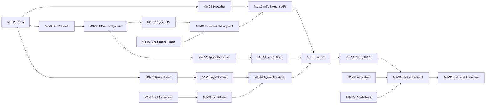

# SerMon – Implementierungsplan

> Grundlage: [KONZEPT.md](KONZEPT.md) (Roadmap §23) und [ADR 0001](adr/0001-zeitreihen-speicher-timescaledb.md).

**Planungsprinzip:** Der Plan wird von grob nach fein ausgearbeitet.

- **M0 und M1** sind bis auf Aufgabenebene detailliert.
- **M2–M5** sind als Epics beschrieben. Sie werden **vor Beginn des jeweiligen Meilensteins** in Aufgaben zerlegt, weil viele Details von den Ergebnissen davor abhängen, z. B. vom TimescaleDB-Spike.

| | |
|---|---|
| Stand | 2026-11-18 |
| Status | Entwurf |

---

## Inhalt

1. [Arbeitsweise](#1-arbeitsweise)
2. [Überblick und kritischer Pfad](#2-überblick-und-kritischer-pfad)
3. [M0 – Fundament](#3-m0--fundament)
4. [M1 – Metriken](#4-m1--metriken)
5. [M2 – Alerting](#5-m2--alerting)
6. [M3 – Logs und Live-Ansicht](#6-m3--logs-und-live-ansicht)
7. [M4 – Updates und Anomalien](#7-m4--updates-und-anomalien)
8. [M5 – Module und Ausbau](#8-m5--module-und-ausbau)
9. [v1.0 – Release](#9-v10--release)
10. [Risiken für den Plan](#10-risiken-für-den-plan)

---

## 1. Arbeitsweise

- **Eine Aufgabe ergibt einen Branch und einen PR.**
  - Branch-Name: `<id>-<kurztitel>`, z. B. `m1-07-agent-ca`
  - Commits nach Conventional Commits mit der Aufgaben-ID im Footer (`Refs: M1-07`)
- **TDD:** Jede Aufgabe beginnt mit den unter „Tests zuerst“ genannten Tests (Skill `sermon-tdd`).
- **Definition of Done** nach KONZEPT §19.4. Bei sicherheitsrelevanten Aufgaben (🔒) ist zusätzlich der Skill `sermon-security-review` Pflicht.
- **Aufwand** (grobe Richtwerte für eine Person mit Claude Code):

  | Größe | Aufwand |
  |---|---|
  | **S** | ≤ ½ Tag |
  | **M** | 1–2 Tage |
  | **L** | 3–5 Tage |

  Eine Aufgabe größer als L wird geteilt.
- **Stränge:** `X` Querschnitt · `A` Agent (Rust) · `S` Server (Go) · `W` Web (SvelteKit). Aufgaben verschiedener Stränge ohne gegenseitige Abhängigkeit können parallel laufen.
- **Status:** ☐ offen · ◐ in Arbeit · ☑ erledigt. Der Plan wird im selben PR aktualisiert, in dem die Aufgabe erledigt wird.
- **Verfeinerung:** Am Ende jedes Meilensteins gibt es ein kurzes Review mit diesen Schritten:
  - Ziel des Meilensteins erreicht?
  - Neue Erkenntnisse als ADRs festhalten
  - Den nächsten Meilenstein in Aufgaben zerlegen

---

## 2. Überblick und kritischer Pfad

| Meilenstein | Ziel / Demo | Grobe Dauer¹ |
|---|---|---|
| **M0 – Fundament** | Leere, aber lauffähige Skelette, grüne CI, Spike-Ergebnisse | 2–3 Wochen |
| **M1 – Metriken** | Node auf Debian/Ubuntu installieren, nach < 2 min Metriken in der UI sehen; Login mit TOTP; Mandantentrennung | 6–8 Wochen |
| **M2 – Alerting** | SSH-Brute-Force-Alert landet in ntfy/Slack; RHEL, Alpine, arm64 | 5–7 Wochen |
| **M3 – Logs und Live** | Fehlersuche ohne SSH: Logs, Live-Ansicht, Security-Dashboard; OIDC, Passkeys | 5–6 Wochen |
| **M4 – Updates und Anomalien** | Patch-Compliance auf einen Blick, Updates per Policy, Anomalie-Erkennung | 5–7 Wochen |
| **M5 – Module und Ausbau** | Integrationsmodule, eigene Dashboards, Kiosk-Modus | 5–7 Wochen |
| **v1.0** | Pentest, Doku, Performance-Nachweis | 2–3 Wochen |

¹ Grobe Schätzung für eine Person, keine Zusage. Wird nach M0 anhand der tatsächlichen Geschwindigkeit neu kalibriert.

### Kritischer Pfad bis „erster Node sichtbar“ (M1)

**Parallel möglich:**

- **Agent-Collectors** (M1-16 bis M1-21) brauchen nur M0-02 und Fixtures. Sie laufen völlig unabhängig vom Server.
- **Web-Shell und Charts** (M1-28, M1-29) können gegen gemockte Connect-Clients entwickelt werden.
- **Auth** (M1-02, M1-03) läuft unabhängig von der PKI.

---

## 3. M0 – Fundament

**Ziel:** Alle Skelette bauen, testen und linten in CI. Die Entwicklungsumgebung startet mit einem Befehl. Die beiden kritischen Annahmen (TimescaleDB-Last, journald über `journalctl`) und der musl-Build für arm64 sind durch Spikes geprüft.

### ☑ M0-01 – Repo-Grundgerüst · X · S
> Erledigt. Zusätzlich gibt es `just setup`, eine PR-Vorlage und einen Commit-Message-Check
> (`scripts/check-commit-msg.sh` mit Tests). GitHub Private Vulnerability Reporting ist seit dem 2026-11-19 aktiv;
> das Repo ist seitdem öffentlich.
- **Ziel:** Struktur nach KONZEPT §20; `LICENSE` (AGPL-3.0), `README.md`, `SECURITY.md` (Responsible Disclosure), `.editorconfig`, `.gitignore`, `CODEOWNERS`, `justfile` mit Ziel-Stubs (`dev`, `gen`, `lint`, `test`, `e2e`, `security`), `lefthook.yml` (Format, Secret-Scan; gitleaks, inzwischen betterleaks – ADR 0005).
- **Abhängig von:** –
- **Abnahme:** `just --list` zeigt alle Ziele; lefthook-Hooks greifen; GitHub Private Vulnerability Reporting ist aktiviert.

### ☑ M0-02 – Rust-Workspace und Cross-Build · A · M
> Erledigt: Workspace mit 10 Crates, Lints, `cargo-deny`; Cross-Build mit cargo-zigbuild ([ADR 0002](adr/0002-agent-build-toolchain.md)).
> Beide Architekturen sind statisch gebaut und im Container getestet (`just build-agent`, `just smoke-agent`).
> Abweichung: Unter echtem QEMU läuft arm64 erst in CI (M0-06). Lokal auf Apple Silicon läuft arm64 nativ und amd64 emuliert.

- **Ziel:** `agent/` als Workspace mit den Crates aus §20 (zunächst leer, inkl. `lib.rs`); `rustfmt.toml`, Clippy-Lints im Workspace-Manifest, `deny.toml` (Lizenzen kompatibel mit AGPL, Advisories).
  - **Spike:** musl-Builds für `x86_64` und `aarch64` mit `cargo-zigbuild` oder `cross`.
- **Abhängig von:** M0-01
- **Tests zuerst:** Smoke-Test `sermon-agent --version`.
- **Abnahme:** `just lint test` grün; statische Binaries für beide Architekturen (`file` meldet „statically linked“); arm64-Binary startet unter QEMU. Ergebnis als ADR (Build-Toolchain).

### ☑ M0-03 – Go-Server-Skelett · S · M
> Erledigt: Konfiguration aus Environment und `*_FILE` (alle Fehler gesammelt), `slog`, `/healthz` und `/readyz`
> (ohne Fehlerdetails), HTTP-Timeouts gegen Slowloris, Graceful Shutdown; Testabdeckung 92,5 %
> (`just test-server`, `just smoke-server`). Die im Konzept optionale YAML-Konfigurationsdatei kommt erst, wenn sie
> gebraucht wird.

- **Ziel:** `server/` mit `cmd/sermon-server`, Schichten `internal/{domain,app,adapters,transport}`; Konfiguration aus Environment und `*_FILE`; `slog` mit JSON-Ausgabe; `/healthz` und `/readyz`; Graceful Shutdown; `golangci-lint`-Konfiguration (inkl. gosec, errcheck, revive).
- **Abhängig von:** M0-01
- **Tests zuerst:** Config-Parsing (Tabellen-Tests, auch fehlende oder ungültige Werte); Health-Handler.
- **Abnahme:** `go test ./...` und Lint grün; Binary startet und beendet sich sauber per SIGTERM.

### ☑ M0-04 – Web-Skelett · W · M
> Erledigt mit **SvelteKit 3**, Vite 8 und Paraglide 3 (aktuelle Versionen der `sv`-CLI). Eine Startseite mit
> Sprachwahl DE/EN ist in die Server-Binary eingebettet; strikte CSP ohne `unsafe-inline`, alle Ressourcen lokal (D27,
> [ADR 0003](adr/0003-ui-auslieferung-und-csp.md)). 10 Unit-/Komponententests und 7 E2E-Tests gegen die echte Binary,
> inklusive Netzwerk-Wächter, CSP-Prüfung und axe. Bundle 54 KiB gzip.
> Abweichung: Das JS-Budget prüft ein eigenes Skript (`pnpm run check:size`) statt Lighthouse; Lighthouse kommt bei
> Bedarf mit der CI (M0-06).
- **Ziel:** SvelteKit 2 + Svelte 5, `adapter-static`, Tailwind 4, shadcn-svelte, Paraglide (de/en), ESLint, Prettier, `svelte-check`, Vitest, Playwright mit `@axe-core/playwright`. Build-Ergebnis wird per `embed.FS` in den Server eingebettet (`server/web/`).
- **Abhängig von:** M0-01, M0-03
- **Tests zuerst:** Komponenten-Test für eine Platzhalter-Seite; Playwright-Smoke-Test inkl. axe.
- **Abnahme:** `sermon-server` liefert die SPA aus; der Sprachwechsel DE/EN funktioniert; Lighthouse-Budget (< 200 KB JS gzip) in CI.

### ☑ M0-05 – Proto und Codegen · X · M
> Erledigt: `AgentService.Session` (umbenannt, weil `Connect` mit dem tonic-Konstruktor `connect()` kollidierte),
> `Hello`/`HostFacts`/`Heartbeat`/`Ack`, `SystemService.GetVersion`, protovalidate-Regeln mit Tests. Code-Generierung
> nur mit lokalen, gepinnten Plugins; der generierte Code ist committet ([ADR 0004](adr/0004-protokoll-codegenerierung.md)).
> Befehle: `just gen`, `just lint-proto`, `just breaking-proto`, `just check-gen`.
- **Ziel:** `proto/` mit `buf.yaml` und `buf.gen.yaml`. Ziele: Rust (`prost`/`tonic`), Go (`connect-go`), TS (`connect-es`). Erstes Schema `sermon.agent.v1.AgentService/Session` mit `Hello`, `Heartbeat`, `Ack`; dazu `sermon.web.v1.SystemService/GetVersion`; protovalidate eingebunden. `just gen`.
- **Abhängig von:** M0-02, M0-03, M0-04
- **Skill:** `sermon-proto-change`
- **Abnahme:** Generierter Code kompiliert in allen drei Sprachen; `buf lint` und `buf breaking` laufen in CI.

### ☑ M0-06 – CI und Security-Pipeline · X · M 🔒
> Erledigt: `ci.yml`, `security.yml` und `renovate.json` ([ADR 0006](adr/0006-ci-und-supply-chain.md)). Actions sind per
> SHA gepinnt (mindestens 3 Tage alt), Rechte minimal, `just lint-ci` (actionlint + zizmor) ist sauber. Der erste Lauf
> war grün bis auf den Job `web`: Im frischen Checkout fehlte der generierte Paraglide-Code für `svelte-check`.
> Behoben, indem `pnpm run check` ihn zuerst erzeugt. Native arm64-Runner, CodeQL und Scorecard laufen, weil das Repo
> öffentlich ist. Abweichungen: Der Secret-Scan nutzt betterleaks statt gitleaks (ADR 0005). Branch-Protection wird
> auf Wunsch des Product Owners erst nach der Implementierung eingerichtet (siehe v1.0). Den Test mit einer absichtlich
> verwundbaren Abhängigkeit ersetzt der reale Fall `minimatch` (GHSA-g3hv-75wg-m249), den die Audits erkannt haben.
> Der Override dafür ist seit typescript-eslint 8.73.0 entfernt (2026-11-20).
- **Ziel:**
  - `ci.yml`: Lint- und Test-Matrix für Rust, Go und Web, Coverage-Upload
  - `security.yml`: CodeQL, gosec, govulncheck, cargo-audit, cargo-deny, `pnpm audit`, betterleaks, OpenSSF Scorecard
  - Alle Actions per SHA gepinnt, minimale `permissions:`
  - `renovate.json`, Branch-Protection für `main`
- **Abhängig von:** M0-02 bis M0-05
- **Abnahme:** PR mit absichtlich verwundbarer Abhängigkeit wird rot; Scorecard läuft.

### ☑ M0-07 – Entwicklungsumgebung · X · S
> Erledigt: `deploy/dev/compose.yaml` mit TimescaleDB 2.32 (pg17), Loki 3.7 (Multi-Tenant), Mailpit und ntfy. Images
> sind per Digest gepinnt, Ports nur auf 127.0.0.1, Telemetrie ist aus. Das DB-Passwort wird zufällig erzeugt und als
> Docker-Secret übergeben. `just dev` startet Infrastruktur, Server mit Hot-Reload (air) und Vite mit Proxy in ca. 6 s
> (die Images müssen dafür schon geladen sein). Der Devcontainer ist getestet: Setup, `just lint`, `just test` und
> `just dev-infra` laufen darin. Die Regeln für Compose-Dateien prüft `just lint-compose` (mit Tests).
- **Ziel:** `deploy/dev/compose.yaml` mit `timescale/timescaledb` (pg17), Loki, Mailpit und ntfy; Devcontainer; `just dev` startet Infrastruktur, Server (Hot-Reload über `air`) und Vite-Dev-Server.
- **Abhängig von:** M0-03, M0-04
- **Abnahme:** Frischer Clone → `just dev` → UI unter `localhost` erreichbar in < 5 min.

### ☑ M0-08 – Datenbank-Grundgerüst · S · M 🔒
> Erledigt ([ADR 0007](adr/0007-mandantentrennung-rls.md)):
> - goose-Migrationen (eingebettet, mit Advisory-Lock), sqlc mit pgx und `just gen-sql`.
> - `tenant.Scope` (100 % Testabdeckung) und `postgres.DB.InTenant` (SET LOCAL).
> - RLS mit FORCE auf `organizations`, `users` und `memberships`.
> - Getrennte Rollen: Owner nur für Migrationen, `sermon_app` für den Server; `Open` verweigert privilegierte Rollen.
> - 10 Integrationstests mit Testcontainers (`just test-integration`, CI-Job `integration`); die Gegenprobe ohne RLS
>   schlägt fehl.
>
> Nebenbefund: Das Init-Skript aus M0-07 lag in einem Unterordner und wurde nie ausgeführt; korrigiert.
- **Ziel:**
  - `goose`-Migrationen und `sqlc`-Konfiguration
  - Testcontainers-Helfer für Integrationstests
  - Typ `tenant.Scope` (OrgID + erlaubte NodeGroups); jede Repository-Methode erwartet ihn
  - Erste Migration: `organizations`, `users`
  - RLS-Muster festlegen: `SET LOCAL sermon.org_id` pro Transaktion
- **Abhängig von:** M0-03, M0-07
- **Tests zuerst:** Integrationstest „Abfrage ohne gesetzte Org liefert nichts“ (RLS greift).
- **Abnahme:** `just test-integration` grün; RLS-Muster als ADR dokumentiert.

### ☑ M0-09 – Spike TimescaleDB-Ingest · S · L
> Erledigt; Ergebnisse in [ADR 0001](adr/0001-zeitreihen-speicher-timescaledb.md#ergebnis-des-spikes-m0-09-2026-11-19).
> Ingest, CPU, Abfragen und Aggregate erfüllen die Kriterien, sobald der Index `(series_id, ts)` angelegt ist.
> - Bei 1 s in der DB entstehen ~320 GB WAL pro Tag. **Entschieden:** 10 s in der DB, 1 s im Ringpuffer (15 min).
> - RLS ist auf komprimierten Hypertables und Continuous Aggregates nicht möglich; die Zweitlinie über eine
>   `SECURITY DEFINER`-Funktion kommt in M1-22.
> - Abweichungen: 20 min statt 24 h Dauerlast, 6 statt 8 GB RAM.
- **Ziel:** Abnahmekriterien aus ADR 0001 messen.
  - Schema `series` und `metrics_raw` als Hypertable mit Kompression; Continuous Aggregates `metrics_1m` und `metrics_1h` mit Policies
  - Minimaler Lastgenerator (Go) für 50 Nodes × 400 Serien × 1 s
  - Schreiben per `COPY`
- **Abhängig von:** M0-08
- **Abnahme:** Messergebnisse in ADR 0001 nachgetragen (Ingest-Lag, CPU, Plattenbedarf, WAL-Volumen, Abfragelatenzen, RLS-Verhalten); Entscheidung bestätigt **oder** Fallback (5–10 s in der DB) festgelegt. Das Schema geht als Basis in M1-22.

### ☑ M0-10 – Spike journald über `journalctl` · A · S
> Erledigt; Ergebnisse in [ADR 0013](adr/0013-log-quelle-journald.md), Versuche in `spikes/journald/` (Container mit
> systemd als PID 1: Debian 13, Ubuntu 24.04, Rocky 9 und zusätzlich Rocky 8).
> - **Abweichung vom Konzept:** kein `--cursor-file`. Rocky 9 schreibt die Datei nach SIGTERM nicht, nach SIGKILL
>   bleibt überall ein alter Stand, systemd 239 (Rocky 8) kennt die Option nicht. Der Agent speichert `__CURSOR`
>   selbst, sobald der Eintrag im WAL liegt, und startet mit `--after-cursor` (0 Duplikate beim Neustart, überall).
> - Rotation und Neustart von journald überstehen den Kindprozess; nach `--vacuum` setzt er am nächsten Eintrag fort,
>   die Lücke zeigt `__SEQNUM` (ab systemd 254) bzw. die Sequenznummer im Cursor.
> - Format: `--all` nötig (sonst Felder > 4 KiB als `null`), binäre Werte als Byte-Array, auf Rocky 8 als ungültiges
>   UTF-8 im JSON; `_CMDLINE` enthielt ein Passwort und wird nicht übernommen.
> - Ressourcen: 6–8 MiB RSS im Leerlauf, ~16 MiB unter Last, 10–22 µs CPU pro Zeile, ~0,45 s Latenz; lesen nur mit
>   der Gruppe `systemd-journal`.
> - Fixtures echter sshd-, su-, sudo- und useradd-Ereignisse sowie der Sonderfälle unter `agent/fixtures/logs/`.
- **Ziel:** Kindprozess `journalctl -o json -f --cursor-file`; Verhalten bei Neustart, Journal-Rotation und `--vacuum`; Ressourcenbedarf; Ausgabeformate auf Debian, Ubuntu und Rocky.
- **Abhängig von:** M0-02
- **Abnahme:** ADR (Log-Quelle journald) mit Ergebnis; erste echte Logzeilen als Fixtures unter `agent/fixtures/logs/`.

### ☑ M0-11 – ADRs zum Entscheidungslog · X · M
> Erledigt: ADRs 0014–0021 fassen D1–D26 zusammen (Stack, Topologie und Betrieb, Zielsysteme und Agent-Rechte,
> Authentifizierung und Rechte, Retention, Alerting, Updates/Logs/Module, Produkt und Projekt). Die Übersicht
> [`docs/adr/README.md`](adr/README.md) listet alle ADRs mit Status und ordnet D1–D30 zu; D29 hat noch keins (folgt
> mit E3.8). KONZEPT §2 verweist darauf.
- **Ziel:** Kurze ADRs für die Entscheidungen D1–D26 aus KONZEPT §2, zusammengefasst, wo sinnvoll (z. B. eines für den gesamten Stack D1–D3 und D26). D13 ist bereits durch ADR 0001 abgedeckt.
- **Abhängig von:** –
- **Skill:** `sermon-adr`
- **Abnahme:** `docs/adr/` enthält eine Übersicht (`README.md`) mit allen ADRs und ihrem Status.

### ☑ M0-12 – Threat Model v1 · X · S 🔒
> Erledigt: [`docs/security/threat-model.md`](security/threat-model.md) mit Assets, Akteuren, Datenfluss (Mermaid),
> sechs Vertrauensgrenzen (Node ↔ Server, Browser ↔ Server, Server ↔ DB/Loki, Agent ↔ Helper, ausgehende
> Verbindungen, Lieferkette) und 53 Bedrohungen nach STRIDE, jeweils mit Gegenmaßnahme, Aufgabe und Stand
> (umgesetzt, teilweise, geplant). Stand nach M1-32, deshalb mit den Befunden aus der Umsetzung (z. B. `/metrics`,
> Live-Streams, Einladungslinks). Das Ergebnis von M1-35 steht am Ende (§6); `SECURITY.md` und der Skill
> `sermon-security-review` verweisen auf das Dokument.
- **Ziel:** `docs/security/threat-model.md`: Datenfluss-Diagramm, Vertrauensgrenzen (Node ↔ Server, Browser ↔ Server, Server ↔ DB, Agent ↔ Helper), STRIDE-Tabelle aus KONZEPT §18.1, Liste der Assets.
- **Abhängig von:** –
- **Abnahme:** Jede Bedrohung hat eine Gegenmaßnahme mit Verweis auf eine geplante Aufgabe in diesem Plan.

**M0 fertig, wenn:** Alle Aufgaben ☑, CI auf `main` grün, Spikes bewertet und M1 bei Bedarf angepasst.

---

## 4. M1 – Metriken

**Ziel (Demo):** Auf einem frischen Debian- oder Ubuntu-Host (amd64) mit dem Einzeiler aus der UI installieren. Nach weniger als 2 min erscheint der Node in der Fleet-Übersicht mit CPU, Memory, Disk, Netzwerk, Load und Uptime. Die Detailansichten funktionieren. Ein User aus Org B sieht davon nichts.

### 4.1 Server: Domäne, Auth und Mandanten

#### ☑ M1-01 – Domänentypen und Autorisierung · S · M 🔒
> Erledigt: Typen `identity.UserID`/`NodeID`, `role.Role`, `tenant.OrgID`/`GroupID`; `authz.Policy` verweigert alles,
> was nicht erlaubt ist, und bildet die Rollen-Matrix aus KONZEPT §7 ab (inkl. `RotateNodeKeys`, Superadmin ohne
> Datenzugriff, Logs für Viewer abschaltbar). `authz.ScopeFor` leitet den Tenant-Scope für Listen ab. Ein Test
> erzwingt, dass jede Action in der Matrix steht; 100 % Abdeckung, Gegenprobe ohne Org-Prüfung schlägt fehl.
- **Ziel:** Starke Typen (`OrgID`, `NodeID`, `UserID`, `GroupID`, `Role`); `authz.Policy` mit Verweigern als Standard und der Rollen-Matrix aus KONZEPT §7.
- **Abhängig von:** M0-03
- **Tests zuerst:** Tabellen-Test „Aktion × Rolle × Gruppen-Bindung → erlaubt/verboten“, inkl. `*`-Bindung und fremder Org.
- **Abnahme:** 100 % Abdeckung von `authz`.

#### ☑ M1-02 – Lokale Anmeldung und Sessions · S · L 🔒
> Erledigt in fünf Teilen:
> - Passwörter: Argon2id, Regeln, Liste häufiger Passwörter.
> - Sessions: Tokens nur als Hash gespeichert, Idle-Timeout 30 min, absolut 12 h, Step-up.
> - DB mit `sermon_definer` für Zugriffe ohne Mandant (ADR 0007 überarbeitet).
> - Login mit Kontosperre (ab dem 5. Fehlversuch, 1–15 min) und Rate-Limit pro IP; einheitliche Fehler und
>   Dummy-Hash gegen Enumeration.
> - Web-API `AuthService` (Login/Logout/GetSession) über Connect mit Cookie `__Host-sermon_session`,
>   Origin-Prüfung (auch gegen Login-CSRF), Security-Header, protovalidate, vertrauenswürdige Proxies für die
>   Client-IP; in `just dev` verdrahtet.
>
> E2E-Tests über HTTPS mit echter DB. Nebenbefund: Konflikt der Routen `GET /` und API (Panic beim Start) mit einem
> Regressionstest behoben. connect-go bleibt vorerst bei v1 (ADR 0004).
>
> Nachtrag Step-up: `AuthService.ConfirmPassword` erneuert den Step-up mit dem Passwort (Fehlversuche zählen zur
> Kontosperre, IP-Rate-Limit gilt); `Session.step_up_until` zeigt, wie lange er gilt. Fehlender Step-up liefert
> `FAILED_PRECONDITION` mit dem Detail `StepUpRequired`; in der UI fragt `withStepUp` per `StepUpDialog` nach dem
> Passwort und wiederholt die Aktion. Vorher war nach 15 min nur Ab- und Anmelden möglich.
- **Ziel:**
  - User mit Argon2id; Login und Logout
  - Serverseitige Sessions (`__Host-sermon_session`, Idle-Timeout 30 min, absolut 12 h)
  - Rate-Limit pro IP und pro Account
  - Middleware: Origin-Prüfung, Security-Header und CSP (KONZEPT §18.3), generische Fehler mit Korrelations-ID
- **Abhängig von:** M0-08, M1-01
- **Tests zuerst:** Passwort-Hashing und -Verifikation (Vergleich in konstanter Zeit), Session-Ablauf mit Fake-Clock, Rate-Limit, abgelehnte Requests ohne gültigen Origin, CSP-Header-Snapshot.
- **Abnahme:** Login-E2E-Test grün; Security-Review bestanden.

#### ☑ M1-03 – TOTP, Recovery-Codes und Step-up · S · M 🔒
> Erledigt:
> - **TOTP** (`app/auth/totp`, eigene Umsetzung von RFC 6238, geprüft mit den RFC-Testvektoren): SHA-1, 30 s,
>   6 Stellen, ±1 Schritt; jeder Zeitschritt gilt einmal (atomar in der DB, parallele Nutzung gewinnt genau einmal).
>   Seed mit der Secrets-Box versiegelt und an den User gebunden (ein kopierter Seed lässt sich nicht öffnen).
> - **Recovery-Codes:** 10 Stück mit 80 Bit, nur als Hash gespeichert, jeder einmal; neu erzeugen ersetzt den Satz.
> - **Login in zwei Schritten:** Nach dem Passwort eine Session, die höchstens 5 min auf den Code wartet und sonst
>   nichts darf (API, Session-Ansicht, Org-Wechsel lehnen sie ab); danach neues Cookie. Falsche Codes zählen zur
>   Kontosperre, und das richtige Passwort setzt den Zähler bei 2FA-Usern nicht mehr zurück – sonst ließen sich
>   Code-Versuche mit neuen Logins abwechseln (Gegenprobe vorhanden).
> - **Step-up:** mit 2FA per `ConfirmSecondFactor` (Code oder Recovery-Code), ohne 2FA weiter per Passwort.
>   Einrichten, Abschalten und neue Codes verlangen einen Step-up.
> - **Org-Pflicht:** `SecurityPolicyService` (Admin für alle Gruppen, Step-up, nur mit eigenem zweiten Faktor,
>   auditiert). Mitglieder ohne zweiten Faktor bekommen überall `FAILED_PRECONDITION` mit
>   `SecondFactorSetupRequired`, nur `TwoFactorService` bleibt erreichbar (Authenticator ohne Principal).
> - **UI:** Code-Schritt im Login, Step-up-Dialog mit Code, Seite „Sicherheit“ (QR-Code als SVG aus der Matrix von
>   `uqr`, Schlüssel zum Abtippen, Recovery-Codes zum Kopieren oder Speichern), Weiterleitung dorthin, solange die
>   Org es verlangt; Hilfetext `pages/security`.
> - **Tests:** Unit-Tests (Codes, Replay, Sperre, Richtlinie), Integration über HTTPS (Login, Step-up, Recovery,
>   Org-Pflicht inkl. Beta ändert Alpha nicht), Komponenten- und Playwright-Tests mit axe.
>
> Der Schalter für die Org-Pflicht ist seit M1-32 in der UI (Organisation → Sicherheit). WebAuthn/Passkeys
> (KONZEPT §7) sind nicht Teil von M1. (Das Bundle-Budget misst seit M1-30 das erste Laden je Seite.)
- **Ziel:** TOTP einrichten (QR-Code) und verifizieren; Recovery-Codes gehasht speichern; Middleware `RequireStepUp(maxAge)`; 2FA-Pflicht pro Org.
- **Abhängig von:** M1-02, M1-06
- **Tests zuerst:** RFC-6238-Testvektoren, Zeitfenster und Schutz vor Replay, Recovery-Code nur einmal verwendbar.

#### ☑ M1-04 – Orgs, Gruppen, Mitgliedschaften und Rollen · S · L 🔒
> Teil a erledigt (Grundlage):
> - Tabellen `node_groups`, `role_bindings` (zusammengesetzte Fremdschlüssel: Bindungen nur auf Gruppen derselben
>   Org) und `audit_log`, alle mit RLS (ENABLE + FORCE).
> - Audit-Log nur anfügen (`sermon_app` hat nur INSERT/SELECT); die Hash-Kette pro Org berechnet ein Trigger unter
>   Advisory-Lock mit fortlaufender `seq`; `VerifyAuditChain` erkennt Manipulationen, auch bei parallelem Schreiben.
> - `access.Loader` baut den Principal bei jedem Request neu: Entzug von Mitgliedschaft oder Rolle wirkt sofort.
> - `webapi.Authenticator` (Connect-Interceptor) verlangt für alle Services außer `AuthService` eine gültige Session.
> - Testgerüst `TestTenantIsolation_EveryProcedureIsCovered`: jede Web-RPC braucht einen Cross-Tenant-Test oder eine
>   begründete Ausnahme.
>
>
> Teil b erledigt (Verwaltung in der Org):
> - `AccessService`: Gruppen anlegen, umbenennen, löschen und auflisten; Mitglieder mit Rollen auflisten; Rollen
>   vergeben und entziehen; Mitglied entfernen (beendet dessen Sessions in der Org); Audit-Log seitenweise.
> - Jede Änderung schreibt ihren Audit-Eintrag in derselben Transaktion; fehlgeschlagene Änderungen hinterlassen keinen.
> - Rechteänderungen verlangen einen Step-up (15 min). Der letzte Admin für alle Gruppen lässt sich nicht entfernen,
>   auch nicht bei gleichzeitigen Änderungen (Advisory-Lock pro Org).
> - `AuthService.SwitchOrganization`: neues Cookie, Timeouts und Step-up bleiben erhalten.
> - Cross-Tenant-Test über HTTPS für alle neuen RPCs: Ein Admin von Org B bekommt für Objekte von Org A `NotFound`
>   oder `PermissionDenied`, Listen enthalten keine fremden Daten, Org A bleibt unverändert.
>
> Teil c erledigt (Einladungen, D28, ADR 0008):
> - `AccessService.InviteMember`, `ListInvitations`, `RevokeInvitation`: Einladen verlangt einen Step-up.
>   Ein erneutes Einladen ersetzt den Link.
> - Die Antwort enthält das Token einmalig; die UI baut daraus `<origin>/invite#<token>`. Mail-Versand kommt mit E2.4.
> - `InvitationService` für die Einladungsseite, rate-limitiert:
>   - `GetInvitation` zeigt die Einladung.
>   - `AcceptInvitation` legt ein neues Konto an; ist die Adresse schon vergeben, scheitert es wie ein ungültiger
>     Link, und die Einladung bleibt bestehen.
>   - `JoinOrganization` nimmt angemeldete User mit passender Adresse auf.
> - Die Annahme verbraucht die Einladung genau einmal und senkt nie eine bestehende Rolle.
> - Suche per Token-Hash über eine minimale Definer-Funktion; Audit für Einladen, Widerrufen und Beitreten.
> - Testhilfe korrigiert: Jeder Test-Client hat jetzt ein eigenes `http.Client`. `httptest.Server.Client()` liefert
>   immer dasselbe Objekt, die Clients hatten sich Cookies geteilt.
>
> Teil d erledigt (Orgs durch den Superadmin):
> - `OrganizationService`: `ListOrganizations` (Name und Mitgliederzahl, keine Mandantendaten),
>   `CreateOrganization` (mit Step-up; lädt den ersten Admin per Link ein), `RenameOrganization`.
> - Audit-Einträge im Log der jeweiligen Org.
> - Ohne Mitgliedschaft sieht der Superadmin keine Daten einer Org (Test).
>
> Orgs zu löschen ist entschieden (D29: sperren, nach Frist löschen) und folgt mit E3.8.
- **Ziel:** CRUD-Use-Cases und Connect-RPCs für Orgs, Node-Gruppen, Mitgliedschaften und Rollen-Bindungen; RLS-Policies; Audit-Log-Tabelle (nur anfügen, Hash-Kette); Org-Switch.
  - **Testgerüst für Mandantentrennung:** ein generischer Test, der **jede** Web-RPC mit einem User aus fremder Org aufruft und `NotFound` oder `PermissionDenied` erwartet. Neue RPCs ohne Eintrag lassen den Test fehlschlagen.
- **Abhängig von:** M1-01, M1-02
- **Abnahme:** Testgerüst läuft in CI; Audit-Einträge für alle Änderungen an Rechten.

#### ☑ M1-05 – Erstinstallation `sermon-server init` · S · M 🔒
> Erledigt:
> - `sermon-server init --master-keys-file PFAD`: Master-Key-Datei (0600, nie überschrieben), Migrationen, Agent-CA,
>   Setup-Token auf stdout. Wiederholbar, bis die Einrichtung abgeschlossen ist; danach Exit-Code 1 ohne Änderung.
> - Der Server braucht mit DB `SERMON_MASTER_KEYS_FILE`, lädt oder erzeugt beim Start die Agent-CA und schreibt
>   ein frisches Setup-Token ins Log, solange die Einrichtung offen ist.
> - Setup-Token: 256 Bit, nur als SHA-256 gespeichert, 30 min gültig, ersetzt das vorige, genau einmal einlösbar
>   (auch bei gleichzeitigen Versuchen).
> - `SetupService` (`GetSetupStatus`, `CompleteSetup` mit Rate-Limit): legt Superadmin, erste Org, Mitgliedschaft
>   und Admin-Rolle für alle Gruppen in einer Transaktion an, mit Audit-Eintrag. Der Principal kennt jetzt `Superadmin`.
> - End-to-End-Test gegen echte DB: `init` zweimal, Serverstart, Token aus dem Log, Einrichtung über HTTP, Login,
>   danach verweigert `init`.
>
> Die Seite des Setup-Assistenten ist mit M1-28 entstanden (`/setup`).
- **Ziel:** Erzeugt Master-Key, Agent-CA (über M1-07) und den ersten Superadmin über ein einmaliges Setup-Token (30 min gültig, wird im Log ausgegeben); Setup-Assistent in der UI.
- **Abhängig von:** M1-02, M1-06, M1-07
- **Tests zuerst:** `init` ist idempotent und verweigert eine zweite Ausführung; das Token verfällt.

#### ☑ M1-06 – Secrets-Box · S · S 🔒
> Erledigt: `secrets.Box` (AES-256-GCM, Key-ID im Ciphertext, Kontextbindung per Associated Data, einheitlicher
> Fehler `ErrDecrypt`), Rotation mit lesbaren Altschlüsseln und `Reseal`, Schlüsseldatei `<id>:<base64>` (neuester
> zuerst, Fehlermeldungen ohne Schlüsselmaterial), `GenerateKeyLine`. 93,6 % Abdeckung; der Rest sind Fehlerpfade
> von `crypto/rand` bzw. AES, die nicht auftreten können. Die Gegenprobe ohne Kontextbindung schlägt fehl.
> Konfiguration (`SERMON_MASTER_KEYS_FILE`) folgt mit M1-05.
- **Ziel:** `secrets.Box`: AES-256-GCM mit Key-ID im Ciphertext; Schlüsselrotation (alte Schlüssel weiter lesbar).
- **Abhängig von:** M0-03
- **Tests zuerst:** Verschlüsseln und Entschlüsseln im Kreis, manipulierter Ciphertext wird abgelehnt, Rotation.

### 4.2 Server: PKI und Enrollment

#### ☑ M1-07 – Interne Agent-CA · S · M 🔒
> Erledigt:
> - `pki`: Root-CA (10 Jahre) und Intermediate-CA (2 Jahre, Name Constraint `spiffe://sermon`, keine weiteren CAs).
> - Agent-Zertifikate 30 Tage, nur `clientAuth`. Nur P-256-CSRs werden akzeptiert; alle Wünsche aus der CSR werden
>   ignoriert.
> - Strenges Parsen der Identität (`AgentIdentity`).
> - `agentca.Service`: Laden oder Anlegen der CA (Schlüssel versiegelt und an ihr Zertifikat gebunden, Race zwischen
>   mehreren Instanzen abgefangen), Ausstellen, Sperren, Prüfen.
> - Migration `00002`: Zertifikate mit RLS und Sperrprüfung per `SECURITY DEFINER`; ADR 0007 um Zugriffe ohne
>   Mandant ergänzt.
> - Unit- und Integrationstests, auch mit Eigentümer ohne Superuser-Rechte; Gegenprobe mit `SECURITY INVOKER`.
- **Ziel:** Root- und Intermediate-CA erzeugen (Schlüssel über M1-06 verschlüsselt gespeichert); CSR signieren mit SAN `spiffe://sermon/org/<org>/node/<node>`, Laufzeit 30 Tage; Serial-Verwaltung; Denylist.
- **Abhängig von:** M0-08, M1-06
- **Tests zuerst:** Ausgestellte Zertifikate validieren gegen die Kette; CSR mit fremden Extensions oder schwachem Schlüssel wird abgelehnt; Laufzeit stimmt; Serial auf der Denylist wird erkannt.

#### ☑ M1-08 – Enrollment-Token · S · M 🔒
> Erledigt:
> - Token `sme_` + 256 Bit; gespeichert wird nur der SHA-256-Hash.
> - Gebunden an Org und Gruppe; gültig 1 h (5 min bis 7 Tage), 1 bis 1000 Nutzungen, widerrufbar.
> - `EnrollmentTokenService` (Create, List, Revoke) für Operatoren und Admins der Gruppe; Listen enthalten nur
>   Gruppen mit diesem Recht.
> - Für M1-09 steht `Redeem` bereit:
>   - Suche per Hash über eine Definer-Funktion, danach ein Hash-Vergleich in konstanter Zeit.
>   - Die Einlösung ist atomar, `max_uses` hält auch bei parallelen Versuchen (Test mit 10 gleichzeitigen).
> - Audit-Einträge für Erzeugen, Widerrufen und Nutzen; Cross-Tenant-Fälle für alle neuen RPCs.
>
> Die Benachrichtigung bei Nutzung folgt mit den Notifiern (E2.4).
- **Ziel:** Token erzeugen (256 Bit, Präfix `sme_`, nur SHA-256-Hash gespeichert, TTL, maximale Nutzungen, an Gruppe gebunden); RPC für Operator und Admin; Audit-Eintrag und Benachrichtigung bei Nutzung.
- **Abhängig von:** M1-04
- **Tests zuerst:** Ablauf, maximale Nutzungen, Vergleich in konstanter Zeit, Bindung an Org und Gruppe.

#### ☑ M1-09 – Enrollment-Endpoint · S · M 🔒
> Erledigt (ADR 0009):
> - `sermon.agent.v1.EnrollmentService.Enroll` auf dem Web-Listener: gRPC über h2c hinter Caddy, ohne Origin-Prüfung
>   und Session, mit Rate-Limit pro IP und protovalidate (CSR höchstens 4 KiB).
> - Der Server signiert die CSR (nur P-256, Inhalt der CSR wird ignoriert) für einen neuen Node der Org und Gruppe des
>   Tokens.
> - In einer Transaktion: Token einmal nutzen, Node anlegen (Tabelle `nodes`, RLS), Zertifikat aufzeichnen, Audit
>   (`enrollment_token.use`, `node.enroll`).
> - Antwort: Zertifikat, Intermediate, Root als Trust-Anker, Node-ID.
> - `machine-id`-Konflikt → `ALREADY_EXISTS`; das Token bleibt unverbraucht, die Übernahme ist noch offen (siehe M1-32).
> - End-to-End-Test über gRPC: Kette prüft gegen den Trust-Anker, SPIFFE-Identität stimmt, `max_uses` und Widerruf
>   greifen. Abgelehnte Anfragen (RSA, manipulierte CSR, ungültiges Token) verbrauchen kein Token.
> - Rust: tonic-Client für `EnrollmentService` und Roundtrip-Tests.
- **Ziel:** `EnrollmentService.Enroll(token, csr, host_facts)` über TLS (Server-Zertifikat, noch ohne Client-Zertifikat). Der Endpoint legt den Node an und signiert das Zertifikat; bei Konflikt der `machine-id` gibt es eine Rückfrage, keine automatische Übernahme. Rate-Limit.
- **Abhängig von:** M0-05, M1-07, M1-08
- **Skill:** `sermon-proto-change`
- **Tests zuerst:** Gültiger Ablauf; ungültiger, abgelaufener oder aufgebrauchter Token; manipulierte CSR; Grenzwerte der Host-Fakten (protovalidate).

#### ☑ M1-10 – Agent-API mit mTLS · S · M 🔒
> Erledigt:
> - **Listener:** eigener Listener (`SERMON_AGENT_ADDR`), nur TLS 1.3 und HTTP/2, Keepalive per HTTP/2-Ping alle 15 s, keine
>   Lese- und Schreib-Timeouts für lange Streams. Beim Shutdown enden offene Streams sofort.
> - **Server-Zertifikat:** von der Agent-CA für `SERMON_AGENT_HOSTNAMES`, 7 Tage gültig, im Speicher nach 2/3 der
>   Laufzeit erneuert (volle Rotation mit M1-11b).
> - **Client-Zertifikat:** Pflicht. Bei jedem Handshake werden geprüft: Kette zur Agent-CA, Client-Auth-EKU, genau
>   eine SPIFFE-Identität, aufgezeichnet und nicht gesperrt.
> - **Identität:** Org und Node kommen nur aus dem Zertifikat in den Request-Kontext.
> - **`AgentService.Session`:** `Hello` zuerst, danach Heartbeats. Höchstens eine aktive Session pro Node; eine zweite
>   wird abgelehnt und als Security-Warnung geloggt.
> - **Tests:**
>   - Echte Handshakes: ohne Zertifikat, fremde CA, gesperrt und TLS 1.2 werden abgelehnt.
>   - Sperre gilt auch für wiederaufgenommene TLS-Sessions: `VerifyConnection` statt `VerifyPeerCertificate`, dazu
>     Session-Tickets aus. Den Befund lieferte gosec G123; die Gegenprobe zeigt die Umgehung über `DidResume`.
>   - Gegenproben für Sperrprüfung und TLS-Version.
>   - End-to-End mit der Server-Binary: Enrollment, mTLS-Session, Sperre greift bei der nächsten Verbindung.
>
> Ingest und Ack folgen mit M1-24, Node-Status mit M1-24/M1-30.
- **Ziel:** Eigener Listener nur mit TLS 1.3; Client-Zertifikat Pflicht und gegen die Agent-CA validiert; Identität (Org, Node) aus der SAN in den Request-Kontext; Denylist bei jedem Verbindungsaufbau prüfen; Keepalive.
- **Abhängig von:** M1-07, M1-09
- **Tests zuerst:** Verbindung ohne, mit fremdem oder mit gesperrtem Zertifikat wird abgelehnt; Identität kommt aus dem Zertifikat, auch wenn der Payload eine andere enthält.

#### ☑ M1-11 – Zertifikatsrotation · S+A · L 🔒
> Teil a erledigt (Server, automatische Rotation und parallele Nutzung):
> - **Protokoll:** `RotateCertificate` (neue CSR) und `CertificateIssued` im Stream.
> - **Rotation:** Der Server stellt für dieselbe Identität aus. Das alte Zertifikat bleibt 1 h gültig (Sperre mit
>   Zeitpunkt); die Prüfung beim Handshake beachtet das.
> - **Rotation mit bereits ersetztem Zertifikat:** vorsorgliche Sperre des Nodes. Alle Zertifikate werden gesperrt,
>   der Node bekommt `locked_at` und `lock_reason`, dazu ein Audit-Eintrag `security.node_locked`. Zertifikate eines
>   gesperrten Nodes sind unbrauchbar, auch später ausgestellte.
> - **Zweite Session:** gleiches Zertifikat und gleiche IP gelten als Reconnect und ersetzen die alte Session.
>   Sonst gibt es eine Sperre, und beide Sessions enden.
> - **Neue Quell-IP:** Rotation von einer anderen IP als die vorige Session → Security-Hinweis
>   (`security.rotation_new_ip`).
> - **Test:** End-to-End mit der Server-Binary. Rotation, neue Verbindung mit dem neuen Zertifikat, ein „Angreifer“
>   mit dem alten Schlüssel rotiert ebenfalls → Sperre, beide Schlüssel funktionieren nicht mehr.
>
> Teil b erledigt (Rotation auf Abruf):
> - `NodeService.RotateNodeKeys` für Nodes, eine Gruppe oder die ganze Org: Operator auf den Gruppen (für die Org auf
>   allen), Step-up, Audit pro Node. Unbekannte oder fremde Nodes → `NotFound`, ohne Änderung.
> - **Online-Agents:** Sie bekommen `RotateNow` im Stream. Ihre nächste Rotation sperrt das alte Zertifikat sofort,
>   danach endet die Session (Reconnect mit dem neuen Zertifikat). Antwortet ein Agent nicht innerhalb von 60 s,
>   werden alle Zertifikate gesperrt.
> - **Offline-Nodes:** Alle Zertifikate werden sofort gesperrt (Re-Enrollment nötig, keine Node-Sperre).
> - Web- und Agent-Listener teilen sich die Sessions.
>
> Agent-Seite erledigt mit M1-14: Rotation nach 2/3 der Laufzeit (Ausstellungszeit in `identity.toml`) und auf
> `RotateNow`, neues Schlüsselpaar, Prüfung und atomares Speichern, danach Reconnect mit dem neuen Zertifikat;
> abgelaufenes oder abgelehntes Zertifikat → Hinweis auf `enroll --force`. End-to-End gegen den echten Server
> (`just e2e-agent`): Rotation ohne Security-Event, zweite Session mit dem neuen Zertifikat.
>
> Weiter bei anderen Aufgaben: Security-Events und Benachrichtigung (E2.3/E2.4), Sperre aufheben (offen, siehe M1-32).
- **Ziel** (KONZEPT §6 „Schlüsselrotation“):
  - **Automatisch:** Der Agent erneuert sein Zertifikat nach 2/3 der Laufzeit über den Stream (`RotateCertificate`,
    neues Schlüsselpaar); der Server stellt aus und sperrt das alte Zertifikat nach Übergangszeit.
  - **Auf Abruf:** Rotation für einen Node, eine Gruppe oder alle; das alte Zertifikat wird sofort gesperrt
    (Operator/Admin, Step-up, Audit).
  - **Parallele Nutzung erkennen:** höchstens eine aktive Session pro Node; Security-Event und vorsorgliche Sperre bei
    zweiter Session, bei gescheiterter Rotation (Zertifikat bereits ersetzt) und bei einer Rotation von einer neuen
    Quell-IP.
- **Abhängig von:** M1-10, M1-14
- **Tests zuerst:**
  - Rotationszeitpunkt mit Fake-Clock; Rotation während eines Verbindungsabbruchs; abgelaufenes Zertifikat führt zu
    Re-Enrollment-Hinweis.
  - Rotation auf Abruf sperrt sofort, auch offene Sessions und offline Nodes.
  - Zweite Session mit derselben Identität wird abgelehnt und erzeugt ein Security-Event; nach einer Rotation durch
    einen Angreifer wird der echte Agent erkannt und die Identität gesperrt.

#### ☑ M1-11b – Rotation von Server-Zertifikat und Agent-CA · S · M 🔒
> Server-Seite erledigt:
> - **Server-Zertifikat:** 7 Tage gültig, erneuert nach 2/3 der Laufzeit und bei jeder Änderung der vertrauten CAs.
>   Offene Verbindungen laufen weiter (Test mit Fake-Clock).
> - **Mehrere CAs:** eine ausstellende CA, daneben weitere vertraute. Jedes Agent-Zertifikat kennt seine CA
>   (`authority_id`). Die Agent-API akzeptiert Zertifikate aller vertrauten CAs.
> - **`AgentCAService` (Superadmin):**
>   - `GetAgentCAStatus`: Fortschritt mit gültigen Zertifikaten pro CA.
>   - `StartAgentCARollover` (Step-up): neue ausstellende CA, die alte bleibt vertraut. Nur ein Wechsel gleichzeitig,
>     auch über mehrere Instanzen (Advisory-Lock).
>   - `RetireAgentCA` (Step-up): verweigert, solange gültige Zertifikate der CA existieren, und für die ausstellende CA.
> - **Trust-Bundle:** Während des Wechsels kommt das Server-Zertifikat von der ältesten vertrauten CA, damit Agents
>   ohne neues Bundle weiter verbinden. Das Bundle (alle Wurzeln) gibt es beim Enrollment (`trust_anchors`) und zu
>   Beginn jeder Session (`TrustBundle`).
> - **Mehrere Instanzen:** Jede lädt die CAs alle 30 s neu.
> - **End-to-End mit der Server-Binary:**
>   - Ein Agent mit nur der alten Wurzel verbindet während des Wechsels und bekommt beide Wurzeln.
>   - Er rotiert auf die neue CA; das Ausmustern wird in der Übergangszeit verweigert und gelingt danach.
>   - Danach verbindet ein Agent mit nur der neuen Wurzel, die alte verifiziert den Server nicht mehr.
>
> Agent-Seite erledigt mit M1-14: Das Bundle aus der Session ersetzt `trust.pem` atomar (leere oder kaputte Bundles
> werden ignoriert); das Server-Zertifikat wird gegen alle Wurzeln geprüft.
>
> Instanzweites Audit-Log (Nachtrag): Tabelle `instance_audit_log` mit derselben Hash-Kette wie das Org-Log (eine
> Kette für die Instanz, für `sermon_app` nur INSERT/SELECT). CA anlegen, Wechsel starten und CA ausmustern schreiben
> ihren Eintrag in derselben Transaktion (`pki.authority_created`, `pki.rollover_started`, `pki.authority_retired`, mit
> Fingerprint der Wurzel). Lesen nur für den Superadmin über `InstanceAuditService.ListInstanceAuditLog`.
> Tests: genau ein Eintrag pro erfolgreicher Aktion (der verlorene parallele Wechsel schreibt keinen), Manipulation
> wird erkannt, UPDATE/DELETE verweigert, End-to-End über die Web-API.
- **Ziel:** Das Server-Zertifikat der Agent-API ist kurzlebig und wird automatisch erneuert. Der CA-Wechsel läuft per
  Trust-Bundle (alte + neue CA über den Stream verteilt); nach dem Wechsel wird nur noch mit der neuen CA
  ausgestellt. Die alte CA wird entfernt, sobald kein gültiges Zertifikat mehr von ihr stammt; der Fortschritt ist
  sichtbar.
- **Abhängig von:** M1-07, M1-11
- **Tests zuerst:** Agent akzeptiert während des Wechsels beide CAs und danach nur die neue; der Server verweigert das
  Entfernen der alten CA, solange noch gültige Zertifikate von ihr existieren; Erneuerung des Server-Zertifikats ohne
  Verbindungsabbruch.

### 4.3 Agent

#### ☑ M1-12 – Agent-Grundgerüst · A · M
> Erledigt:
> - CLI mit clap: `run`, `enroll` (Argumente; Umsetzung mit M1-13), `uninstall --yes`, `version`, global `--config`.
>   Das Token kommt bevorzugt aus `SERMON_ENROLLMENT_TOKEN`; es erscheint weder in `Debug`-Ausgaben noch in
>   Fehlermeldungen (clap gibt ungültige Werte sonst wieder aus, deshalb wird es erst nach dem Parsen geprüft).
> - `agent.toml`: `[server] url/agent_url`, `[paths] state_dir/host_root`, `[local] allow_live_view/allow_logs`,
>   `log_level`. Unbekannte Schlüssel sind Fehler, alle Probleme werden auf einmal gemeldet. URLs nur `https://`
>   ohne User-Info, Pfad oder Query; `http://` nur für Loopback (`just dev`), für die Agent-API nie.
>   `agent_url` ist standardmäßig derselbe Host mit Port 8443.
> - `sermon-core`: Ports `Clock` (Wanduhr + monotone Zeit, `FakeClock` hinter Feature `testing`) und `ProcRoot`
>   (`proc/`, `sys/`, `etc/` unter einer injizierbaren Wurzel; Pfade mit `..` oder absolute Pfade werden abgelehnt,
>   Lesen auf 8 MiB begrenzt).
> - `uninstall` löscht nur, was der Agent selbst anlegt (`identity/`, `wal/`), folgt keinen Symlinks und verlangt
>   `--yes`.
> - `tracing`-Logs auf stdout, ohne eigenen Zeitstempel unter journald (`JOURNAL_STREAM`); SIGTERM und SIGINT beenden
>   sauber (Test mit der Binary, zusätzlich im Alpine-Container geprüft).
- **Ziel:** CLI mit `clap` (`enroll`, `run`, `version`, `uninstall`); `agent.toml` lesen; Ports `Clock` und `ProcRoot`; `tracing`-Logs auf stdout (landet in journald); Signal-Handling.
- **Abhängig von:** M0-02
- **Tests zuerst:** Config-Parsing inkl. Fehlerfälle; CLI-Argumente.

#### ☑ M1-13 – `sermon-agent enroll` · A · M 🔒
> Erledigt ([ADR 0010](adr/0010-agent-enrollment-tls-und-identitaet.md)):
> - Ablauf: Token-Format und vorhandenes Enrollment werden lokal geprüft, dann Host-Fakten gelesen, ein P-256-Schlüssel
>   erzeugt (rcgen) und die CSR ohne Subject und Extensions gesendet. Gespeichert wird erst nach geprüfter Antwort.
> - TLS über einen eigenen rustls-Connector (ring): System-CAs **oder** `--ca-fingerprint`. Der Pin passt auf das
>   Leaf-Zertifikat (wie ein SSH-Host-Key) oder auf eine CA in der Kette (dann mit Ketten- und Namensprüfung). Bei
>   falschem Pin bricht der Agent vor dem ersten Request ab und nennt die gezeigten Fingerprints. `http://` nur für
>   Loopback (`just dev`).
> - Prüfung der Antwort: eigener Schlüssel, Client-Auth, Signatur der ausstellenden CA, genau eine SPIFFE-ID mit
>   passender Node-ID, Ablauf in der Zukunft. Fehlercodes des Servers werden zu Hinweisen (Token ungültig,
>   `machine-id` schon registriert, Rate-Limit); Servermeldungen ohne Steuerzeichen.
> - Identität unter `identity/` (0700/0600, Eigentümer wie das State-Verzeichnis, Austausch als Ganzes per Rename,
>   keine Symlinks). Ohne `--force` bricht `enroll` bei vorhandener Identität ab; ein fehlgeschlagenes `--force` lässt
>   die alte stehen.
> - Host-Fakten (`sermon-collectors::host`) aus `/proc` und `/etc`; erste Fixtures für Debian 13 und Ubuntu 24.04
>   unter `agent/fixtures/`.
> - Tests: Fake-Server im Prozess (`sermon-testserver`, neue Server-Stubs nach ADR 0004) für TLS, Pinning, Fehler und
>   manipulierte Antworten; die Binary end-to-end; dazu `just e2e-agent` (Rust-Binary gegen den echten Go-Server,
>   auch in CI). Dieser Test fand eine Inkompatibilität: rustls-webpki lehnt den URI-Name-Constraint der Agent-CA ab.
>   Der Agent prüft den Constraint deshalb nicht selbst, das tut der Server (ADR 0010).
- **Ziel:** P-256-Schlüssel lokal erzeugen (`rcgen`); CSR bauen; TLS-Verbindung mit System-CA **oder** gepinntem Fingerprint (`--ca-fingerprint`); Zertifikat, Schlüssel (`0600`) und CA-Kette speichern.
- **Abhängig von:** M0-05, M1-12 (Server-Gegenstück: M1-09)
- **Tests zuerst:** CSR-Inhalt; Abbruch bei falschem Fingerprint; Dateirechte; Verhalten bei vorhandenem Enrollment (Abbruch ohne `--force`).

#### ☑ M1-14 – Agent-Transport · A · L
> Erledigt:
> - **Protokoll:** `Batch{seq, MetricBatch}` (Agent → Server) und `Throttle{min_interval}` (Server → Agent) mit
>   protovalidate-Regeln (Metriknamen `sermon_…`, höchstens 8 Labels, 2 000 Samples, keine NaN/∞). Der Server nimmt
>   Batches an, bestätigt aber bis M1-24 nichts – die Daten bleiben im WAL.
> - **Verbindung:** eigener rustls-Connector, nur TLS 1.3, Server-Zertifikat gegen das Trust-Bundle, Client-Zertifikat
>   aus der Identität; HTTP/2-Keepalive 15 s, gzip.
> - **Session:** `Hello` mit Host-Fakten, Heartbeat alle 15 s, Batches aus dem WAL in Seq-Reihenfolge, höchstens 64
>   unbestätigt; `Ack` löscht aus dem WAL; `Throttle` begrenzt auf einen Batch pro Intervall (höchstens 1 h).
>   Unbekannte Server-Nachrichten werden ignoriert, ein `Ack` jenseits des Gesendeten beendet die Session.
> - **Reconnect:** exponentieller Backoff mit Full Jitter (1 s bis 60 s), Reset nach erfolgreichem Aufbau; nach einer
>   Rotation sofort. Identität und Host-Fakten werden vor jeder Verbindung neu gelesen.
> - **`sermon-agent run`:** öffnet WAL und Transport, Housekeeping (fsync, Alterslimit) alle 5 s, sauberes Ende bei
>   SIGTERM; ohne Enrollment Abbruch mit Hinweis.
> - **Tests:** Fake-Agent-API im Prozess (mTLS, Mitschnitt pro Session, steuerbare Acks und Abbrüche): Hello und
>   Heartbeats, Reihenfolge und Löschen nach Ack, In-flight-Grenze, Resend nur des Unbestätigten, Property-Test über
>   zufällige Abbrüche ohne Datenverlust, Throttle, Trust-Bundle, Rotation (fällig und auf Abruf), abgelaufenes
>   Zertifikat, fremder Server. Gegenproben für In-flight-Grenze, Resend, Ack und Trust-Bundle. Binary-Tests für `run`
>   und End-to-End gegen den echten Server (`just e2e-agent`).
> - **Härtung:** Server-Meldungen ohne Steuerzeichen in den Logs (keine gefälschten Logzeilen).
>
> Abweichung: Nur gzip, kein zstd (bräuchte eine C-Bibliothek im statischen Build); KONZEPT §5 angepasst.
- **Ziel:** `tonic`-Client mit `rustls` und mTLS; bidirektionaler Stream; Reconnect mit exponentiellem Backoff und Jitter; `Hello` mit Host-Fakten; `Heartbeat`; Senden aus dem WAL nach Sequenznummer und Löschen erst nach `Ack`; `Throttle` beachten; gzip/zstd.
- **Abhängig von:** M1-13, M1-15
- **Tests zuerst:** Gegen Mock-gRPC-Server: Reconnect, Ack-Handling, Throttle, keine Datenverluste bei Abbruch (Property-Test über zufällige Abbrüche).

#### ☑ M1-15 – WAL-Puffer · A · L
> Erledigt (`sermon-buffer`):
> - **Format:** Segmente `seg-<erste Seq>.wal` mit Header; jeder Eintrag hat Länge, CRC-32, Seq, Zeitstempel und
>   Nutzdaten. Der Lesepfad prüft die Länge vor jeder Allokation.
> - **Seq:** Ein neues WAL beginnt bei der aktuellen Zeit in Mikrosekunden. Geht das Verzeichnis verloren, liegen neue
>   Nummern trotzdem über allen alten (Vorgabe für M1-24). Das aktive Segment wird nie gelöscht und hält den Zähler
>   auch dann, wenn alles bestätigt ist.
> - **Ack:** wird in `acked` gespeichert (Seq + CRC); nach einem Neustart kommen bestätigte Einträge nicht wieder.
>   Vollständig bestätigte Segmente werden gelöscht.
> - **Grenzen:** 200 MB und 24 h (konfigurierbar). Die ältesten Segmente werden verworfen und gezählt; ein Segment
>   wird nach 4 MB oder 1 h geschlossen. `expire()` setzt das Alterslimit auch ohne neue Daten durch.
> - **fsync:** `Always`, `Interval` (Standard 5 s) oder `Never`. Ein fehlgeschlagener Schreibvorgang hinterlässt keinen
>   halben Eintrag, hinter dem weitergeschrieben würde.
> - **Absturz:** Beim Öffnen wird jedes Segment am ersten kaputten oder nicht fortlaufenden Eintrag gekürzt;
>   unlesbare Segmente werden entfernt, fremde Dateien bleiben. Ein Lock (`flock`) verhindert zwei Prozesse.
> - **Tests:** Modell-basierter Property-Test (Reihenfolge, Ack, Neustarts), Grenzen (Bytes, Alter, Zählung,
>   lückenloser Rest), Beschädigung beliebiger Segmente (Kürzen, Bit-Kippen, Müll am Ende) inklusive Schreiben und
>   Lesen danach; Gegenproben für Ack-Persistenz und Kürzen. Auch unter Linux im Container ausgeführt.
>
> Den Lesepfad prüft proptest (beliebige Bytes, Bit-Kippen). Nachtrag: Zusätzlich gibt es `cargo-fuzz` (`agent/fuzz`,
> gepinnte nightly, eigener Workspace): `wal_recovery` überschreibt ein Segment mit beliebigen Bytes, öffnet den WAL
> und verlangt, dass Anhängen und Lesen danach funktionieren; `proc_parsers` füttert alle `/proc`-Parser und die
> Ratenberechnung aus zwei Messungen (Overflow-Prüfung an), Seeds aus `agent/fixtures`. `just fuzz-agent [sekunden]`;
> `fuzz.yml` fuzzt bei Agent-Änderungen 30 s und nachts 5 min pro Ziel. Gegenprobe: ein eingebauter Slice-Fehler in
> `parse_uptime` wird in Sekunden gefunden.
- **Ziel:** `sermon-buffer`: segmentierte Dateien, Sequenznummern, Kürzen nach Ack, Grenzen (24 h / 200 MB), FIFO-Verwerfen mit Zähler, konfigurierbare fsync-Strategie, Wiederherstellung nach Absturz (abgeschnittene Einträge erkennen).
- **Abhängig von:** M1-12
- **Tests zuerst:** Property-Tests (Reihenfolge bleibt erhalten, kein Eintrag doppelt nach Ack, Grenzen werden eingehalten); Absturz-Simulation mit abgeschnittener Datei; Fuzzing des Lese-Pfads.

#### ☑ M1-16 – Collector CPU und Load · A · M
> Erledigt (`sermon-collectors::cpu`, `::pressure`): Anteile je Modus (ppm), Kontextwechsel, Interrupts, Forks,
> laufende/blockierte Prozesse, Load 1/5/15 auch pro CPU; PSI für CPU, Memory und I/O als eigener Collector aus den
> `total`-Zählern (exakt pro Sekunde statt Kernel-Mittelwert). Abweichung: pro Kern nur der Busy-Anteil, nicht jeder
> Modus – 8 Modi × 128 Kerne würden das halbe Serienbudget belegen.
- **Ziel:** `/proc/stat` und `/proc/loadavg`, PSI CPU; Raten und Anteile aus Deltas (Reset-Erkennung). Fixtures für Debian und Ubuntu (RHEL und Alpine folgen in M2).
- **Abhängig von:** M1-12
- **Skill:** `sermon-add-collector`
- **Tests zuerst:** Parser-Tests auf Fixtures; Property-Test „Modi summieren sich zu 1 ± ε“; Counter-Reset; Fuzz-Target.

#### ☑ M1-17 – Collector Memory · A · M
> Erledigt: Zusammensetzung (total, free, available, used = total − available, buffers, cached, shared, slab), Swap,
> Swap-In/-Out, Major-Faults, OOM-Kills (Rate), Auslastung in ppm; Fallback für Kernel ohne `MemAvailable`.
- **Ziel:** `/proc/meminfo`, `/proc/vmstat` (Swap-IO, Major-Faults, OOM-Kills), PSI Memory.
- **Abhängig von:** M1-12
- **Skill:** `sermon-add-collector`

#### ☑ M1-18 – Collector Disk-IO und Dateisysteme · A · M
> Erledigt: pro ganzem Device (`/sys/block`, ohne Partitionen, `loop`, `ram`, `zram`, `nbd`, ungenutzte) Durchsatz,
> IOPS, Busy-Anteil, await, Queue-Länge. Dateisysteme aus `/proc/1/mountinfo` (der eigene Namespace des Agents ist
> unter `ProtectSystem=strict` read-only), `statvfs` über `rustix`, Allowlist lokaler Typen, jedes Device einmal,
> höchstens 64 Mounts, alle 10 s. Netzwerk-Dateisysteme bleiben weg (ein hängender Server würde `statvfs` blockieren).
> Mit `ProtectHome=yes` sähe der Agent eine eigene `/home`-Partition nicht; die Unit aus M1-27 nutzt deshalb
> `ProtectHome=read-only`.
- **Ziel:** `/proc/diskstats` (Durchsatz, IOPS, await, Auslastung, Queue); `statvfs` und `/proc/self/mountinfo` (Füllstand, Inodes, read-only); Filter für tmpfs, overlay, squashfs und loop; PSI IO.
- **Abhängig von:** M1-12
- **Skill:** `sermon-add-collector`

#### ☑ M1-19 – Collector Netzwerk · A · M
> Erledigt: pro Interface Bytes/Pakete/Fehler/Drops pro Sekunde, Link-Status und Speed; TCP established, time_wait,
> Retransmits, Listen-Overflows/-Drops; conntrack mit Auslastung. Gefiltert: `lo`, Container- und VM-Interfaces,
> Interfaces ohne je ein Paket; höchstens 64.
- **Ziel:** `/proc/net/dev` und `/sys/class/net` (Link, Speed), `/proc/net/snmp` und `/proc/net/netstat` (TCP-Zustände, Retransmits, Listen-Overflows), conntrack; Filter für `veth*`, `docker*` und `lo`.
- **Abhängig von:** M1-12
- **Skill:** `sermon-add-collector`

#### ☑ M1-20 – Collector System · A · S
> Erledigt (alle 10 s): Uptime, Boot-Zeit (Reboot-Erkennung), Prozesse, Threads, Zombies, File-Descriptors, Entropie,
> Temperaturen aus hwmon (höchstens 32 Sensoren). Abweichung: Zeit-Synchronisation (`adjtimex`) folgt mit E2.8.
- **Ziel:** Uptime, Boot-ID, Prozess- und Thread-Anzahl, Zombies, File-Descriptors (`file-nr`), Zeit-Synchronisation (`adjtimex`), Temperaturen (hwmon, optional).
- **Abhängig von:** M1-12
- **Skill:** `sermon-add-collector`

#### ☑ M1-21 – Collector-Scheduler und Cardinality-Schutz · A · M
> Erledigt (`sermon-agent::scheduler`): fester 1-s-Takt ohne Drift (verspätete Takte werden übersprungen statt
> nachgeholt), Intervalle pro Collector, Ausführung auf einem Blocking-Thread, Fehler einmal pro Fehlerserie geloggt;
> Serienlimit 2 000 (neue Serien darüber werden verworfen und gezählt, nach 1 h ungesehene vergessen); Batches mit
> höchstens 2 000 Samples in die Outbox. Selbst-Metriken: CPU, RSS, Puffer, verworfene Serien. Neuer Befehl
> `sermon-agent collect --seconds N` (lokal sammeln und ausgeben).
> - Jeder Parser hat Fixture-Tests (Debian 13, Ubuntu 24.04), Delta-/Reset-Tests und einen proptest „nie Panic“;
>   Property „Modi summieren sich zu 100 %“. Ein Test prüft alle Samples gegen die Regeln des Protokolls.
> - **Budget gemessen** (Release, arm64, 60 s im Container): 0,2 % eines Kerns, 7,5 MB RSS.
>
> Abweichungen: Statt `criterion`-Benchmarks die Messung über `collect`; Hilfetexte zu den Metriken entstehen mit dem
> Katalog (M1-25) und den Detailansichten (M1-31).
- **Ziel:** Takt von 1 s mit Ausgleich von Verschiebungen; Batches bilden; Serien-Limit pro Node; Ressourcen-Budget messen (`criterion`-Benchmarks + Test „< 1 % CPU, < 30 MB RSS“ in CI auf dem E2E-Host).
- **Abhängig von:** M1-16 bis M1-20, M1-15
- **Tests zuerst:** Scheduler mit Fake-Clock (kein Takt geht verloren, Verschiebung wird ausgeglichen); Cardinality-Limit greift.

#### ☑ M1-34 – Agent-Simulator · A · M
> Erledigt: `sermon-agent simulate --nodes N --seed S` (Unterbefehl statt `--simulate`, passend zur übrigen CLI).
> - **Nachtrag (M1-35):** nur mit dem Cargo-Feature `simulate` (`just simulate`, `just e2e-agent`); Release-Builds
>   enthalten den Simulator nicht, denn er meldet mit einem Token viele Identitäten an.
> - Jeder virtuelle Node ist ein echter Agent gegenüber dem Server: eigenes Enrollment (ein Token mit genug
>   Nutzungen), eigene Identität und mTLS-Session, eigener WAL unter `<state_dir>/simulate/node-NNNN`; ein Neustart
>   nutzt die Identitäten weiter.
> - Werte aus dem Metrik-Katalog: Tagesmuster (Spitze 14 Uhr, pro Node verschoben), Charakter pro Node (CPUs,
>   Speicher, Last, Netz), Rauschen, gelegentliche Lastspitzen, Load mit Kernel-Dämpfung, jeder fünfte Node füllt
>   seine Platte sichtbar (Prognose); deterministisch pro Seed. Dateisysteme und Bootzeit alle 10 s wie im Agent.
> - `just simulate [nodes] [seed]` gegen `just dev`.
> - Tests: Plausibilität (Modi summieren sich zu 100 %, Füllstände, Tagesmuster, Wachstum), der Katalog-Abgleich
>   umfasst den Simulator, End-to-End mit Server-Binary: drei virtuelle Nodes liefern Metriken, der Server meldet
>   nichts Unbekanntes, Neustart ohne Token.
>
> Der Go-Lastgenerator aus M0-09 bleibt als Spike-Artefakt unter `spikes/timescale`; für Last- und E2E-Tests dient
> künftig der Simulator.
- **Ziel:** `sermon-agent --simulate N`: N virtuelle Nodes mit realistischen Verläufen (Rauschen, Tagesmuster) für Entwicklung, E2E- und Lasttests. Ersetzt den Lastgenerator aus M0-09.
- **Abhängig von:** M1-14, M1-21

### 4.4 Server: Ingest und Speicher

#### ☑ M1-22 – `MetricStore` auf TimescaleDB · S · L 🔒
> Erledigt:
> - **Migration `00013_metrics.sql`:** `series` (RLS, FK auf den Node der Org), `metrics_raw` (10-s-Fenster
>   avg/min/max, 1-h-Chunks, Index `(series_id, ts DESC)`, Kompression nach 2 h, Retention 24 h), `metrics_1m`
>   (30 Tage) und `metrics_1h` (1 Jahr) als Continuous Aggregates; `nodes.ingest_seq`, `last_seen_at`, `agent_version`.
> - **Port** `app/metrics.Store` mit `Write` (Fenster + höchste Batch-Seq pro Node in einer Transaktion),
>   `PersistedSeq` und `Query`; Auswahl der Quelle nach Zeitraum und Schritt, automatischer Schritt, höchstens 2 000
>   Punkte pro Serie.
> - **`adapters/timescale`:** Serien-Register mit Cache (erst nach dem Commit befüllt), `COPY`, Lesen über
>   `SECURITY DEFINER`-Funktionen; `sermon_app` hat kein SELECT auf die Metrik-Tabellen.
> - **Tests:** Contract-Tests (`metricstoretest`): Roundtrip, Buckets, Zeitraum, Labels, fremde Org, Gruppen-Scope,
>   fremde Nodes beim Schreiben, Seq, Aggregate und komprimierte Daten. Bestanden von TimescaleDB (Testcontainers) und
>   `memstore`. Dazu: kein direktes Lesen für `sermon_app`, Reader-Funktionen ignorieren fremde Serien-IDs und liefern
>   ohne Mandant nichts (Gegenprobe mit Ausnahme-Policy schlägt fehl). ADR 0007 ergänzt.
>
> Abweichung: Das Batching auf 1 s entfällt; der Ingest (M1-24) schreibt abgeschlossene 10-s-Fenster.
> Vorgaben aus dem Spike M0-09:
> - 10-s-Fenster mit avg/min/max in `metrics_raw` und Index `(series_id, ts DESC)`.
> - Kein direktes SELECT für `sermon_app`; Lesen über eine `SECURITY DEFINER`-Funktion mit RLS-geschützter `series`.
> - Tests auf Mandantentrennung auch für komprimierte Chunks und Continuous Aggregates.
- **Ziel:**
  - Port `MetricStore` mit **Contract-Tests**; jede alternative Implementierung muss sie ebenfalls bestehen
  - Implementierung `adapters/timescale`: Migrationen aus M0-09 übernehmen
  - Serien-Register mit Cache
  - `COPY`-Writer mit 1-s-Batching
  - Abfragen sind immer an einen `tenant.Scope` gebunden
- **Abhängig von:** M0-09, M1-04
- **Tests zuerst:** Contract-Tests (Schreiben und Lesen, Zeitraum, Schrittweite, Auswahl der Aggregationsstufe, Mandantentrennung); Integrationstests mit Testcontainers.

#### ☑ M1-23 – Ringpuffer und Abfrage-Routing · S · M
> Erledigt (`app/metrics`): `Ring` mit einem Slot pro Sekunde (15 min, 12 Byte pro Sekunde und Serie), Scope-Prüfung
> nach Org und Node-Gruppe (Gruppe zum Zeitpunkt des Ingests), Buckets nach Schritt, `Prune` für verstummte Serien;
> `Reader` wählt Ring → `metrics_raw` → `metrics_1m` → `metrics_1h` nach Zeitraum und Schritt. Tests: Tabelle
> Zeitraum/Schritt → Quelle, Überlauf, Org/Gruppe/Node-Filter, nebenläufiger Zugriff mit `-race`, Routing.
- **Ziel:** Ringpuffer im Speicher (15 min, 1 s); Router wählt die Quelle nach Zeitraum und Schrittweite (Ring → `metrics_raw` → `metrics_1m` → `metrics_1h`).
- **Abhängig von:** M1-22
- **Tests zuerst:** Tabellen-Test „Zeitraum/Schritt → Quelle“; Ring-Überlauf; nebenläufiger Zugriff (`go test -race`).

#### ☑ M1-24 – Ingest-Pipeline und Node-Status · S · M 🔒
> Erledigt (`app/ingest`, verdrahtet im Session-Handler der Agent-API):
> - **Fenster und Ack:** 1-s-Samples in den Ringpuffer und in 10-s-Fenster; ein Fenster ist abgeschlossen, sobald
>   Daten eines späteren Fensters eintreffen. Alle 2 s (oder ab 32 wartenden Batches) werden abgeschlossene Fenster
>   geschrieben, zusammen mit der höchsten Seq, deren Fenster alle geschrieben sind; erst dann folgt das `Ack`. Offene
>   Fenster werden beim Session-Ende verworfen, der Agent sendet sie erneut → jeder Batch genau einmal.
> - **Deduplizierung:** `seq ≤ nodes.ingest_seq` wird sofort bestätigt und nicht gespeichert (auch nach Neustart des
>   Servers).
> - **Schutz:** Token-Bucket pro Node (10 000 Samples/s, Burst 50 000) → `Throttle` 5 s und Aufhebung; Serienlimit
>   2 000; Samples mehr als 5 min in der Zukunft oder älter als 24 h und Samples für schon geschriebene Fenster werden
>   verworfen (und bestätigt); ungültige Batches beenden die Session (protovalidate).
> - **Node:** `Hello` aktualisiert Host-Fakten und Agent-Version; Kontakt (`last_seen_at`) höchstens alle 30 s;
>   `ingest.Online` (offline nach 60 s ohne Kontakt). Org und Node nur aus dem Zertifikat.
> - **Zähler:** Batches, Samples, Duplikate, verspätete und verworfene Samples, Schreibfehler, Lag (`Service.Stats`).
> - **Tests:** Fenster und Ack, Duplikate nach Reconnect, offene Fenster beim Session-Ende, verspätete/zukünftige/alte
>   Samples, Schreibfehler mit Wiederholung, Ring, Throttle, Serienlimit, Kontakt-Intervall, unbekannte Nodes;
>   Gegenproben für Fenster-, Ack-, Duplikat- und Verspätungslogik. Handler-Test über mTLS mit Ack und Duplikat,
>   ungültiger Batch. **End-to-End:** Rust-Agent → Server → TimescaleDB in wenigen Sekunden (`just e2e-agent`).
>
> Nachtrag: Die Zähler stehen unter `/metrics` auf eigenem Listener `SERMON_METRICS_ADDR` (standardmäßig aus, ohne
> Anmeldung, nur Instanzwerte ohne Mandantendaten; [ADR 0011](adr/0011-server-metriken-endpunkt.md)): Ingest-Zähler
> und Lag, verbundene Agents, offene Live-Streams, Goroutinen, Heap, Version. Der End-to-End-Test mit der Agent-Binary
> prüft Batches, Samples und die Agent-Session dort und dass keine Node-Daten auftauchen.
- **Ziel:** Stream-Handler: `Hello` (Host-Fakten aktualisieren), Validierung, Quotas und `Throttle`, Deduplizierung über `(node_id, seq)`, Weitergabe an `MetricStore` und Ring, `Ack`; Node-Status online/offline per Heartbeat (60 s); Self-Metriken (Ingest-Lag).
- **Abhängig von:** M1-10, M1-22, M1-23
- **Tests zuerst:** Duplikate werden verworfen; Quota löst Throttle aus; Node-Status-Übergänge mit Fake-Clock; Identität nur aus dem Kontext.

#### ☑ M1-25 – Metrik-Katalog · S · S
> Erledigt (`domain/metric`): 79 Metriken mit Einheit (ppm, Bytes, Raten, …), genau erlaubten Labels,
> Standard-Aggregation (avg/max/last), Bereich sowie Schlüsseln für Anzeigename (`metric_…`) und Hilfe
> (`metrics/<name>`). Der Ingest verwirft unbekannte Metriken und abweichende Label-Sätze (gezählt, einmal geloggt) –
> das begrenzt auch die Cardinality. Abgleich mit dem Agent: Ein Rust-Test prüft jeden `sermon_…`-Namen der
> Collectors gegen den Katalog (Gegenprobe: fehlender Eintrag fällt auf), der End-to-End-Test prüft, dass der Server
> nichts als unbekannt meldet. Hilfetexte entstehen mit M1-29/M1-31.
- **Ziel:** `domain/metrics/catalog.go`: Name, Einheit, Labels, Anzeigename-Key, Hilfe-Key, Standard-Aggregation. Quelle für UI und Validierung beim Ingest (unbekannte Metriken nur mit Prometheus-Präfix, ab M5).
- **Abhängig von:** M0-03

#### ☑ M1-26 – Abfrage-RPCs für die Web-UI · S · M 🔒
> Erledigt (`app/fleet`, Web-API):
> - **`MetricsService`:** `ListMetrics` (Katalog), `QueryMetrics` (bis 100 Nodes, Zeitraum ≤ 400 Tage, Quelle und
>   Schritt automatisch, ≤ 2 000 Punkte pro Serie, ≤ 500 Serien), `WatchMetrics` (Server-Streaming, jede Sekunde die
>   neuen 1-s-Punkte, schaut 5 s zurück und schickt pro Serie nur Neues – verspätete Samples gehen nicht verloren;
>   endet nach 15 min). Nur für diesen Stream wird das Write-Timeout des Web-Servers per `ResponseController`
>   verlängert.
> - **`FleetService.GetFleetSummary`:** sichtbare Nodes mit Status (online = Kontakt in 60 s), Zählern und Kennzahlen
>   aus dem Ringpuffer (CPU busy, Memory, vollstes Dateisystem, Load pro CPU, Uptime, Netzwerk), optional pro Gruppe.
> - **`NodeService.GetNode`, `ListFilesystems`:** Details und Dateisysteme mit **Füllprognose** (lineare Regression
>   über 24 h in 10-min-Schritten, nur innerhalb eines Jahres).
> - **Rechte:** Viewer-Scope über `authz.ScopeFor`; jede fremde oder unsichtbare Node bzw. Gruppe → `NotFound`.
>   Cross-Tenant-Fälle für alle fünf neuen RPCs (`ListMetrics` als Katalog ausgenommen), positiver
>   Integrationstest als Viewerin der Gruppe, Unit-Tests für Scope, Kennzahlen, Prognose und Live-Stream.
>
> Abweichung: Werte in `QueryMetrics` kommen in der Einheit des Katalogs (z. B. ppm), die Kennzahlen der Übersicht
> als 0..1.
>
> Nachtrag Live-Streams: höchstens 32 pro Session, 64 pro User, 250 pro Org (seit M1-35) und 1 000 pro Instanz
> (`RESOURCE_EXHAUSTED`). Alle 30 s prüft ein laufender Stream Session und Rechte erneut: Logout oder entfernte
> Mitgliedschaft beenden ihn mit `UNAUTHENTICATED`, geänderte Rechte normal (der Client verbindet neu mit dem neuen
> Scope). Vorher lief ein Stream nach dem Logout bis zu 15 min weiter.
- **Ziel:** `MetricsService.Query` (typisiert: Metrik, Nodes, Zeitraum, Schritt, Aggregation); `FleetService.Summary`; `NodeService.Get` und `NodeService.Summary`; Server-Streaming für Live-Werte; Füllprognose (lineare Regression, für Kapazitäts-Badges).
- **Abhängig von:** M1-23, M1-24, M1-25
- **Skill:** `sermon-proto-change`
- **Tests zuerst:** Rollen- und Mandanten-Tests (Gerüst aus M1-04), Grenzen (maximaler Zeitraum, maximale Punktzahl), Regression auf synthetischen Reihen.

### 4.5 Paketierung

#### ☑ M1-27 – Install-Skript, systemd-Unit und Signaturen · X · M 🔒
> Erledigt ([ADR 0012](adr/0012-agent-installation-und-signaturen.md)):
> - **`packaging/install.sh`** (POSIX-sh, ShellCheck): erkennt Architektur, Distro und Init-System, lädt
>   `sermon-agent-linux-<arch>` samt `.minisig` vom Server, prüft die Signatur gegen den eingebetteten Release-Key
>   (minisign, sonst OpenSSL ≥ 3) und bricht vorher ab, legt `sermon` mit den Gruppen `systemd-journal`/`adm` an,
>   schreibt `/etc/sermon/agent.toml`, ruft `enroll` (Token per Umgebung, nie als Argument) und startet die Unit
>   (systemd oder OpenRC). Token auch aus `SERMON_ENROLLMENT_TOKEN`.
> - **Signaturen:** `scripts/release-sign.sh` erzeugt Schlüssel und minisign-kompatible Signaturen nur mit OpenSSL;
>   `just sign-agent KEY` signiert die Release-Binaries nach `dist/agent/`. Der Public Key wird in den Server
>   kompiliert (`SERMON_RELEASE_KEY` bzw. `packaging/release.pub`), ohne Key verweigert das Skript die Installation.
> - **Server:** `GET /install.sh` (als Text zum Ansehen) und `GET /downloads/…` aus `SERMON_AGENT_DOWNLOADS_DIR`,
>   nur die festen Dateinamen, über `os.Root` (Gegenprobe: mit `os.DirFS` würde ein Symlink `/etc/passwd`
>   ausliefern).
> - **Unit** `packaging/systemd/sermon-agent.service` nach KONZEPT §18.4 und strenger, `ProtectHome=read-only`
>   (Dateisystem-Collector); Score **1,6** per `systemd-analyze security --offline` (Gegenprobe: eine nackte Unit
>   hat 9,4 und lässt den Test scheitern). OpenRC-Skript mit `supervise-daemon`.
> - **Tests:** `just test-packaging` (Debian-Container, auch in CI): bats für Erkennung, Argumente, Konfiguration
>   und Signaturprüfung (gültig mit OpenSSL und mit minisign; veränderte Datei, fremder Schlüssel, kaputte
>   Signatur, Server ohne Key werden abgelehnt) sowie die Exposure-Schwelle; Go-Tests für Rendering, Dateien und den
>   laufenden Server.
>
> Offen: Den echten Release-Schlüssel erzeugt der Product Owner (`scripts/release-sign.sh generate`), legt ihn als
> Secret der Release-Pipeline ab und committet `packaging/release.pub`; die Release-Pipeline selbst (KONZEPT §20,
> `release.yml`) entsteht mit dem ersten Release. Die vollständige Installation in einem Container mit systemd
> prüft M1-33. Der Helper (`sermon-helper`) wird erst installiert, wenn er Funktionen hat (Updates, M4).
- **Ziel:**
  - `packaging/install.sh` (POSIX-sh): Erkennung von Distro und Architektur, Download, **minisign-Prüfung gegen eingebetteten Public Key**, User `sermon` mit Gruppen, Unit installieren, `enroll`
  - Gehärtete systemd-Unit (KONZEPT §18.4)
  - Release-Signierung in CI vorbereiten
  - Server liefert `install.sh` und Binaries aus
- **Abhängig von:** M1-13, M0-06
- **Tests zuerst:** ShellCheck; `bats`-Tests (Distro-Erkennung, Abbruch bei falscher Signatur); E2E: `systemd-analyze security sermon-agent` < 2,0.

### 4.6 Web-UI

#### ☑ M1-28 – App-Shell und Auth-Seiten · W · L
> Erledigt (`web/`):
> - **Routen:** `/` leitet je nach Zustand zu Setup, Login oder Flotte; `/login`, `/setup` (Setup-Assistent mit
>   Token, Organisation, Name, E-Mail, Passwort ≥ 12 Zeichen); `(app)/` mit Auth-Guard und `/fleet` als Empty State
>   bis M1-30.
> - **App-Shell:** Skip-Link, Navigation mit `aria-current`, Org-Switcher (neue Session per `SwitchOrganization`,
>   Seiteninhalt wird danach neu aufgebaut), Light/Dark/System (localStorage, Inline-Skript vor dem ersten Paint, per
>   CSP-Hash erlaubt), Sprache, Abmelden, deaktivierter Platzhalter für die Command-Palette.
> - **Sessions:** Connect-Clients mit Cookie (`credentials: same-origin`, Connect-JSON); ein Interceptor erkennt
>   `UNAUTHENTICATED` außerhalb von Auth/Setup als abgelaufene Session und führt zum Login mit Hinweis und Rücksprung.
>   Rücksprungziele nur als Pfad dieser App (`safeRedirect`, kein Open Redirect).
> - **Tests:** Komponenten-Tests für Login- und Setup-Formular (Validierung, Fehlercodes ohne Hinweis auf das falsche
>   Feld), Session-Store inkl. Ablauf, Org-Switcher, Theme; Playwright gegen den echten Server mit gemockter API:
>   Login mit Rücksprung, Setup-Durchlauf, Org-Wechsel, Logout, Open-Redirect-Abwehr, Dark-Theme ab dem ersten Paint
>   (Gegenprobe ohne Inline-Skript schlägt fehl), axe für Login, Setup und Shell (hell und dunkel).
>
> Abweichungen: Die **TOTP-Seite** kam mit M1-03 (Code-Schritt im Login, Seite „Sicherheit“). Der echte Login gegen die Datenbank
> wird mit M1-33 getestet; der E2E-Guard lässt dafür nur die Browser-Meldung zu 401-Antworten zu. Der Ablauf einer
> Session ist per Komponententest und seit M1-30 auch per E2E abgedeckt.
- **Ziel:** Layout mit Navigation, Light/Dark/System, Org-Switcher, Platzhalter für die Command-Palette; Seiten für Login, TOTP und Setup-Assistent (`SetupService` aus M1-05); Behandlung abgelaufener Sessions; Empty States.
- **Abhängig von:** M0-04, M0-05 (API zunächst gemockt)
- **Skill:** `sermon-ui-component`
- **Tests zuerst:** Komponenten-Tests für Formulare (Validierung, Fehlerzustände); E2E-Login inkl. axe.

#### ☑ M1-29 – Chart-Basis und Hilfe-Pipeline · W · M
> Erledigt (`web/`):
> - **`$lib/format`:** Bytes (IEC), bit/s (SI), Prozent, Dauer (zwei größte Einheiten), Zeitpunkte und `formatValue`
>   für jede Einheit des Metrik-Katalogs (ppm → %, Byte/s wahlweise als bit/s), über `Intl` nach Locale;
>   Tabellen-Tests DE/EN.
> - **Zeitraum:** `timeRange`-Store mit Presets (15 min bis 30 Tage, laufen mit) und Zoom; `TimeRangePicker`.
> - **`$lib/charts/TimeSeries.svelte`:** uPlot, gemeinsames Crosshair (`cursor.sync`), Ziehen zoomt alle Charts über
>   den Store, Doppelklick setzt zurück; Achsen und Legende über `$lib/format`, Farben aus Design-Tokens
>   (`--chart-1…5`, hell/dunkel), Lücken bleiben sichtbar; Lade-, Fehler- und Leer-Zustand; Zusammenfassung
>   (Min/Max/zuletzt im Zeitraum) für Screenreader.
> - **Hilfe-Pipeline:** `docs/help/{de,en}/**.md` → `web/scripts/help.js` (eigener kleiner Parser) → Baum aus Blöcken
>   und Inlines, per Vite-Plugin als `virtual:sermon-help/<locale>` (ein Chunk pro Sprache, bei Bedarf geladen).
>   Gerendert wird nur als Text (kein `{@html}`); Links nur `help:`, App-Pfade und https. `pnpm run lint:help` (Teil
>   von `lint`) schlägt fehl bei fehlender Übersetzung, kaputter Datei, Link auf unbekanntes Thema und im Code
>   verwendetem, fehlendem Thema. Format: `docs/help/README.md`.
> - **`HelpTip`** (ⓘ mit Zusammenfassung, „Mehr erfahren“) und **Hilfe-Panel** (rechts, `?`-Taste oder Hilfe-Button
>   der Shell, Seitenzuordnung in `$lib/help/pages.ts`); Hilfetexte für die Flotte, die sieben Kennzahlen und
>   „Charts und Zeitraum“.
> - **Tests:** Formatierer, Store, Chart (Zusammenfassung, Zoom per Ziehen, Doppelklick, Zustände), Parser und Lint
>   (Gegenprobe: fehlende EN-Datei), HelpTip/Panel inkl. Markup-als-Text; Playwright für Tooltip, Panel, `?`, Deutsch
>   und axe mit offenem Panel unter der strikten CSP.
>
> Offen: Hilfetexte zu den einzelnen Metriken mit M1-31 (dann prüft ein Test, dass es zu jeder Katalog-Metrik eine
> Datei gibt). Der Chart ist noch auf keiner Seite eingebaut; das kommt mit M1-30/M1-31 samt E2E unter der CSP.
- **Ziel:**
  - uPlot-Wrapper `TimeSeries.svelte`, globaler Zeitraum-Store, synchronisiertes Crosshair und Zoom
  - `$lib/format` (Bytes IEC, bit/s, %, Dauer; abhängig von der Locale)
  - `HelpTip` und Kontexthilfe-Panel
  - **Hilfe-Pipeline:** `docs/help/{de,en}` → JSON zur Build-Zeit + Lint für fehlende Übersetzungen
- **Abhängig von:** M0-04
- **Skill:** `sermon-ui-component`
- **Tests zuerst:** Formatierer (Tabellen-Tests DE/EN); Store-Synchronisation; Hilfe-Lint schlägt bei fehlender EN-Datei fehl.

#### ☑ M1-30 – Fleet-Übersicht · W · M
> Erledigt:
> - **Kacheln und Tabelle** (umschaltbar, gemerkt): Ampel mit Icon und Text, Mini-Anzeigen für CPU, Speicher und
>   vollstes Dateisystem (SVG statt Inline-Style wegen CSP), Sparkline der CPU-Last der letzten 15 min (eine
>   `QueryMetrics`-Abfrage für bis zu 100 Nodes, 30-s-Schritte), Uptime, Netzwerk; offline mit „zuletzt gesehen vor …“.
>   Probleme zuerst, dann nach Hostname.
> - **Kopfzeile:** Anzahl gesamt und je Status, zugleich Statusfilter; dazu Suche (Hostname, Gruppe, System) und
>   Gruppenfilter.
> - **Live:** Übersicht alle 10 s, Sparklines alle 30 s; scheitert eine Aktualisierung, bleiben die Daten mit Hinweis
>   stehen. Lade-, Fehler- und Leer-Zustand; ⓘ-Hilfe an den Kennzahlen der Tabelle.
> - **Tests:** Status- und Filterlogik, Store (Sparklines, Fehler, abgelaufene Session), Playwright mit axe in beiden
>   Ansichten, Filter, Leer-Zustand und der E2E-Fall „Session abgelaufen → Login mit Hinweis“ (aus M1-28 offen).
> - **Bundle-Budget** jetzt richtig gemessen: `tests/e2e/budget.e2e.ts` zählt das JavaScript, das der Browser beim
>   ersten Laden holt (Login 118 KiB, Flotte 163 KiB gzip, Grenze 200 KiB). `check:size` begrenzt nur noch die
>   Summe aller Chunks (400 KiB) gegen versehentlich große Abhängigkeiten.
>
> Abweichungen: Die Ampel kommt bis zur Alert-Engine (M2) aus den Kennzahlen (Warnung ab 80 %, kritisch ab 90 %).
> Tags gibt es im Datenmodell noch nicht, Badges für Updates und Reboot kommen mit M3 – deshalb keine Filter danach.
- **Ziel:** Kachel- und Tabellenansicht, Ampel, Mini-Anzeigen, Sparkline der letzten 15 min, Badges, Filter nach Gruppe, Tag und Suche, Kopfzeile mit Kennzahlen; Live-Aktualisierung.
- **Abhängig von:** M1-26, M1-28, M1-29
- **Skill:** `sermon-ui-component`

#### ☑ M1-31 – Node-Detail · W · L
> Erledigt (`/nodes/[id]`):
> - **Kopfzeile:** Hostname, Gruppe, System, Kernel, Architektur, CPUs, Arbeitsspeicher, Uptime, Agent-Version,
>   eingebunden seit, letzter Kontakt, Status und Mini-Anzeigen mit ⓘ; fremde oder unbekannte Nodes zeigen „Node
>   nicht gefunden“ (wie der Server: `NotFound`).
> - **Tabs CPU, Speicher, Datenträger, Netzwerk** mit synchronisierten Charts für den globalen Zeitraum (Live-Modus
>   rückt alle 10 s weiter): CPU nach Modus, Load pro CPU, PSI, Prozesse; Speicher, Swap, Major Faults, OOM-Kills;
>   Durchsatz, IOPS, Latenz, Auslastung je Device; Netzwerk-Durchsatz (umschaltbar auf bit/s), Pakete,
>   Fehler/Drops, TCP-Zustände, Retransmits, Conntrack. Jeder Chart hat ein ⓘ zur Metrik.
> - **Dateisysteme** mit Füllstand, Größe, verfügbar, Inodes, „nur lesbar“ und **Füllprognose** („voll in 3 Tagen“).
> - **Hilfetexte zu allen 74 Katalog-Metriken** (DE/EN, `docs/help/*/metrics/`) und zur Seite; ein Go-Test prüft,
>   dass jede Metrik des Katalogs beide Dateien hat (Gegenprobe: fehlende EN-Datei fällt auf).
> - **Bundle:** Die TypeScript-Generierung lässt `buf.validate` weg (die Regeln prüft der Server); das spart 13 KiB
>   gzip in jeder Seite. Erstes Laden: Login 107, Flotte 158, Node-Detail 185 KiB (Grenze 200).
> - **Tests:** Formatierer für Prognose und kleine Prozente, Playwright mit axe auf CPU- und Datenträger-Tab,
>   Bit-Umschaltung, unbekannter Node.
>
> Abweichungen: CPU-Modi als Linien statt gestapelt, keine Heatmap pro Kern und keine Top-Prozesse (die kommen mit
> der Live-Ansicht, §9); OOM-Kills als Chart statt als Marker. Das Budget der Node-Seite ist knapp – vor weiteren
> Bibliotheken dort Chunks prüfen.
- **Ziel:** Kopfzeile (Host-Fakten, Uptime, Agent-Version); Tabs CPU, Memory, Disk und Netzwerk gemäß KONZEPT §8.2 inkl. Füllprognose; ⓘ-Hilfe zu jeder Kennzahl (Hilfetexte DE und EN).
- **Abhängig von:** M1-26, M1-29
- **Skill:** `sermon-ui-component`

#### ☑ M1-32 – Admin-UI und Assistent „Node hinzufügen“ · W · M 🔒
> Erledigt:
> - **Rechte in der Session-Ansicht:** `Session.org_admin` und `enroll_group_ids` (`"*"` = alle Gruppen) aus dem
>   Principal (`AuthHandler.WithPrincipals`); sie steuern nur die Navigation, der Server prüft jeden Aufruf weiter.
>   Integrationstest für Admin, Betrachter und Operator einer Gruppe.
> - **Seite „Organisation“** (`/admin`, nur für Admins aller Gruppen in der Navigation) mit Tabs: Mitglieder (Rolle
>   für eine oder alle Gruppen vergeben, entziehen, Mitglied entfernen – mit Rückfrage), Einladungen (Link einmal
>   anzeigen, Token im Fragment, zurückziehen), Gruppen (anlegen, umbenennen, löschen), Sicherheit (Schalter für die
>   2FA-Pflicht aus M1-03), Audit-Log (seitenweise). Rechteänderungen laufen über `withStepUp`.
> - **Assistent „Node hinzufügen“** (`/nodes/add`, Knopf auf der Flottenseite für Operatoren und Admins): Gruppe aus
>   den erlaubten, Gültigkeit, Nutzungen; Befehl zum Kopieren (Token per Umgebung, nicht als Argument), Link „Skript
>   erst ansehen“, Hinweis zu `--ca-fingerprint`; Live-Status „verbunden ✓ – erste Metriken ✓“ per Abfrage der Gruppe
>   alle 3 s, danach „Node öffnen“.
> - **Einladung annehmen** (`/invite#token`): neues Konto (danach Login mit Hinweis) oder Beitritt mit dem
>   angemeldeten Konto samt Org-Wechsel; ungültige Links mit Meldung.
> - **Nebenbefund:** Die shadcn-Tabs erwarteten `data-active`/`data-horizontal`, bits-ui setzt `data-state` und
>   `data-orientation`; Varianten in `layout.css` zugeordnet (aktiver Tab war bisher nicht hervorgehoben).
>   `InvitationForm` lud die Einladung bei jedem Wechsel des Session-Status neu (jetzt `untrack`).
> - **Tests:** Komponententests für alle Panels, den Assistenten und die Einladung; Playwright mit axe für alle
>   Admin-Tabs inklusive Step-up-Dialog, Assistent bis „erste Metriken“, Einladung neu und mit Konto.
>
> Offen: Übernahme bei `machine-id`-Konflikt und „Sperre aufheben“ für Nodes (siehe M1-12, M1-11) brauchen eigene
> Server-APIs und folgen als eigene Aufgabe. Tags und das Paket-Repo gibt es noch nicht; die Eingabe des
> Fingerprints im Assistenten fehlt (Hinweistext stattdessen).
- **Ziel:** Verwaltung von Usern, Gruppen und Rollen; „Node hinzufügen“: Gruppe wählen, Token erzeugen, Befehl kopieren (mit Link „Skript erst ansehen“), Live-Status („verbunden ✓ – erste Metriken ✓“).
- **Abhängig von:** M1-04, M1-08, M1-28
- **Skill:** `sermon-ui-component`

### 4.7 Querschnitt

#### ☑ M1-33 – E2E-Umgebung und Demo-Test · X · M
> Erledigt (`just e2e-demo`, CI-Job `e2e-demo`):
> - **`deploy/e2e/compose.yaml`:** TimescaleDB, `sermon-server init` als einmaliger Lauf, Server (non-root,
>   read-only, ohne Capabilities) mit eingebetteter UI, Caddy mit `tls internal` vor dem Web-Port und drei
>   Agent-Hosts mit systemd als PID 1 (Debian 12, Debian 13, Ubuntu 24.04). Alle Images per Digest gepinnt; das
>   Compose-Lint prüft jetzt auch die Basis-Images selbst gebauter Images (Build-Args eingeschlossen).
> - **`scripts/e2e-demo.sh`:** baut Agent (musl), UI und Server, erzeugt einen Release-Schlüssel nur für den Lauf
>   (Public Key in den Server kompiliert, Agent damit signiert) und die DB-Passwörter, startet die Umgebung und räumt
>   danach ab (`KEEP=1`, `SKIP_BUILD=1`).
> - **Playwright-Ablauf** (`web/tests/demo`) gegen den echten Stack: Setup mit dem Token aus dem Server-Log → Login →
>   Gruppe anlegen (vom Assistenten aus) → Token für 3 Nutzungen → der Befehl aus der UI läuft in jedem Container
>   (zwei Hosts vertrauen Caddys CA systemweit, einer pinnt die Intermediate-CA mit `--ca-fingerprint`) → alle drei
>   Nodes mit Metriken in der Flotte (gemessen: 3 s, Grenze 120 s), Node-Detail mit Chart-Daten (14 s) → der
>   Superadmin legt Org B an, deren Admin tritt per Einladungslink bei und sieht keinen Node, auch nicht per
>   direkter URL oder API.
> - **Gegenprobe:** Vor der Installation wird die Binary auf dem Server manipuliert; `install.sh` bricht mit
>   „signature check failed“ ab und installiert nichts.
> - **Gefundene Fehler:**
>   - `install.sh` installierte nichts, weil `verify` die Variable `work` von `main` überschrieb (POSIX-sh kennt
>     keine lokalen Variablen); behoben, bats-Regressionstest.
>   - Ohne Gruppe zeigte „Node hinzufügen“ eine leere Auswahl ohne Erklärung; jetzt mit Hinweis und Link für Admins.
>   - Die y-Achse zeigte ohne Daten dreimal „0 %“ (Bereich 0–1 ppm); jetzt 0–100 % bzw. eine Einheit.
>   - Der Hinweis zum selbstsignierten Zertifikat nennt jetzt auch `curl -k`.
>
> Abweichungen: Die Agents erreichen den Agent-Port des Servers direkt (`--agent-url https://server:8443`); in
> Produktion leitet der Proxy ihn per TLS-Passthrough weiter (Caddy braucht dafür ein Layer-4-Plugin, folgt mit der
> Produktions-Compose). Im Container sehen die Agents den Kernel der Docker-VM. Rocky und Alpine kommen mit E2.7.
- **Ziel:** Compose-Umgebung für E2E mit Server und Agent-Containern (Debian 12/13, Ubuntu 24.04 LTS, mit systemd im Container); Playwright-Ablauf: Setup → Login → Token erzeugen → Agent im Container enrollen → Node mit Metriken sichtbar in < 2 min; Mandantentrennung end-to-end (User aus Org B).
- **Abhängig von:** M1-27, M1-30, M1-31, M1-32

#### ☑ M1-35 – Security-Review M1 · X · S 🔒
> Erledigt: vier Teil-Reviews (Web-API und Mandanten; PKI, Enrollment und Ingest; Rust-Agent und Installation; Web-UI
> und Lieferkette) und `just security` ohne Befund. **Kein kritischer Befund offen.** Ergebnis und Entscheidungen im
> Threat Model §6 (`docs/security/threat-model.md`). Behoben, jeweils mit Test und Gegenprobe:
> - **Hoch:**
>   - `enroll` als root schrieb in das Verzeichnis von `sermon` und übereignete per `lchown`: ein übernommener Agent
>     konnte über getauschte Symlinks root-Rechte erlangen. Jetzt läuft `enroll` als `sermon` (`runuser`/`setpriv`),
>     als root verweigert der Agent fremde oder für andere beschreibbare Verzeichnisse (ADR 0010).
>   - Keine Größengrenze für Nachrichten: ein kleiner gzip-Body ohne Anmeldung dehnte sich auf Gigabytes aus. Jetzt
>     64 KiB (Web-API, Enrollment, auch nach dem Entpacken) und 4 MiB (Agent-Stream).
> - **Mittel:**
>   - Kontosperre: Jeder Versuch wird vor der Prüfung per Compare-and-swap reserviert (vorher: 12 parallele Versuche,
>     keine Sperre).
>   - Höchstens 512 MiB für gleichzeitige Argon2id-Prüfungen; Rate-Limits zählen IPv6 pro /64; alle
>     `X-Forwarded-For`-Zeilen werden gelesen.
>   - Ingest verwirft Werte eines Agents, der `Throttle` ignoriert (über die Batches im Flug hinaus).
>   - Offene Agent-Sessions prüfen ihr Zertifikat jede Minute (Widerruf, Schonfrist, Ablauf).
>   - HSTS, sobald alle erlaubten Origins `https://` sind; Enrollment-Tokens verlangen einen Step-up.
> - **Niedrig:**
>   - `sermon_app` darf `users` nicht mehr ändern (Migration 00016).
>   - `install.sh` bricht ab, wenn `agent.toml` auf einen anderen Server zeigt (außer `--force`) oder ein bestehender
>     User `sermon` kein System-Konto ist.
>   - Agent: `http://` nur zu Loopback-IPs, Simulator nur mit Cargo-Feature `simulate`, Bidi- und Null-Breite-Zeichen
>     aus Servertexten entfernt, Zeitwerte aus `identity.toml` ohne Panic.
>   - Web: GET mit `Sec-Fetch-Site` einer fremden Seite abgelehnt; Live-Streams auch pro User (64) und Org (250)
>     begrenzt; kein offener Redirect über `/.//host`; unerlaubte Links in Hilfetexten brechen den Build ab und werden
>     nie gerendert; `tailwind-variants` exakt gepinnt (Test prüft alle Pins).
>   - `release-sign.sh` nimmt nur Ed25519-Schlüssel; `.build/` der E2E-Umgebung nur für den eigenen User.
>
> Entscheidungen: Recovery-Codes bleiben bei 80 Bit (Threat Model §5). Der Re-Check offener Agent-Sessions
> aktualisiert `last_seen` nicht. Offene Befunde: M1-36 bis M1-40.
- **Ziel:** Skill `sermon-security-review` über alle M1-Änderungen; Threat Model aktualisieren; offene Findings als Aufgaben erfassen.
- **Abhängig von:** alle M1-Aufgaben

#### ☑ M1-36 – Ingest-Grenzen pro Node und Org · S · M 🔒
> Erledigt (ADR 0001, Nachtrag M1-36):
> - **`bigint`** für `series.id`, `metrics_raw.series_id`, die Aggregate und die Definer-Funktionen. Abweichung:
>   `00013_metrics.sql` direkt geändert statt einer neuen Migration – TimescaleDB ändert den Spaltentyp nicht mehr,
>   sobald Chunks komprimiert sind, und vor dem ersten Release gibt es keine Daten zu erhalten. Entwicklungs-DBs einmal
>   neu anlegen.
> - **Aktive Serien:** `series.seen_at` (Migration 00017, nur diese Spalte für `sermon_app` änderbar), höchstens alle
>   6 h fortgeschrieben. `MetricStore.NodeSeries` und `OrgSeriesCount` mit Contract-Tests (memstore und Timescale).
> - **Ingest:** `Open` lädt die Serien des Nodes mit Daten in den letzten 48 h; das Limit von 2 000 gilt so über
>   Reconnects. Pro Org höchstens 250 000 aktive Serien: gezählt höchstens einmal pro Minute (nach einem Neustart
>   verbinden alle Agents gleichzeitig), neue Serien aller Sessions zählen sofort mit.
> - **Speicher:** Ringpuffer höchstens 2 000 Serien pro Node, Serien-Cache des Adapters höchstens 500 000 Einträge.
> - **Tests:** Reconnect mit neuen Serien bleibt beim Limit, eingestellte Serien geben den Platz frei, Org-Limit, eine
>   Zählung für drei Sessions, Ring-Limit pro Node, Cache-Grenze ohne doppelte Serien, Spaltentypen `bigint`; Gegenproben
>   für Laden in `Open`, `seen_at`, Cache, Ring und die alte Migration.
- **Ziel:** Das Serien-Limit (2 000) gilt pro Node über alle Sessions und Instanzen, nicht pro Session: `Open` lädt die
  Zahl der gespeicherten Serien des Nodes. Dazu eine Obergrenze pro Org. Ring-Slots werden erst bei Bedarf oder mit
  Größenlimit angelegt, der Serien-Cache des Timescale-Adapters verdrängt alte Einträge. `series.id` und `series_id`
  werden `bigint`.
- **Hintergrund (M1-35):** Ein übernommener Agent verbindet sich neu und schickt jedes Mal 2 000 neue Label-Werte:
  etwa 21 MB RAM pro Reconnect für 15 min, ein Cache ohne Ende und eine `series`-Tabelle, deren `integer`-ID nach 2³¹
  Zeilen den Ingest aller Mandanten stoppt.
- **Tests zuerst:** Reconnects mit neuen Serien bleiben beim Limit pro Node; Org-Limit; Speicher des Rings bleibt
  begrenzt; Migration auf `bigint` mit bestehenden Daten.
- **Abhängig von:** M1-21, M1-22

#### ☑ M1-37 – Agent-Installation: Signatur, Bootstrap, Token · X · M 🔒
> Erledigt (ADR 0012, Nachtrag M1-37):
> - **Signatur:** `release-sign.sh sign KEY --version V` schreibt `file:` und `version:` in den Trusted Comment;
>   `just sign-agent KEY VERSION`. Der Server setzt seine Version in `install.sh` ein (`AGENT_VERSION`, Prüfung des
>   Formats). Das Skript prüft die globale Signatur auch im OpenSSL-Pfad und verlangt Dateiname und genau diese
>   Version.
> - **Bootstrap:** Abweichung vom Ziel – **Prüfsumme statt `--pinnedpubkey`**. Caddy `tls internal` tauscht das Leaf
>   alle 12 Stunden, ein SPKI-Pin im Befehl wäre bald ungültig, und `wget` kann gar nicht pinnen. Der Server schickt
>   die SHA-256 von `install.sh` im Header `X-Sermon-Script-SHA256`. Ist der Haken „kein öffentlich
>   vertrauenswürdiges Zertifikat“ gesetzt, liest die UI ihn über die Verbindung des Browsers. Sie nimmt den
>   Fingerprint entgegen (auch als Ausgabe von `openssl x509 -fingerprint`) und zeigt einen Befehl, der das Skript
>   mit `curl -k` lädt und vor `sudo` mit `sha256sum -c` prüft. Werte ohne sicheres Format lehnt sie ab, statt sie zu
>   escapen.
> - **Token:** Der Befehl exportiert das Token mit führendem Leerzeichen (bash-History) und reicht es per
>   `sudo --preserve-env` weiter. `install.sh` kennt `--token-file`; `--token` warnt.
> - **Tests:** bats für fremde Version, fremden Dateinamen und gefälschten Trusted Comment (minisign und OpenSSL,
>   Gegenprobe mit dem alten Skript), Server ohne Version, Token-Datei und Warnung. Go-Tests für Version und
>   Prüfsumme (GET und HEAD). Unit-Tests für Befehl und Fingerprint, Komponententest für die Variante. Die E2E-Demo
>   nutzt für den Host mit gepinnter CA die Variante aus der UI.
- **Ziel:**
  - `install.sh` prüft auch den Trusted Comment der Signatur (im OpenSSL-Pfad die globale Signatur) und verlangt
    `file:<Binary>` sowie eine Mindestversion oder einen Mindest-Zeitstempel, den der Server beim Build einträgt.
  - Bei selbstsigniertem Zertifikat zeigt „Node hinzufügen“ einen Befehl mit `curl --pinnedpubkey 'sha256//…'` (SPKI-Pin,
    curl prüft ihn auch mit `-k`); `install.sh` lädt mit demselben Pin statt `--insecure`, ohne curl bricht es ab.
  - Das Token steht nicht mehr in einer Kommandozeile: `install.sh` liest es ohne Echo von `/dev/tty` oder per
    `--token-file`; der Befehl in der UI nutzt `read -rs` und `sudo --preserve-env=SERMON_ENROLLMENT_TOKEN`.
- **Hintergrund (M1-35):** Mit `--ca-fingerprint` lädt das Skript ohne Zertifikatsprüfung; ein Angreifer im Netz könnte
  eine ältere signierte Binary (Rollback) oder ein eigenes `install.sh` ausliefern. `sudo SERMON_ENROLLMENT_TOKEN=… sh`
  zeigt das Token während der Installation in `ps`.
- **Tests zuerst:** bats: falscher Dateiname und zu alte Version im Trusted Comment werden abgelehnt (minisign und
  OpenSSL), Pin-Fehler bricht ab, Token aus Datei; UI-Test für den Befehl mit Pin.
- **Abhängig von:** M1-27, M1-32

#### ☐ M1-38 – Rotation und Identität nachschärfen · S · S 🔒
- **Ziel:**
  - `SignAgentCertificate` liefert die ausstellende Intermediate und die Wurzel mit; Rotation und Enrollment nutzen
    diese statt eines späteren `Intermediate()`, damit ein CA-Wechsel dazwischen keine falsche Kette erzeugt.
  - Nach jeder erfolgreichen Rotation endet die alte Session; `claim()` erkennt die Nachfolge-Serial als Ersatz statt
    als zweite Session (sonst falsche Sperre bei IP-Wechsel oder langsamem Aufräumen).
  - Die Widerrufsprüfung bindet Serial an Org und Node (neue Migration, Handshake und Re-Check).
  - Ein Modus „widerrufen und neu enrollen“ ohne Rotation auf Abruf: Ist der Dieb gerade verbunden, bekäme er sonst das
    neue Zertifikat. In ADR 0010 bzw. im Threat Model (T4) festhalten.
- **Tests zuerst:** CA-Wechsel zwischen Signatur und Antwort; Reconnect mit neuer Serial vor dem Aufräumen ohne Sperre;
  Serial mit fremder Org/Node abgelehnt; Widerruf ohne Rotation.
- **Abhängig von:** M1-11, M1-11b

#### ☐ M1-39 – Einladungen ohne Konto-Squatting · S · M 🔒
- **Ziel:** Ein Org-Admin kann über die eigene Einladung kein instanzweites Konto mit fremder Adresse anlegen: Adresse
  nachweisen (Link per Mail, wenn SMTP eingerichtet ist) oder neue Konten bis zur Bestätigung als unbestätigt führen.
  `AcceptInvitation` antwortet gleich, ob die Adresse ein Konto hat oder nicht (z. B. „Mail prüfen oder anmelden“).
  ADR 0008 anpassen.
- **Hintergrund (M1-35):** ADR 0008, Nachtrag „Konto-Squatting“.
- **Tests zuerst:** Annahme durch den Admin legt kein nutzbares Konto für fremde Adressen an; gleiche Antwort mit und
  ohne bestehendes Konto.
- **Abhängig von:** M1-04, E2.4 (Mail, optional)

#### ☐ M1-40 – Kleinere Härtungen aus M1-35 · S · S 🔒
- **Ziel:**
  - Der Re-Check laufender Live-Streams prüft die Session, ohne `last_seen_at` zu erneuern (`Peek`): Eine offene
    Live-Ansicht hält die Session nicht über das Idle-Timeout hinaus am Leben.
  - `sermon_app` verliert `INSERT` auf `superadmins`; der erste Superadmin entsteht über eine
    `SECURITY DEFINER`-Funktion, die das Setup-Token atomar verbraucht.
- **Tests zuerst:** Stream offen, keine Anfragen → Session läuft nach dem Idle-Timeout ab; `INSERT INTO superadmins`
  als `sermon_app` verweigert, Setup funktioniert weiter.
- **Abhängig von:** M1-05, M1-26

**M1 fertig, wenn:** Der Demo-Test M1-33 ist grün, Mandanten- und Rollen-Tests sind vollständig, das Ressourcen-Budget des Agents ist eingehalten, und die Security-Review hat keine offenen kritischen Findings.

---

## 5. M2 – Alerting

**Ziel (Demo):** Ein simulierter SSH-Brute-Force löst einen Alert aus, der in ntfy und Slack landet: mit Zeitstempel, User, IP und Port, Hysterese und Quittierung. Agent auf RHEL, Alpine und arm64.

| Epic | Inhalt | Skills | Abhängig von |
|---|---|---|---|
| **E2.1 Alert-Engine** | Zustandsautomat (OK → PENDING → WARNING/CRITICAL → RESOLVED), `for`, `clear`/Hysterese, Flapping, Quittieren, Instanzen pro Dimension; Auswertung alle 10 s; Leases in PG | `sermon-tdd` | M1-23 |
| **E2.2 Regeltypen und Standardregeln** | Typen `threshold`, `rate`, `state`, `absence`, `prediction`; YAML-Schema (aus Proto), Loader, Überschreiben pro Org; Standardregeln aus KONZEPT §12.3 (ohne Anomalie) | `sermon-add-alert-rule` | E2.1 |
| **E2.3 Security-Events** | Parser für `sshd`/`sshd-session`, sudo, useradd/userdel, OOM; Reboot über Boot-ID; Speicherung (partitioniert); Regeltyp `event` mit `groupBy` und Zeitfenster; Fleet-Korrelation (dieselbe IP auf mindestens 3 Nodes); „Login erfolgreich nach Fehlversuchen“ | `sermon-add-security-event`, `sermon-add-alert-rule` | M1-14, E2.1 |
| **E2.4 Notifier** | `safehttp` (SSRF-Schutz); Notifier-Framework mit Templates (i18n), Zustellprotokoll, „Test senden“; Kanäle in drei Wellen: ① E-Mail und Webhook (HMAC) ② Slack, Teams, Discord und Mattermost ③ Telegram, ntfy, Gotify und Pushover | `sermon-add-notifier`, `sermon-security-review` | M1-06 |
| **E2.5 Routing und Silences** | Notification-Policies (Label-Matcher), Gruppierung und Digest, Wiederholungsintervall, Eskalation, Silences, Wartungsfenster | `sermon-tdd` | E2.1, E2.4 |
| **E2.6 Alert-UI** | Seite mit aktiven Alerts, Historie und Timeline, Regel-Editor, YAML-Import und -Export mit Dry-Run-Diff, Kanal- und Policy-Verwaltung | `sermon-ui-component` | E2.1–E2.5 |
| **E2.7 Weitere Distros** | Fixtures und Tests für RHEL/Rocky/Alma, Fedora und Alpine; OpenRC-Script; Security-Events aus `/var/log/secure` und `/var/log/auth.log`; arm64 in der E2E-Nightly über QEMU; Pakete mit nfpm (`.deb`, `.rpm`, `.apk`) | `sermon-add-collector` | M1-27 |
| **E2.8 Zusätzliche Zustands-Collectors** | Fehlgeschlagene systemd-Units, Zeit-Synchronisation, RAID (`/proc/mdstat`), Dateisystem read-only, Interface down | `sermon-add-collector`, `sermon-add-alert-rule` | E2.2 |

---

## 6. M3 – Logs und Live-Ansicht

**Ziel (Demo):** Fehlersuche ohne SSH. Logs aller Nodes durchsuchen und live verfolgen, Prozessliste live ansehen, Security-Dashboard; Anmeldung per OIDC und Passkey.

| Epic | Inhalt | Skills | Abhängig von |
|---|---|---|---|
| **E3.1 Log-Pipeline im Agent** | journald-Quelle (aus Spike M0-10), Datei-Tailing (inotify, Rotation, Offsets), Normalisierung, **Redaction** (Standard- und Org-Regeln), Grenzen, WAL-Integration | `sermon-tdd`, `sermon-security-review` | M1-14, M0-10 |
| **E3.2 Loki-Adapter** | Push mit `X-Scope-OrgID`, sparsame Labels, LogQL-Builder aus typisierten Filtern (mit Escaping), Retention pro Tenant | `sermon-security-review` | E3.1 |
| **E3.3 Log-Explorer** | Filter, Volltext, Histogramm nach Severity, Live-Tail (Streaming), Kontextansicht, Absprung aus Charts und Alerts; Darstellung nur als Text | `sermon-ui-component` | E3.2 |
| **E3.4 Live-Ansicht (top)** | Prozess-Snapshots im Agent (redacted), `Start`/`StopLiveView`, Verteilung an mehrere Betrachter im Server, UI mit Sortierung, Filter, Baumansicht und Detail-Drawer | `sermon-proto-change`, `sermon-ui-component` | M1-14 |
| **E3.5 Security-Dashboard** | Zeitverläufe, Top-IPs und Top-User, Tabelle mit CSV-Export, GeoIP (lokale DB, optional), Tracking bekannter IPs | `sermon-ui-component` | E2.3 |
| **E3.6 OIDC/SSO** | Authorization Code + PKCE, Mapping von Gruppen-Claims, Just-in-Time-Provisioning | `sermon-security-review` | M1-04 |
| **E3.7 Passkeys und Step-up** | WebAuthn-Registrierung und -Login, Step-up für alle sensiblen Aktionen vervollständigen | `sermon-security-review` | M1-03 |
| **E3.8 Orgs sperren und löschen** | Sperre (Logins, Ingest und Agent-Verbindungen der Org sofort beenden, Zertifikate sperren), Export des Audit-Logs, Löschjob nach Frist (Stamm-, Event- und Metrikdaten, Loki-Tenant), Aufheben der Sperre während der Frist; alles mit Step-up und Audit (D29) | `sermon-security-review` | M1-04, M1-22, E3.2 |

---

## 7. M4 – Updates und Anomalien

**Ziel (Demo):** Updates-Dashboard zeigt alle Nodes mit offenen Security-Updates. Eine Policy „security-auto“ mit Wartungsfenster aktualisiert eine Gruppe schrittweise inkl. Reboot. Ein künstlicher Lastsprung wird als Anomalie erkannt.

| Epic | Inhalt | Skills | Abhängig von |
|---|---|---|---|
| **E4.1 Root-Helper** | Eigene Binary und Unit, Unix-Socket mit `SO_PEERCRED`, festes Enum an Operationen, lokales Veto (`helper.toml`), Audit; < 1 000 LoC | `sermon-adr`, `sermon-security-review` | M1-12 |
| **E4.2 Update-Erfassung** | Adapter für apt, dnf und apk (Fixtures der Befehlsausgaben), Security-Kennzeichnung, Erkennung „Reboot nötig“, Auslöser (alle 6 h, nach dpkg-/rpm-Änderungen) | `sermon-tdd` | E4.1 |
| **E4.3 Policies und Rollout** | Update-Policy pro Gruppe, Wartungsfenster (Zeitzonen!), Orchestrator mit `maxParallel`, `stopOnFailure` und Health-Check, automatische Silences, manueller Anstoß mit Step-up | `sermon-tdd`, `sermon-security-review` | E4.2, E2.5 |
| **E4.4 Updates-Dashboard** | Compliance-Übersicht, Alter offener Security-Updates, Historie und Laufprotokolle; Standardregeln Updates und Reboot | `sermon-ui-component`, `sermon-add-alert-rule` | E4.2 |
| **E4.5 Self-Update und Paket-Repos** | Signierte apt-, rpm- und apk-Repos; Self-Update über den Helper mit Signaturprüfung und Rollback; Kanäle `stable` und `beta` | `sermon-security-review` | E4.1, E2.7 |
| **E4.6 Anomalie-Erkennung** | Worker auf `metrics_1m`; EWMA und saisonaler Median/MAD; Debounce; Anomalie-Rate pro Node; Lernphase 7 Tage; Benchmark für Precision und Recall in CI; Anomalie-Band in Charts, „Was war ungewöhnlich?“ | `sermon-tdd`, `sermon-ui-component` | M1-22 |
| **E4.7 Kapazität und Heatmap** | Kapazitäts-Dashboard (Füllprognosen, Trends), Fleet-Heatmap | `sermon-ui-component` | M1-26 |

---

## 8. M5 – Module und Ausbau

**Ziel (Demo):** In der UI wird „nginx erkannt – Modul aktivieren?“ vorgeschlagen; nach Aktivierung erscheinen nginx-Metriken und -Alerts. Ein eigenes Dashboard läuft im Kiosk-Modus.

| Epic | Inhalt | Skills | Abhängig von |
|---|---|---|---|
| **E5.1 Modul-Framework** | Trait `Module`, Isolation (Zeitbudget, Absturz eines Moduls ohne Folgen), Konfigurationsformular aus JSON-Schema, verschlüsselte Zustellung von Zugangsdaten, Discovery-Hinweise | `sermon-add-module`, `sermon-proto-change` | M1-14 |
| **E5.2 Module** | Wellen: ① HTTP- und TCP-Check, TLS-Zertifikate, systemd-Units ② nginx, Apache, PostgreSQL, MySQL/MariaDB, Redis ③ Docker (über cgroups, optional per Socket mit Warnung), SMART (neue Helper-Operation + ADR) ④ Prometheus-Scraper | `sermon-add-module`, `sermon-add-alert-rule` | E5.1 |
| **E5.3 Docker-Logs** | Container-Logs über das Docker-Modul | `sermon-security-review` | E5.2, E3.1 |
| **E5.4 Eigene Dashboards** | Grid-Editor, Widgets, Variablen, Teilen, JSON-Import und -Export | `sermon-ui-component` | M1-29 |
| **E5.5 Kiosk und Vergleich** | Kiosk-Token (schreibgeschützt, widerrufbar), Auto-Rotation; Vergleichsansicht für 2–4 Nodes | `sermon-ui-component`, `sermon-security-review` | E5.4 |

---

## 9. v1.0 – Release

| Aufgabe | Inhalt |
|---|---|
| Pentest / externes Review | Agent, Helper, Enrollment, Web-API, Mandantentrennung |
| Performance-Nachweis | 50 simulierte Nodes über 7 Tage, Ressourcen dokumentiert (§22) |
| Upgrade- und Restore-Tests | Datenbank der Vorversion → Migration → Tests; Backup → Restore in CI |
| Dokumentation | Admin-Doku (Installation, Backup, Upgrade, Härtung), User-Doku, Hilfetexte vollständig DE und EN, Vorlage für die DSGVO-Dokumentation |
| Release-Prozess | release-please, SBOM, cosign, SLSA-Provenance, signierte Repos, Release-Notes |
| Branch-Schutz | `main` nur noch per PR mit grüner CI (erforderliche Status-Checks), kein Force-Push; erst nach der Implementierung (Wunsch des Product Owners) |

---

## 10. Risiken für den Plan

| Risiko | Auswirkung | Gegenmaßnahme |
|---|---|---|
| Spike M0-09 verfehlt die Abnahmekriterien | Speicherkonzept muss angepasst werden | Fallback ist vorbereitet (5–10 s in der DB); die Schnittstelle `MetricStore` kapselt die Entscheidung |
| systemd in E2E-Containern ist umständlich | E2E-Tests sind instabil | Images mit systemd (z. B. `jrei/systemd-*`) oder VMs über QEMU bzw. Vagrant für die Nightly |
| Drei Sprachen (Rust, Go, TS) verlangsamen | Kontextwechsel kosten Zeit | Strangweise Blöcke bilden; Codegen aus Proto hält die Schnittstellen synchron |
| Umfang von M2/M3 wächst | Verzögerung | Kanal- und Modul-Wellen erlauben frühes Kürzen; Priorität: E-Mail, Webhook und ntfy vor den übrigen Kanälen |
| Security-Findings spät entdeckt | Nacharbeit | 🔒-Aufgaben mit Pflicht-Review, Security-Review am Ende jedes Meilensteins, Fuzzing nightly ab M0 |
