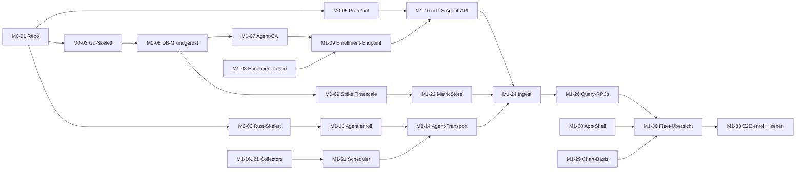

# SerMon – Implementierungsplan

> Grundlage: [KONZEPT.md](KONZEPT.md) (Roadmap §23) und [ADR 0001](adr/0001-zeitreihen-speicher-timescaledb.md).

**Planungsprinzip:** Der Plan wird von grob nach fein ausgearbeitet.

- **M0 und M1** sind bis auf Aufgabenebene detailliert.
- **M2–M5** sind als Epics beschrieben. Sie werden **vor Beginn des jeweiligen Meilensteins** in Aufgaben zerlegt, weil viele Details von den Ergebnissen davor abhängen, z. B. vom TimescaleDB-Spike.

| | |
|---|---|
| Stand | 2026-11-18 |
| Status | Entwurf |

---

## Inhalt

1. [Arbeitsweise](#1-arbeitsweise)
2. [Überblick und kritischer Pfad](#2-überblick-und-kritischer-pfad)
3. [M0 – Fundament](#3-m0--fundament)
4. [M1 – Metriken](#4-m1--metriken)
5. [M2 – Alerting](#5-m2--alerting)
6. [M3 – Logs und Live-Ansicht](#6-m3--logs-und-live-ansicht)
7. [M4 – Updates und Anomalien](#7-m4--updates-und-anomalien)
8. [M5 – Module und Ausbau](#8-m5--module-und-ausbau)
9. [v1.0 – Release](#9-v10--release)
10. [Risiken für den Plan](#10-risiken-für-den-plan)

---

## 1. Arbeitsweise

- **Eine Aufgabe ergibt einen Branch und einen PR.**
  - Branch-Name: `<id>-<kurztitel>`, z. B. `m1-07-agent-ca`
  - Commits nach Conventional Commits mit der Aufgaben-ID im Footer (`Refs: M1-07`)
- **TDD:** Jede Aufgabe beginnt mit den unter „Tests zuerst“ genannten Tests (Skill `sermon-tdd`).
- **Definition of Done** nach KONZEPT §19.4. Bei sicherheitsrelevanten Aufgaben (🔒) ist zusätzlich der Skill `sermon-security-review` Pflicht.
- **Aufwand** (grobe Richtwerte für eine Person mit Claude Code):

  | Größe | Aufwand |
  |---|---|
  | **S** | ≤ ½ Tag |
  | **M** | 1–2 Tage |
  | **L** | 3–5 Tage |

  Eine Aufgabe größer als L wird geteilt.
- **Stränge:** `X` Querschnitt · `A` Agent (Rust) · `S` Server (Go) · `W` Web (SvelteKit). Aufgaben verschiedener Stränge ohne gegenseitige Abhängigkeit können parallel laufen.
- **Status:** ☐ offen · ◐ in Arbeit · ☑ erledigt. Der Plan wird im selben PR aktualisiert, in dem die Aufgabe erledigt wird.
- **Verfeinerung:** Am Ende jedes Meilensteins gibt es ein kurzes Review mit diesen Schritten:
  - Ziel des Meilensteins erreicht?
  - Neue Erkenntnisse als ADRs festhalten
  - Den nächsten Meilenstein in Aufgaben zerlegen

---

## 2. Überblick und kritischer Pfad

| Meilenstein | Ziel / Demo | Grobe Dauer¹ |
|---|---|---|
| **M0 – Fundament** | Leere, aber lauffähige Skelette, grüne CI, Spike-Ergebnisse | 2–3 Wochen |
| **M1 – Metriken** | Node auf Debian/Ubuntu installieren, nach < 2 min Metriken in der UI sehen; Login mit TOTP; Mandantentrennung | 6–8 Wochen |
| **M2 – Alerting** | SSH-Brute-Force-Alert landet in ntfy/Slack; RHEL, Alpine, arm64 | 5–7 Wochen |
| **M3 – Logs und Live** | Fehlersuche ohne SSH: Logs, Live-Ansicht, Security-Dashboard; OIDC, Passkeys | 5–6 Wochen |
| **M4 – Updates und Anomalien** | Patch-Compliance auf einen Blick, Updates per Policy, Anomalie-Erkennung | 5–7 Wochen |
| **M5 – Module und Ausbau** | Integrationsmodule, eigene Dashboards, Kiosk-Modus | 5–7 Wochen |
| **v1.0** | Pentest, Doku, Performance-Nachweis | 2–3 Wochen |

¹ Grobe Schätzung für eine Person, keine Zusage. Wird nach M0 anhand der tatsächlichen Geschwindigkeit neu kalibriert.

### Kritischer Pfad bis „erster Node sichtbar“ (M1)

**Parallel möglich:**

- **Agent-Collectors** (M1-16 bis M1-21) brauchen nur M0-02 und Fixtures. Sie laufen völlig unabhängig vom Server.
- **Web-Shell und Charts** (M1-28, M1-29) können gegen gemockte Connect-Clients entwickelt werden.
- **Auth** (M1-02, M1-03) läuft unabhängig von der PKI.

---

## 3. M0 – Fundament

**Ziel:** Alle Skelette bauen, testen und linten in CI. Die Entwicklungsumgebung startet mit einem Befehl. Die beiden kritischen Annahmen (TimescaleDB-Last, journald über `journalctl`) und der musl-Build für arm64 sind durch Spikes geprüft.

### ☑ M0-01 – Repo-Grundgerüst · X · S
> Erledigt. Zusätzlich gibt es `just setup`, eine PR-Vorlage und einen Commit-Message-Check
> (`scripts/check-commit-msg.sh` mit Tests). GitHub Private Vulnerability Reporting ist seit dem 2026-11-19 aktiv;
> das Repo ist seitdem öffentlich.
- **Ziel:** Struktur nach KONZEPT §20; `LICENSE` (AGPL-3.0), `README.md`, `SECURITY.md` (Responsible Disclosure), `.editorconfig`, `.gitignore`, `CODEOWNERS`, `justfile` mit Ziel-Stubs (`dev`, `gen`, `lint`, `test`, `e2e`, `security`), `lefthook.yml` (Format, Secret-Scan; gitleaks, inzwischen betterleaks – ADR 0005).
- **Abhängig von:** –
- **Abnahme:** `just --list` zeigt alle Ziele; lefthook-Hooks greifen; GitHub Private Vulnerability Reporting ist aktiviert.

### ☑ M0-02 – Rust-Workspace und Cross-Build · A · M
> Erledigt: Workspace mit 10 Crates, Lints, `cargo-deny`; Cross-Build mit cargo-zigbuild ([ADR 0002](adr/0002-agent-build-toolchain.md)).
> Beide Architekturen sind statisch gebaut und im Container getestet (`just build-agent`, `just smoke-agent`).
> Abweichung: Unter echtem QEMU läuft arm64 erst in CI (M0-06). Lokal auf Apple Silicon läuft arm64 nativ und amd64 emuliert.

- **Ziel:** `agent/` als Workspace mit den Crates aus §20 (zunächst leer, inkl. `lib.rs`); `rustfmt.toml`, Clippy-Lints im Workspace-Manifest, `deny.toml` (Lizenzen kompatibel mit AGPL, Advisories).
  - **Spike:** musl-Builds für `x86_64` und `aarch64` mit `cargo-zigbuild` oder `cross`.
- **Abhängig von:** M0-01
- **Tests zuerst:** Smoke-Test `sermon-agent --version`.
- **Abnahme:** `just lint test` grün; statische Binaries für beide Architekturen (`file` meldet „statically linked“); arm64-Binary startet unter QEMU. Ergebnis als ADR (Build-Toolchain).

### ☑ M0-03 – Go-Server-Skelett · S · M
> Erledigt: Konfiguration aus Environment und `*_FILE` (alle Fehler gesammelt), `slog`, `/healthz` und `/readyz`
> (ohne Fehlerdetails), HTTP-Timeouts gegen Slowloris, Graceful Shutdown; Testabdeckung 92,5 %
> (`just test-server`, `just smoke-server`). Die im Konzept optionale YAML-Konfigurationsdatei kommt erst, wenn sie
> gebraucht wird.

- **Ziel:** `server/` mit `cmd/sermon-server`, Schichten `internal/{domain,app,adapters,transport}`; Konfiguration aus Environment und `*_FILE`; `slog` mit JSON-Ausgabe; `/healthz` und `/readyz`; Graceful Shutdown; `golangci-lint`-Konfiguration (inkl. gosec, errcheck, revive).
- **Abhängig von:** M0-01
- **Tests zuerst:** Config-Parsing (Tabellen-Tests, auch fehlende oder ungültige Werte); Health-Handler.
- **Abnahme:** `go test ./...` und Lint grün; Binary startet und beendet sich sauber per SIGTERM.

### ☑ M0-04 – Web-Skelett · W · M
> Erledigt mit **SvelteKit 3**, Vite 8 und Paraglide 3 (aktuelle Versionen der `sv`-CLI). Eine Startseite mit
> Sprachwahl DE/EN ist in die Server-Binary eingebettet; strikte CSP ohne `unsafe-inline`, alle Ressourcen lokal (D27,
> [ADR 0003](adr/0003-ui-auslieferung-und-csp.md)). 10 Unit-/Komponententests und 7 E2E-Tests gegen die echte Binary,
> inklusive Netzwerk-Wächter, CSP-Prüfung und axe. Bundle 54 KiB gzip.
> Abweichung: Das JS-Budget prüft ein eigenes Skript (`pnpm run check:size`) statt Lighthouse; Lighthouse kommt bei
> Bedarf mit der CI (M0-06).
- **Ziel:** SvelteKit 2 + Svelte 5, `adapter-static`, Tailwind 4, shadcn-svelte, Paraglide (de/en), ESLint, Prettier, `svelte-check`, Vitest, Playwright mit `@axe-core/playwright`. Build-Ergebnis wird per `embed.FS` in den Server eingebettet (`server/web/`).
- **Abhängig von:** M0-01, M0-03
- **Tests zuerst:** Komponenten-Test für eine Platzhalter-Seite; Playwright-Smoke-Test inkl. axe.
- **Abnahme:** `sermon-server` liefert die SPA aus; der Sprachwechsel DE/EN funktioniert; Lighthouse-Budget (< 200 KB JS gzip) in CI.

### ☑ M0-05 – Proto und Codegen · X · M
> Erledigt: `AgentService.Session` (umbenannt, weil `Connect` mit dem tonic-Konstruktor `connect()` kollidierte),
> `Hello`/`HostFacts`/`Heartbeat`/`Ack`, `SystemService.GetVersion`, protovalidate-Regeln mit Tests. Code-Generierung
> nur mit lokalen, gepinnten Plugins; der generierte Code ist committet ([ADR 0004](adr/0004-protokoll-codegenerierung.md)).
> Befehle: `just gen`, `just lint-proto`, `just breaking-proto`, `just check-gen`.
- **Ziel:** `proto/` mit `buf.yaml` und `buf.gen.yaml`. Ziele: Rust (`prost`/`tonic`), Go (`connect-go`), TS (`connect-es`). Erstes Schema `sermon.agent.v1.AgentService/Session` mit `Hello`, `Heartbeat`, `Ack`; dazu `sermon.web.v1.SystemService/GetVersion`; protovalidate eingebunden. `just gen`.
- **Abhängig von:** M0-02, M0-03, M0-04
- **Skill:** `sermon-proto-change`
- **Abnahme:** Generierter Code kompiliert in allen drei Sprachen; `buf lint` und `buf breaking` laufen in CI.

### ☑ M0-06 – CI und Security-Pipeline · X · M 🔒
> Erledigt: `ci.yml`, `security.yml` und `renovate.json` ([ADR 0006](adr/0006-ci-und-supply-chain.md)). Actions sind per
> SHA gepinnt (mindestens 3 Tage alt), Rechte minimal, `just lint-ci` (actionlint + zizmor) ist sauber. Der erste Lauf
> war grün bis auf den Job `web`: Im frischen Checkout fehlte der generierte Paraglide-Code für `svelte-check`.
> Behoben, indem `pnpm run check` ihn zuerst erzeugt. Native arm64-Runner, CodeQL und Scorecard laufen, weil das Repo
> öffentlich ist. Abweichungen: Der Secret-Scan nutzt betterleaks statt gitleaks (ADR 0005). Branch-Protection wird
> auf Wunsch des Product Owners erst nach der Implementierung eingerichtet (siehe v1.0). Den Test mit einer absichtlich
> verwundbaren Abhängigkeit ersetzt der reale Fall `minimatch` (GHSA-g3hv-75wg-m249), den die Audits erkannt haben.
- **Ziel:**
  - `ci.yml`: Lint- und Test-Matrix für Rust, Go und Web, Coverage-Upload
  - `security.yml`: CodeQL, gosec, govulncheck, cargo-audit, cargo-deny, `pnpm audit`, betterleaks, OpenSSF Scorecard
  - Alle Actions per SHA gepinnt, minimale `permissions:`
  - `renovate.json`, Branch-Protection für `main`
- **Abhängig von:** M0-02 bis M0-05
- **Abnahme:** PR mit absichtlich verwundbarer Abhängigkeit wird rot; Scorecard läuft.

### ☐ M0-07 – Entwicklungsumgebung · X · S
- **Ziel:** `deploy/dev/compose.yaml` mit `timescale/timescaledb` (pg17), Loki, Mailpit und ntfy; Devcontainer; `just dev` startet Infrastruktur, Server (Hot-Reload über `air`) und Vite-Dev-Server.
- **Abhängig von:** M0-03, M0-04
- **Abnahme:** Frischer Clone → `just dev` → UI unter `localhost` erreichbar in < 5 min.

### ☐ M0-08 – Datenbank-Grundgerüst · S · M 🔒
- **Ziel:**
  - `goose`-Migrationen und `sqlc`-Konfiguration
  - Testcontainers-Helfer für Integrationstests
  - Typ `tenant.Scope` (OrgID + erlaubte NodeGroups); jede Repository-Methode erwartet ihn
  - Erste Migration: `organizations`, `users`
  - RLS-Muster festlegen: `SET LOCAL sermon.org_id` pro Transaktion
- **Abhängig von:** M0-03, M0-07
- **Tests zuerst:** Integrationstest „Abfrage ohne gesetzte Org liefert nichts“ (RLS greift).
- **Abnahme:** `just test-integration` grün; RLS-Muster als ADR dokumentiert.

### ☐ M0-09 – Spike TimescaleDB-Ingest · S · L
- **Ziel:** Abnahmekriterien aus ADR 0001 messen.
  - Schema `series` und `metrics_raw` als Hypertable mit Kompression; Continuous Aggregates `metrics_1m` und `metrics_1h` mit Policies
  - Minimaler Lastgenerator (Go) für 50 Nodes × 400 Serien × 1 s
  - Schreiben per `COPY`
- **Abhängig von:** M0-08
- **Abnahme:** Messergebnisse in ADR 0001 nachgetragen (Ingest-Lag, CPU, Plattenbedarf, WAL-Volumen, Abfragelatenzen, RLS-Verhalten); Entscheidung bestätigt **oder** Fallback (5–10 s in der DB) festgelegt. Das Schema geht als Basis in M1-22.

### ☐ M0-10 – Spike journald über `journalctl` · A · S
- **Ziel:** Kindprozess `journalctl -o json -f --cursor-file`; Verhalten bei Neustart, Journal-Rotation und `--vacuum`; Ressourcenbedarf; Ausgabeformate auf Debian, Ubuntu und Rocky.
- **Abhängig von:** M0-02
- **Abnahme:** ADR (Log-Quelle journald) mit Ergebnis; erste echte Logzeilen als Fixtures unter `agent/fixtures/logs/`.

### ☐ M0-11 – ADRs zum Entscheidungslog · X · M
- **Ziel:** Kurze ADRs für die Entscheidungen D1–D26 aus KONZEPT §2, zusammengefasst, wo sinnvoll (z. B. eines für den gesamten Stack D1–D3 und D26). D13 ist bereits durch ADR 0001 abgedeckt.
- **Abhängig von:** –
- **Skill:** `sermon-adr`
- **Abnahme:** `docs/adr/` enthält eine Übersicht (`README.md`) mit allen ADRs und ihrem Status.

### ☐ M0-12 – Threat Model v1 · X · S 🔒
- **Ziel:** `docs/security/threat-model.md`: Datenfluss-Diagramm, Vertrauensgrenzen (Node ↔ Server, Browser ↔ Server, Server ↔ DB, Agent ↔ Helper), STRIDE-Tabelle aus KONZEPT §18.1, Liste der Assets.
- **Abhängig von:** –
- **Abnahme:** Jede Bedrohung hat eine Gegenmaßnahme mit Verweis auf eine geplante Aufgabe in diesem Plan.

**M0 fertig, wenn:** Alle Aufgaben ☑, CI auf `main` grün, Spikes bewertet und M1 bei Bedarf angepasst.

---

## 4. M1 – Metriken

**Ziel (Demo):** Auf einem frischen Debian- oder Ubuntu-Host (amd64) mit dem Einzeiler aus der UI installieren. Nach weniger als 2 min erscheint der Node in der Fleet-Übersicht mit CPU, Memory, Disk, Netzwerk, Load und Uptime. Die Detailansichten funktionieren. Ein User aus Org B sieht davon nichts.

### 4.1 Server: Domäne, Auth und Mandanten

#### ☐ M1-01 – Domänentypen und Autorisierung · S · M 🔒
- **Ziel:** Starke Typen (`OrgID`, `NodeID`, `UserID`, `GroupID`, `Role`); `authz.Policy` mit Verweigern als Standard und der Rollen-Matrix aus KONZEPT §7.
- **Abhängig von:** M0-03
- **Tests zuerst:** Tabellen-Test „Aktion × Rolle × Gruppen-Bindung → erlaubt/verboten“, inkl. `*`-Bindung und fremder Org.
- **Abnahme:** 100 % Abdeckung von `authz`.

#### ☐ M1-02 – Lokale Anmeldung und Sessions · S · L 🔒
- **Ziel:**
  - User mit Argon2id; Login und Logout
  - Serverseitige Sessions (`__Host-sermon_session`, Idle-Timeout 30 min, absolut 12 h)
  - Rate-Limit pro IP und pro Account
  - Middleware: Origin-Prüfung, Security-Header und CSP (KONZEPT §18.3), generische Fehler mit Korrelations-ID
- **Abhängig von:** M0-08, M1-01
- **Tests zuerst:** Passwort-Hashing und -Verifikation (Vergleich in konstanter Zeit), Session-Ablauf mit Fake-Clock, Rate-Limit, abgelehnte Requests ohne gültigen Origin, CSP-Header-Snapshot.
- **Abnahme:** Login-E2E-Test grün; Security-Review bestanden.

#### ☐ M1-03 – TOTP, Recovery-Codes und Step-up · S · M 🔒
- **Ziel:** TOTP einrichten (QR-Code) und verifizieren; Recovery-Codes gehasht speichern; Middleware `RequireStepUp(maxAge)`; 2FA-Pflicht pro Org.
- **Abhängig von:** M1-02, M1-06
- **Tests zuerst:** RFC-6238-Testvektoren, Zeitfenster und Schutz vor Replay, Recovery-Code nur einmal verwendbar.

#### ☐ M1-04 – Orgs, Gruppen, Mitgliedschaften und Rollen · S · L 🔒
- **Ziel:** CRUD-Use-Cases und Connect-RPCs für Orgs, Node-Gruppen, Mitgliedschaften und Rollen-Bindungen; RLS-Policies; Audit-Log-Tabelle (nur anfügen, Hash-Kette); Org-Switch.
  - **Testgerüst für Mandantentrennung:** ein generischer Test, der **jede** Web-RPC mit einem User aus fremder Org aufruft und `NotFound` oder `PermissionDenied` erwartet. Neue RPCs ohne Eintrag lassen den Test fehlschlagen.
- **Abhängig von:** M1-01, M1-02
- **Abnahme:** Testgerüst läuft in CI; Audit-Einträge für alle Änderungen an Rechten.

#### ☐ M1-05 – Erstinstallation `sermon-server init` · S · M 🔒
- **Ziel:** Erzeugt Master-Key, Agent-CA (über M1-07) und den ersten Superadmin über ein einmaliges Setup-Token (30 min gültig, wird im Log ausgegeben); Setup-Assistent in der UI.
- **Abhängig von:** M1-02, M1-06, M1-07
- **Tests zuerst:** `init` ist idempotent und verweigert eine zweite Ausführung; das Token verfällt.

#### ☐ M1-06 – Secrets-Box · S · S 🔒
- **Ziel:** `secrets.Box`: AES-256-GCM mit Key-ID im Ciphertext; Schlüsselrotation (alte Schlüssel weiter lesbar).
- **Abhängig von:** M0-03
- **Tests zuerst:** Verschlüsseln und Entschlüsseln im Kreis, manipulierter Ciphertext wird abgelehnt, Rotation.

### 4.2 Server: PKI und Enrollment

#### ☐ M1-07 – Interne Agent-CA · S · M 🔒
- **Ziel:** Root- und Intermediate-CA erzeugen (Schlüssel über M1-06 verschlüsselt gespeichert); CSR signieren mit SAN `spiffe://sermon/org/<org>/node/<node>`, Laufzeit 30 Tage; Serial-Verwaltung; Denylist.
- **Abhängig von:** M0-08, M1-06
- **Tests zuerst:** Ausgestellte Zertifikate validieren gegen die Kette; CSR mit fremden Extensions oder schwachem Schlüssel wird abgelehnt; Laufzeit stimmt; Serial auf der Denylist wird erkannt.

#### ☐ M1-08 – Enrollment-Token · S · M 🔒
- **Ziel:** Token erzeugen (256 Bit, Präfix `sme_`, nur SHA-256-Hash gespeichert, TTL, maximale Nutzungen, an Gruppe gebunden); RPC für Operator und Admin; Audit-Eintrag und Benachrichtigung bei Nutzung.
- **Abhängig von:** M1-04
- **Tests zuerst:** Ablauf, maximale Nutzungen, Vergleich in konstanter Zeit, Bindung an Org und Gruppe.

#### ☐ M1-09 – Enrollment-Endpoint · S · M 🔒
- **Ziel:** `EnrollmentService.Enroll(token, csr, host_facts)` über TLS (Server-Zertifikat, noch ohne Client-Zertifikat). Der Endpoint legt den Node an und signiert das Zertifikat; bei Konflikt der `machine-id` gibt es eine Rückfrage, keine automatische Übernahme. Rate-Limit.
- **Abhängig von:** M0-05, M1-07, M1-08
- **Skill:** `sermon-proto-change`
- **Tests zuerst:** Gültiger Ablauf; ungültiger, abgelaufener oder aufgebrauchter Token; manipulierte CSR; Grenzwerte der Host-Fakten (protovalidate).

#### ☐ M1-10 – Agent-API mit mTLS · S · M 🔒
- **Ziel:** Eigener Listener nur mit TLS 1.3; Client-Zertifikat Pflicht und gegen die Agent-CA validiert; Identität (Org, Node) aus der SAN in den Request-Kontext; Denylist bei jedem Verbindungsaufbau prüfen; Keepalive.
- **Abhängig von:** M1-07, M1-09
- **Tests zuerst:** Verbindung ohne, mit fremdem oder mit gesperrtem Zertifikat wird abgelehnt; Identität kommt aus dem Zertifikat, auch wenn der Payload eine andere enthält.

#### ☐ M1-11 – Zertifikatsrotation · S+A · M 🔒
- **Ziel:** Der Agent erneuert sein Zertifikat nach 2/3 der Laufzeit über den Stream (`RotateCertificate`, neues Schlüsselpaar); der Server stellt aus und sperrt das alte Zertifikat nach Übergangszeit.
- **Abhängig von:** M1-10, M1-14
- **Tests zuerst:** Rotationszeitpunkt mit Fake-Clock; Rotation während eines Verbindungsabbruchs; abgelaufenes Zertifikat führt zu Re-Enrollment-Hinweis.

### 4.3 Agent

#### ☐ M1-12 – Agent-Grundgerüst · A · M
- **Ziel:** CLI mit `clap` (`enroll`, `run`, `version`, `uninstall`); `agent.toml` lesen; Ports `Clock` und `ProcRoot`; `tracing`-Logs auf stdout (landet in journald); Signal-Handling.
- **Abhängig von:** M0-02
- **Tests zuerst:** Config-Parsing inkl. Fehlerfälle; CLI-Argumente.

#### ☐ M1-13 – `sermon-agent enroll` · A · M 🔒
- **Ziel:** P-256-Schlüssel lokal erzeugen (`rcgen`); CSR bauen; TLS-Verbindung mit System-CA **oder** gepinntem Fingerprint (`--ca-fingerprint`); Zertifikat, Schlüssel (`0600`) und CA-Kette speichern.
- **Abhängig von:** M0-05, M1-12 (Server-Gegenstück: M1-09)
- **Tests zuerst:** CSR-Inhalt; Abbruch bei falschem Fingerprint; Dateirechte; Verhalten bei vorhandenem Enrollment (Abbruch ohne `--force`).

#### ☐ M1-14 – Agent-Transport · A · L
- **Ziel:** `tonic`-Client mit `rustls` und mTLS; bidirektionaler Stream; Reconnect mit exponentiellem Backoff und Jitter; `Hello` mit Host-Fakten; `Heartbeat`; Senden aus dem WAL nach Sequenznummer und Löschen erst nach `Ack`; `Throttle` beachten; gzip/zstd.
- **Abhängig von:** M1-13, M1-15
- **Tests zuerst:** Gegen Mock-gRPC-Server: Reconnect, Ack-Handling, Throttle, keine Datenverluste bei Abbruch (Property-Test über zufällige Abbrüche).

#### ☐ M1-15 – WAL-Puffer · A · L
- **Ziel:** `sermon-buffer`: segmentierte Dateien, Sequenznummern, Kürzen nach Ack, Grenzen (24 h / 200 MB), FIFO-Verwerfen mit Zähler, konfigurierbare fsync-Strategie, Wiederherstellung nach Absturz (abgeschnittene Einträge erkennen).
- **Abhängig von:** M1-12
- **Tests zuerst:** Property-Tests (Reihenfolge bleibt erhalten, kein Eintrag doppelt nach Ack, Grenzen werden eingehalten); Absturz-Simulation mit abgeschnittener Datei; Fuzzing des Lese-Pfads.

#### ☐ M1-16 – Collector CPU und Load · A · M
- **Ziel:** `/proc/stat` und `/proc/loadavg`, PSI CPU; Raten und Anteile aus Deltas (Reset-Erkennung). Fixtures für Debian und Ubuntu (RHEL und Alpine folgen in M2).
- **Abhängig von:** M1-12
- **Skill:** `sermon-add-collector`
- **Tests zuerst:** Parser-Tests auf Fixtures; Property-Test „Modi summieren sich zu 1 ± ε“; Counter-Reset; Fuzz-Target.

#### ☐ M1-17 – Collector Memory · A · M
- **Ziel:** `/proc/meminfo`, `/proc/vmstat` (Swap-IO, Major-Faults, OOM-Kills), PSI Memory.
- **Abhängig von:** M1-12
- **Skill:** `sermon-add-collector`

#### ☐ M1-18 – Collector Disk-IO und Dateisysteme · A · M
- **Ziel:** `/proc/diskstats` (Durchsatz, IOPS, await, Auslastung, Queue); `statvfs` und `/proc/self/mountinfo` (Füllstand, Inodes, read-only); Filter für tmpfs, overlay, squashfs und loop; PSI IO.
- **Abhängig von:** M1-12
- **Skill:** `sermon-add-collector`

#### ☐ M1-19 – Collector Netzwerk · A · M
- **Ziel:** `/proc/net/dev` und `/sys/class/net` (Link, Speed), `/proc/net/snmp` und `/proc/net/netstat` (TCP-Zustände, Retransmits, Listen-Overflows), conntrack; Filter für `veth*`, `docker*` und `lo`.
- **Abhängig von:** M1-12
- **Skill:** `sermon-add-collector`

#### ☐ M1-20 – Collector System · A · S
- **Ziel:** Uptime, Boot-ID, Prozess- und Thread-Anzahl, Zombies, File-Descriptors (`file-nr`), Zeit-Synchronisation (`adjtimex`), Temperaturen (hwmon, optional).
- **Abhängig von:** M1-12
- **Skill:** `sermon-add-collector`

#### ☐ M1-21 – Collector-Scheduler und Cardinality-Schutz · A · M
- **Ziel:** Takt von 1 s mit Ausgleich von Verschiebungen; Batches bilden; Serien-Limit pro Node; Ressourcen-Budget messen (`criterion`-Benchmarks + Test „< 1 % CPU, < 30 MB RSS“ in CI auf dem E2E-Host).
- **Abhängig von:** M1-16 bis M1-20, M1-15
- **Tests zuerst:** Scheduler mit Fake-Clock (kein Takt geht verloren, Verschiebung wird ausgeglichen); Cardinality-Limit greift.

#### ☐ M1-34 – Agent-Simulator · A · M
- **Ziel:** `sermon-agent --simulate N`: N virtuelle Nodes mit realistischen Verläufen (Rauschen, Tagesmuster) für Entwicklung, E2E- und Lasttests. Ersetzt den Lastgenerator aus M0-09.
- **Abhängig von:** M1-14, M1-21

### 4.4 Server: Ingest und Speicher

#### ☐ M1-22 – `MetricStore` auf TimescaleDB · S · L 🔒
- **Ziel:**
  - Port `MetricStore` mit **Contract-Tests**; jede alternative Implementierung muss sie ebenfalls bestehen
  - Implementierung `adapters/timescale`: Migrationen aus M0-09 übernehmen
  - Serien-Register mit Cache
  - `COPY`-Writer mit 1-s-Batching
  - Abfragen sind immer an einen `tenant.Scope` gebunden
- **Abhängig von:** M0-09, M1-04
- **Tests zuerst:** Contract-Tests (Schreiben und Lesen, Zeitraum, Schrittweite, Auswahl der Aggregationsstufe, Mandantentrennung); Integrationstests mit Testcontainers.

#### ☐ M1-23 – Ringpuffer und Abfrage-Routing · S · M
- **Ziel:** Ringpuffer im Speicher (15 min, 1 s); Router wählt die Quelle nach Zeitraum und Schrittweite (Ring → `metrics_raw` → `metrics_1m` → `metrics_1h`).
- **Abhängig von:** M1-22
- **Tests zuerst:** Tabellen-Test „Zeitraum/Schritt → Quelle“; Ring-Überlauf; nebenläufiger Zugriff (`go test -race`).

#### ☐ M1-24 – Ingest-Pipeline und Node-Status · S · M 🔒
- **Ziel:** Stream-Handler: `Hello` (Host-Fakten aktualisieren), Validierung, Quotas und `Throttle`, Deduplizierung über `(node_id, seq)`, Weitergabe an `MetricStore` und Ring, `Ack`; Node-Status online/offline per Heartbeat (60 s); Self-Metriken (Ingest-Lag).
- **Abhängig von:** M1-10, M1-22, M1-23
- **Tests zuerst:** Duplikate werden verworfen; Quota löst Throttle aus; Node-Status-Übergänge mit Fake-Clock; Identität nur aus dem Kontext.

#### ☐ M1-25 – Metrik-Katalog · S · S
- **Ziel:** `domain/metrics/catalog.go`: Name, Einheit, Labels, Anzeigename-Key, Hilfe-Key, Standard-Aggregation. Quelle für UI und Validierung beim Ingest (unbekannte Metriken nur mit Prometheus-Präfix, ab M5).
- **Abhängig von:** M0-03

#### ☐ M1-26 – Abfrage-RPCs für die Web-UI · S · M 🔒
- **Ziel:** `MetricsService.Query` (typisiert: Metrik, Nodes, Zeitraum, Schritt, Aggregation); `FleetService.Summary`; `NodeService.Get` und `NodeService.Summary`; Server-Streaming für Live-Werte; Füllprognose (lineare Regression, für Kapazitäts-Badges).
- **Abhängig von:** M1-23, M1-24, M1-25
- **Skill:** `sermon-proto-change`
- **Tests zuerst:** Rollen- und Mandanten-Tests (Gerüst aus M1-04), Grenzen (maximaler Zeitraum, maximale Punktzahl), Regression auf synthetischen Reihen.

### 4.5 Paketierung

#### ☐ M1-27 – Install-Skript, systemd-Unit und Signaturen · X · M 🔒
- **Ziel:**
  - `packaging/install.sh` (POSIX-sh): Erkennung von Distro und Architektur, Download, **minisign-Prüfung gegen eingebetteten Public Key**, User `sermon` mit Gruppen, Unit installieren, `enroll`
  - Gehärtete systemd-Unit (KONZEPT §18.4)
  - Release-Signierung in CI vorbereiten
  - Server liefert `install.sh` und Binaries aus
- **Abhängig von:** M1-13, M0-06
- **Tests zuerst:** ShellCheck; `bats`-Tests (Distro-Erkennung, Abbruch bei falscher Signatur); E2E: `systemd-analyze security sermon-agent` < 2,0.

### 4.6 Web-UI

#### ☐ M1-28 – App-Shell und Auth-Seiten · W · L
- **Ziel:** Layout mit Navigation, Light/Dark/System, Org-Switcher, Platzhalter für die Command-Palette; Seiten für Login, TOTP und Setup-Assistent; Behandlung abgelaufener Sessions; Empty States.
- **Abhängig von:** M0-04, M0-05 (API zunächst gemockt)
- **Skill:** `sermon-ui-component`
- **Tests zuerst:** Komponenten-Tests für Formulare (Validierung, Fehlerzustände); E2E-Login inkl. axe.

#### ☐ M1-29 – Chart-Basis und Hilfe-Pipeline · W · M
- **Ziel:**
  - uPlot-Wrapper `TimeSeries.svelte`, globaler Zeitraum-Store, synchronisiertes Crosshair und Zoom
  - `$lib/format` (Bytes IEC, bit/s, %, Dauer; abhängig von der Locale)
  - `HelpTip` und Kontexthilfe-Panel
  - **Hilfe-Pipeline:** `docs/help/{de,en}` → JSON zur Build-Zeit + Lint für fehlende Übersetzungen
- **Abhängig von:** M0-04
- **Skill:** `sermon-ui-component`
- **Tests zuerst:** Formatierer (Tabellen-Tests DE/EN); Store-Synchronisation; Hilfe-Lint schlägt bei fehlender EN-Datei fehl.

#### ☐ M1-30 – Fleet-Übersicht · W · M
- **Ziel:** Kachel- und Tabellenansicht, Ampel, Mini-Anzeigen, Sparkline der letzten 15 min, Badges, Filter nach Gruppe, Tag und Suche, Kopfzeile mit Kennzahlen; Live-Aktualisierung.
- **Abhängig von:** M1-26, M1-28, M1-29
- **Skill:** `sermon-ui-component`

#### ☐ M1-31 – Node-Detail · W · L
- **Ziel:** Kopfzeile (Host-Fakten, Uptime, Agent-Version); Tabs CPU, Memory, Disk und Netzwerk gemäß KONZEPT §8.2 inkl. Füllprognose; ⓘ-Hilfe zu jeder Kennzahl (Hilfetexte DE und EN).
- **Abhängig von:** M1-26, M1-29
- **Skill:** `sermon-ui-component`

#### ☐ M1-32 – Admin-UI und Assistent „Node hinzufügen“ · W · M 🔒
- **Ziel:** Verwaltung von Usern, Gruppen und Rollen; „Node hinzufügen“: Gruppe wählen, Token erzeugen, Befehl kopieren (mit Link „Skript erst ansehen“), Live-Status („verbunden ✓ – erste Metriken ✓“).
- **Abhängig von:** M1-04, M1-08, M1-28
- **Skill:** `sermon-ui-component`

### 4.7 Querschnitt

#### ☐ M1-33 – E2E-Umgebung und Demo-Test · X · M
- **Ziel:** Compose-Umgebung für E2E mit Server und Agent-Containern (Debian 12/13, Ubuntu 24.04 LTS, mit systemd im Container); Playwright-Ablauf: Setup → Login → Token erzeugen → Agent im Container enrollen → Node mit Metriken sichtbar in < 2 min; Mandantentrennung end-to-end (User aus Org B).
- **Abhängig von:** M1-27, M1-30, M1-31, M1-32

#### ☐ M1-35 – Security-Review M1 · X · S 🔒
- **Ziel:** Skill `sermon-security-review` über alle M1-Änderungen; Threat Model aktualisieren; offene Findings als Aufgaben erfassen.
- **Abhängig von:** alle M1-Aufgaben

**M1 fertig, wenn:** Der Demo-Test M1-33 ist grün, Mandanten- und Rollen-Tests sind vollständig, das Ressourcen-Budget des Agents ist eingehalten, und die Security-Review hat keine offenen kritischen Findings.

---

## 5. M2 – Alerting

**Ziel (Demo):** Ein simulierter SSH-Brute-Force löst einen Alert aus, der in ntfy und Slack landet: mit Zeitstempel, User, IP und Port, Hysterese und Quittierung. Agent auf RHEL, Alpine und arm64.

| Epic | Inhalt | Skills | Abhängig von |
|---|---|---|---|
| **E2.1 Alert-Engine** | Zustandsautomat (OK → PENDING → WARNING/CRITICAL → RESOLVED), `for`, `clear`/Hysterese, Flapping, Quittieren, Instanzen pro Dimension; Auswertung alle 10 s; Leases in PG | `sermon-tdd` | M1-23 |
| **E2.2 Regeltypen und Standardregeln** | Typen `threshold`, `rate`, `state`, `absence`, `prediction`; YAML-Schema (aus Proto), Loader, Überschreiben pro Org; Standardregeln aus KONZEPT §12.3 (ohne Anomalie) | `sermon-add-alert-rule` | E2.1 |
| **E2.3 Security-Events** | Parser für `sshd`/`sshd-session`, sudo, useradd/userdel, OOM; Reboot über Boot-ID; Speicherung (partitioniert); Regeltyp `event` mit `groupBy` und Zeitfenster; Fleet-Korrelation (dieselbe IP auf mindestens 3 Nodes); „Login erfolgreich nach Fehlversuchen“ | `sermon-add-security-event`, `sermon-add-alert-rule` | M1-14, E2.1 |
| **E2.4 Notifier** | `safehttp` (SSRF-Schutz); Notifier-Framework mit Templates (i18n), Zustellprotokoll, „Test senden“; Kanäle in drei Wellen: ① E-Mail und Webhook (HMAC) ② Slack, Teams, Discord und Mattermost ③ Telegram, ntfy, Gotify und Pushover | `sermon-add-notifier`, `sermon-security-review` | M1-06 |
| **E2.5 Routing und Silences** | Notification-Policies (Label-Matcher), Gruppierung und Digest, Wiederholungsintervall, Eskalation, Silences, Wartungsfenster | `sermon-tdd` | E2.1, E2.4 |
| **E2.6 Alert-UI** | Seite mit aktiven Alerts, Historie und Timeline, Regel-Editor, YAML-Import und -Export mit Dry-Run-Diff, Kanal- und Policy-Verwaltung | `sermon-ui-component` | E2.1–E2.5 |
| **E2.7 Weitere Distros** | Fixtures und Tests für RHEL/Rocky/Alma, Fedora und Alpine; OpenRC-Script; Security-Events aus `/var/log/secure` und `/var/log/auth.log`; arm64 in der E2E-Nightly über QEMU; Pakete mit nfpm (`.deb`, `.rpm`, `.apk`) | `sermon-add-collector` | M1-27 |
| **E2.8 Zusätzliche Zustands-Collectors** | Fehlgeschlagene systemd-Units, Zeit-Synchronisation, RAID (`/proc/mdstat`), Dateisystem read-only, Interface down | `sermon-add-collector`, `sermon-add-alert-rule` | E2.2 |

---

## 6. M3 – Logs und Live-Ansicht

**Ziel (Demo):** Fehlersuche ohne SSH. Logs aller Nodes durchsuchen und live verfolgen, Prozessliste live ansehen, Security-Dashboard; Anmeldung per OIDC und Passkey.

| Epic | Inhalt | Skills | Abhängig von |
|---|---|---|---|
| **E3.1 Log-Pipeline im Agent** | journald-Quelle (aus Spike M0-10), Datei-Tailing (inotify, Rotation, Offsets), Normalisierung, **Redaction** (Standard- und Org-Regeln), Grenzen, WAL-Integration | `sermon-tdd`, `sermon-security-review` | M1-14, M0-10 |
| **E3.2 Loki-Adapter** | Push mit `X-Scope-OrgID`, sparsame Labels, LogQL-Builder aus typisierten Filtern (mit Escaping), Retention pro Tenant | `sermon-security-review` | E3.1 |
| **E3.3 Log-Explorer** | Filter, Volltext, Histogramm nach Severity, Live-Tail (Streaming), Kontextansicht, Absprung aus Charts und Alerts; Darstellung nur als Text | `sermon-ui-component` | E3.2 |
| **E3.4 Live-Ansicht (top)** | Prozess-Snapshots im Agent (redacted), `Start`/`StopLiveView`, Verteilung an mehrere Betrachter im Server, UI mit Sortierung, Filter, Baumansicht und Detail-Drawer | `sermon-proto-change`, `sermon-ui-component` | M1-14 |
| **E3.5 Security-Dashboard** | Zeitverläufe, Top-IPs und Top-User, Tabelle mit CSV-Export, GeoIP (lokale DB, optional), Tracking bekannter IPs | `sermon-ui-component` | E2.3 |
| **E3.6 OIDC/SSO** | Authorization Code + PKCE, Mapping von Gruppen-Claims, Just-in-Time-Provisioning | `sermon-security-review` | M1-04 |
| **E3.7 Passkeys und Step-up** | WebAuthn-Registrierung und -Login, Step-up für alle sensiblen Aktionen vervollständigen | `sermon-security-review` | M1-03 |

---

## 7. M4 – Updates und Anomalien

**Ziel (Demo):** Updates-Dashboard zeigt alle Nodes mit offenen Security-Updates. Eine Policy „security-auto“ mit Wartungsfenster aktualisiert eine Gruppe schrittweise inkl. Reboot. Ein künstlicher Lastsprung wird als Anomalie erkannt.

| Epic | Inhalt | Skills | Abhängig von |
|---|---|---|---|
| **E4.1 Root-Helper** | Eigene Binary und Unit, Unix-Socket mit `SO_PEERCRED`, festes Enum an Operationen, lokales Veto (`helper.toml`), Audit; < 1 000 LoC | `sermon-adr`, `sermon-security-review` | M1-12 |
| **E4.2 Update-Erfassung** | Adapter für apt, dnf und apk (Fixtures der Befehlsausgaben), Security-Kennzeichnung, Erkennung „Reboot nötig“, Auslöser (alle 6 h, nach dpkg-/rpm-Änderungen) | `sermon-tdd` | E4.1 |
| **E4.3 Policies und Rollout** | Update-Policy pro Gruppe, Wartungsfenster (Zeitzonen!), Orchestrator mit `maxParallel`, `stopOnFailure` und Health-Check, automatische Silences, manueller Anstoß mit Step-up | `sermon-tdd`, `sermon-security-review` | E4.2, E2.5 |
| **E4.4 Updates-Dashboard** | Compliance-Übersicht, Alter offener Security-Updates, Historie und Laufprotokolle; Standardregeln Updates und Reboot | `sermon-ui-component`, `sermon-add-alert-rule` | E4.2 |
| **E4.5 Self-Update und Paket-Repos** | Signierte apt-, rpm- und apk-Repos; Self-Update über den Helper mit Signaturprüfung und Rollback; Kanäle `stable` und `beta` | `sermon-security-review` | E4.1, E2.7 |
| **E4.6 Anomalie-Erkennung** | Worker auf `metrics_1m`; EWMA und saisonaler Median/MAD; Debounce; Anomalie-Rate pro Node; Lernphase 7 Tage; Benchmark für Precision und Recall in CI; Anomalie-Band in Charts, „Was war ungewöhnlich?“ | `sermon-tdd`, `sermon-ui-component` | M1-22 |
| **E4.7 Kapazität und Heatmap** | Kapazitäts-Dashboard (Füllprognosen, Trends), Fleet-Heatmap | `sermon-ui-component` | M1-26 |

---

## 8. M5 – Module und Ausbau

**Ziel (Demo):** In der UI wird „nginx erkannt – Modul aktivieren?“ vorgeschlagen; nach Aktivierung erscheinen nginx-Metriken und -Alerts. Ein eigenes Dashboard läuft im Kiosk-Modus.

| Epic | Inhalt | Skills | Abhängig von |
|---|---|---|---|
| **E5.1 Modul-Framework** | Trait `Module`, Isolation (Zeitbudget, Absturz eines Moduls ohne Folgen), Konfigurationsformular aus JSON-Schema, verschlüsselte Zustellung von Zugangsdaten, Discovery-Hinweise | `sermon-add-module`, `sermon-proto-change` | M1-14 |
| **E5.2 Module** | Wellen: ① HTTP- und TCP-Check, TLS-Zertifikate, systemd-Units ② nginx, Apache, PostgreSQL, MySQL/MariaDB, Redis ③ Docker (über cgroups, optional per Socket mit Warnung), SMART (neue Helper-Operation + ADR) ④ Prometheus-Scraper | `sermon-add-module`, `sermon-add-alert-rule` | E5.1 |
| **E5.3 Docker-Logs** | Container-Logs über das Docker-Modul | `sermon-security-review` | E5.2, E3.1 |
| **E5.4 Eigene Dashboards** | Grid-Editor, Widgets, Variablen, Teilen, JSON-Import und -Export | `sermon-ui-component` | M1-29 |
| **E5.5 Kiosk und Vergleich** | Kiosk-Token (schreibgeschützt, widerrufbar), Auto-Rotation; Vergleichsansicht für 2–4 Nodes | `sermon-ui-component`, `sermon-security-review` | E5.4 |

---

## 9. v1.0 – Release

| Aufgabe | Inhalt |
|---|---|
| Pentest / externes Review | Agent, Helper, Enrollment, Web-API, Mandantentrennung |
| Performance-Nachweis | 50 simulierte Nodes über 7 Tage, Ressourcen dokumentiert (§22) |
| Upgrade- und Restore-Tests | Datenbank der Vorversion → Migration → Tests; Backup → Restore in CI |
| Dokumentation | Admin-Doku (Installation, Backup, Upgrade, Härtung), User-Doku, Hilfetexte vollständig DE und EN, Vorlage für die DSGVO-Dokumentation |
| Release-Prozess | release-please, SBOM, cosign, SLSA-Provenance, signierte Repos, Release-Notes |
| Branch-Schutz | `main` nur noch per PR mit grüner CI (erforderliche Status-Checks), kein Force-Push; erst nach der Implementierung (Wunsch des Product Owners) |

---

## 10. Risiken für den Plan

| Risiko | Auswirkung | Gegenmaßnahme |
|---|---|---|
| Spike M0-09 verfehlt die Abnahmekriterien | Speicherkonzept muss angepasst werden | Fallback ist vorbereitet (5–10 s in der DB); die Schnittstelle `MetricStore` kapselt die Entscheidung |
| systemd in E2E-Containern ist umständlich | E2E-Tests sind instabil | Images mit systemd (z. B. `jrei/systemd-*`) oder VMs über QEMU bzw. Vagrant für die Nightly |
| Drei Sprachen (Rust, Go, TS) verlangsamen | Kontextwechsel kosten Zeit | Strangweise Blöcke bilden; Codegen aus Proto hält die Schnittstellen synchron |
| Umfang von M2/M3 wächst | Verzögerung | Kanal- und Modul-Wellen erlauben frühes Kürzen; Priorität: E-Mail, Webhook und ntfy vor den übrigen Kanälen |
| Security-Findings spät entdeckt | Nacharbeit | 🔒-Aufgaben mit Pflicht-Review, Security-Review am Ende jedes Meilensteins, Fuzzing nightly ab M0 |
