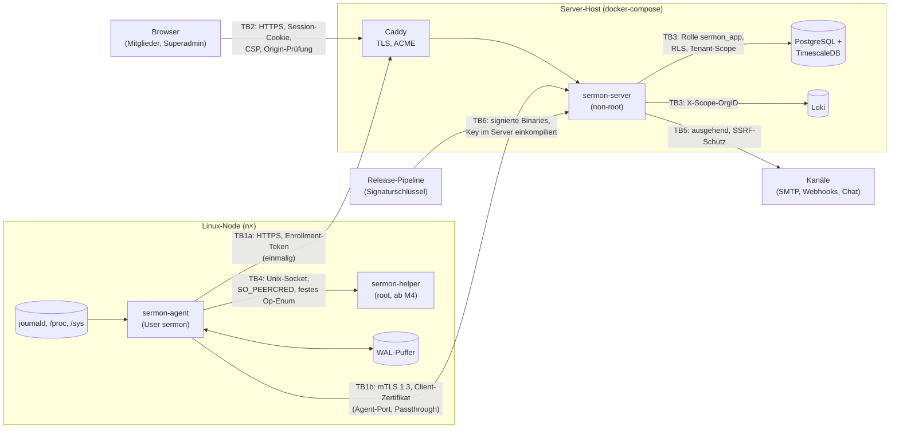

# Threat Model v1

- Stand: 2026-11-20 (nach M1-33)
- Bezug: KONZEPT.md §18; IMPLEMENTIERUNGSPLAN M0-12, M1-35; Skill `sermon-security-review`
- Pflege: Bei jeder Änderung an einer Vertrauensgrenze (Protokoll, Rechte, Helper-Operationen, Secrets, ausgehende
  Verbindungen) wird dieses Dokument im selben Commit angepasst. Das Security-Review M1-35 und jedes spätere Review
  gehen die Tabellen durch.

Legende Stand: ✓ umgesetzt und getestet · ◐ teilweise · ☐ geplant (Aufgabe genannt).

## 1. Assets

| Asset | Wo | Schutzbedarf |
|---|---|---|
| A1 Kontrolle über die Nodes (Updates, Reboot, künftig Self-Update) | Helper auf jedem Node, Befehle vom Server | sehr hoch: Kompromittierung des Servers darf nicht root auf allen Nodes bedeuten |
| A2 Agent-CA (Root- und Intermediate-Schlüssel) | PostgreSQL, versiegelt mit dem Master-Key | sehr hoch: erlaubt das Ausstellen beliebiger Node-Identitäten |
| A3 Master-Keys (`SERMON_MASTER_KEYS_FILE`) | Datei bzw. Docker-Secret auf dem Server-Host | sehr hoch: öffnen alle versiegelten Secrets |
| A4 Release-Signaturschlüssel | nur in der Release-Pipeline | sehr hoch: Installskript und Self-Update vertrauen nur ihm |
| A5 Node-Identitäten (Agent-Schlüssel, Zertifikate) | `/var/lib/sermon-agent` auf den Nodes | hoch |
| A6 Konten: Passwort-Hashes, TOTP-Seeds, Recovery-Codes, Sessions | PostgreSQL | hoch |
| A7 Mandantendaten: Metriken, Logs, Security-Events, Inventar | PostgreSQL/TimescaleDB, Loki | hoch, personenbezogen (IP-Adressen, Usernamen, §18.7) |
| A8 Audit-Logs (Org und Instanz) | PostgreSQL, Hash-Kette | hoch (Nachvollziehbarkeit) |
| A9 Einmal-Geheimnisse: Setup-Token, Enrollment-Token, Einladungslinks | nur als Hash in PostgreSQL | mittel bis hoch (kurzlebig) |
| A10 Zugangsdaten für Kanäle und Module | PostgreSQL, versiegelt | hoch (Zugang zu Drittsystemen) |
| A11 Verfügbarkeit des Servers | Server, Datenbank | mittel (Monitoring fällt aus, Agents puffern 24 h) |

## 2. Akteure

| Akteur | Vertrauen |
|---|---|
| Superadmin | verwaltet Instanz und Organisationen, sieht keine Mandantendaten |
| Mitglieder (Viewer, Operator, Admin) | nur innerhalb ihrer Organisation und Gruppen |
| Agent auf einem Node | vertraut für die eigenen Daten seines Nodes, sonst nichts |
| Root-Helper | lokal vertraut, nimmt nur feste Operationen vom Agent an |
| Angreifer im Internet | erreicht Web-Port und Agent-Port |
| Angreifer mit Konto in Org B | gültige Session, will an Daten von Org A |
| Angreifer mit root auf einem Node | besitzt dessen Identität, will an andere Nodes, Orgs oder den Server |
| Angreifer mit Kontrolle über den Server | will root auf den Nodes |

## 3. Datenfluss und Vertrauensgrenzen

| Grenze | Zwischen | Was sie schützt |
|---|---|---|
| TB1 | Node ↔ Server (a: Enrollment per HTTPS, b: Agent-Stream per mTLS) | Identität der Nodes, Integrität der Daten und Befehle |
| TB2 | Browser ↔ Server | Konten, Sessions, Mandantendaten |
| TB3 | Server ↔ Datenbank/Loki | Mandantentrennung als zweite Linie, Secrets at rest |
| TB4 | Agent ↔ Helper | root auf dem Node |
| TB5 | Server ↔ externe Ziele (Kanäle, Webhooks, Versionsprüfung) | internes Netz (SSRF), Zugangsdaten |
| TB6 | Release ↔ Server ↔ Node (Lieferkette der Agent-Binaries) | Integrität des Codes auf den Nodes |

## 4. Bedrohungen (STRIDE) nach Grenze

### TB1 – Node ↔ Server

| # | STRIDE | Bedrohung | Gegenmaßnahme | Aufgabe | Stand |
|---|---|---|---|---|---|
| T1 | S | Fremder Agent gibt sich als Node aus | mTLS mit Client-Zertifikat der Agent-CA; Org und Node nur aus dem Zertifikat (SPIFFE-URI), nie aus Nachrichten | M1-07, M1-10 | ✓ |
| T2 | S | Gestohlener Enrollment-Token | 256 Bit, nur Hash, TTL, `max_uses`, gruppengebunden, Widerruf, Rate-Limit am Endpunkt, Audit | M1-08, M1-09 | ✓ |
| T3 | S | Gestohlener Enrollment-Token: Benachrichtigung bei Nutzung | Event „Token benutzt“ an die Admins | E2.3, E2.4 | ☐ |
| T4 | S | Gestohlener Agent-Schlüssel wird parallel genutzt | nur eine Session pro Node: dieselbe IP gilt als Reconnect und ersetzt die alte Session, eine zweite IP sperrt die Identität sofort (Log `security: second session`); Rotation auf Abruf mit Sperre des alten Zertifikats | M1-10, M1-11 | ◐ (Security-Event und Alert: E2.3) |
| T5 | S | Klon eines Nodes (gleiche `machine-id`) | `ALREADY_EXISTS`, Token bleibt unverbraucht | M1-09 | ✓ (Übernahme in der UI offen, M1-32) |
| T6 | T | MITM beim Enrollment | System-CAs oder gepinnter Fingerprint (`--ca-fingerprint`), ausgestelltes Zertifikat wird gegen den Trust-Anker geprüft | M1-13 (ADR 0010) | ✓ |
| T7 | T | MITM auf dem Agent-Stream, Downgrade | TLS 1.3 only, eigene Agent-CA, Server-Zertifikat mit Rotation, keine Fallback-Optionen | M1-10, M1-11b | ✓ |
| T8 | I | Kompromittierter Node liest Daten anderer Nodes/Orgs | der Stream liefert nur Befehle für den eigenen Node; Scope aus dem Zertifikat | M1-10, M1-24 | ✓ |
| T9 | D | Ein Agent flutet den Server | Batch-Größe, Sample-Rate pro Node, Serien-Limit (2 000), Throttle, Plausibilität der Zeitstempel, Agent-seitiges Serien-Limit | M1-21, M1-24 | ✓ |
| T10 | D | Viele Enrollment-Versuche | Rate-Limit pro Client-IP, Größenlimits | M1-09 | ✓ |
| T11 | R | Node bestreitet gelieferte Daten | Identität aus dem Zertifikat, Batch-Seq, Audit für Enrollment und Rotation | M1-09, M1-24 | ✓ |
| T12 | E | Befehl vom Server führt Code auf dem Node aus | Protokoll kennt nur typisierte Befehle, kein generisches „exec“; unbekannte Befehle → `unsupported` | M0-05, M1-14 | ✓ |

### TB2 – Browser ↔ Server

| # | STRIDE | Bedrohung | Gegenmaßnahme | Aufgabe | Stand |
|---|---|---|---|---|---|
| T13 | S | Brute-Force auf Passwörter | Argon2id, Kontosperre mit Backoff, IP-Rate-Limit, einheitliche Fehlermeldung | M1-02 | ✓ |
| T14 | S | Phishing/gestohlenes Passwort | TOTP mit Recovery-Codes, Org-Pflicht zur 2FA; Code-Versuche zählen zur selben Sperre | M1-03 | ✓ |
| T15 | S | Phishing-resistente Anmeldung | Passkeys/WebAuthn, OIDC mit PKCE | E3.6, E3.7 | ☐ |
| T16 | S | Session-Diebstahl, Session-Fixation | `__Host-`-Cookie (Secure, HttpOnly, SameSite=Lax), serverseitige Sessions, neues Cookie nach 2FA und Org-Wechsel, Idle- und Absolut-Timeout | M1-02, M1-03 | ✓ |
| T17 | S | Gekaperte Session ändert Rechte oder richtet eigene 2FA ein | Step-up (15 min) für Rechteänderungen, Einladungen, Schlüsselrotation, 2FA-Einrichtung; Fehlversuche zählen zur Sperre | M1-02, M1-03 | ✓ |
| T18 | T | CSRF | SameSite, Connect-Requests mit `application/proto|json`, Origin-Allowlist im Server | M1-02 | ✓ |
| T19 | T | XSS über Hostnamen, Logzeilen, Prozessnamen | kein `{@html}` mit API-Daten, strikte CSP ohne `unsafe-inline`, nur eigene Origin; QR-Code als SVG aus der Matrix | M0-04, M1-28 ff. (ADR 0003) | ✓ |
| T20 | T | Injection in SQL und LogQL | sqlc (parametrisiert); LogQL nur aus typisierten Bausteinen mit Escaping | M0-08, E3.2 | ✓ / ☐ (LogQL) |
| T21 | I | User aus Org B sieht Daten von Org A | Tenant-Scope in jeder Repository-Methode, RLS als zweite Linie, Isolationstest für **jede** RPC (CI erzwingt Abdeckung), fremde Objekte = `NOT_FOUND`; End-to-End im Browser gegen den echten Stack | M1-04, M1-22, M1-26, M1-33 | ✓ |
| T22 | I | Viewer sieht Logs/Security-Events trotz Verbot | Rollen-Matrix mit `viewerLogs`-Schalter, Matrix-Test | M1-01, E3.3 | ✓ / ☐ (UI) |
| T23 | I | User-Enumeration über Login, Einladung, Passwort-Reset | gleiche Antworten und Laufzeiten (Dummy-Hash), Einladungen ohne Hinweis auf bestehende Konten | M1-02, M1-04 | ✓ |
| T24 | I | Geheimnisse in Antworten, Logs oder URLs | Tokens nur einmal angezeigt, nur Hash gespeichert; Einladungs-Token im URL-Fragment; keine Stacktraces, Korrelations-ID | M1-04, M1-08, M1-32 | ✓ |
| T25 | I | Server-Metriken ohne Anmeldung verraten Mandanten | `/metrics` auf eigenem Listener, standardmäßig aus, nur Instanzwerte ohne Labels von Orgs/Nodes; Warnung bei nicht-Loopback | M1-24 (ADR 0011) | ✓ |
| T26 | D | Viele Live-Streams oder große Abfragen | max. 32 Streams pro Session, 1 000 pro Instanz, Re-Check alle 30 s; Begrenzung von Zeitraum, Nodes und Punkten pro Abfrage | M1-26 | ✓ |
| T27 | D | Login-Flut | Rate-Limits pro IP, progressive Sperre | M1-02 | ✓ |
| T28 | R | „Wer hat die Rolle vergeben?“ | Audit-Log pro Org mit Hash-Kette, `sermon_app` nur INSERT/SELECT; instanzweites Audit-Log für CA-Aktionen | M1-04, M1-11b | ✓ |
| T29 | E | Viewer löst Operator-Aktion aus | zentrale Policy, deny by default, Rollen-Matrix-Test (jede Aktion × jede Rolle) | M1-01 | ✓ |
| T30 | E | Admin einer Gruppe erweitert eigene Rechte | Rechteverwaltung nur für Admins aller Gruppen, letzter Admin nicht entfernbar, Step-up | M1-04 | ✓ |
| T31 | S | Setup-Token aus dem Log missbraucht | 30 min, einmalig, nur Hash; `init` verweigert erneute Ausführung | M1-05 | ✓ |

### TB3 – Server ↔ Datenbank und Loki

| # | STRIDE | Bedrohung | Gegenmaßnahme | Aufgabe | Stand |
|---|---|---|---|---|---|
| T32 | I | Fehler in der Anwendung umgeht den Tenant-Scope | RLS mit `FORCE`, Server-Rolle ohne `BYPASSRLS`, Server verweigert privilegierte Rollen; Metriken nur über `SECURITY DEFINER`-Funktion mit RLS-geschützter `series` | M0-08, M1-22 (ADR 0007) | ✓ |
| T33 | I | DB-Dump verrät Secrets | Secrets-Box (AES-256-GCM, Key-ID, Associated Data mit Kontext, z. B. `totp:<user>`), Passwörter Argon2id, Tokens/Codes nur als Hash | M1-06, M1-03 | ✓ |
| T34 | T | Manipulation des Audit-Logs | Hash-Kette, kein UPDATE/DELETE für `sermon_app`, Prüffunktion | M1-04, M1-11b | ✓ |
| T35 | I | Logs einer Org landen bei einer anderen | Loki mit `auth_enabled`, `X-Scope-OrgID` aus dem Scope, nie aus Eingaben | E3.2 | ☐ |
| T36 | I | Telemetrie von TimescaleDB oder Loki | in jeder Compose-Datei abgeschaltet, Test | M0-07 | ✓ |
| T37 | D | Schreiblast füllt WAL/Platte | 10 s in der DB, Kompression, Retention-Policies, Self-Monitoring | M0-09, M1-22 | ◐ (Self-Monitoring-Alerts: M2) |

### TB4 – Agent ↔ Helper (ab M4)

| # | STRIDE | Bedrohung | Gegenmaßnahme | Aufgabe | Stand |
|---|---|---|---|---|---|
| T38 | E | Kompromittierter Agent wird root | Agent ohne root und Capabilities, gehärtete Unit (Score 1,6), Helper nur mit festem Op-Enum | M1-27, E4.1 | ✓ / ☐ (Helper) |
| T54 | E | Kompromittierter Agent (User `sermon`) lässt root beim erneuten Enrollment über getauschte Symlinks Dateien schreiben und übereignen | `install.sh` startet `enroll` als `sermon` (`runuser`); der Agent verweigert als root jedes Schreiben in Verzeichnisse anderer User oder mit Schreibrecht für Gruppe/andere; kein `lchown` mehr | M1-35 | ✓ |
| T39 | S | Anderer lokaler Prozess spricht den Helper an | Socket `root:sermon 0660`, `SO_PEERCRED` prüft UID `sermon` | E4.1 | ☐ |
| T40 | E | Kompromittierter Server lässt Nodes beliebigen Code ausführen | keine freien Kommandos; Updates nur aus Distro-signierten Quellen; lokales Veto (`allow_remote_updates`, `allow_remote_reboot`); Self-Update nur mit Signatur des Release-Keys | E4.1, E4.3, E4.5 | ☐ |
| T41 | R | „Wer hat das Update ausgelöst?“ | Helper protokolliert lokal (journald) und zentral (Audit) | E4.1 | ☐ |
| T42 | I | Agent liest fremde Daten über Logs/Prozesse | nur Lesen, Redaction vor dem Versand (Kommandozeilen, Logs), Live-Ansicht nur lesend | E3.1, E3.4 | ☐ |

### TB5 – Server ↔ externe Ziele

| # | STRIDE | Bedrohung | Gegenmaßnahme | Aufgabe | Stand |
|---|---|---|---|---|---|
| T43 | I/E | SSRF über Webhook-URL (Metadata-Dienst, internes Netz) | `safehttp`: private, Loopback-, Link-local- und Metadata-Adressen blockiert, IP gepinnt (DNS-Rebinding), Redirects begrenzt, Timeouts; Allowlist durch den Superadmin | E2.4 | ☐ |
| T44 | S | Gefälschte Webhooks beim Empfänger | HMAC-Signatur mit Zeitstempel | E2.4 | ☐ |
| T45 | I | Mail-Zugangsdaten im Klartext übertragen | SMTP mit TLS-Pflicht (konfigurierbar) | E2.4 | ☐ |
| T46 | I | „Phone-Home“ | keine Telemetrie, Versionsprüfung abschaltbar | M0-07, v1.0 | ◐ |
| T47 | I | Prometheus-Scraper oder Module als SSRF | Scraper nur localhost/Allowlist, Serien-Limit; Modul-Zugangsdaten nur im Speicher des Agents | E5.1, E5.2 | ☐ |

### TB6 – Lieferkette der Agent-Binaries

| # | STRIDE | Bedrohung | Gegenmaßnahme | Aufgabe | Stand |
|---|---|---|---|---|---|
| T48 | T | Manipulierte Binary auf dem Download-Weg oder Mirror | minisign-Signatur, Prüfung im Skript vor jeder Installation (minisign oder OpenSSL), kein Schalter zum Abschalten; End-to-End-Gegenprobe mit manipulierter Binary auf dem Server | M1-27 (ADR 0012), M1-33 | ✓ |
| T49 | T | Server liefert Binaries aus einem fremden Verzeichnis (Path-Traversal, Symlink) | nur feste Dateinamen, Lesen über `os.Root` | M1-27 | ✓ |
| T50 | T | Kompromittierter Server liefert ein manipuliertes `install.sh` | Grenze von `curl | sh` (O5): „Skript erst ansehen“, Paket-Repo als Alternative, Signaturschlüssel nicht auf dem Server | M1-27, E4.5 | ◐ |
| T51 | T | Release-Schlüssel kompromittiert oder fehlt | Schlüssel nur in der Release-Pipeline; ohne einkompilierten Key verweigert das Skript die Installation | v1.0 (Release-Prozess) | ☐ (Schlüssel erzeugen, `release.yml`) |
| T52 | T | Kompromittierte Abhängigkeit oder Action | exakt gepinnte Versionen, Mindestalter 3 Tage, Actions per SHA, cargo-deny, govulncheck, pnpm audit, zizmor, Secret-Scan | M0-06 (ADR 0005, 0006) | ✓ |
| T53 | T | Fehlerhafte Parser für untrusted Input auf dem Node | cargo-fuzz für `/proc`-Parser und WAL-Recovery, proptest; Fuzzing der Log-Parser mit E2.3/E3.1 | M1-15, E2.3 | ◐ |

## 5. Restrisiken und bewusste Entscheidungen

- **`curl | sh`** (T50): Wer den Server kontrolliert, kann ein anderes Skript ausliefern. Akzeptiert für den
  Einzeiler; abgemildert durch Signaturprüfung, Ansicht vor der Ausführung und das Paket-Repo (O5).
- **Docker-Socket** ist root-äquivalent: Modul standardmäßig aus, Warnung, cgroup-Variante bevorzugt (O4).
- **Prozessdetails** ohne `CAP_SYS_PTRACE` bleiben unvollständig (O3).
- **Kein HA** in v1 (O11): Ausfall des Servers kostet bis zu 24 h keine Daten (WAL), aber Alerts.
- **Superadmin** ist instanzweit mächtig (CA-Wechsel, Orgs), sieht aber keine Mandantendaten; alle Aktionen im
  instanzweiten Audit-Log.

## 6. Offene Punkte für das Security-Review M1-35

- T3, T4: Benachrichtigung bei Token-Nutzung und zweiter Session hängt an Security-Events und Kanälen (M2).
- T5: Übernahme eines Nodes bei `machine-id`-Konflikt und „Sperre aufheben“ in der UI (M1-32 offen).
- T51: Release-Schlüssel erzeugen, als Secret ablegen, `packaging/release.pub` committen, `release.yml` (Product Owner).
- T37: Self-Monitoring-Alerts für Ingest-Lag und Plattenfüllstand (M2).
- Abweichung von der Checkliste (`sermon-security-review` §2, „Tokens ≥ 256 Bit“): Recovery-Codes haben 80 Bit
  (M1-03). Online begrenzt die gemeinsame Kontosperre die Versuche, offline sind 2^80 SHA-256-Versuche nicht machbar;
  dafür bleiben die Codes abschreibbar. Im Review bestätigen oder auf 128 Bit erhöhen.
- Kommandozeilen im Journal (`_CMDLINE`) enthalten Geheimnisse (Spike M0-10); die Log-Pipeline übernimmt das Feld nicht
  (ADR 0013, E3.1).
