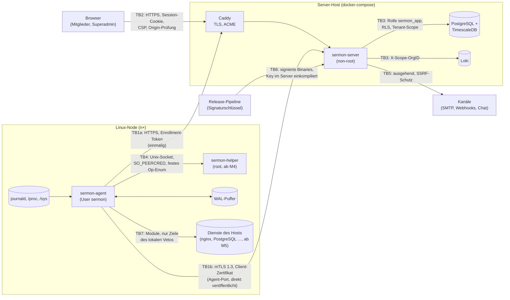

# Threat Model v1

- Stand: 2026-11-22 (nach M2-26)
- Bezug: KONZEPT.md §18; IMPLEMENTIERUNGSPLAN M0-12, M1-35; Skill `sermon-security-review`
- Pflege: Bei jeder Änderung an einer Vertrauensgrenze (Protokoll, Rechte, Helper-Operationen, Secrets, ausgehende
  Verbindungen) wird dieses Dokument im selben Commit angepasst. Das Security-Review M1-35 und jedes spätere Review
  gehen die Tabellen durch.

Legende Stand: ✓ umgesetzt und getestet · ◐ teilweise · ☐ geplant (Aufgabe genannt).

## 1. Assets

| Asset | Wo | Schutzbedarf |
|---|---|---|
| A1 Kontrolle über die Nodes (Updates, Reboot, künftig Self-Update) | Helper auf jedem Node, Befehle vom Server | sehr hoch: Kompromittierung des Servers darf nicht root auf allen Nodes bedeuten |
| A2 Agent-CA (Root- und Intermediate-Schlüssel) | PostgreSQL, versiegelt mit dem Master-Key | sehr hoch: erlaubt das Ausstellen beliebiger Node-Identitäten |
| A3 Master-Keys (`SERMON_MASTER_KEYS_FILE`) | Datei bzw. Docker-Secret auf dem Server-Host | sehr hoch: öffnen alle versiegelten Secrets |
| A4 Release-Signaturschlüssel | nur in der Release-Pipeline | sehr hoch: Installskript und Self-Update vertrauen nur ihm; der Helper nimmt zwei Schlüssel für die Rotation (ADR 0036) und erneuert sich seit M4-31 mit dem Agent: Rotation und Widerruf erreichen auch Skript-Installationen; die Paket-Repos haben eigene Schlüssel |
| A12 Paket-Signaturschlüssel (OpenPGP für .deb/.rpm, RSA für .apk) | nur in der Release-Pipeline | hoch: Paketmanager vertrauen ihnen, sobald ein Admin den öffentlichen Schlüssel importiert |
| A5 Node-Identitäten (Agent-Schlüssel, Zertifikate) | `/var/lib/sermon-agent` auf den Nodes | hoch |
| A6 Konten: Passwort-Hashes, TOTP-Seeds, Recovery-Codes, Sessions | PostgreSQL | hoch |
| A7 Mandantendaten: Metriken, Logs, Security-Events, Inventar | PostgreSQL/TimescaleDB, Loki | hoch, personenbezogen (IP-Adressen, Usernamen, §18.7) |
| A8 Audit-Logs (Org und Instanz) | PostgreSQL, Hash-Kette | hoch (Nachvollziehbarkeit) |
| A9 Einmal-Geheimnisse: Setup-Token, Enrollment-Token, Einladungslinks | nur als Hash in PostgreSQL | mittel bis hoch (kurzlebig) |
| A10 Zugangsdaten für Kanäle und Module | PostgreSQL, versiegelt; Modul-Zugangsdaten zusätzlich im Speicher des Agents (ADR 0039) | hoch (Zugang zu Drittsystemen) |
| A11 Verfügbarkeit des Servers | Server, Datenbank | mittel (Monitoring fällt aus, Agents puffern 24 h) |

## 2. Akteure

| Akteur | Vertrauen |
|---|---|
| Superadmin | verwaltet Instanz und Organisationen, sieht keine Mandantendaten |
| Mitglieder (Viewer, Operator, Admin) | nur innerhalb ihrer Organisation und Gruppen |
| Agent auf einem Node | vertraut für die eigenen Daten seines Nodes, sonst nichts |
| Root-Helper | lokal vertraut, nimmt nur feste Operationen vom Agent an |
| Angreifer im Internet | erreicht Web-Port und Agent-Port |
| Angreifer mit Konto in Org B | gültige Session, will an Daten von Org A |
| Angreifer mit root auf einem Node | besitzt dessen Identität, will an andere Nodes, Orgs oder den Server |
| Angreifer mit Kontrolle über den Server | will root auf den Nodes |

## 3. Datenfluss und Vertrauensgrenzen

| Grenze | Zwischen | Was sie schützt |
|---|---|---|
| TB1 | Node ↔ Server (a: Enrollment per HTTPS, b: Agent-Stream per mTLS) | Identität der Nodes, Integrität der Daten und Befehle |
| TB2 | Browser ↔ Server | Konten, Sessions, Mandantendaten |
| TB3 | Server ↔ Datenbank/Loki | Mandantentrennung als zweite Linie, Secrets at rest |
| TB4 | Agent ↔ Helper | root auf dem Node |
| TB5 | Server ↔ externe Ziele (Kanäle, Webhooks, Versionsprüfung) | internes Netz (SSRF), Zugangsdaten |
| TB6 | Release ↔ Server ↔ Node (Lieferkette der Agent-Binaries) | Integrität des Codes auf den Nodes |
| TB7 | Agent ↔ Dienste des Hosts (Module, ab M5) | internes Netz des Hosts, Zugangsdaten der Dienste, Budget des Agents |
| TB8 | Kiosk-Anzeige ↔ Server (ab M5) | Daten eines geteilten Dashboards ohne Session, Kiosk-Token |

## 4. Bedrohungen (STRIDE) nach Grenze

### TB1 – Node ↔ Server

| # | STRIDE | Bedrohung | Gegenmaßnahme | Aufgabe | Stand |
|---|---|---|---|---|---|
| T1 | S | Fremder Agent gibt sich als Node aus | mTLS mit Client-Zertifikat der Agent-CA; Org und Node nur aus dem Zertifikat (SPIFFE-URI), nie aus Nachrichten | M1-07, M1-10 | ✓ |
| T2 | S | Gestohlener Enrollment-Token | 256 Bit, nur Hash, TTL, `max_uses`, gruppengebunden, Widerruf, Rate-Limit am Endpunkt, Audit | M1-08, M1-09 | ✓ |
| T3 | S | Gestohlener Enrollment-Token: Benachrichtigung bei Nutzung | Security-Event `enrollment.token_used` (mit Absenderadresse) in der Transaktion des Enrollments, Standardregel an die Kanäle der Org (ADR 0027) | M2-24 | ✓ |
| T4 | S | Gestohlener Agent-Schlüssel wird parallel genutzt | nur eine Session pro Node: dieselbe IP gilt als Reconnect und ersetzt die alte Session, eine zweite IP sperrt die Identität sofort (Log `security: second session`); Rotation auf Abruf mit Sperre des alten Zertifikats; nach jeder Rotation endet die Session, das neue Zertifikat gilt als Nachfolger (keine falsche Sperre); „nur widerrufen“ ohne Rotation, wenn der verbundene Agent der Dieb sein könnte ; Sperre aufheben in der UI nur für Operatoren der Gruppe mit Step-up und Audit, mit Hinweis, bei Diebstahlverdacht zu widerrufen (M2-23); „Sperre aufheben“ gibt dem Agent das aktuelle Zertifikat zurück, ältere aus Rotationen und vorher widerrufene bleiben widerrufen | M1-10, M1-11, M1-38, M2-23, M2-39 | ✓ (Security-Events `node.locked`, `node.rotation_new_ip` mit Standardregeln, M2-24) |
| T56 | S | Widerrufenes oder abgelaufenes Zertifikat hält einen offenen Stream weiter | jede Session prüft ihr Zertifikat jede Minute nach (Widerruf, Ende der Schonfrist nach Rotation, Ablauf) und endet mit `PERMISSION_DENIED` | M1-35 | ✓ |
| T58 | I | Enrollment-Token im Klartext an einen falschen Server oder in der Prozessliste | `http://` nur zu Loopback-IPs (keine Namen); `install.sh` übernimmt keine `agent.toml`, die auf einen anderen Server zeigt (außer `--force`); Token nur in der Umgebung (`export` + `sudo --preserve-env`) oder per `--token-file`, `--token` warnt; die Paket-Konfiguration nennt denselben Weg, die Redaction erkennt Namen wie `SERMON_ENROLLMENT_TOKEN=` in sudo-Zeilen (M2-28) | M1-35, M1-37, M2-28 | ✓ |
| T59 | S | Simulator in der Release-Binary meldet mit einem Token viele Identitäten an | `simulate` nur mit Cargo-Feature, Release-Builds ohne | M1-35 | ✓ |
| T60 | S | Gefälschtes Agent-Zertifikat mit bekannter, gültiger Serial (nur bei kompromittierter Intermediate) | Widerrufsprüfung bindet Serial an Org und Node (Handshake und Nachprüfung) | M1-38 | ✓ |
| T5 | S | Klon eines Nodes (gleiche `machine-id`) | `ALREADY_EXISTS`, Token bleibt unverbraucht; Übernahme nur nach Freigabe eines Operators der Gruppe (Step-up, Audit) für eine Stunde und nur mit einem Token derselben Gruppe, alte Zertifikate werden widerrufen (ADR 0009, Nachtrag M2-23) | M1-09, M2-23 | ✓ |
| T112 | S/I | Ein aufgegebener oder gestohlener Node (kopierter Schlüssel) meldet sich nach dem Deaktivieren oder Löschen weiter; seine Daten (Logins, Logs) bleiben gegen den Willen der Org | Deaktivieren und Löschen widerrufen alle Zertifikate (Denylist) und `agent_certificate_usable` lehnt deaktivierte Nodes zusätzlich ab; die Session endet sofort, auf anderen Instanzen nach höchstens einer Minute (T56); nur Admins der Gruppe (`manage_node_lifecycle`) mit Step-up, Löschen mit dem Hostnamen, Audit; nach der Frist (7 Tage, mindestens 24 h) löscht `node_purge` unter Zeilensperre Metriken, Anomalien, Events, Alerts, Login-Quellen und vorher die Loki-Zeilen; während der Frist keine Übernahme (ADR 0041) | M5-29 | ✓ (Audit-Log, Protokoll der Benachrichtigungen und Silences behalten ID bzw. Hostname) |
| T6 | T | MITM beim Enrollment | System-CAs oder gepinnter Fingerprint (`--ca-fingerprint`), ausgestelltes Zertifikat wird gegen den Trust-Anker geprüft | M1-13 (ADR 0010) | ✓ |
| T7 | T | MITM auf dem Agent-Stream, Downgrade | TLS 1.3 only, eigene Agent-CA, Server-Zertifikat mit Rotation, keine Fallback-Optionen | M1-10, M1-11b | ✓ |
| T8 | I | Kompromittierter Node liest Daten anderer Nodes/Orgs | der Stream liefert nur Befehle für den eigenen Node; Scope aus dem Zertifikat | M1-10, M1-24 | ✓ |
| T9 | D | Ein Agent flutet den Server | Batch-Größe, Sample-Rate pro Node mit Throttle; wer ihn über die Batches im Flug hinaus ignoriert, dessen Werte werden verworfen; Serien-Limit pro Node (2 000 aktive Serien, über alle Sessions gezählt) und pro Org (250 000), Ringpuffer und Serien-Cache begrenzt, Serien-IDs `bigint`; Plausibilität der Zeitstempel, Agent-seitiges Serien-Limit; Security-Events: zwei Token-Buckets pro Node über Reconnects – 50/s (Burst 5 000) für die von außen auslösbaren Arten, 5/s (Burst 500) für die übrigen, damit eine Flut von Fehlversuchen den erfolgreichen Login danach nicht verdrängt (M2-37); Verworfenes pro Art in `/metrics`, verworfene seltene Events im Self-Monitoring, höchstens 500 je Batch, Zeitfenster 7 Tage ; Logs im Agent höchstens 500 Einträge bzw. 512 KiB pro Sekunde und die Hälfte des Puffers (M3-04), im Server 1 MiB/s pro Node über Reconnects und 3 MiB/s pro Org, höchstens 64 Units pro Node (Streams in Loki), Zeitfenster; ein Ausfall von Loki hält Metriken höchstens 30 s auf (M3-07); Logs kosten in den Buckets ihre Nachricht samt Metadaten (Unit, Datei, Prozess …) und 16 Bytes je Eintrag; ein 429 von Loki (Limit eines Tenants) verwirft nach 30 s nur die Einträge dieses Nodes, Loki gilt nicht als ausgefallen und die anderen Orgs schreiben weiter; die Limits von Loki liegen über denen des Servers (M3-28) | M1-21, M1-24, M1-35, M1-36, M2-07, M2-37, M3-04, M3-07, M3-28 | ✓ |
| T55 | D | Kleiner gzip-Body wird beim Dekodieren zu Gigabytes (ohne Anmeldung: Login, Setup, Einladung, Enrollment) | höchstens 64 KiB pro Nachricht der Web-API und des Enrollments (auch nach dem Entpacken) plus Grenze für den Body, 4 MiB pro Nachricht des Agent-Streams | M1-35 | ✓ |
| T10 | D | Viele Enrollment-Versuche | Rate-Limit pro Client-IP, Größenlimits | M1-09 | ✓ |
| T11 | R | Node bestreitet gelieferte Daten | Identität aus dem Zertifikat, Batch-Seq, Audit für Enrollment und Rotation | M1-09, M1-24 | ✓ |
| T12 | E | Befehl vom Server führt Code auf dem Node aus | Protokoll kennt nur typisierte Befehle, kein generisches „exec“; unbekannte Befehle → `unsupported` | M0-05, M1-14 | ✓ |
| T81 | E/I | Ein kompromittierter Server oder Admin-Konto nutzt die Konfiguration der Agents (M3-03): Logs fremder Units anschalten, Dateien außerhalb von `/var/log` lesen lassen (Schlüssel des Agents), Redaction abschalten, Regexes, die den Agent auslasten | Nur typisierte Auswahl: Logs an/aus, Severity, Units, Globs, zusätzliche Redaction-Regeln; die eingebauten Regeln bleiben; lokales Veto `allow_logs` gewinnt und wird gemeldet; Agent prüft Grenzen und Regexes selbst (`regex`, lineare Laufzeit, 1 MiB) und behält sonst die alte Konfiguration; Globs absolut ohne `..` (Server und Agent); Ändern nur Admins (`manage_log_settings`) mit Step-up und Audit; Version pro Org, ADR 0030; Dateien nur unter `log_file_prefixes` der `agent.toml` (Standard `/var/log`), nie State-Verzeichnis, `/etc/sermon`, `/proc`, `/sys`, `/dev`, Symlinks aufgelöst und erneut geprüft, Präfixe segmentweise, höchstens 64 Dateien (ADR 0030, Nachtrag M3-05; Test mit dem echten Binary: Symlink auf den Agent-Schlüssel abgelehnt); seit M3-28 gilt die Prüfung bei jedem Öffnen, auch nach einer Rotation und für `.0`/`.1`: nicht blockierend, nur reguläre Dateien (kein FIFO, kein Gerät), und die geöffnete Datei muss nach Gerät und Inode die geprüfte sein (Symlink, der nach dem Glob untergeschoben wird); `/var/log/journal`, `/run/log/journal`, `wtmp`, `btmp`, `lastlog` immer gesperrt; ein Lesevorgang hält höchstens rund 8 192 Zeilen; seit M3-29: alle Regeln einer Org zusammen höchstens 8 MiB kompiliert (je Regel ihr Anteil, höchstens 1 MiB), Multiline-Regexes je 256 KiB, DFA-Cache 256 KiB; die Glob-Expansion hält höchstens 512 Kandidaten (die kleinsten Namen) und löst Präfixe einmal pro Lauf auf | M3-03, M3-05, M3-28, M3-29 | ✓ |
| T65 | S | Lokaler User ohne Rechte schreibt gefälschte Security-Zeilen ins Journal (`logger -t sshd "Failed password for root from <fremde IP> …"`) und lässt eine fremde IP als Angreifer erscheinen oder flutet Alerts; User-Namen mit `from <ip> port <n>` täuschen die Quelle | Events nur von privilegierten Absendern: `_UID` 0 aus den Socket-Credentials; `_CAP_EFFECTIVE` ≠ 0 nur bei sudo, das mit der UID des Users loggt – journald liest das Feld erst nachträglich aus `/proc`, ein `exec` eines setuid-Programms direkt nach dem Senden täuschte es vor (M2-28), OOM nur vom Kernel-Transport; Adresse und Port vom Zeilenende, feste Längen, `regex` mit linearer Laufzeit; Fixtures mit gefälschten Zeilen aller Distros (ADR 0023) | M2-06, M2-28 | ✓ (sudo-Zeilen bleiben über dieses Race fälschbar; Logdateien ohne diese Felder: T70) |
| T70 | S/T | Ohne journald (Alpine) schreibt ein lokaler User ohne Rechte mit `logger -p auth.info -t sshd …` Zeilen in die Logdatei, die der Agent liest, löst Brute-Force- oder Root-Login-Alerts aus und lässt fremde IPs als Angreifer erscheinen; eine Zeile täuscht ein anderes Format vor | Format fest pro Datei, nie aus der Zeile; Events aus Dateien „nicht verifiziert“ (Agent → Protokoll → DB → Alert-Feld `source`, Hinweis in UI und Kanälen; ein unverifiziertes Event markiert den ganzen Alert); mit der SerMon-Vorlage für rsyslog verifiziert UID 0 vom Kernel, andere UIDs außer sudo werden verworfen; Leserecht für den Agent nur per `--grant-log-access` (Gruppe `sermon` statt `wheel`, nie Mitglied von `wheel`); Zeilen ≤ 16 KiB, ≤ 1 MiB pro Lesevorgang; Parser gefuzzt auch mit Dateiquelle (ADR 0025); eine rotierte Datei wird bis zum Ende gelesen, verlorene Bytes nach doppelter Rotation zählt und meldet der Agent; Zeilen mit fremdem Host-Feld (zentraler Syslog-Server) zählen nicht | M2-20, M2-39 | ◐ (busybox: nur sichtbar, nicht verhindert; sudo aus Dateien nie verifiziert) |
| T66 | D/R | Angreifer entgeht der Brute-Force-Erkennung oder überflutet die Alerts: Adressen im eigenen IPv6-Netz rotieren, sehr viele Adressen oder Events, Steuerzeichen und Zeilenumbrüche in User-Namen für Benachrichtigungen | IPv6 zählt pro /64; Fleet-Korrelation über die Nodes der Org; höchstens 50 000 Events pro Abfrage und 100 Instanzen pro Regel und Runde, offene Instanzen behalten bei einer Kappung ihren Zustand, Zähler `sermon_server_alert_event_reads_truncated_total`; Felder und Dimensionen ohne Steuerzeichen, höchstens 256 Bytes (ADR 0019, Nachtrag M2-08); seit M2-28 auch ohne Format-, Bidi- und Trennzeichen (`textsafe`: Event-Felder beim Ingest, Host-Fakten, Kanäle, Namen); sudo-Ziel mit mehrdeutigem `USER=` im selbst gewählten Arbeitsverzeichnis wird `?`; Details passen in die Grenze der Datenbank (sonst blockierte ein Event den ganzen Batch des Nodes); seit M4-30 auch die Host-Fakten beim Enrollment (vor der ersten Session) und die Hangul-Füllzeichen | M2-08, M2-28, M4-30 | ✓ (Darstellung als Text in Kanälen und UI: M2-10, M2-16) |
| T82 | D/S | Angreifer flutet die bekannten Login-Quellen eines Nodes (gefälschte `Accepted …`-Zeilen aus Logdateien ohne journald, T70) oder lernt eine Quelle vor, damit ein späterer echter Login nicht als neu gilt | Quellen nur aus erfolgreichen Logins; höchstens 10 000 pro Node, darüber wird eine unbekannte Quelle weder gemerkt noch markiert; nach einem Jahr ohne Nutzung vergessen; IPv6 pro /64; die Regel gilt erst 7 Tage nach `learning_since`; Events aus Dateien bleiben „nicht verifiziert“ (das Vorlernen ist auf solchen Hosts nicht zu verhindern, T70); Tests gegen PostgreSQL für die Grenze und das Vergessen (M3-16) | M3-16 | ✓ (Vorlernen auf Hosts ohne journald bleibt möglich) |
| T92 | T/I | Paketnamen, Versionen, Quellen und Gründe im Update-Bericht stammen aus fremden Paketquellen (oder einem kompromittierten Node): Steuer- und Bidi-Zeichen, die Anzeige oder Benachrichtigungen fälschen, HTML/Skript in der UI, überlange Texte | Länge im Schema (256 bzw. 1 024 Byte) und in der Tabelle; vor dem Speichern ungültiges UTF-8 und unsichtbare Zeichen ersetzt (`textsafe`), danach wieder auf die Grenze gekürzt; die Web-API liefert sie als Daten, die UI zeigt sie nur als Text | M4-09, M4-15 | ◐ (Anzeige ab M4-15) |
| T93 | D/T | Ein Agent flutet den Server mit Update-Berichten oder blockiert sie: viele Berichte, 5 000 Pakete je Bericht über viele Nodes, eine Uhr weit in der Zukunft (der neuere Bericht gewinnt, spätere echte würden verworfen) | 12 Berichte pro Stunde und Node (über Reconnects), 20 000 pro Org, verworfene werden bestätigt und gezählt; höchstens 1 Mio. Pakete pro Org (Zahlen bleiben); Erhebungszeit höchstens 5 min in der Zukunft und 30 Tage alt; zwischen zwei Flushes nur der neueste Bericht | M4-09 | ✓ |
| T95 | S/T | Ein kompromittierter Agent meldet Ergebnisse für Läufe anderer Nodes oder Orgs, oder überschreibt ein Ergebnis (Erfolg statt Fehlschlag) | Ergebnis gilt nur für einen Lauf des Nodes aus dem Zertifikat in dessen Org; ein Start nur vor jeder Phase, eine Endphase nur einmal; Ausgabe höchstens 256 KiB, ohne NUL, Grund ohne unsichtbare Zeichen; die Zeiten des Agents beim Empfang auf die des Servers gekappt (M4-30) | M4-11, M4-30 | ✓ |
| T104 | D | Ein kompromittierter Agent oder eine falsche Uhr des Hosts hält Rollouts an: ein Ende weit in der Zukunft lässt den Health-Check nie enden, die Gruppe patcht nie wieder; eine vorgehende Uhr lässt einen Reboot als gescheitert gelten | Start und Ende eines Laufs beim Empfang auf die Zeit des Servers gekappt; der Health-Check beginnt mit der Zeit des Servers, „wieder da“ heißt eine Session nach dem Senden des Laufs (Server-Zeit) – so besteht auch ein Self-Update ohne Pakete, dessen neuer Agent sich vor dem Ende meldet (Review M4-30) | M4-30 | ✓ |
| T96 | I/D | Befehle über Instanzen: `NOTIFY` trägt Mandantendaten, ein verlorenes `NOTIFY` lässt Befehle liegen, ein Reconnect führt einen Befehl doppelt aus, Refresh-Anfragen fluten Agents | `NOTIFY` nur mit der Node-ID, gelesen wird im Mandanten; Rückfall-Abfrage alle 30 s; erneute Zustellung mit derselben `run_id` (im Agent idempotent, M4-12); Ablauf nach `expires_at`; Refresh höchstens einmal je Node in 5 min und 60 je Org und Minute, nur mit `run_updates` | M4-11, M4-12 | ✓ |

### TB2 – Browser ↔ Server

| # | STRIDE | Bedrohung | Gegenmaßnahme | Aufgabe | Stand |
|---|---|---|---|---|---|
| T113 | R/I | Ein übernommenes Admin-Konto verkürzt die Aufbewahrung, um Spuren eines Angriffs (Logins, sudo, Logs) zu verwischen, oder ein Fehler löscht Daten anderer Orgs | Nur Admins aller Gruppen mit Step-up, Eintrag im Audit-Log (mit vorheriger Frist); Events nie unter 7 Tage, auch bei falscher Uhr des Servers (Uhr der Datenbank); Löschen per Definer nur im Tenant der Org (RLS und `org_id`), Loki-Löschung nur im Tenant der Org; Checks der Tabelle begrenzen die Werte (ADR 0029, Nachtrag M5-30) | M5-30 | ✓ (Logs lassen sich auf einen Tag verkürzen) |
| T13 | S | Brute-Force auf Passwörter und Codes, auch mit parallelen Anfragen | Argon2id, Kontosperre mit Backoff, jeder Versuch wird vor der Prüfung atomar reserviert (Compare-and-swap), IP-Rate-Limit, einheitliche Fehlermeldung | M1-02, M1-35 | ✓ |
| T14 | S | Phishing/gestohlenes Passwort | TOTP mit Recovery-Codes, Org-Pflicht zur 2FA; Code-Versuche zählen zur selben Sperre | M1-03 | ✓ |
| T15 | S | Phishing-resistente Anmeldung | Passkeys/WebAuthn an die RP-ID der Instanz gebunden (M3-23, ADR 0034), OIDC mit PKCE (S256, M3-20, ADR 0033); in der UI Anmeldung, zweiter Faktor und Step-up mit Passkey (M3-24) | E3.6, E3.7 | ✓ |
| T87 | S/E | Passkeys: Antworten wiederverwendet oder einer anderen Session untergeschoben, fremde Origin oder RP-ID, ein fremder Passkey für den eigenen User, geklonter Authenticator, Raten ohne Sperre | go-webauthn prüft Challenge, Origin, RP-ID-Hash, Flags und Signatur; Zeremonien 5 min, einmal, an Session oder Browser-Cookie (`__Host-sermon_webauthn`, SameSite=Strict) gebunden; User-Handle muss zum Passkey passen; Anmeldung ohne Passwort nur mit User Verification; rückwärts laufender Zähler abgewiesen; Fehlversuche zählen zur Kontosperre, Rate-Limit pro IP; Hinzufügen und Löschen mit Step-up und Audit (M3-23); ein rückwärts laufender Zähler steht als `passkey.clone_suspected` im Audit-Log der Instanz (M3-28); seit M3-29: Start und Antwort mit getrennten Rate-Limits, höchstens 10 000 offene Zeremonien, Conditional UI erst beim Fokus des E-Mail-Felds; das Löschen eines Passkeys beendet die übrigen Sessions des Users | M3-23, M3-28, M3-29 | ✓ (Konten ohne Passwort haben keine Sperre, nur das Rate-Limit) |
| T84 | S/E | Übernahme eines Kontos über OIDC: gestohlener oder fremder Code (Login-CSRF), wiederverwendete Antwort, gefälschtes oder fremdes ID-Token (`alg: none`, falscher Issuer oder Audience, abgelaufen), gleiche E-Mail bei einem anderen Provider | Authorization Code mit PKCE (S256); `state` und `nonce` an einen 10 min gültigen, einmal nutzbaren Flow in der DB und ein Cookie des startenden Browsers gebunden; go-oidc prüft Signatur (nur asymmetrisch), Issuer, Audience und Ablauf; Identität nur über `iss` + `sub`, nie die E-Mail; Verknüpfen und Lösen nur angemeldet mit frischem Step-up und Audit, Lösen nicht des letzten Anmeldewegs; unbekannte Identitäten wie jeder Fehler abgewiesen; Weiterleitung nur auf Pfade der App, `Referrer-Policy: no-referrer`; Rate-Limit pro IP; Tests mit Fake-IdP (eigener Schlüssel, JWKS) für alle Ablehnungen und über den echten Stack (M3-20), E2E gegen Dex (M3-22); seit M3-29: Start und Rückkehr mit getrennten Rate-Limits (pro IPv4-Adresse bzw. IPv6-/64), höchstens 10 000 offene Flows; das Lösen einer Identität beendet die übrigen Sessions des Users | M3-20, M3-22, M3-29 | ✓ |
| T85 | S | Step-up oder 2FA-Pflicht über eine alte oder schwache Anmeldung beim Provider | Step-up mit `prompt=login`, `max_age=0`, `auth_time` nach dem Start des Flows, Identität des Users; 2FA-Pflicht nur mit `amr`-Werten eines zweiten Faktors oder ausdrücklichem Vertrauen des Betreibers (`SERMON_OIDC_MFA=trusted`), sonst lokaler zweiter Faktor nach der Anmeldung (M3-20); seit M3-28 verlangt auch der Step-up beim Provider bei Usern mit eigenem zweiten Faktor einen zweiten Faktor dort (`amr` oder Vertrauen des Betreibers), sonst wird er abgewiesen; die UI bietet ihn dann gar nicht an (`GetLoginOptions.oidc_second_factor`) | M3-20, M3-28 | ✓ (Vertrauen in den Provider liegt beim Betreiber) |
| T86 | E/I | Rechte über Gruppen des Providers: Rollen bleiben nach dem Entzug, ein Admin einer Org greift über Zuordnungen in eine andere, ein Konto wird über die gleiche E-Mail übernommen, eine gesperrte Org nimmt Mitglieder auf, die Org verliert ihren letzten Admin | Zuordnungen pro Org mit RLS, nur Admins für alle Gruppen mit Step-up und Audit; Abgleich bei jeder Anmeldung vor der Session, Fehler beenden die Anmeldung; nur Bindungen mit Herkunft `oidc` werden geändert, von Hand Vergebenes bleibt; fehlender Claim heißt keine Gruppen; JIT nur mit bestätigter E-Mail, nie für eine vorhandene E-Mail, abschaltbar (`SERMON_OIDC_JIT`); gesperrte Orgs ausgenommen, Kontingent gilt, letzter org-weiter Admin bleibt; passende Orgs per SECURITY-DEFINER-Funktion nur als IDs; Tenant-Isolationstest (M3-21); seit M3-28 tritt nur ein bei dieser Anmeldung neu angelegtes Konto Orgs bei, ein von einem Admin entferntes Mitglied kehrt über die Zuordnung nicht zurück; Konten ohne Passwort richten kein TOTP ein (keine Sperre für Codes), nur Passkeys | M3-21, M3-28 | ✓ (Rollen gelten bis zur nächsten Anmeldung) |
| T16 | S | Session-Diebstahl, Session-Fixation | `__Host-`-Cookie (Secure, HttpOnly, SameSite=Lax), serverseitige Sessions, neues Cookie nach 2FA und Org-Wechsel, Idle- und Absolut-Timeout (der Re-Check offener Live-Ansichten zählt nicht als Aktivität); automatisch wieder geöffnete Streams (Log-Tail, Live-Ansicht) tragen `Sermon-Background: 1` und verlängern die Session nicht (M3-28) | M1-02, M1-03, M1-40, M3-28 | ✓ |
| T57 | S | Downgrade auf HTTP beim ersten Aufruf, gefälschte Login-Seite | HSTS (1 Jahr, `includeSubDomains`), sobald alle erlaubten Origins `https://` sind; in Produktion sind nur solche erlaubt (`http://` nur im Entwicklungsmodus) | M1-35, M1-39 | ✓ |
| T17 | S | Gekaperte Session ändert Rechte, richtet eigene 2FA ein, lässt eigene Maschinen beitreten, schaltet Alerts und Redaction ab oder liest das Audit-Log aus | Step-up (15 min) für alle sensiblen Aktionen: Tabelle `stepUpRequired` mit Begründung, jede andere schreibende RPC in `stepUpExempt` mit Grund; ein Unit-Test erzwingt den Eintrag neuer RPCs, ein Integrationstest ruft jede mit gealtertem Step-up auf (M3-25); Fehlversuche zählen zur Sperre | M1-02, M1-03, M1-35, M3-25 | ✓ |
| T18 | T | CSRF, Lesen über Navigationen von fremden Seiten | SameSite, Connect-Requests mit `application/proto|json`, Origin-Allowlist im Server, GET mit `Sec-Fetch-Site` einer fremden Seite abgelehnt | M1-02, M1-35 | ✓ |
| T19 | T | XSS über Hostnamen, Logzeilen, Prozessnamen; Täuschung durch Logzeilen (Terminal-Codes, umgedrehte Leserichtung) | kein `{@html}` mit API-Daten, strikte CSP ohne `unsafe-inline`, nur eigene Origin; QR-Code als SVG aus der Matrix; Log-Explorer: ANSI-Sequenzen (CSI, OSC) entfernt, Steuer-, Bidi- und unsichtbare Zeichen als markierte Symbole (`⟨U+202E⟩`), Unit- und E2E-Test mit feindlicher Zeile (M3-11); Prozess-Ansicht ebenso, Test mit Markup und Bidi-Zeichen im Prozessnamen und in der Befehlszeile (M3-15); Security-Dashboard ebenso für User-, Host- und Befehlstexte, Unit- und E2E-Test mit feindlichem User-Namen (M3-17); seit M3-28: OSC-Sequenzen werden mit ihrem Inhalt als `⟨OSC …⟩` gezeigt statt still entfernt, unsichtbar sind alle Zeichen der Kategorien Cc, Cf, Zl, Zp und die Hangul-Füllzeichen (wie `textsafe`), auch die Unit einer Zeile; Namen aus JIT über `naming.Clean`; der Browser verlässt die App nur zu einer https-Adresse des Providers; seit M4-30 auch die Hostnamen der Updates-Seite und Ziel und Details im Audit-Log; Schlüssel der Listen können Hosts nicht zur Kollision bringen (Anomalien, Pakete) | M0-04, M1-28 ff. (ADR 0003), M3-11, M3-15, M3-17, M3-28, M4-30 | ✓ |
| T20 | T | Injection in SQL und LogQL | sqlc (parametrisiert); LogQL nur aus typisierten Bausteinen (`domain/logql`): Werte als Go-Literale, Units und Text in Regexes mit `QuoteMeta`, nie ohne Nodes; Fuzz-Ziel `FuzzLines` prüft die Struktur jeder Ausgabe, Integrationstest mit feindlichem Text gegen das echte Loki (M3-08) | M0-08, M3-08 | ✓ |
| T21 | I | User aus Org B sieht Daten von Org A | Tenant-Scope in jeder Repository-Methode, RLS als zweite Linie, Isolationstest für **jede** RPC (CI erzwingt Abdeckung), fremde Objekte = `NOT_FOUND`; End-to-End im Browser gegen den echten Stack | M1-04, M1-22, M1-26, M1-33 | ✓ |
| T22 | I | Viewer sieht Logs/Security-Events trotz Verbot | Rollen-Matrix mit `viewerLogs`-Schalter, Matrix-Test; Schalter in `organizations.viewers_see_logs`, mit den Rechten bei jeder Anfrage geladen (`Principal.ViewersWithoutLogs`), laufende Live-Streams enden beim Umschalten (`samePrincipal`); setzen nur Admins aller Gruppen mit Step-up und Audit; Test über den echten Stack: die nächste Anfrage eines Viewers wird abgewiesen (M3-12); die Live-Ansicht zeigt Befehlszeilen nur, wer die Logs des Nodes lesen darf – Viewer einer Org ohne Logs für Viewer sehen Prozesse und User, aber keine Befehlszeilen (M3-29) | M1-01, E3.3, M3-12, M3-28, M3-29 | ✓ |
| T83 | T/E | CSV-Injection: User-Namen, Hostnamen oder sudo-Befehle aus den Logs (vom Angreifer gewählt) werden beim Öffnen des Exports in einer Tabellenkalkulation als Formel ausgeführt (`=HYPERLINK(…)`, `=cmd\|…`) | `ExportSecurityEvents` setzt vor jede Textzelle, die mit `=`, `+`, `-`, `@`, Tab oder CR beginnt, ein Apostroph; Quoting über `encoding/csv`; höchstens 10 000 Zeilen und 8 MiB; gleiche Rechte wie die Liste (Viewer-Schalter); Unit-Test der Zellen und Test über den echten Stack (M3-16); seit M3-28 auch jeder durch `;` getrennte Teil einer Zelle (Tabellenkalkulationen mit `;` als Trenner, deutsches Excel) | M3-16, M3-28 | ✓ |
| T94 | E/D | Ein übernommenes Konto (oder ein Operator) stellt eine Gruppe auf automatische Updates mit Reboot zu jeder Stunde und `maxParallel` 50 und legt so die Flotte lahm | Ändern, Import und Zurücksetzen der Update-Policy nur mit `manage_policies` (Admin auf allen Gruppen) und frischem Step-up, Audit-Eintrag mit allen Werten in derselben Transaktion; ohne Policy nur „melden“; `maxParallel` höchstens 50, Fenster 15 min bis 24 h; Reboot erst, wenn der Host ihn erlaubt (`allow_remote_reboot`, ab Werk aus) | M4-10 | ✓ |
| T97 | E/D | Ein übernommenes Konto (Operator) aktualisiert oder startet viele Nodes von Hand neu, auch mit einem Grund, der als Option von `shutdown` gilt | `run_updates` bzw. `reboot_nodes` auf jeder Gruppe, frischer Step-up, Audit-Eintrag mit allen Nodes; höchstens 100 Nodes je Aufruf; Updates laufen als Rollout mit dem `maxParallel` der Gruppe (seit M4-30 über alle ihre Rollouts); Grund 1 bis 200 Byte ohne Steuer-, Format- und Trennzeichen (Schema und Dienst), im Audit-Log als Text mit sichtbaren Steuerzeichen, im Helper hinter `--` und Präfix (T90); der Host entscheidet (`helper.toml`); ein Lauf startet nicht nach der Frist des Befehls (`valid_for_seconds`, bei Rollouts höchstens bis zum Ende des Fensters), gesendete Befehle laufen erst nach der Antwort des Agents oder einer Karenz ab; Rollouts und nicht begonnene Läufe lassen sich abbrechen, ein Admin pausiert alle Updates der Org; von Hand höchstens 100 laufende Läufe je Org und 500 je Instanz, kein zweiter Reboot (M4-31) | M4-14, M4-30, M4-31 | ✓ |
| T98 | T/R | Ein kompromittierter Agent sendet selbst die abgeleiteten Update-Serien (`sermon_updates_*`) mit harmlosen Werten und unterdrückt so die Alerts zu offenen Security-Updates oder fälligen Reboots | Die Serien stehen im Katalog als „vom Server“: Proben eines Agents mit diesen Namen verwirft der Ingest (gezählt als unbekannt); der Server schreibt sie aus dem gespeicherten Bericht. Den Bericht selbst liefert der Agent – ein kompromittierter Host kann ihn fälschen (T92), das bleibt eine Grenze jedes Agents | M4-16 | ✓ |
| T99 | E/T | Ein kompromittierter Agent missbraucht das Self-Update: Symlink auf eine Datei von root, Tausch der Datei zwischen Prüfung und Einsatz, ältere signierte Version, Binary einer anderen Architektur oder die Signatur des Helpers, falsche Bestätigung | Der Helper öffnet die bereitgelegten Dateien ohne Symlinks (`openat`, `O_NOFOLLOW` ab `/`), nur reguläre Dateien bis 64 MiB, und setzt genau die geprüften Bytes aus seinem eigenen Verzeichnis ein; Trusted Comment mit Datei, Architektur und Version; nur neuer als die installierte, die er aus seiner eigenen Kopie der Signatur kennt; Bestätigung nur nach dem Ersetzen – eine falsche wählt nur zwischen zwei signierten Fassungen (ADR 0036) | M4-18 | ✓ |
| T100 | E | Ein Konto mit zu wenig Rechten oder eine gekaperte Sitzung löst Self-Updates auf fremden oder allen Nodes aus, oder ein Admin einer Org zielt auf Nodes einer anderen | `UpdateAgents` verlangt `run_updates` auf den Gruppen der Nodes und einen frischen Step-up, steht im Audit-Log; Nodes außerhalb des Scopes sind `NOT_FOUND`. Die Version wählt der Server (neueste des Kanals), nie der Aufrufer; der Helper nimmt ohnehin nur signierte, neuere Versionen (T99). Die Policy `agentUpdate: auto` braucht ein Fenster und `manage_policies` (Admin) | M4-19 | ✓ |
| T101 | T/S | Jemand im Netz oder ein kompromittierter Server schiebt Hosts über die Paket-Repos fremde oder alte Pakete unter (Index ersetzen, Paket tauschen, Repo auf einen alten Stand zurücksetzen) | apt (`InRelease`), dnf (`repomd.xml.asc`, `gpgcheck`) und apk (`APKINDEX`) prüfen Index und Pakete gegen die Schlüssel des Hosts; die Signierschlüssel hat nur die Release-Pipeline, der Server liefert das Verzeichnis nur lesend aus (`os.Root`, keine versteckten Dateien, nur `apt/ rpm/ apk/ keys/`). `install.sh --repo` holt die Schlüssel über dieselbe geprüfte TLS-Verbindung wie sich selbst und verlangt dafür ein vertrautes Zertifikat. Grenze: Ein kompromittierter Server kann neuen Hosts eigene Schlüssel geben – wie ein eigenes `install.sh`; eingerichtete Hosts behalten ihre. Ein zurückgesetztes Repo hält apt durch `Valid-Until` nicht auf (noch nicht gesetzt); seit M4-30 liegen die privaten Schlüssel beim Bau nie im Ausgabeverzeichnis (ein abgebrochener Lauf ließ sie dort, `chmod` machte sie lesbar), die Signier-Container laufen ohne Netz. Seit M4-31 rotieren die Schlüssel über das Agent-Paket (aktuelle und nächste, geprüft mit dem alten Schlüssel), `/repo/keys/SHA256SUMS` ist vom Release-Key signiert und `install.sh` prüft jeden Schlüssel dagegen, apk-Schlüssel heißen nach ihrem Fingerprint, apt (Pin 999) und dnf (`priority`, `includepkgs`) bevorzugen das SerMon-Repo nur für dessen Pakete; bewusst ohne `Valid-Until` (ein verspätetes Release ließe sonst jeden Update-Lauf scheitern, ADR 0036). Rest: dnf behält einen widerrufenen Schlüssel bis `rpm -e`/`dnf clean all` auf dem Host | M4-20, M4-30, M4-31 | ✓ |
| T102 | I/D | Die Anomalie-Erkennung verrät Daten einer anderen Organisation (die Hypertable `anomaly_points` hat keine RLS) oder eine große Organisation verdrängt die übrigen (Rechenzeit des Workers) | `sermon_app` darf `anomaly_points` nur schreiben; gelesen wird über `SECURITY DEFINER`-Funktionen, die nur Serien der RLS-geschützten `series` der aktuellen Organisation liefern; geschrieben werden nur Minuten solcher Serien. Baselines und Leases mit RLS. Der Worker hat je Lauf 20 s, setzt danach fort, wechselt die Reihenfolge der Organisationen und bewertet höchstens 64 Serien je Node, 4 000 je Organisation und 20 000 je Instanz; die Leser verlangen `view_nodes` und begrenzen Bereich, Serien und Minuten (ADR 0037); seit M4-30 ersetzen die Baselines einer Stunde ihre alten Zeilen (verwaiste ließen die Stunde ewig veraltet erscheinen und alle 168 Stunden stündlich neu rechnen) | M4-23, M4-30 | ✓ |
| T105 | D | Eine große oder laute Organisation verdrängt die anderen aus dem Anomalie-Worker; ihre Ergebnisse fehlen ohne Fehler (ein blinder Fleck durch einen anderen Mandanten) | Nach einer Runde, der das Budget ausging, beginnt die nächste nach der Organisation, bei der es ausging; nach der Übernahme schreibt der Worker jede Minute ab dem Ende des Aufwärmens, nicht nur die letzten 5 min einer Runde (Review M4-30). Kandidaten je Node schon in SQL begrenzt; jede Organisation bekommt von der Instanz, was die anderen übrig lassen, mindestens einen gleichen Anteil; eine Instanz ohne Serien einer Organisation gibt deren Lease frei; Leases mit der Zeit der Datenbank, geschrieben wird nur mit gültiger Lease (M4-31) | M4-30, M4-31 | ✓ |
| T106 | D | Ein Viewer bindet mit teuren Lesern (Anomalien der Fleet über 7 Tage, Kapazität, Heatmap) die Verbindungen der Datenbank, die alle Organisationen teilen | Diese Leser enden nach 15 s mit `DEADLINE_EXCEEDED` (Review M4-30). Höchstens die Hälfte des Pools gleichzeitig, je Session 2, je User 3, je Org die Hälfte davon (`ResourceExhausted`); `anomaly_top` sucht die Spitze nur der gezeigten Serien statt aller Minuten in einem Array; Trends höchstens von 1 000 Nodes; die Definer-Funktionen begrenzen ihre Argumente (M4-31) | M4-30, M4-31 | ✓ |
| T114 | I/D | Über eigene Dashboards liest ein Mitglied Daten fremder Gruppen oder Organisationen (gespeicherte Node-IDs, geteilte Dashboards, Import fremder Dokumente) oder belastet mit vielen Widgets die Datenbank | Das Dokument enthält keine Messwerte; die Widgets lesen über die vorhandenen Leser mit den Rechten des Betrachters (fremde Nodes `NOT_FOUND`). Speichern und Import lehnen Node- und Gruppen-IDs ab, die der Speichernde nicht sieht (`NOT_FOUND`, fremd und unbekannt gleich); private Dashboards sieht nur der Eigentümer, auch kein Admin; RLS auf `dashboards`; Import streng (unbekannte Felder abgelehnt, höchstens 32 KiB); höchstens 30 Widgets, 20 Nodes je Widget, 200 Dashboards je Org; Revision gegen verlorene Änderungen; Audit (ADR 0040) | M5-23 | ✓ |
| T23 | I | User-Enumeration über Login, Einladung, Passwort-Reset | gleiche Antworten und Laufzeiten (Dummy-Hash), Einladungen ohne Hinweis auf bestehende Konten | M1-02, M1-04, M1-39 | ✓ (in Produktion bekommt nur die Mailbox den Link, ADR 0022; im Entwicklungsmodus ohne SMTP bleibt das Restrisiko) |
| T24 | I | Geheimnisse in Antworten, Logs oder URLs | Tokens nur einmal angezeigt, nur Hash gespeichert; Einladungs-Token im URL-Fragment; keine Stacktraces, Korrelations-ID | M1-04, M1-08, M1-32 | ✓ |
| T61 | S | Org-Admin nimmt die eigene Einladung an und besetzt ein instanzweites Konto mit fremder Adresse | in Produktion gehen Einladungen und die erste Admin-Einladung neuer Orgs nur per Mail an die Adresse, die API gibt kein Token heraus; SMTP Pflicht (STARTTLS/TLS, geprüftes Zertifikat), Standardmodus `production` | M1-39 (ADR 0022) | ✓ |
| T62 | T | Admin einer Org ändert das globale Konto (E-Mail = Login) eines Users, der auch in anderen Orgs ist | `sermon_app` darf `users` nicht ändern (kein UPDATE-Recht, keine Policy) | M1-35 | ✓ |
| T25 | I | Server-Metriken ohne Anmeldung verraten Mandanten | `/metrics` auf eigenem Listener, standardmäßig aus, nur Instanzwerte ohne Labels von Orgs/Nodes; Warnung bei nicht-Loopback | M1-24 (ADR 0011) | ✓ |
| T26 | D | Viele Live-Streams oder große Abfragen | max. 32 Streams pro Session, 64 pro User, 250 pro Org, 1 000 pro Instanz, für `WatchMetrics`, `TailLogs` und `WatchProcesses` gemeinsam gezählt, Re-Check alle 30 s; Begrenzung von Zeitraum, Nodes und Punkten pro Abfrage; ein Log-Tail sendet höchstens 100 Zeilen/s, liest je Runde (2 s) höchstens 201 Zeilen und endet nach 15 min (ADR 0032, M3-09); die Live-Ansicht teilt pro Node einen Agent-Stream unter allen Betrachtern der Instanz (2 s, Lease 60 s, Stop 30 s nach dem letzten), ein langsamer Betrachter bekommt nur den neuesten Snapshot, der Stream endet nach 15 min (M3-14); seit M3-28: Log-Abfragen (Liste, Histogramm, Kontext) höchstens 4 gleichzeitig pro Session, 8 pro User, 32 pro Org, 128 pro Instanz; Live-Ansichten zusätzlich höchstens 4/8/50/200, ein Snapshot wird pro Node einmal gebaut und von allen Betrachtern geteilt; jedes Schreiben eines Live-Streams hat eine Frist von 30 s, ein Leser, der nicht mehr liest, wird getrennt; seit M3-29: ein Agent liefert höchstens einen Snapshot pro halbem Intervall (Uhr des Servers), ohne Betrachter wird keiner umgewandelt; Öffnen und Re-Check laden nur den einen Node; Abfragen gehen als POST an Loki, höchstens 5 000 Nodes je Abfrage (darüber eingrenzen), eine zu große Antwort kommt mit 20 Zeilen und „mehr“ statt als Fehler | M1-26, M1-35, M3-09, M3-14, M3-28, M3-29 | ✓ |
| T27 | D | Login-Flut, auch über viele IPv6-Adressen; Argon2id-Speicher (64 MiB je Prüfung) erschöpfen | Rate-Limits pro IP (IPv6 pro /64), progressive Sperre, höchstens 512 MiB für gleichzeitige Passwortprüfungen, alle `X-Forwarded-For`-Zeilen ausgewertet | M1-02, M1-35 | ✓ |
| T28 | R | „Wer hat die Rolle vergeben?“ | Audit-Log pro Org mit Hash-Kette, `sermon_app` nur INSERT/SELECT; instanzweites Audit-Log für CA-Aktionen | M1-04, M1-11b | ✓ |
| T29 | E | Viewer löst Operator-Aktion aus | zentrale Policy, deny by default, Rollen-Matrix-Test (jede Aktion × jede Rolle) | M1-01 | ✓ |
| T30 | E | Admin einer Gruppe erweitert eigene Rechte | Rechteverwaltung nur für Admins aller Gruppen, letzter Admin nicht entfernbar, Step-up | M1-04 | ✓ |
| T31 | S | Setup-Token aus dem Log missbraucht | 30 min, einmalig, nur Hash; `init` verweigert erneute Ausführung | M1-05 | ✓ |
| T79 | I | Ein Viewer einer Org mit abgeschalteten Logs liest über die Dimension von Event-Regeln (`ip=…`, `user=…`) doch Adressen und Kontonamen | Ohne `view_security_events` kommt die Dimension von Event-Regeln versiegelt (`secrets.Box`, gebunden an Org, Regel und Node); Verlauf und Quittieren lösen sie serverseitig auf, eine fremde ergibt NOT_FOUND (M2-28) | M2-28 | ✓ |

### TB3 – Server ↔ Datenbank und Loki

| # | STRIDE | Bedrohung | Gegenmaßnahme | Aufgabe | Stand |
|---|---|---|---|---|---|
| T32 | I | Fehler in der Anwendung umgeht den Tenant-Scope | RLS mit `FORCE`, Server-Rolle ohne `BYPASSRLS`, Server verweigert privilegierte Rollen; Metriken nur über `SECURITY DEFINER`-Funktion mit RLS-geschützter `series` | M0-08, M1-22 (ADR 0007) | ✓ |
| T33 | I | DB-Dump verrät Secrets | Secrets-Box (AES-256-GCM, Key-ID, Associated Data mit Kontext, z. B. `totp:<user>`), Passwörter Argon2id, Tokens/Codes nur als Hash | M1-06, M1-03 | ✓ |
| T34 | T | Manipulation des Audit-Logs | Hash-Kette, kein UPDATE/DELETE für `sermon_app`, Prüffunktion | M1-04, M1-11b | ✓ |
| T63 | E | Fehler in der Anwendung (z. B. SQL-Injection) legt einen Superadmin an | `sermon_app` darf weder `superadmins` schreiben noch `instance_setup` ändern; Token ausgeben und verbrauchen nur über `SECURITY DEFINER`-Funktionen, die den Superadmin zusammen mit dem Verbrauch anlegen | M1-40 | ✓ |
| T35 | I | Logs einer Org landen bei einer anderen; jemand anderes als der Server liest oder schreibt Loki (Loki hat keine eigene Anmeldung) | Loki mit `auth_enabled: true` (`check-compose` prüft das), `X-Scope-OrgID` immer aus dem Scope bzw. Zertifikat (`tenant.OrgID`, nie aus Eingaben); Loki nur im Netz `internal` ohne veröffentlichten Port (gehärtet geprüft); feste URL des Betreibers, Client ohne Proxy und Redirects (ADR 0031); Integrationstest: Org B liest nichts von Org A, ohne Tenant 401; der Ingest nimmt Org und Node aus dem Zertifikat (M3-07); E2E: die Zeilen eines Nodes stehen im Tenant seiner Org, eine andere sieht nichts ; Abfragen nur für die mit `view_logs` sichtbaren Nodes im Tenant des Aufrufers, alle drei RPCs im Tenant-Isolationstest mit einer echten Zeile von Org A in Loki (M3-08) | M3-06, M3-07, M3-08 | ✓ |
| T36 | I | Telemetrie von TimescaleDB oder Loki | in jeder Compose-Datei abgeschaltet, Test; Dev und Produktion teilen `deploy/compose/loki.yaml` | M0-07, M3-06 | ✓ |
| T37 | D | Schreiblast füllt WAL/Platte | 10 s in der DB, Kompression, Retention-Policies, Self-Monitoring (Ingest-Lag, verworfene Samples, DB-Größe gegen `SERMON_DATABASE_SIZE_LIMIT`; Mail an Superadmins und Hinweis in der UI, ADR 0027); Regel „Agent hat Daten verworfen“ | M0-09, M1-22, M2-24 | ✓ |
| T78 | D/R | Ein Sprung der Server-Uhr oder ein Fehler löscht über `security_events_expire` die Security-Events aller Orgs und verhindert weitere Inserts | Die Definer-Funktion löscht nie etwas der letzten 365 Tage, nach der Uhr der Datenbank (Migration 00037, wie die Löschgrenze von `alert_history`) | M2-28 | ✓ |

### TB4 – Agent ↔ Helper (ab M4)

| # | STRIDE | Bedrohung | Gegenmaßnahme | Aufgabe | Stand |
|---|---|---|---|---|---|
| T38 | E | Kompromittierter Agent wird root | Agent ohne root und Capabilities, gehärtete Unit (Score 1,6), Helper nur mit festem Op-Enum ohne freie Argumente (nur Enums und UUIDs, ADR 0035), Ausgaben der Paketmanager parst der Agent statt des Helpers (bis auf die Namen der Security-Pakete von apt, nach Debians Regeln geprüft und nur als Argumente), ≤ 1 800 eigene Zeilen in CI geprüft (ADR 0036, jetzt 1 795); Decoder gefuzzt (`helper_request`), Aufrufer-Prüfung und Veto getestet; seit M4-30 liest der Helper `helper.toml` bei jeder Anfrage und prüft das Veto beim Start jedes Laufs erneut (T103); seit M5-18 `ReadSmart` ohne Parameter: die Disks wählt der Helper aus `/sys/block` (nur `sd*` und `nvme*n*`), `smartctl` nur lesend mit festen Argumenten, höchstens einmal je Minute, 24 Disks, 20 s; die JSON-Ausgabe parst der Agent (gefuzzt, `smart_parser`), Veto `allow_smart`; die Unit sieht nur noch die Disks, lesend (`DeviceAllow`) | M1-27, M4-02, M4-04, M4-30, M5-18 | ✓ |
| T54 | E | Kompromittierter Agent (User `sermon`) lässt root beim erneuten Enrollment über getauschte Symlinks Dateien schreiben und übereignen | `install.sh` startet `enroll` als `sermon` (`runuser`); der Agent verweigert als root jedes Schreiben in Verzeichnisse anderer User oder mit Schreibrecht für Gruppe/andere; kein `lchown` mehr | M1-35 | ✓ |
| T39 | S | Anderer lokaler Prozess spricht den Helper an | Socket `root:sermon 0660`, `SO_PEERCRED` prüft UID `sermon` (aus `/etc/passwd`, nie aus der Umgebung), abgewiesene Aufrufer in journald, ohne ihre Anfrage zu lesen (ADR 0035; umgesetzt in M4-02); in der Demo auf allen zehn Hosts geprüft: `sermon` erreicht den Helper, `nobody` nicht, root bekommt keine Antwort (M4-04) | M4-02, M4-04 | ✓ |
| T40 | E | Kompromittierter Server lässt Nodes beliebigen Code ausführen | keine freien Kommandos; Updates nur aus Distro-signierten Quellen; lokales Veto (`allow_remote_updates`, `allow_remote_reboot`); Self-Update nur mit Signatur des Release-Keys, geprüft vom Helper auf einer root-eigenen Kopie, nur neuere Versionen, Rollback nur auf die ersetzte (ADR 0036); Reboot ab Werk aus, ohne Helper keine Fernsteuerung (ADR 0035); seit M4-30: der Health-Check rechnet nur mit Zeiten des Servers (T104), `maxParallel` gilt je Gruppe über alle ihre Rollouts, ein Node läuft in höchstens einem; seit M4-31: der Helper ersetzt sich nur durch eine neuere, signierte Version, die bei ihm läuft, eine Vorabversion nur mit `allow_prerelease`, ein abgebrochenes Self-Update rollt zurück | M4-02, M4-13, M4-18, M4-30, M4-31 | ✓ |
| T41 | R | „Wer hat das Update ausgelöst?“ | Helper protokolliert jede Anfrage lokal (journald, auch Ablehnungen) und der Server zentral (Audit) aus `CommandResult` (ADR 0035); seit M4-30 im Audit-Log jeder Lauf, den ein Rollout sendet (`node.command`: Lauf, Art, Rollout, „update policy“ oder „rollout by hand“ mit dessen Urheber), und jedes Ende (`node.run_ended`: Art, Phase, Exit-Code, Grund); das Journal des Helpers nennt Scope, Version bzw. Grund (maskiert, gekürzt) und die PID des Aufrufers | M4-02, M4-12, M4-30 | ✓ |
| T88 | D | Ein Update erneuert die Pakete von Agent oder Helper, deren Neustart bricht den Lauf mitten in dpkg ab | Jeder Lauf ist eine eigene Unit (`systemd-run`) bzw. unter OpenRC eine eigene Prozessgruppe; das Ergebnis liegt root-eigen beim Helper, bis der Agent es abholt (ADR 0035) | M4-03, M4-12 | ✓ |
| T89 | D | Ein kompromittierter Agent flutet Host und Paketspiegel über den Helper (`apt-get update` im Sekundentakt, parallele Läufe) | höchstens ein schreibender Lauf (`flock`), Aktualisieren der Quellen höchstens alle 5 min im Helper gezählt, Größe von Anfrage und Antwort begrenzt, eine Anfrage komplett in 5 s, Verbindungen nacheinander, höchstens 20 je Sekunde; je Art höchstens ein Lauf in 5 min, höchstens 500 Läufe; Listen mit `Nice`, IO-Klasse `idle` und `CPUQuota` (ADR 0035, Nachträge M4-02, M4-04) | M4-02, M4-03 | ✓ |
| T90 | E/D | Ein kompromittierter Server gibt einem Reboot einen Grund, der als Option von `shutdown` gilt (`-h`: die Flotte schaltet ab statt neu zu starten) | `shutdown -r -- +1 "SerMon: GRUND"`; der Grund ohne Steuer-, Format- und Trennzeichen (Cc, Cf, Zl, Zp) und ohne Füllzeichen, höchstens 200 Byte – seit M4-30 in Schema, Dienst und Helper gleich; Reboot ab Werk aus (Review M4-04) | M4-04, M4-30 | ✓ |
| T91 | E | Ein Kindprozess des Helpers (Hook von apt oder dnf) erbt den lauschenden Socket und beantwortet Anfragen des Agents mit Gefälschtem | fd 3 von systemd mit `FD_CLOEXEC`, alle übrigen Deskriptoren ohnehin; fd 3 muss ein lauschender Unix-Stream-Socket sein (Review M4-04) | M4-04 | ✓ |
| T103 | T/E | Ein Admin verbietet im Vorfall in `helper.toml` Updates, Reboots oder Self-Updates – der Helper, vom kompromittierten Agent per Anfrage alle 30 s wach gehalten (oder unter OpenRC ohne Neustart), arbeitet mit dem alten Veto weiter | Der Helper liest `helper.toml` bei jeder Anfrage, unlesbar oder unsicher heißt jede Anfrage abgelehnt (fail closed); ein angenommener Lauf prüft das Veto bei seinem Start erneut und endet sonst mit dem Grund (Review M4-30) | M4-30 | ✓ |
| T42 | I | Agent liest fremde Daten über Logs/Prozesse | nur Lesen, Redaction vor dem Versand (Kommandozeilen, Logs), Live-Ansicht nur lesend; Log-Einträge im Protokoll ohne Kommandozeilen und Umgebung (feste Feldliste, M3-01); Redaction mit Standardregeln (Schlüssel-Wert, Header, URLs, Schlüsselblöcke auch Zeile für Zeile, bekannte Tokens) und Regeln der Org (`regex`, lineare Laufzeit, ≤ 32 Regeln, 1 MiB kompiliert), danach erneut gekürzt; gefuzzt (`redaction`, M3-02); redigiert wird vor dem WAL, ein Test liest die Dateien des Puffers und findet kein Geheimnis (M3-04); Live-Ansicht: Befehlszeilen mit denselben Regeln redigiert, auf 1 KiB und je Snapshot auf 1 MiB gekürzt, mit `hide_cmdline` gar nicht gesendet, nur auf Anfrage mit Lease (60 s), nie im WAL, lokales Veto `allow_live_view`, Parser gefuzzt (`process_parsers`), Golden-Snapshot gegen die Validierung des Servers (M3-13); im Server nur mit `use_live_view` für die Gruppe des Nodes, fremde Nodes `NOT_FOUND` (Tenant-Isolationstest), Rechte, Sichtbarkeit und Schalter alle 30 s erneut geprüft; Org-Schalter „Befehlszeile ausblenden“ (Admin, Step-up, Audit) wirkt im Agent und zusätzlich im Server, der die Befehlszeilen selbst entfernt; Texte des Hosts mit `textsafe` sichtbar gemacht; Snapshots nie gespeichert (M3-14); die UI zeigt Namen, User und Befehlszeilen nur als Text, Steuer- und Bidi-Zeichen markiert, ohne Aktionen auf Prozesse (D19), der Stream läuft nur, solange der Reiter offen ist; Unit- und E2E-Test mit Markup im Prozessnamen, Demo mit redigierter Befehlszeile im Detail (M3-15); seit M3-28 zusätzlich `PGPASSWORD=`-artige Schlüssel, `passphrase`, `secret_key`, `--beliebig-password Wert`, `mysql -p…`, `sshpass -p`, `redis-cli -a`, Cookies, Werte mit maskierten Anführungszeichen und base64-Zeilen in mehrzeiligen Einträgen (gemeinsame Fälle mit der Kopie im Server); die Dateien des Journals und die Login-Protokolle sind für Globs gesperrt (Server und Agent), damit die feste Feldliste nicht über `/var/log/journal` umgangen wird; seit M3-29: Befehlszeilen mit ihren Argumenten (NUL-getrennt): das Argument nach einer Passwort-Option ganz maskiert (auch mit Leerzeichen), `mysql -p…`, `sshpass -p`, `redis-cli -a`; Schlüsselblöcke über mehrere Einträge einer Quelle bis zur END-Zeile (höchstens 128 Zeilen) | E3.1 (M3-01, M3-02, M3-04), E3.4 (M3-13, M3-14, M3-15), M3-28, M3-29 | ✓ |

### TB5 – Server ↔ externe Ziele

| # | STRIDE | Bedrohung | Gegenmaßnahme | Aufgabe | Stand |
|---|---|---|---|---|---|
| T43 | I/E | SSRF über Webhook-URL (Metadata-Dienst, internes Netz), auch über DNS-Rebinding, Redirects, IPv6-Formen mit eingebetteter IPv4 oder einen Proxy aus der Umgebung; Geheimnisse der URL in Fehlermeldungen | `safehttp`: Sonderadressen blockiert (auch IPv4-mapped, NAT64, 6to4), IP aufgelöst und gepinnt, Socket prüft erneut, höchstens 3 Redirects mit erneuter Prüfung und ohne Wechsel auf http, öffentliche Ziele nur https, kein Proxy, 15 s, 1 MiB; Fehler nur mit Host; Allowlist nur durch den Betreiber (`SERMON_OUTBOUND_ALLOWLIST`), Metadata-Dienste nie freigebbar (Bereiche mit eingebetteter IPv4 – NAT64, 6to4, Teredo, `::/96` – in der Allowlist abgelehnt, NAT64 vor der Allowlist ausgepackt, M2-28); Redirects nur auf denselben Host (M2-28); `forbidigo` verbietet andere HTTP-Clients (ADR 0024); Namen, die nicht auflösen oder auf gesperrte Adressen zeigen, liefern denselben Fehlertext, damit „Test senden“ interne Namen nicht abfragen kann | M2-09, M2-28, M2-39 | ✓ (Nutzung durch die Kanäle: M2-10) |
| T67 | I/T | Ein gekapertes Admin-Konto leitet Alerts mit Security-Events (User, IP) an ein eigenes Ziel um (Kanal oder Policy) oder liest Zugangsdaten der Kanäle; Dienste spiegeln Tokens in Fehlermeldungen zurück | Kanäle (`manage_channels`) und Policies (`manage_policies`) anlegen, ändern und löschen nur mit frischem Step-up, Audit ohne Ziel und Zugangsdaten; Policies nennen nur Kanäle und Gruppen der eigenen Org (Fremdschlüssel in der Org, Prüfung im Use-Case); Zugangsdaten versiegelt (`notification_channel:<org>:<id>`) und nur schreibbar; Fehlertexte ohne die Zugangsdaten des Kanals, eine Zeile, höchstens 500 Bytes; „Test senden“ 5 pro Minute und Org; Protokoll nach 30 Tagen gelöscht, die API zeigt keine Felder daraus; Digests ohne Felder; die UI zeigt Zugangsdaten nie und sendet nur Getipptes (ADR 0019, Nachträge M2-10, M2-14 und M2-18); eine neue Adresse (Feld vom Typ URL) verlangt alle Zugangsdaten neu, Redirects nur auf denselben Host – vorher gingen Token an einen Server des Admins (M2-28); die Webhook-URL ist ein Zugangsdatum (versiegelt, nie angezeigt), jede Zustellung trägt eine ID im Header und im signierten Body gegen Duplikate und Replays | M2-10, M2-14, M2-18, M2-28, M2-39 | ✓ |
| T68 | T/S | Werte der Hosts (User-, Host-Namen aus Logs) schleusen in Benachrichtigungen Erwähnungen (`@everyone`, `<!channel>`), Links, Markup oder Zeilen ein | Werte ohne Steuerzeichen und auf ihrer Zeile (`notify.Render`); Slack nur `plain_text`, Teams nur `TextRun`, Discord und Mattermost Markdown-escapt mit entschärften Erwähnungen (Discord dazu `allowed_mentions` leer), Telegram HTML-escapt mit entschärften Erwähnungen und ohne Link-Vorschau, E-Mail-HTML über `html/template`, ntfy, Gotify und Pushover als reiner Text, Webhook als JSON; Tests mit feindlichen Werten je Kanal (ADR 0019, Nachträge M2-10 bis M2-13) | M2-10 bis M2-13 | ✓ |
| T69 | R/E | Ein gekapertes Konto schaltet Security-Alerts stumm, quittiert sie oder schaltet ihre Regeln ab, bevor es angreift, oder legt Silences für Gruppen an, die es nicht verwaltet | Regeln ändern und abschalten nur Admins (`manage_alert_rules`) mit frischem Step-up und Audit; Quittieren nur mit `acknowledge_alerts` für die Gruppe des Nodes, bei Security-Regeln nur mit frischem Step-up, mit Name in Historie und Benachrichtigung; Silences nur mit `silence_alerts` auf allen genannten Gruppen (für alle Gruppen: Recht auf allen), Anlegen nur mit frischem Step-up, höchstens 30 Tage, Kommentar Pflicht, Audit mit Zeitraum; nur Benachrichtigungen werden stumm, Alerts und Security-Events bleiben sichtbar; Wartungsfenster nur für Reboot und Offline und nur durch Admins (ADR 0019, Nachträge M2-15 bis M2-17) | M2-15 bis M2-17 | ✓ (UI für Silences: M2-18) |
| T44 | S | Gefälschte Webhooks beim Empfänger | HMAC-SHA256-Signatur über Zeitstempel und Body (`X-SerMon-Signature: t=…,v1=…`), Geheimnis mindestens 16 Zeichen und versiegelt; die Hilfe beschreibt Prüfung in konstanter Zeit und das Ablehnen alter Zeitstempel | M2-11 | ✓ |
| T45 | I | Mail-Zugangsdaten im Klartext übertragen; Header-Injection über Alert-Werte | SMTP mit TLS-Pflicht (STARTTLS oder TLS, Klartext nur im Entwicklungsmodus); Betreff und Empfänger mit Zeilenumbruch abgelehnt; HTML über `html/template` | M1-39, M2-11 | ✓ |
| T46 | I | „Phone-Home“ | keine Telemetrie, Versionsprüfung abschaltbar; GeoIP nur aus einer lokalen Datei des Betreibers, kein Download und kein Dienst, Adressen verlassen den Server nicht (M3-18) | M0-07, M3-18, v1.0 | ◐ |
| T47 | I | Prometheus-Scraper oder Module als SSRF | Ziele der Module nur unter dem lokalen Veto (`module_targets`, ab Werk Loopback), siehe TB7 (T107); Serien-Limit des Scrapers; Modul-Zugangsdaten nur im Speicher des Agents (ADR 0039) | M5-01, M5-03, M5-19 | ◐ |
| T80 | D/I | Eine Org verzögert Alerting und Zustellung aller Orgs (viele eigene Regeln mit langen Fenstern, langsame oder tote Ziele) oder verschickt über viele E-Mail-Kanäle Spam vom Mailserver des Betreibers; bei mehreren Instanzen kommen Benachrichtigungen doppelt | Engine mit Zeitbudget pro Org, Regeln lädt nur der Lease-Halter, `Save` nur mit gültigem Lease (Fencing); Dispatcher mit Orgs nebeneinander, begrenzt parallelen Zustellungen pro Org, Claim so lang wie ein Batch und `Finish` nur mit dem eigenen Claim; höchstens 50 Kanäle, 200 eigene Regeln und 100 Mails pro Stunde pro Org (ADR 0019, Nachtrag M2-38) | M2-38 | ✓ |

### TB6 – Lieferkette der Agent-Binaries

| # | STRIDE | Bedrohung | Gegenmaßnahme | Aufgabe | Stand |
|---|---|---|---|---|---|
| T48 | T | Manipulierte, ältere oder fremde Binary auf dem Download-Weg oder Mirror | minisign-Signatur, Prüfung im Skript vor jeder Installation (minisign oder OpenSSL), kein Schalter zum Abschalten; der signierte Trusted Comment muss Dateiname und genau die Version des Servers nennen (kein Rollback); End-to-End-Gegenprobe mit manipulierter Binary auf dem Server | M1-27 (ADR 0012), M1-33, M1-37 | ✓ |
| T49 | T | Server liefert Binaries aus einem fremden Verzeichnis (Path-Traversal, Symlink) | nur feste Dateinamen, Lesen über `os.Root` | M1-27 | ✓ |
| T50 | T | Kompromittierter Server liefert ein manipuliertes `install.sh` | Grenze von `curl | sh` (O5): „Skript erst ansehen“, Paket-Repo als Alternative, Signaturschlüssel nicht auf dem Server | M1-27, E4.5 | ◐ |
| T64 | T | Bei selbstsigniertem Server-Zertifikat liefert ein Angreifer im Netz ein eigenes `install.sh` (`curl -k`) | die UI holt die SHA-256 des Skripts über die Verbindung des Browsers (`X-Sermon-Script-SHA256`), der Befehl prüft es mit `sha256sum -c`, bevor `sudo` es ausführt (statt SPKI-Pin, ADR 0012) | M1-37 | ✓ |
| T51 | T | Release-Schlüssel kompromittiert oder fehlt | Schlüssel nur in der Release-Pipeline; ohne einkompilierten Key verweigert das Skript die Installation; `release-sign.sh` nimmt nur Ed25519-Schlüssel | v1.0 (Release-Prozess) | ☐ (Schlüssel erzeugen, `release.yml`) |
| T71 | T | Manipuliertes oder fremdes Agent-Paket (.deb, .rpm, .apk); ein Upgrade löscht die Identität; ein Paket startet einen Agent ohne Server | jedes Paket signiert (`package-agent.sh` baut ohne Schlüssel nicht; .deb als `_gpgorigin`, .rpm mit OpenPGP, .apk mit RSA), Schlüssel getrennt vom minisign-Release-Schlüssel und nur in der Release-Pipeline, Test-Schlüssel nur pro Lauf; Tests: Signatur gut, ohne Schlüssel bzw. verändert abgelehnt (`just test-packages`); Remove-Skripte unterscheiden Upgrade und Entfernen (Test: Upgrade behält die Identität); der Dienst startet erst nach Enrollment durch den Admin, Rechte wie bei `install.sh` | M2-21 | ✓ (Paket-Repos: offen) |
| T52 | T | Kompromittierte Abhängigkeit oder Action | exakt gepinnte Versionen, Mindestalter 3 Tage, Actions per SHA, cargo-deny, govulncheck, pnpm audit, zizmor, Secret-Scan | M0-06 (ADR 0005, 0006) | ✓ |
| T53 | T | Fehlerhafte Parser für untrusted Input auf dem Node | cargo-fuzz für `/proc`-Parser, WAL-Recovery, Journal-Zeilen (`journal_line`), Security-Parser (`security_parser`) und Redaction mit Regeln der Org (`redaction`, M3-02), proptest; Logdateien mit E3.1; Mehrzeilen-Assembler der Logdateien (`multiline`, M3-05) | M1-15, M2-05, M2-06, E3.1, M3-05 | ✓ |
| T77 | S/T/D/E | Orgs sperren und löschen (M2-33): ein Org-Admin oder ein gestohlener Login sperrt oder löscht eine Org; Fehlbedienung löscht die falsche Org; eine gesperrte Org arbeitet über offene Sitzungen, Agent-Streams oder andere Server-Instanzen weiter; das Löschen trifft Daten oder Konten anderer Orgs; der Export lässt Manipulationen am Audit-Log nicht erkennen | Nur Superadmins (`ManageOrganizations`, Rollen- und Isolationstest), Step-up, Name exakt abgeschrieben, Sofort-Löschen erst nach dem Sperren, Mails an die Admins, Audit in Org und Instanz; Sperre in den Definer-Funktionen (Zertifikat, Token, Einladung, Login) und in `IsMember`, Sitzungen gelöscht, Streams beendet; `org_purge` nur für gesperrte, fällige Orgs, begrenzt durch die Mandanten-Policies, Test über alle Tabellen mit `org_id`, Konten nur ohne weitere Mitgliedschaft, Superadmins bleiben; Export mit Hash-Kette und `chain_valid`, aus der Datei nachrechenbar; `org_purge` sperrt die Org-Zeile vor der Prüfung (kein Löschen nach einem gleichzeitigen Aufheben) und prüft die Konten am Ende erneut auf Mitgliedschaften (Migration 00038) | M2-33, M2-39 | ✓ |
| T76 | E/D/I | Organisationsverwaltung (M2-32): ein Org-Admin hebt die Kontingente seiner Org selbst an; viele parallele Enrollments oder Einladungen überlisten die Zählung; der Superadmin sieht über die Übersicht Daten einer Org; doppelte Namen täuschen beim Wechsel der Org | Kontingente setzt nur der Superadmin (`ManageOrganizations`, Rollen-Matrix, Step-up, Audit mit altem und neuem Stand); Zählung unter Sperre der Org-Zeile in derselben Transaktion wie das Anlegen, beim Annehmen erneut; die Übersicht enthält nur Zahlen (Definer-Funktion nur für Namen, Mitgliederzahl, Kontingente und Gesamtgrößen, Zähler in Tenant-Transaktionen, Test ohne Mandantendaten); Namen eindeutig ohne Groß- und Kleinschreibung (Index, Migration für Bestand) | M2-32 | ✓ |
| T75 | S/R | Ohne journald (M2-31) täuscht oder verschweigt jemand Neustarts und die Quelle: ein lokaler User schreibt eine Boot-ID in den Zustand des Agents, um einen Reboot vorzutäuschen; eine gefälschte Logzeile soll einen Reboot melden; ein Node ohne lesbare Quelle wirkt in der UI ruhig, obwohl er gar keine Security-Events liefert | Boot-ID nur vom Kernel (`/proc`, Format geprüft), gespeichert in `<state_dir>` (nur `sermon`, Datei 0600, atomar ersetzt); aus Logzeilen nie ein Reboot; die Quelle ist ein festes Enum in den Host-Fakten (Proto-Validierung, CHECK in der DB), wird bei jeder Verbindung neu bestimmt und auf der Node-Seite als Warnung gezeigt | M2-31 | ✓ |
| T74 | T/E | Tags (M2-29) als Hebel: ein Admin einer Gruppe nimmt einem Node `env=prod` weg, damit eine Rufbereitschafts-Policy oder Regel nicht mehr passt; Tags als Rechte missverstanden; Markup oder Steuerzeichen in Tags in UI und Kanälen | Tags setzt nur der Admin der Gruppe des Nodes (`TagNodes`, Rollen-Matrix) mit frischem Step-up; jede Änderung im Audit-Log mit altem und neuem Stand; Tags geben keine Rechte (Scopes nur aus Gruppen); Schlüssel und Werte streng geprüft (Server und Proto: Muster, ≤ 16 Paare), Anzeige nur als Text; Isolation (`SetNodeTags` im Tenant-Test, RLS auf `nodes`); eine Silence nur auf Tags gilt für alle Gruppen und braucht Operator auf allen | M2-29 | ✓ |
| T73 | E/I | Ein kompromittierter Container der Installation (Proxy, Server, Datenbank) breitet sich aus; die Datenbank ist aus dem Netz erreichbar; Secrets stehen in Umgebungsvariablen; ein Host-Prozess fälscht `X-Forwarded-For`; der Proxy verschleiert die Adressen der Agents | `deploy/compose`: jeder Container `read_only`, `cap_drop: ALL` (nur `NET_BIND_SERVICE` bzw. die Benutzerwechsel von PostgreSQL zurück), `no-new-privileges`, kein Docker-Socket, kein Host-Netz (`check-compose.sh --hardened` in `just lint-compose`, mit Tests); Server in `distroless` als `nonroot`; Datenbank nur im Netz `internal`; Secrets als Dateien (`secrets.sh`, überschreibt nie); nur die feste Adresse von Caddy ist Trusted Proxy; Agent-Port direkt veröffentlicht, der Server sieht die echte Adresse (ADR 0028); Images per Digest; die E2E-Demo läuft gegen diese Datei; die Datenbank-Rollen getrennt: Superuser nur im Datenbank-Container, die Owner-Rolle `sermon_owner` (ohne Superuser) nur im einmaligen Service `migrate`, der Server nur `sermon_app` – `check-compose --hardened` prüft beides (ADR 0028, Nachtrag M2-36); `check-compose --hardened` prüft auch `cap_add` (nur Benutzerwechsel und Port-Bindung), Host-Namespaces, `seccomp`/`apparmor:unconfined`, Geräte und Mounts von `/run` und Sockets | M2-26, M2-36, M2-39 | ✓ |
| T72 | E/D | Zustands-Collectors (M2-22) als Einfallstor: der Agent startet `systemctl`, ruft `adjtimex` über `unsafe` auf; ein hängender systemctl blockiert die Collectors; gefälschte Unit-Namen sprengen die Kardinalität | `systemctl` mit festen Argumenten, leerer Umgebung, ohne Shell, 10 s Zeitlimit mit `kill`, ≤ 256 KiB Ausgabe; Unit-Namen geprüft, ≤ 50 Serien; `adjtimex` nur mit `modes = 0`, gekapselt mit `SAFETY`-Begründung; die Unit erlaubt nur `adjtimex`/`clock_adjtime` zusätzlich, ohne `CAP_SYS_TIME` kann der Agent die Uhr nicht stellen; Parser von mdstat und systemctl gefuzzt (ADR 0026) | M2-22 | ✓ |

### TB7 – Agent ↔ Dienste des Hosts (Module, ab M5)

| # | STRIDE | Bedrohung | Gegenmaßnahme | Aufgabe | Stand |
|---|---|---|---|---|---|
| T107 | I/E | Ein kompromittierter Server macht jeden Agent zur Sonde im Netz seines Hosts: interne Dienste abfragen, Ports abtasten, Metadaten der Cloud lesen, über Weiterleitungen oder DNS-Rebinding hinaus | Ziele nur unter dem lokalen Veto in `agent.toml` (`module_targets`, ab Werk `127.0.0.0/8` und `::1`; Unix-Sockets unter `module_sockets`); jede aufgelöste Adresse geprüft, Verbindung zur geprüften Adresse; Weiterleitungen nur innerhalb, höchstens drei, nie von HTTPS zu HTTP, Zugangsdaten nur an den konfigurierten Host; alle Module nur über den gemeinsamen HTTP-Client (M5-08); `allow_modules = false` schaltet alles ab (ADR 0039) | M5-01, M5-03, M5-08 | ☑ |
| T108 | I | Module lesen über Pfade fremde Dateien (private Schlüssel, `/etc/shadow`, Identität des Agents) | Dateien nur unter `module_file_prefixes`, segmentweise, Symlinks aufgelöst und erneut geprüft; State-Verzeichnis, `/etc/sermon`, `/proc`, `/sys`, `/dev` und der Socket des Root-Helpers immer gesperrt; nur Metadaten (Ablauf eines Zertifikats) verlassen den Host | M5-01, M5-03, M5-09 | ◐ |
| T109 | I | Zugangsdaten der Module (DB-Passwörter) im Klartext in Datenbank, Backups, Logs, WAL, Audit-Log, UI oder auf der Disk des Hosts | `secrets.Box` mit AAD (Org, Gruppe, Modul, Feld); eigene Nachricht `ModuleSecrets` über den mTLS-Stream, `Debug` geschwärzt; beim Agent nur im Speicher; die UI sieht nur „gesetzt“; Audit ohne Wert; Gesundheitsmeldungen durch die Redaction; Empfehlung eines Monitoring-Users | M5-01, M5-05 | ☐ |
| T110 | D | Ein Modul hängt, panickt, liefert riesige Antworten oder viele Serien und legt Agent, Collectors oder den Server lahm | Task je Modul, Zeitbudget je Lauf, hängende Läufe starten nicht neu, Panic im `JoinHandle` mit Pause; höchstens 256 Samples je Lauf, 1 MiB je Antwort, Labels begrenzt; Intervall mindestens 10 s; Budget in der Demo; der Server schreibt je Node nur den neuesten Bericht der Module beim Flush und nimmt nur Metriken aus dem Katalog des Moduls an | M5-01, M5-03, M5-06, M5-31 | ◐ |
| T111 | T/I | Fremde Dienste liefern bösartige Antworten (Statusseiten, `INFO`, SQL-Ergebnisse, `/metrics`, Docker-API), die Parser oder Darstellung angreifen | Parser im Agent ohne Rechte, auf begrenzten Eingaben, gefuzzt; Werte und Labels nur als Text angezeigt (`textsafe`); Gründe der Gesundheit im Server durch `textsafe` und auf 256 Byte begrenzt, Vorschläge der Discovery gegen das Schema geprüft; kein Modul startet Programme, SMART nur über eine feste Helper-Operation | M5-01, M5-06, E5.2 | ☐ |

### TB8 – Kiosk-Anzeige ↔ Server (ab M5)

Ein Fernseher im Flur zeigt ein geteiltes Dashboard ohne Anmeldung (ADR 0040). Der Kiosk-Token ist ein langlebiges
Geheimnis ohne zweiten Faktor; er liegt im URL-Fragment des Browsers der Anzeige.

| # | STRIDE | Bedrohung | Gegenmaßnahme | Aufgabe | Stand |
|---|---|---|---|---|---|
| T115 | S/I/E | Ein abgeschriebener oder abgefilmter Kiosk-Token öffnet mehr als das Dashboard: andere RPCs, freie Abfragen, Daten anderer Gruppen oder Orgs, oder er wirkt nach Widerruf, Ablauf oder dem Ausscheiden seines Erstellers weiter | 256 Bit aus `crypto/rand` mit Präfix `smk_`, nur SHA-256 gespeichert, Suche über eine `SECURITY DEFINER`-Funktion (nur nicht widerrufen, nicht abgelaufen, Dashboard geteilt, Org nicht gesperrt), danach Vergleich in konstanter Zeit; im URL-Fragment, gesendet nur als Header `Authorization: Kiosk …`, kein Cookie, keine Session, kein Step-up. Nur der `KioskService` kennt ihn (eigener Interceptor); eine Tabelle ruft jede RPC der Web-API mit dem Token und verlangt dieselbe Antwort wie ohne. Er liefert nur das Dokument und Widgets daraus, die Abfrage baut der Server aus dem gespeicherten Widget (Standard-Zeitraum, Vorgaben der Variablen) über dieselben Leser wie die UI, mit den aktuellen Rechten des Erstellers; der muss Admin aller Gruppen bleiben. Anlegen nur `manage_kiosk_tokens` mit Step-up und Audit (ohne Geheimnis), Ablauf 1 bis 365 Tage, höchstens 10 offene je Dashboard; Widerruf, Löschen oder Nicht-mehr-Teilen beenden ihn. Rate-Limits 600/min je Adresse und 240/min je Token. Rest: Wer den Bildschirm sieht, sieht die Daten – so gewollt | M5-26 | ✓ |

## 5. Restrisiken und bewusste Entscheidungen

- **`curl | sh`** (T50): Wer den Server kontrolliert, kann ein anderes Skript ausliefern. Akzeptiert für den
  Einzeiler; abgemildert durch Signaturprüfung, Ansicht vor der Ausführung und das Paket-Repo (O5).
- **Docker-Socket** ist root-äquivalent: Modul standardmäßig aus, Warnung, cgroup-Variante bevorzugt (O4).
- **Prozessdetails** ohne `CAP_SYS_PTRACE` bleiben unvollständig (O3).
- **Kein HA** in v1 (O11): Ausfall des Servers kostet bis zu 24 h keine Daten (WAL), aber Alerts.
- **Recovery-Codes mit 80 Bit** (M1-03, bestätigt in M1-35): Sie werden abgeschrieben, deshalb kürzer als die
  256 Bit der Checkliste. Online begrenzt die gemeinsame Kontosperre die Versuche; aus einem DB-Dump sind 2^80
  SHA-256-Versuche pro Code nicht machbar, und ein Code ersetzt nur den zweiten Faktor, nicht das Passwort.
- **Superadmin** ist instanzweit mächtig (CA-Wechsel, Orgs), sieht aber keine Mandantendaten; alle Aktionen im
  instanzweiten Audit-Log.

## 6. Ergebnis des Security-Reviews M1-35

Geprüft am 2026-11-20 mit dem Skill `sermon-security-review`: vier Teil-Reviews (Web-API und Mandanten; PKI,
Enrollment und Ingest; Rust-Agent und Installation; Web-UI und Lieferkette), dazu `just security` (Secret-Scan,
cargo-deny, govulncheck, pnpm audit: ohne Befund). **Kein kritischer Befund offen.**

Behoben, jeweils mit Test und Gegenprobe:

- **Hoch:** root-Eskalation über getauschte Symlinks beim erneuten Enrollment (T54); Speichererschöpfung durch kleine
  gzip-Bodies ohne Anmeldung (T55).
- **Mittel:** Kontosperre mit parallelen Anfragen umgehbar (T13); Argon2id-Speicher bei Login-Flut, IPv6-Budgets pro
  Adresse, gefälschte `X-Forwarded-For`-Zeilen (T27); Throttle beim Ingest nur erbeten, nicht erzwungen (T9); offene
  Streams überlebten Widerruf und Ablauf des Zertifikats (T56); kein HSTS (T57); Enrollment-Token ohne Step-up (T17).
- **Niedrig:** Org-Admins konnten globale Konten ändern (T62); `install.sh` schickte das Token an den Server einer
  alten `agent.toml` und übernahm einen bestehenden User `sermon` ohne Prüfung; `http://` auch zu `localhost` (T58);
  Simulator in der Release-Binary (T59); GET von fremden Seiten (T18); Live-Streams ohne Grenze pro User und Org
  (T26); offener Redirect über `/.//host`; Hilfetexte mit unerlaubten Links landeten trotzdem im Bundle;
  Bidi- und Null-Breite-Zeichen in Servertexten; `release-sign.sh` nahm jeden Schlüsseltyp; ein ungepinntes
  npm-Paket (jetzt mit Test); Rechte von `.build/` in der E2E-Umgebung.

Offen als Aufgaben (keine kritisch):

- M1-36: Ingest-Grenzen pro Node und Org (T9) – **erledigt**.
- M1-37: Signatur an Datei und Version binden, gepinnter Bootstrap bei selbstsigniertem Zertifikat, Token aus der
  Prozessliste (T48, T64, T58) – **erledigt**.
- M1-38: Rotation und Identität – Intermediate aus der Signatur, falsche Sperre nach Rotation, Widerrufsprüfung mit
  Org/Node, Widerruf ohne Rotation auf Abruf (T4, T60). – **erledigt**.
- M1-39: Einladungen ohne Konto-Squatting (T23, T61). – **erledigt** (ADR 0022: Betriebsmodus, SMTP in Produktion Pflicht).
- M1-40: Stream-Re-Check ohne Aktivität, Superadmins nur über Definer-Funktion (T16, T63). – **erledigt**. Damit sind alle Befunde aus M1-35 abgearbeitet.

Weiter offen aus früheren Aufgaben: T3/T4 (Benachrichtigung, M2), T5 (Übernahme bei `machine-id`-Konflikt in der UI),
T37 (Self-Monitoring, M2), T51 (Release-Schlüssel, Product Owner). Kommandozeilen im Journal (`_CMDLINE`) enthalten
Geheimnisse (Spike M0-10); die Log-Pipeline übernimmt das Feld nicht (ADR 0013, E3.1, T42).

Entscheidungen:

- **Recovery-Codes bleiben bei 80 Bit** (bewusste Abweichung von „Tokens ≥ 256 Bit“, siehe §5).
- Der Re-Check offener Agent-Sessions aktualisiert `last_seen` **nicht**: Es soll nur zeigen, was der Agent wirklich
  sendet (Heartbeats, Batches); sonst wirkte ein hängender, aber offener Stream online.

## 7. Ergebnis des Security-Reviews M2-28

Geprüft am 2026-11-22 mit dem Skill `sermon-security-review`, wie M1-35 in vier unabhängigen Teil-Reviews ohne Kontext
der Umsetzung (Agent und Security-Events; ausgehende Verbindungen, Kanäle und Zugangsdaten; Engine, Mandantentrennung
und Organisationen; Web-UI und Lieferkette), dazu `just security` ohne Befund. **Kein kritischer Befund offen.**

Behoben, jeweils mit Test und Gegenprobe:

- **Hoch:** Jeder lokale User konnte verifizierte Security-Events fälschen (Root-Login, fremde IPs): journald liest
  `_CAP_EFFECTIVE` nachträglich aus `/proc`, ein `exec` von `passwd` direkt nach dem Senden genügte. Jetzt zählt für
  sshd, useradd und userdel nur `_UID` 0 (T65, ADR 0023).
- **Mittel:** `security_events_expire` ohne Untergrenze (T78); die Dimension von Event-Regeln verriet Viewern
  Adressen und User trotz abgeschalteter Logs (T79); Zugangsdaten von ntfy und Gotify ließen sich über eine geänderte
  Server-Adresse oder einen Redirect auf einen fremden Host auslesen (T67).
- **Niedrig:** Bidi-, Null-Breite- und Trennzeichen aus SSH-User-Namen und Host-Fakten in UI und Kanälen (T66);
  Step-up beim Quittieren hing am Präfix `security.`, jetzt am Regeltyp `event` und der Kategorie; das sudo-Ziel ließ
  sich über das Arbeitsverzeichnis fälschen; ein Event über der Grenze der Datenbank blockierte den Ingest des Nodes;
  Allowlist mit NAT64 öffnete den Metadata-Dienst (T43); Enrollment-Token in Prozessliste und sudo-Log über den Hinweis
  der Pakete, Redaction ohne Präfixe (T58); Passphrase des Paketschlüssels im argv von `docker run`, Schlüsselkopien
  blieben bei Ctrl-C liegen; die archivierte YAML-Bibliothek `gopkg.in/yaml.v3` (jetzt `go mod tidy -diff` im Lint).

Offen als Aufgaben (keine kritisch):

- M2-36: eigene Owner-Rolle ohne Superuser, Migrations-URL nicht im Dauerbetrieb (T73) – **erledigt**.
- M2-37: Prioritäten für seltene Security-Events im Ingest (T9) – **erledigt**.
- M2-38: Fairness zwischen Orgs in Engine und Dispatcher, Fencing der Leases, Grenzen für Regeln, Kanäle und Mails (T80) –
  **erledigt**.
- M2-39: Sammlung der übrigen niedrigen Befunde (siehe Plan) – **erledigt**. Damit sind alle Befunde aus M2-28 abgearbeitet.

## 8. Ergebnis des Security-Reviews M3-28

Geprüft am 2026-11-24 mit dem Skill `sermon-security-review` in fünf unabhängigen Teil-Reviews ohne Kontext der
Umsetzung (Log-Pipeline und Redaction im Agent; Loki, LogQL und Mandantentrennung; Live-Ansicht; OIDC, Passkeys und
Step-up; Darstellung fremder Daten in der UI), dazu `just security`. **Kein kritischer und kein hoher Befund.**

Behoben, jeweils mit Test und Gegenprobe:

- **Mittel:**
  - Ein 429 von Loki (Limit eines Tenants) markierte Loki für alle Orgs als ausgefallen: ein einzelner Node konnte die
    Logs aller Orgs verwerfen lassen. Jetzt nur noch die Einträge dieses Nodes; die Buckets zählen Metadaten mit (T9).
  - Log-Abfragen ohne Grenze der Gleichzeitigkeit (bis zu 32 MiB Antwort je Abfrage im Speicher, T26).
  - Live-Ansicht: ein Snapshot wurde für jeden Betrachter neu gebaut, ein Leser, der nicht liest, hielt ihn 16 min;
    jetzt einmal pro Node gebaut, eigene Grenzen, 30 s Frist je Schreiben (T26). Automatisch wieder geöffnete Streams
    hielten eine unbeaufsichtigte Session bis zum absoluten Timeout am Leben (T16).
  - Step-up beim Provider ersetzte für User mit eigenem zweiten Faktor diesen durch das Passwort beim Provider (T85).
  - Mit JIT kehrte ein von einem Admin entferntes Mitglied bei der nächsten Anmeldung über die Zuordnung zurück (T86).
  - CSV-Export: Formeln nach einem `;` in einer Zelle (Tabellenkalkulationen mit `;` als Trenner, T83).
  - Agent: eine Datei wurde nach einer Rotation ohne Prüfung neu geöffnet (FIFO legte den Agent still, ein
    untergeschobener Symlink las außerhalb der Präfixe, T81); die Dateien des Journals unter `/var/log` umgingen die
    feste Feldliste (T42); die Redaction übersah verbreitete Formen in Befehlszeilen (`mysql -p…`, `PGPASSWORD=`,
    `--db-password …`, T42); ein Lesevorgang mit vielen kurzen Zeilen brauchte bis zu 80 MiB (T81).
- **Niedrig:** Zeilen mit Zeitstempel in der Zukunft überlebten ein sofortiges Löschen der Org (jetzt frühestens
  10 min nach der Sperre); TOTP für Konten ohne Passwort sperrte sie aus (jetzt nur Passkeys); ein vermuteter Klon
  eines Passkeys stand nur im Log (jetzt im Audit-Log der Instanz, T87); die Session-Ansicht verlangte die Einrichtung
  eines zweiten Faktors trotz zweitem Faktor beim Provider; Unit einer Logzeile ohne Markierung unsichtbarer Zeichen,
  OSC still entfernt, unvollständige Liste unsichtbarer Zeichen (T19); Anzeigenamen aus JIT ohne `naming.Clean`;
  Verlassen der App zu einer Adresse, die nicht https ist.

Die übrigen niedrigen Befunde hat M3-29 abgearbeitet – **erledigt** (Plan M3-29): Befehlszeilen pro Betrachter und nur
mit Log-Rechten auf dem Node (T22), Rate der Snapshots und Laden nur des einen Nodes (T26), Abfragen als POST mit Grenze
der Nodes und weicher Grenze der Antwort (T26), getrennte Rate-Limits für Start und Abschluss und Obergrenzen offener
Flows und Zeremonien (T84, T87; pro IPv6-/64 zählte der Limiter schon), Sessions enden mit dem Lösen einer Identität
oder dem Löschen eines Passkeys, Gesamtbudget der Regexes (T81), begrenzte Glob-Expansion, Schlüsselblöcke über mehrere
Einträge und Redaction mit Argumenten (T42). Damit sind alle Befunde aus M3-28 abgearbeitet.

## 9. Ergebnis des Security-Reviews M4-30

Geprüft am 2026-11-25 mit dem Skill `sermon-security-review` in fünf unabhängigen Teil-Reviews ohne Kontext der
Umsetzung (Helper und TB4 mit Self-Update; Befehle, Orchestrator und Rechte; Self-Update, Signaturen und Paket-Repos;
Anomalie- und Update-Worker; Darstellung fremder Daten in der UI), dazu `just security`. **Kein kritischer und kein
hoher Befund.** Ein kompromittierter Server kann auf den Nodes nichts außerhalb der festen Operationen auslösen, keine
Mandanten überschreiten und kein Veto des Hosts umgehen; ein kompromittierter Agent wird über den Helper nicht root.

Behoben, jeweils mit Test und Gegenprobe:

- **Mittel:**
  - Der Helper las `helper.toml` nur beim Start; ein vom Agent wach gehaltener Helper ignorierte ein neues Veto (T103).
  - `maxParallel` galt je Rollout statt je Gruppe: ein Rollout von Hand neben dem der Policy (oder zwei von Hand)
    startete mehr Nodes, ein Node konnte zwei Läufe gleichzeitig bekommen (T40, T97).
  - Der Health-Check rechnete mit Zeiten des Hosts: ein Ende in der Zukunft hielt den Rollout für immer an, und ein
    Self-Update ohne Pakete scheiterte stets, weil der neue Agent sich vor dem Ende meldet (T104).
  - Host-Fakten beim Enrollment ohne `textsafe` (ein Node ohne Session behielt Bidi-Zeichen im Namen); Hostnamen der
    Updates-Seite ohne `displayText`; Hangul-Füllzeichen galten im Server als sichtbar (T19, T66).
  - Reboot-Gründe mit Format- und Trennzeichen (Bidi) passierten Schema und Dienst und standen roh im Audit-Log
    (T90, T97).
  - Verwaiste Baselines ließen jede Stunde der Woche veraltet erscheinen: der Worker rechnete alle 168 Stunden
    stündlich neu (T102). Eine große Organisation verdrängte die anderen, und ihre Wartezeit über 5 min ging ohne
    Fehler verloren (T105).
  - Teure Leser (Anomalien, Kapazität, Heatmap) ohne Zeitgrenze auf dem gemeinsamen Pool (T106; Grenzen der
    Gleichzeitigkeit in M4-31).
  - Private Schlüssel der Paket-Repos lagen beim Bau im Ausgabeverzeichnis und wurden vor dem Aufräumen lesbar (T101).
- **Niedrig, gleich mit erledigt:** Schlüssel der Listen „Was war ungewöhnlich?“ und der Pakete konnte ein Host zur
  Kollision bringen (die Liste brach ab); Zeiten der Ergebnisse auf die des Servers gekappt (T95); das Audit-Log nennt
  jeden Lauf eines Rollouts und jedes Ende, das Journal des Helpers die Parameter und die PID des Aufrufers (T41); der
  Helper lehnt im Grund dieselben Zeichen ab wie der Server.

**TB4 ist damit erledigt** (T38 bis T41, T54, T88 bis T91, T103). Die übrigen Befunde – Selbst-Update des Helpers und
Rotation der Release- und Repo-Schlüssel, Fristen der Befehle im Protokoll, Abbrechen von Rollouts und Läufen, Grenzen
der Gleichzeitigkeit der Leser und alle niedrigen – hat M4-31 abgearbeitet – **erledigt** (Plan M4-31): Leser und
Anomalie-Worker (T105, T106), Fristen der Befehle (T40, T97), Abbrechen und Pausieren mit Grenzen der Läufe von Hand
(T97), Rotation der Repo-Schlüssel über das Agent-Paket (T101), der Helper erneuert sich mit dem Agent und mit ihm der
Release-Key (T40, A4), dazu die niedrigen und Info-Befunde. Bewusst nicht umgesetzt (ADR 0036): der Kanal im signierten
Kommentar und `Valid-Until` für apt. Damit sind alle Befunde aus M4-30 abgearbeitet.
