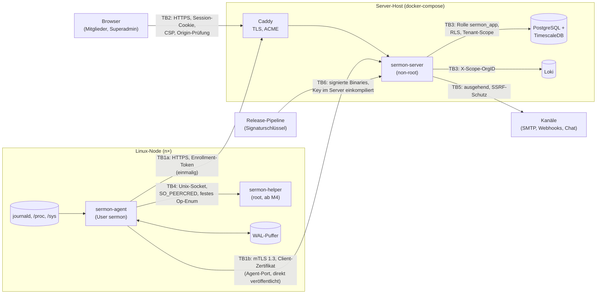

# Threat Model v1

- Stand: 2026-11-22 (nach M2-26)
- Bezug: KONZEPT.md §18; IMPLEMENTIERUNGSPLAN M0-12, M1-35; Skill `sermon-security-review`
- Pflege: Bei jeder Änderung an einer Vertrauensgrenze (Protokoll, Rechte, Helper-Operationen, Secrets, ausgehende
  Verbindungen) wird dieses Dokument im selben Commit angepasst. Das Security-Review M1-35 und jedes spätere Review
  gehen die Tabellen durch.

Legende Stand: ✓ umgesetzt und getestet · ◐ teilweise · ☐ geplant (Aufgabe genannt).

## 1. Assets

| Asset | Wo | Schutzbedarf |
|---|---|---|
| A1 Kontrolle über die Nodes (Updates, Reboot, künftig Self-Update) | Helper auf jedem Node, Befehle vom Server | sehr hoch: Kompromittierung des Servers darf nicht root auf allen Nodes bedeuten |
| A2 Agent-CA (Root- und Intermediate-Schlüssel) | PostgreSQL, versiegelt mit dem Master-Key | sehr hoch: erlaubt das Ausstellen beliebiger Node-Identitäten |
| A3 Master-Keys (`SERMON_MASTER_KEYS_FILE`) | Datei bzw. Docker-Secret auf dem Server-Host | sehr hoch: öffnen alle versiegelten Secrets |
| A4 Release-Signaturschlüssel | nur in der Release-Pipeline | sehr hoch: Installskript und Self-Update vertrauen nur ihm |
| A12 Paket-Signaturschlüssel (OpenPGP für .deb/.rpm, RSA für .apk) | nur in der Release-Pipeline | hoch: Paketmanager vertrauen ihnen, sobald ein Admin den öffentlichen Schlüssel importiert |
| A5 Node-Identitäten (Agent-Schlüssel, Zertifikate) | `/var/lib/sermon-agent` auf den Nodes | hoch |
| A6 Konten: Passwort-Hashes, TOTP-Seeds, Recovery-Codes, Sessions | PostgreSQL | hoch |
| A7 Mandantendaten: Metriken, Logs, Security-Events, Inventar | PostgreSQL/TimescaleDB, Loki | hoch, personenbezogen (IP-Adressen, Usernamen, §18.7) |
| A8 Audit-Logs (Org und Instanz) | PostgreSQL, Hash-Kette | hoch (Nachvollziehbarkeit) |
| A9 Einmal-Geheimnisse: Setup-Token, Enrollment-Token, Einladungslinks | nur als Hash in PostgreSQL | mittel bis hoch (kurzlebig) |
| A10 Zugangsdaten für Kanäle und Module | PostgreSQL, versiegelt | hoch (Zugang zu Drittsystemen) |
| A11 Verfügbarkeit des Servers | Server, Datenbank | mittel (Monitoring fällt aus, Agents puffern 24 h) |

## 2. Akteure

| Akteur | Vertrauen |
|---|---|
| Superadmin | verwaltet Instanz und Organisationen, sieht keine Mandantendaten |
| Mitglieder (Viewer, Operator, Admin) | nur innerhalb ihrer Organisation und Gruppen |
| Agent auf einem Node | vertraut für die eigenen Daten seines Nodes, sonst nichts |
| Root-Helper | lokal vertraut, nimmt nur feste Operationen vom Agent an |
| Angreifer im Internet | erreicht Web-Port und Agent-Port |
| Angreifer mit Konto in Org B | gültige Session, will an Daten von Org A |
| Angreifer mit root auf einem Node | besitzt dessen Identität, will an andere Nodes, Orgs oder den Server |
| Angreifer mit Kontrolle über den Server | will root auf den Nodes |

## 3. Datenfluss und Vertrauensgrenzen

| Grenze | Zwischen | Was sie schützt |
|---|---|---|
| TB1 | Node ↔ Server (a: Enrollment per HTTPS, b: Agent-Stream per mTLS) | Identität der Nodes, Integrität der Daten und Befehle |
| TB2 | Browser ↔ Server | Konten, Sessions, Mandantendaten |
| TB3 | Server ↔ Datenbank/Loki | Mandantentrennung als zweite Linie, Secrets at rest |
| TB4 | Agent ↔ Helper | root auf dem Node |
| TB5 | Server ↔ externe Ziele (Kanäle, Webhooks, Versionsprüfung) | internes Netz (SSRF), Zugangsdaten |
| TB6 | Release ↔ Server ↔ Node (Lieferkette der Agent-Binaries) | Integrität des Codes auf den Nodes |

## 4. Bedrohungen (STRIDE) nach Grenze

### TB1 – Node ↔ Server

| # | STRIDE | Bedrohung | Gegenmaßnahme | Aufgabe | Stand |
|---|---|---|---|---|---|
| T1 | S | Fremder Agent gibt sich als Node aus | mTLS mit Client-Zertifikat der Agent-CA; Org und Node nur aus dem Zertifikat (SPIFFE-URI), nie aus Nachrichten | M1-07, M1-10 | ✓ |
| T2 | S | Gestohlener Enrollment-Token | 256 Bit, nur Hash, TTL, `max_uses`, gruppengebunden, Widerruf, Rate-Limit am Endpunkt, Audit | M1-08, M1-09 | ✓ |
| T3 | S | Gestohlener Enrollment-Token: Benachrichtigung bei Nutzung | Security-Event `enrollment.token_used` (mit Absenderadresse) in der Transaktion des Enrollments, Standardregel an die Kanäle der Org (ADR 0027) | M2-24 | ✓ |
| T4 | S | Gestohlener Agent-Schlüssel wird parallel genutzt | nur eine Session pro Node: dieselbe IP gilt als Reconnect und ersetzt die alte Session, eine zweite IP sperrt die Identität sofort (Log `security: second session`); Rotation auf Abruf mit Sperre des alten Zertifikats; nach jeder Rotation endet die Session, das neue Zertifikat gilt als Nachfolger (keine falsche Sperre); „nur widerrufen“ ohne Rotation, wenn der verbundene Agent der Dieb sein könnte ; Sperre aufheben in der UI nur für Operatoren der Gruppe mit Step-up und Audit, mit Hinweis, bei Diebstahlverdacht zu widerrufen (M2-23) | M1-10, M1-11, M1-38, M2-23 | ✓ (Security-Events `node.locked`, `node.rotation_new_ip` mit Standardregeln, M2-24) |
| T56 | S | Widerrufenes oder abgelaufenes Zertifikat hält einen offenen Stream weiter | jede Session prüft ihr Zertifikat jede Minute nach (Widerruf, Ende der Schonfrist nach Rotation, Ablauf) und endet mit `PERMISSION_DENIED` | M1-35 | ✓ |
| T58 | I | Enrollment-Token im Klartext an einen falschen Server oder in der Prozessliste | `http://` nur zu Loopback-IPs (keine Namen); `install.sh` übernimmt keine `agent.toml`, die auf einen anderen Server zeigt (außer `--force`); Token nur in der Umgebung (`export` + `sudo --preserve-env`) oder per `--token-file`, `--token` warnt; die Paket-Konfiguration nennt denselben Weg, die Redaction erkennt Namen wie `SERMON_ENROLLMENT_TOKEN=` in sudo-Zeilen (M2-28) | M1-35, M1-37, M2-28 | ✓ |
| T59 | S | Simulator in der Release-Binary meldet mit einem Token viele Identitäten an | `simulate` nur mit Cargo-Feature, Release-Builds ohne | M1-35 | ✓ |
| T60 | S | Gefälschtes Agent-Zertifikat mit bekannter, gültiger Serial (nur bei kompromittierter Intermediate) | Widerrufsprüfung bindet Serial an Org und Node (Handshake und Nachprüfung) | M1-38 | ✓ |
| T5 | S | Klon eines Nodes (gleiche `machine-id`) | `ALREADY_EXISTS`, Token bleibt unverbraucht; Übernahme nur nach Freigabe eines Operators der Gruppe (Step-up, Audit) für eine Stunde und nur mit einem Token derselben Gruppe, alte Zertifikate werden widerrufen (ADR 0009, Nachtrag M2-23) | M1-09, M2-23 | ✓ |
| T6 | T | MITM beim Enrollment | System-CAs oder gepinnter Fingerprint (`--ca-fingerprint`), ausgestelltes Zertifikat wird gegen den Trust-Anker geprüft | M1-13 (ADR 0010) | ✓ |
| T7 | T | MITM auf dem Agent-Stream, Downgrade | TLS 1.3 only, eigene Agent-CA, Server-Zertifikat mit Rotation, keine Fallback-Optionen | M1-10, M1-11b | ✓ |
| T8 | I | Kompromittierter Node liest Daten anderer Nodes/Orgs | der Stream liefert nur Befehle für den eigenen Node; Scope aus dem Zertifikat | M1-10, M1-24 | ✓ |
| T9 | D | Ein Agent flutet den Server | Batch-Größe, Sample-Rate pro Node mit Throttle; wer ihn über die Batches im Flug hinaus ignoriert, dessen Werte werden verworfen; Serien-Limit pro Node (2 000 aktive Serien, über alle Sessions gezählt) und pro Org (250 000), Ringpuffer und Serien-Cache begrenzt, Serien-IDs `bigint`; Plausibilität der Zeitstempel, Agent-seitiges Serien-Limit; Security-Events: Token-Bucket pro Node (50/s, Burst 5 000, über Reconnects), höchstens 500 je Batch, Zeitfenster 7 Tage | M1-21, M1-24, M1-35, M1-36, M2-07 | ◐ (Flut verrauschter Events verdrängt seltene wie `ssh.login.success`, `sudo.*`, `account.*`: M2-37) |
| T55 | D | Kleiner gzip-Body wird beim Dekodieren zu Gigabytes (ohne Anmeldung: Login, Setup, Einladung, Enrollment) | höchstens 64 KiB pro Nachricht der Web-API und des Enrollments (auch nach dem Entpacken) plus Grenze für den Body, 4 MiB pro Nachricht des Agent-Streams | M1-35 | ✓ |
| T10 | D | Viele Enrollment-Versuche | Rate-Limit pro Client-IP, Größenlimits | M1-09 | ✓ |
| T11 | R | Node bestreitet gelieferte Daten | Identität aus dem Zertifikat, Batch-Seq, Audit für Enrollment und Rotation | M1-09, M1-24 | ✓ |
| T12 | E | Befehl vom Server führt Code auf dem Node aus | Protokoll kennt nur typisierte Befehle, kein generisches „exec“; unbekannte Befehle → `unsupported` | M0-05, M1-14 | ✓ |
| T65 | S | Lokaler User ohne Rechte schreibt gefälschte Security-Zeilen ins Journal (`logger -t sshd "Failed password for root from <fremde IP> …"`) und lässt eine fremde IP als Angreifer erscheinen oder flutet Alerts; User-Namen mit `from <ip> port <n>` täuschen die Quelle | Events nur von privilegierten Absendern: `_UID` 0 aus den Socket-Credentials; `_CAP_EFFECTIVE` ≠ 0 nur bei sudo, das mit der UID des Users loggt – journald liest das Feld erst nachträglich aus `/proc`, ein `exec` eines setuid-Programms direkt nach dem Senden täuschte es vor (M2-28), OOM nur vom Kernel-Transport; Adresse und Port vom Zeilenende, feste Längen, `regex` mit linearer Laufzeit; Fixtures mit gefälschten Zeilen aller Distros (ADR 0023) | M2-06, M2-28 | ✓ (sudo-Zeilen bleiben über dieses Race fälschbar; Logdateien ohne diese Felder: T70) |
| T70 | S/T | Ohne journald (Alpine) schreibt ein lokaler User ohne Rechte mit `logger -p auth.info -t sshd …` Zeilen in die Logdatei, die der Agent liest, löst Brute-Force- oder Root-Login-Alerts aus und lässt fremde IPs als Angreifer erscheinen; eine Zeile täuscht ein anderes Format vor | Format fest pro Datei, nie aus der Zeile; Events aus Dateien „nicht verifiziert“ (Agent → Protokoll → DB → Alert-Feld `source`, Hinweis in UI und Kanälen; ein unverifiziertes Event markiert den ganzen Alert); mit der SerMon-Vorlage für rsyslog verifiziert UID 0 vom Kernel, andere UIDs außer sudo werden verworfen; Leserecht für den Agent nur per `--grant-log-access` (Gruppe `sermon` statt `wheel`, nie Mitglied von `wheel`); Zeilen ≤ 16 KiB, ≤ 1 MiB pro Lesevorgang; Parser gefuzzt auch mit Dateiquelle (ADR 0025) | M2-20 | ◐ (busybox: nur sichtbar, nicht verhindert; sudo aus Dateien nie verifiziert) |
| T66 | D/R | Angreifer entgeht der Brute-Force-Erkennung oder überflutet die Alerts: Adressen im eigenen IPv6-Netz rotieren, sehr viele Adressen oder Events, Steuerzeichen und Zeilenumbrüche in User-Namen für Benachrichtigungen | IPv6 zählt pro /64; Fleet-Korrelation über die Nodes der Org; höchstens 50 000 Events pro Abfrage und 100 Instanzen pro Regel und Runde, offene Instanzen behalten bei einer Kappung ihren Zustand, Zähler `sermon_server_alert_event_reads_truncated_total`; Felder und Dimensionen ohne Steuerzeichen, höchstens 256 Bytes (ADR 0019, Nachtrag M2-08); seit M2-28 auch ohne Format-, Bidi- und Trennzeichen (`textsafe`: Event-Felder beim Ingest, Host-Fakten, Kanäle, Namen); sudo-Ziel mit mehrdeutigem `USER=` im selbst gewählten Arbeitsverzeichnis wird `?`; Details passen in die Grenze der Datenbank (sonst blockierte ein Event den ganzen Batch des Nodes) | M2-08, M2-28 | ✓ (Darstellung als Text in Kanälen und UI: M2-10, M2-16) |

### TB2 – Browser ↔ Server

| # | STRIDE | Bedrohung | Gegenmaßnahme | Aufgabe | Stand |
|---|---|---|---|---|---|
| T13 | S | Brute-Force auf Passwörter und Codes, auch mit parallelen Anfragen | Argon2id, Kontosperre mit Backoff, jeder Versuch wird vor der Prüfung atomar reserviert (Compare-and-swap), IP-Rate-Limit, einheitliche Fehlermeldung | M1-02, M1-35 | ✓ |
| T14 | S | Phishing/gestohlenes Passwort | TOTP mit Recovery-Codes, Org-Pflicht zur 2FA; Code-Versuche zählen zur selben Sperre | M1-03 | ✓ |
| T15 | S | Phishing-resistente Anmeldung | Passkeys/WebAuthn, OIDC mit PKCE | E3.6, E3.7 | ☐ |
| T16 | S | Session-Diebstahl, Session-Fixation | `__Host-`-Cookie (Secure, HttpOnly, SameSite=Lax), serverseitige Sessions, neues Cookie nach 2FA und Org-Wechsel, Idle- und Absolut-Timeout (der Re-Check offener Live-Ansichten zählt nicht als Aktivität) | M1-02, M1-03, M1-40 | ✓ |
| T57 | S | Downgrade auf HTTP beim ersten Aufruf, gefälschte Login-Seite | HSTS (1 Jahr, `includeSubDomains`), sobald alle erlaubten Origins `https://` sind; in Produktion sind nur solche erlaubt (`http://` nur im Entwicklungsmodus) | M1-35, M1-39 | ✓ |
| T17 | S | Gekaperte Session ändert Rechte, richtet eigene 2FA ein oder lässt eigene Maschinen beitreten | Step-up (15 min) für Rechteänderungen, Einladungen, Schlüsselrotation, 2FA-Einrichtung, Enrollment-Tokens (seit M1-35); Fehlversuche zählen zur Sperre | M1-02, M1-03, M1-35 | ✓ |
| T18 | T | CSRF, Lesen über Navigationen von fremden Seiten | SameSite, Connect-Requests mit `application/proto|json`, Origin-Allowlist im Server, GET mit `Sec-Fetch-Site` einer fremden Seite abgelehnt | M1-02, M1-35 | ✓ |
| T19 | T | XSS über Hostnamen, Logzeilen, Prozessnamen | kein `{@html}` mit API-Daten, strikte CSP ohne `unsafe-inline`, nur eigene Origin; QR-Code als SVG aus der Matrix | M0-04, M1-28 ff. (ADR 0003) | ✓ |
| T20 | T | Injection in SQL und LogQL | sqlc (parametrisiert); LogQL nur aus typisierten Bausteinen mit Escaping | M0-08, E3.2 | ✓ / ☐ (LogQL) |
| T21 | I | User aus Org B sieht Daten von Org A | Tenant-Scope in jeder Repository-Methode, RLS als zweite Linie, Isolationstest für **jede** RPC (CI erzwingt Abdeckung), fremde Objekte = `NOT_FOUND`; End-to-End im Browser gegen den echten Stack | M1-04, M1-22, M1-26, M1-33 | ✓ |
| T22 | I | Viewer sieht Logs/Security-Events trotz Verbot | Rollen-Matrix mit `viewerLogs`-Schalter, Matrix-Test | M1-01, E3.3 | ✓ / ☐ (UI) |
| T23 | I | User-Enumeration über Login, Einladung, Passwort-Reset | gleiche Antworten und Laufzeiten (Dummy-Hash), Einladungen ohne Hinweis auf bestehende Konten | M1-02, M1-04, M1-39 | ✓ (in Produktion bekommt nur die Mailbox den Link, ADR 0022; im Entwicklungsmodus ohne SMTP bleibt das Restrisiko) |
| T24 | I | Geheimnisse in Antworten, Logs oder URLs | Tokens nur einmal angezeigt, nur Hash gespeichert; Einladungs-Token im URL-Fragment; keine Stacktraces, Korrelations-ID | M1-04, M1-08, M1-32 | ✓ |
| T61 | S | Org-Admin nimmt die eigene Einladung an und besetzt ein instanzweites Konto mit fremder Adresse | in Produktion gehen Einladungen und die erste Admin-Einladung neuer Orgs nur per Mail an die Adresse, die API gibt kein Token heraus; SMTP Pflicht (STARTTLS/TLS, geprüftes Zertifikat), Standardmodus `production` | M1-39 (ADR 0022) | ✓ |
| T62 | T | Admin einer Org ändert das globale Konto (E-Mail = Login) eines Users, der auch in anderen Orgs ist | `sermon_app` darf `users` nicht ändern (kein UPDATE-Recht, keine Policy) | M1-35 | ✓ |
| T25 | I | Server-Metriken ohne Anmeldung verraten Mandanten | `/metrics` auf eigenem Listener, standardmäßig aus, nur Instanzwerte ohne Labels von Orgs/Nodes; Warnung bei nicht-Loopback | M1-24 (ADR 0011) | ✓ |
| T26 | D | Viele Live-Streams oder große Abfragen | max. 32 Streams pro Session, 64 pro User, 250 pro Org, 1 000 pro Instanz, Re-Check alle 30 s; Begrenzung von Zeitraum, Nodes und Punkten pro Abfrage | M1-26, M1-35 | ✓ |
| T27 | D | Login-Flut, auch über viele IPv6-Adressen; Argon2id-Speicher (64 MiB je Prüfung) erschöpfen | Rate-Limits pro IP (IPv6 pro /64), progressive Sperre, höchstens 512 MiB für gleichzeitige Passwortprüfungen, alle `X-Forwarded-For`-Zeilen ausgewertet | M1-02, M1-35 | ✓ |
| T28 | R | „Wer hat die Rolle vergeben?“ | Audit-Log pro Org mit Hash-Kette, `sermon_app` nur INSERT/SELECT; instanzweites Audit-Log für CA-Aktionen | M1-04, M1-11b | ✓ |
| T29 | E | Viewer löst Operator-Aktion aus | zentrale Policy, deny by default, Rollen-Matrix-Test (jede Aktion × jede Rolle) | M1-01 | ✓ |
| T30 | E | Admin einer Gruppe erweitert eigene Rechte | Rechteverwaltung nur für Admins aller Gruppen, letzter Admin nicht entfernbar, Step-up | M1-04 | ✓ |
| T31 | S | Setup-Token aus dem Log missbraucht | 30 min, einmalig, nur Hash; `init` verweigert erneute Ausführung | M1-05 | ✓ |
| T79 | I | Ein Viewer einer Org mit abgeschalteten Logs liest über die Dimension von Event-Regeln (`ip=…`, `user=…`) doch Adressen und Kontonamen | Ohne `view_security_events` kommt die Dimension von Event-Regeln versiegelt (`secrets.Box`, gebunden an Org, Regel und Node); Verlauf und Quittieren lösen sie serverseitig auf, eine fremde ergibt NOT_FOUND (M2-28) | M2-28 | ✓ |

### TB3 – Server ↔ Datenbank und Loki

| # | STRIDE | Bedrohung | Gegenmaßnahme | Aufgabe | Stand |
|---|---|---|---|---|---|
| T32 | I | Fehler in der Anwendung umgeht den Tenant-Scope | RLS mit `FORCE`, Server-Rolle ohne `BYPASSRLS`, Server verweigert privilegierte Rollen; Metriken nur über `SECURITY DEFINER`-Funktion mit RLS-geschützter `series` | M0-08, M1-22 (ADR 0007) | ✓ |
| T33 | I | DB-Dump verrät Secrets | Secrets-Box (AES-256-GCM, Key-ID, Associated Data mit Kontext, z. B. `totp:<user>`), Passwörter Argon2id, Tokens/Codes nur als Hash | M1-06, M1-03 | ✓ |
| T34 | T | Manipulation des Audit-Logs | Hash-Kette, kein UPDATE/DELETE für `sermon_app`, Prüffunktion | M1-04, M1-11b | ✓ |
| T63 | E | Fehler in der Anwendung (z. B. SQL-Injection) legt einen Superadmin an | `sermon_app` darf weder `superadmins` schreiben noch `instance_setup` ändern; Token ausgeben und verbrauchen nur über `SECURITY DEFINER`-Funktionen, die den Superadmin zusammen mit dem Verbrauch anlegen | M1-40 | ✓ |
| T35 | I | Logs einer Org landen bei einer anderen | Loki mit `auth_enabled`, `X-Scope-OrgID` aus dem Scope, nie aus Eingaben | E3.2 | ☐ |
| T36 | I | Telemetrie von TimescaleDB oder Loki | in jeder Compose-Datei abgeschaltet, Test | M0-07 | ✓ |
| T37 | D | Schreiblast füllt WAL/Platte | 10 s in der DB, Kompression, Retention-Policies, Self-Monitoring (Ingest-Lag, verworfene Samples, DB-Größe gegen `SERMON_DATABASE_SIZE_LIMIT`; Mail an Superadmins und Hinweis in der UI, ADR 0027); Regel „Agent hat Daten verworfen“ | M0-09, M1-22, M2-24 | ✓ |
| T78 | D/R | Ein Sprung der Server-Uhr oder ein Fehler löscht über `security_events_expire` die Security-Events aller Orgs und verhindert weitere Inserts | Die Definer-Funktion löscht nie etwas der letzten 365 Tage, nach der Uhr der Datenbank (Migration 00037, wie die Löschgrenze von `alert_history`) | M2-28 | ✓ |

### TB4 – Agent ↔ Helper (ab M4)

| # | STRIDE | Bedrohung | Gegenmaßnahme | Aufgabe | Stand |
|---|---|---|---|---|---|
| T38 | E | Kompromittierter Agent wird root | Agent ohne root und Capabilities, gehärtete Unit (Score 1,6), Helper nur mit festem Op-Enum | M1-27, E4.1 | ✓ / ☐ (Helper) |
| T54 | E | Kompromittierter Agent (User `sermon`) lässt root beim erneuten Enrollment über getauschte Symlinks Dateien schreiben und übereignen | `install.sh` startet `enroll` als `sermon` (`runuser`); der Agent verweigert als root jedes Schreiben in Verzeichnisse anderer User oder mit Schreibrecht für Gruppe/andere; kein `lchown` mehr | M1-35 | ✓ |
| T39 | S | Anderer lokaler Prozess spricht den Helper an | Socket `root:sermon 0660`, `SO_PEERCRED` prüft UID `sermon` | E4.1 | ☐ |
| T40 | E | Kompromittierter Server lässt Nodes beliebigen Code ausführen | keine freien Kommandos; Updates nur aus Distro-signierten Quellen; lokales Veto (`allow_remote_updates`, `allow_remote_reboot`); Self-Update nur mit Signatur des Release-Keys | E4.1, E4.3, E4.5 | ☐ |
| T41 | R | „Wer hat das Update ausgelöst?“ | Helper protokolliert lokal (journald) und zentral (Audit) | E4.1 | ☐ |
| T42 | I | Agent liest fremde Daten über Logs/Prozesse | nur Lesen, Redaction vor dem Versand (Kommandozeilen, Logs), Live-Ansicht nur lesend | E3.1, E3.4 | ☐ |

### TB5 – Server ↔ externe Ziele

| # | STRIDE | Bedrohung | Gegenmaßnahme | Aufgabe | Stand |
|---|---|---|---|---|---|
| T43 | I/E | SSRF über Webhook-URL (Metadata-Dienst, internes Netz), auch über DNS-Rebinding, Redirects, IPv6-Formen mit eingebetteter IPv4 oder einen Proxy aus der Umgebung; Geheimnisse der URL in Fehlermeldungen | `safehttp`: Sonderadressen blockiert (auch IPv4-mapped, NAT64, 6to4), IP aufgelöst und gepinnt, Socket prüft erneut, höchstens 3 Redirects mit erneuter Prüfung und ohne Wechsel auf http, öffentliche Ziele nur https, kein Proxy, 15 s, 1 MiB; Fehler nur mit Host; Allowlist nur durch den Betreiber (`SERMON_OUTBOUND_ALLOWLIST`), Metadata-Dienste nie freigebbar (Bereiche mit eingebetteter IPv4 – NAT64, 6to4, Teredo, `::/96` – in der Allowlist abgelehnt, NAT64 vor der Allowlist ausgepackt, M2-28); Redirects nur auf denselben Host (M2-28); `forbidigo` verbietet andere HTTP-Clients (ADR 0024) | M2-09, M2-28 | ✓ (Nutzung durch die Kanäle: M2-10) |
| T67 | I/T | Ein gekapertes Admin-Konto leitet Alerts mit Security-Events (User, IP) an ein eigenes Ziel um (Kanal oder Policy) oder liest Zugangsdaten der Kanäle; Dienste spiegeln Tokens in Fehlermeldungen zurück | Kanäle (`manage_channels`) und Policies (`manage_policies`) anlegen, ändern und löschen nur mit frischem Step-up, Audit ohne Ziel und Zugangsdaten; Policies nennen nur Kanäle und Gruppen der eigenen Org (Fremdschlüssel in der Org, Prüfung im Use-Case); Zugangsdaten versiegelt (`notification_channel:<org>:<id>`) und nur schreibbar; Fehlertexte ohne die Zugangsdaten des Kanals, eine Zeile, höchstens 500 Bytes; „Test senden“ 5 pro Minute und Org; Protokoll nach 30 Tagen gelöscht, die API zeigt keine Felder daraus; Digests ohne Felder; die UI zeigt Zugangsdaten nie und sendet nur Getipptes (ADR 0019, Nachträge M2-10, M2-14 und M2-18); eine neue Adresse (Feld vom Typ URL) verlangt alle Zugangsdaten neu, Redirects nur auf denselben Host – vorher gingen Token an einen Server des Admins (M2-28) | M2-10, M2-14, M2-18, M2-28 | ✓ |
| T68 | T/S | Werte der Hosts (User-, Host-Namen aus Logs) schleusen in Benachrichtigungen Erwähnungen (`@everyone`, `<!channel>`), Links, Markup oder Zeilen ein | Werte ohne Steuerzeichen und auf ihrer Zeile (`notify.Render`); Slack nur `plain_text`, Teams nur `TextRun`, Discord und Mattermost Markdown-escapt mit entschärften Erwähnungen (Discord dazu `allowed_mentions` leer), Telegram HTML-escapt mit entschärften Erwähnungen und ohne Link-Vorschau, E-Mail-HTML über `html/template`, ntfy, Gotify und Pushover als reiner Text, Webhook als JSON; Tests mit feindlichen Werten je Kanal (ADR 0019, Nachträge M2-10 bis M2-13) | M2-10 bis M2-13 | ✓ |
| T69 | R/E | Ein gekapertes Konto schaltet Security-Alerts stumm, quittiert sie oder schaltet ihre Regeln ab, bevor es angreift, oder legt Silences für Gruppen an, die es nicht verwaltet | Regeln ändern und abschalten nur Admins (`manage_alert_rules`) mit frischem Step-up und Audit; Quittieren nur mit `acknowledge_alerts` für die Gruppe des Nodes, bei Security-Regeln nur mit frischem Step-up, mit Name in Historie und Benachrichtigung; Silences nur mit `silence_alerts` auf allen genannten Gruppen (für alle Gruppen: Recht auf allen), Anlegen nur mit frischem Step-up, höchstens 30 Tage, Kommentar Pflicht, Audit mit Zeitraum; nur Benachrichtigungen werden stumm, Alerts und Security-Events bleiben sichtbar; Wartungsfenster nur für Reboot und Offline und nur durch Admins (ADR 0019, Nachträge M2-15 bis M2-17) | M2-15 bis M2-17 | ✓ (UI für Silences: M2-18) |
| T44 | S | Gefälschte Webhooks beim Empfänger | HMAC-SHA256-Signatur über Zeitstempel und Body (`X-SerMon-Signature: t=…,v1=…`), Geheimnis mindestens 16 Zeichen und versiegelt; die Hilfe beschreibt Prüfung in konstanter Zeit und das Ablehnen alter Zeitstempel | M2-11 | ✓ |
| T45 | I | Mail-Zugangsdaten im Klartext übertragen; Header-Injection über Alert-Werte | SMTP mit TLS-Pflicht (STARTTLS oder TLS, Klartext nur im Entwicklungsmodus); Betreff und Empfänger mit Zeilenumbruch abgelehnt; HTML über `html/template` | M1-39, M2-11 | ✓ |
| T46 | I | „Phone-Home“ | keine Telemetrie, Versionsprüfung abschaltbar | M0-07, v1.0 | ◐ |
| T47 | I | Prometheus-Scraper oder Module als SSRF | Scraper nur localhost/Allowlist, Serien-Limit; Modul-Zugangsdaten nur im Speicher des Agents | E5.1, E5.2 | ☐ |
| T80 | D/I | Eine Org verzögert Alerting und Zustellung aller Orgs (viele eigene Regeln mit langen Fenstern, langsame oder tote Ziele) oder verschickt über viele E-Mail-Kanäle Spam vom Mailserver des Betreibers; bei mehreren Instanzen kommen Benachrichtigungen doppelt | Import höchstens 100 Regeln, „Test senden“ 5 pro Minute; Engine und Dispatcher arbeiten die Orgs aber nacheinander ab, ohne Zeitbudget, und der Lease wird beim Speichern nicht geprüft | M2-38 | ☐ |

### TB6 – Lieferkette der Agent-Binaries

| # | STRIDE | Bedrohung | Gegenmaßnahme | Aufgabe | Stand |
|---|---|---|---|---|---|
| T48 | T | Manipulierte, ältere oder fremde Binary auf dem Download-Weg oder Mirror | minisign-Signatur, Prüfung im Skript vor jeder Installation (minisign oder OpenSSL), kein Schalter zum Abschalten; der signierte Trusted Comment muss Dateiname und genau die Version des Servers nennen (kein Rollback); End-to-End-Gegenprobe mit manipulierter Binary auf dem Server | M1-27 (ADR 0012), M1-33, M1-37 | ✓ |
| T49 | T | Server liefert Binaries aus einem fremden Verzeichnis (Path-Traversal, Symlink) | nur feste Dateinamen, Lesen über `os.Root` | M1-27 | ✓ |
| T50 | T | Kompromittierter Server liefert ein manipuliertes `install.sh` | Grenze von `curl | sh` (O5): „Skript erst ansehen“, Paket-Repo als Alternative, Signaturschlüssel nicht auf dem Server | M1-27, E4.5 | ◐ |
| T64 | T | Bei selbstsigniertem Server-Zertifikat liefert ein Angreifer im Netz ein eigenes `install.sh` (`curl -k`) | die UI holt die SHA-256 des Skripts über die Verbindung des Browsers (`X-Sermon-Script-SHA256`), der Befehl prüft es mit `sha256sum -c`, bevor `sudo` es ausführt (statt SPKI-Pin, ADR 0012) | M1-37 | ✓ |
| T51 | T | Release-Schlüssel kompromittiert oder fehlt | Schlüssel nur in der Release-Pipeline; ohne einkompilierten Key verweigert das Skript die Installation; `release-sign.sh` nimmt nur Ed25519-Schlüssel | v1.0 (Release-Prozess) | ☐ (Schlüssel erzeugen, `release.yml`) |
| T71 | T | Manipuliertes oder fremdes Agent-Paket (.deb, .rpm, .apk); ein Upgrade löscht die Identität; ein Paket startet einen Agent ohne Server | jedes Paket signiert (`package-agent.sh` baut ohne Schlüssel nicht; .deb als `_gpgorigin`, .rpm mit OpenPGP, .apk mit RSA), Schlüssel getrennt vom minisign-Release-Schlüssel und nur in der Release-Pipeline, Test-Schlüssel nur pro Lauf; Tests: Signatur gut, ohne Schlüssel bzw. verändert abgelehnt (`just test-packages`); Remove-Skripte unterscheiden Upgrade und Entfernen (Test: Upgrade behält die Identität); der Dienst startet erst nach Enrollment durch den Admin, Rechte wie bei `install.sh` | M2-21 | ✓ (Paket-Repos: offen) |
| T52 | T | Kompromittierte Abhängigkeit oder Action | exakt gepinnte Versionen, Mindestalter 3 Tage, Actions per SHA, cargo-deny, govulncheck, pnpm audit, zizmor, Secret-Scan | M0-06 (ADR 0005, 0006) | ✓ |
| T53 | T | Fehlerhafte Parser für untrusted Input auf dem Node | cargo-fuzz für `/proc`-Parser, WAL-Recovery, Journal-Zeilen (`journal_line`) und Security-Parser (`security_parser`), proptest; Logdateien mit E3.1 | M1-15, M2-05, M2-06, E3.1 | ◐ (Logdateien) |
| T77 | S/T/D/E | Orgs sperren und löschen (M2-33): ein Org-Admin oder ein gestohlener Login sperrt oder löscht eine Org; Fehlbedienung löscht die falsche Org; eine gesperrte Org arbeitet über offene Sitzungen, Agent-Streams oder andere Server-Instanzen weiter; das Löschen trifft Daten oder Konten anderer Orgs; der Export lässt Manipulationen am Audit-Log nicht erkennen | Nur Superadmins (`ManageOrganizations`, Rollen- und Isolationstest), Step-up, Name exakt abgeschrieben, Sofort-Löschen erst nach dem Sperren, Mails an die Admins, Audit in Org und Instanz; Sperre in den Definer-Funktionen (Zertifikat, Token, Einladung, Login) und in `IsMember`, Sitzungen gelöscht, Streams beendet; `org_purge` nur für gesperrte, fällige Orgs, begrenzt durch die Mandanten-Policies, Test über alle Tabellen mit `org_id`, Konten nur ohne weitere Mitgliedschaft, Superadmins bleiben; Export mit Hash-Kette und `chain_valid`, aus der Datei nachrechenbar | M2-33 | ✓ |
| T76 | E/D/I | Organisationsverwaltung (M2-32): ein Org-Admin hebt die Kontingente seiner Org selbst an; viele parallele Enrollments oder Einladungen überlisten die Zählung; der Superadmin sieht über die Übersicht Daten einer Org; doppelte Namen täuschen beim Wechsel der Org | Kontingente setzt nur der Superadmin (`ManageOrganizations`, Rollen-Matrix, Step-up, Audit mit altem und neuem Stand); Zählung unter Sperre der Org-Zeile in derselben Transaktion wie das Anlegen, beim Annehmen erneut; die Übersicht enthält nur Zahlen (Definer-Funktion nur für Namen, Mitgliederzahl, Kontingente und Gesamtgrößen, Zähler in Tenant-Transaktionen, Test ohne Mandantendaten); Namen eindeutig ohne Groß- und Kleinschreibung (Index, Migration für Bestand) | M2-32 | ✓ |
| T75 | S/R | Ohne journald (M2-31) täuscht oder verschweigt jemand Neustarts und die Quelle: ein lokaler User schreibt eine Boot-ID in den Zustand des Agents, um einen Reboot vorzutäuschen; eine gefälschte Logzeile soll einen Reboot melden; ein Node ohne lesbare Quelle wirkt in der UI ruhig, obwohl er gar keine Security-Events liefert | Boot-ID nur vom Kernel (`/proc`, Format geprüft), gespeichert in `<state_dir>` (nur `sermon`, Datei 0600, atomar ersetzt); aus Logzeilen nie ein Reboot; die Quelle ist ein festes Enum in den Host-Fakten (Proto-Validierung, CHECK in der DB), wird bei jeder Verbindung neu bestimmt und auf der Node-Seite als Warnung gezeigt | M2-31 | ✓ |
| T74 | T/E | Tags (M2-29) als Hebel: ein Admin einer Gruppe nimmt einem Node `env=prod` weg, damit eine Rufbereitschafts-Policy oder Regel nicht mehr passt; Tags als Rechte missverstanden; Markup oder Steuerzeichen in Tags in UI und Kanälen | Tags setzt nur der Admin der Gruppe des Nodes (`TagNodes`, Rollen-Matrix) mit frischem Step-up; jede Änderung im Audit-Log mit altem und neuem Stand; Tags geben keine Rechte (Scopes nur aus Gruppen); Schlüssel und Werte streng geprüft (Server und Proto: Muster, ≤ 16 Paare), Anzeige nur als Text; Isolation (`SetNodeTags` im Tenant-Test, RLS auf `nodes`); eine Silence nur auf Tags gilt für alle Gruppen und braucht Operator auf allen | M2-29 | ✓ |
| T73 | E/I | Ein kompromittierter Container der Installation (Proxy, Server, Datenbank) breitet sich aus; die Datenbank ist aus dem Netz erreichbar; Secrets stehen in Umgebungsvariablen; ein Host-Prozess fälscht `X-Forwarded-For`; der Proxy verschleiert die Adressen der Agents | `deploy/compose`: jeder Container `read_only`, `cap_drop: ALL` (nur `NET_BIND_SERVICE` bzw. die Benutzerwechsel von PostgreSQL zurück), `no-new-privileges`, kein Docker-Socket, kein Host-Netz (`check-compose.sh --hardened` in `just lint-compose`, mit Tests); Server in `distroless` als `nonroot`; Datenbank nur im Netz `internal`; Secrets als Dateien (`secrets.sh`, überschreibt nie); nur die feste Adresse von Caddy ist Trusted Proxy; Agent-Port direkt veröffentlicht, der Server sieht die echte Adresse (ADR 0028); Images per Digest; die E2E-Demo läuft gegen diese Datei | M2-26 | ◐ (die Migrations-URL mit dem Passwort des Datenbank-Superusers liegt dauerhaft im Server-Container: M2-36) |
| T72 | E/D | Zustands-Collectors (M2-22) als Einfallstor: der Agent startet `systemctl`, ruft `adjtimex` über `unsafe` auf; ein hängender systemctl blockiert die Collectors; gefälschte Unit-Namen sprengen die Kardinalität | `systemctl` mit festen Argumenten, leerer Umgebung, ohne Shell, 10 s Zeitlimit mit `kill`, ≤ 256 KiB Ausgabe; Unit-Namen geprüft, ≤ 50 Serien; `adjtimex` nur mit `modes = 0`, gekapselt mit `SAFETY`-Begründung; die Unit erlaubt nur `adjtimex`/`clock_adjtime` zusätzlich, ohne `CAP_SYS_TIME` kann der Agent die Uhr nicht stellen; Parser von mdstat und systemctl gefuzzt (ADR 0026) | M2-22 | ✓ |

## 5. Restrisiken und bewusste Entscheidungen

- **`curl | sh`** (T50): Wer den Server kontrolliert, kann ein anderes Skript ausliefern. Akzeptiert für den
  Einzeiler; abgemildert durch Signaturprüfung, Ansicht vor der Ausführung und das Paket-Repo (O5).
- **Docker-Socket** ist root-äquivalent: Modul standardmäßig aus, Warnung, cgroup-Variante bevorzugt (O4).
- **Prozessdetails** ohne `CAP_SYS_PTRACE` bleiben unvollständig (O3).
- **Kein HA** in v1 (O11): Ausfall des Servers kostet bis zu 24 h keine Daten (WAL), aber Alerts.
- **Recovery-Codes mit 80 Bit** (M1-03, bestätigt in M1-35): Sie werden abgeschrieben, deshalb kürzer als die
  256 Bit der Checkliste. Online begrenzt die gemeinsame Kontosperre die Versuche; aus einem DB-Dump sind 2^80
  SHA-256-Versuche pro Code nicht machbar, und ein Code ersetzt nur den zweiten Faktor, nicht das Passwort.
- **Superadmin** ist instanzweit mächtig (CA-Wechsel, Orgs), sieht aber keine Mandantendaten; alle Aktionen im
  instanzweiten Audit-Log.

## 6. Ergebnis des Security-Reviews M1-35

Geprüft am 2026-11-20 mit dem Skill `sermon-security-review`: vier Teil-Reviews (Web-API und Mandanten; PKI,
Enrollment und Ingest; Rust-Agent und Installation; Web-UI und Lieferkette), dazu `just security` (Secret-Scan,
cargo-deny, govulncheck, pnpm audit: ohne Befund). **Kein kritischer Befund offen.**

Behoben, jeweils mit Test und Gegenprobe:

- **Hoch:** root-Eskalation über getauschte Symlinks beim erneuten Enrollment (T54); Speichererschöpfung durch kleine
  gzip-Bodies ohne Anmeldung (T55).
- **Mittel:** Kontosperre mit parallelen Anfragen umgehbar (T13); Argon2id-Speicher bei Login-Flut, IPv6-Budgets pro
  Adresse, gefälschte `X-Forwarded-For`-Zeilen (T27); Throttle beim Ingest nur erbeten, nicht erzwungen (T9); offene
  Streams überlebten Widerruf und Ablauf des Zertifikats (T56); kein HSTS (T57); Enrollment-Token ohne Step-up (T17).
- **Niedrig:** Org-Admins konnten globale Konten ändern (T62); `install.sh` schickte das Token an den Server einer
  alten `agent.toml` und übernahm einen bestehenden User `sermon` ohne Prüfung; `http://` auch zu `localhost` (T58);
  Simulator in der Release-Binary (T59); GET von fremden Seiten (T18); Live-Streams ohne Grenze pro User und Org
  (T26); offener Redirect über `/.//host`; Hilfetexte mit unerlaubten Links landeten trotzdem im Bundle;
  Bidi- und Null-Breite-Zeichen in Servertexten; `release-sign.sh` nahm jeden Schlüsseltyp; ein ungepinntes
  npm-Paket (jetzt mit Test); Rechte von `.build/` in der E2E-Umgebung.

Offen als Aufgaben (keine kritisch):

- M1-36: Ingest-Grenzen pro Node und Org (T9) – **erledigt**.
- M1-37: Signatur an Datei und Version binden, gepinnter Bootstrap bei selbstsigniertem Zertifikat, Token aus der
  Prozessliste (T48, T64, T58) – **erledigt**.
- M1-38: Rotation und Identität – Intermediate aus der Signatur, falsche Sperre nach Rotation, Widerrufsprüfung mit
  Org/Node, Widerruf ohne Rotation auf Abruf (T4, T60). – **erledigt**.
- M1-39: Einladungen ohne Konto-Squatting (T23, T61). – **erledigt** (ADR 0022: Betriebsmodus, SMTP in Produktion Pflicht).
- M1-40: Stream-Re-Check ohne Aktivität, Superadmins nur über Definer-Funktion (T16, T63). – **erledigt**. Damit sind alle Befunde aus M1-35 abgearbeitet.

Weiter offen aus früheren Aufgaben: T3/T4 (Benachrichtigung, M2), T5 (Übernahme bei `machine-id`-Konflikt in der UI),
T37 (Self-Monitoring, M2), T51 (Release-Schlüssel, Product Owner). Kommandozeilen im Journal (`_CMDLINE`) enthalten
Geheimnisse (Spike M0-10); die Log-Pipeline übernimmt das Feld nicht (ADR 0013, E3.1, T42).

Entscheidungen:

- **Recovery-Codes bleiben bei 80 Bit** (bewusste Abweichung von „Tokens ≥ 256 Bit“, siehe §5).
- Der Re-Check offener Agent-Sessions aktualisiert `last_seen` **nicht**: Es soll nur zeigen, was der Agent wirklich
  sendet (Heartbeats, Batches); sonst wirkte ein hängender, aber offener Stream online.

## 7. Ergebnis des Security-Reviews M2-28

Geprüft am 2026-11-22 mit dem Skill `sermon-security-review`, wie M1-35 in vier unabhängigen Teil-Reviews ohne Kontext
der Umsetzung (Agent und Security-Events; ausgehende Verbindungen, Kanäle und Zugangsdaten; Engine, Mandantentrennung
und Organisationen; Web-UI und Lieferkette), dazu `just security` ohne Befund. **Kein kritischer Befund offen.**

Behoben, jeweils mit Test und Gegenprobe:

- **Hoch:** Jeder lokale User konnte verifizierte Security-Events fälschen (Root-Login, fremde IPs): journald liest
  `_CAP_EFFECTIVE` nachträglich aus `/proc`, ein `exec` von `passwd` direkt nach dem Senden genügte. Jetzt zählt für
  sshd, useradd und userdel nur `_UID` 0 (T65, ADR 0023).
- **Mittel:** `security_events_expire` ohne Untergrenze (T78); die Dimension von Event-Regeln verriet Viewern
  Adressen und User trotz abgeschalteter Logs (T79); Zugangsdaten von ntfy und Gotify ließen sich über eine geänderte
  Server-Adresse oder einen Redirect auf einen fremden Host auslesen (T67).
- **Niedrig:** Bidi-, Null-Breite- und Trennzeichen aus SSH-User-Namen und Host-Fakten in UI und Kanälen (T66);
  Step-up beim Quittieren hing am Präfix `security.`, jetzt am Regeltyp `event` und der Kategorie; das sudo-Ziel ließ
  sich über das Arbeitsverzeichnis fälschen; ein Event über der Grenze der Datenbank blockierte den Ingest des Nodes;
  Allowlist mit NAT64 öffnete den Metadata-Dienst (T43); Enrollment-Token in Prozessliste und sudo-Log über den Hinweis
  der Pakete, Redaction ohne Präfixe (T58); Passphrase des Paketschlüssels im argv von `docker run`, Schlüsselkopien
  blieben bei Ctrl-C liegen; die archivierte YAML-Bibliothek `gopkg.in/yaml.v3` (jetzt `go mod tidy -diff` im Lint).

Offen als Aufgaben (keine kritisch):

- M2-36: eigene Owner-Rolle ohne Superuser, Migrations-URL nicht im Dauerbetrieb (T73).
- M2-37: Prioritäten für seltene Security-Events im Ingest (T9).
- M2-38: Fairness zwischen Orgs in Engine und Dispatcher, Fencing der Leases, Grenzen für Regeln, Kanäle und Mails (T80).
- M2-39: Sammlung der übrigen niedrigen Befunde (siehe Plan).
